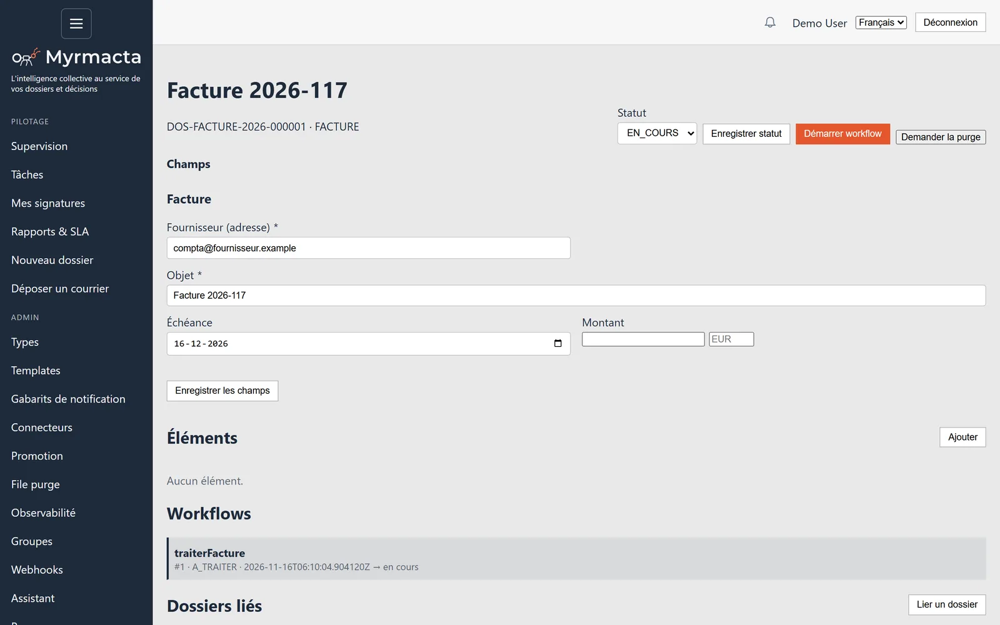
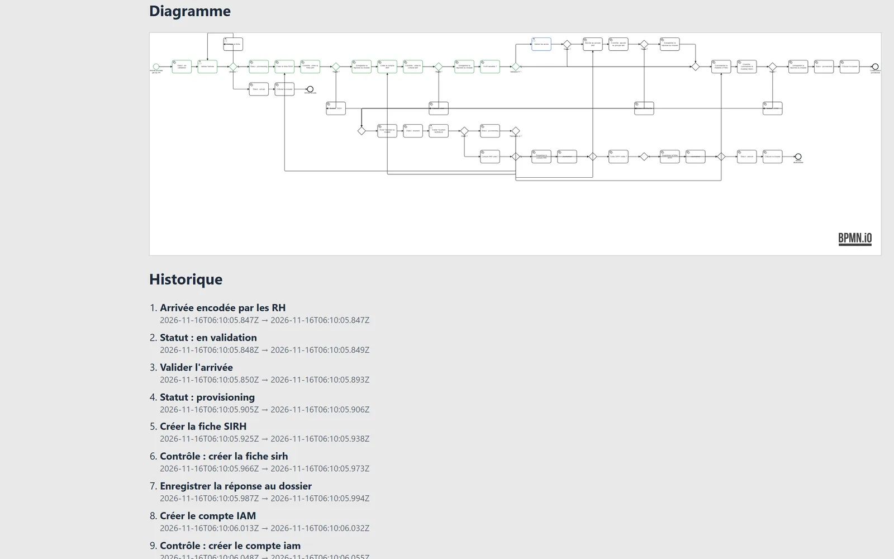
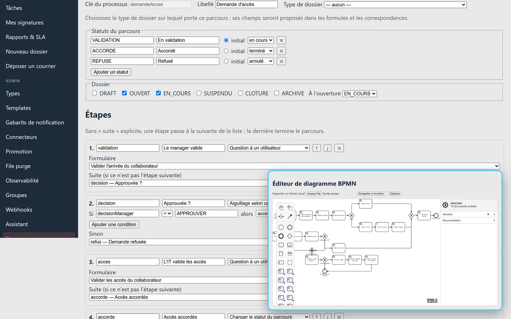
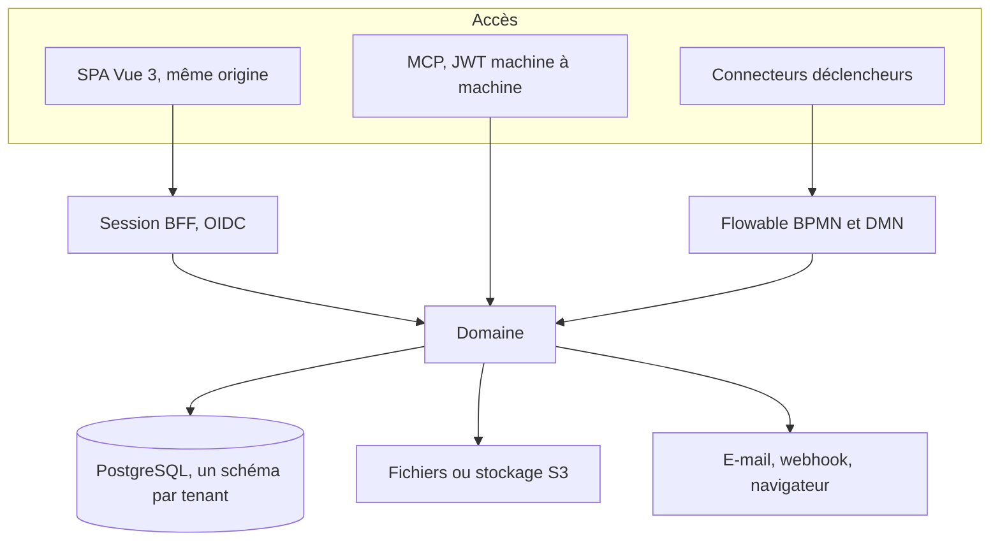

# Myrmacta


> **La plateforme de dossiers métier pilotée par workflows.**
> L'intelligence collective au service de vos dossiers et décisions.

Myrmacta orchestre vos dossiers, vos règles de décision et vos documents sur un standard ouvert, BPMN/DMN. Elle est hébergeable en Europe et pensée pour les intégrateurs comme pour les organismes publics.

Présentation : [www.myrmacta.be](https://www.myrmacta.be) · [contact@myrmacta.be](mailto:contact@myrmacta.be)

[](https://www.myrmacta.be/media/long/t00-teaser-fr.mp4)

> **Démarrage local :** voir [docs/guides/GETTING-STARTED.md](docs/guides/GETTING-STARTED.md) — infrastructure Docker/Podman
> (PostgreSQL, Keycloak, stockage S3-compatible en option) + lancement backend/frontend, config minimale incluse.
>  **Utilisation de l'UI :** voir [docs/guides/GUIDE-UTILISATEUR.md](docs/guides/GUIDE-UTILISATEUR.md) — créer un dossier,
> démarrer/suivre un workflow, configurer un connecteur ou un template de document.
>  **Déploiement :** voir [docs/guides/DEPLOIEMENT.md](docs/guides/DEPLOIEMENT.md) — au-delà du poste de dev : artefact,
> reverse-proxy, provisioning d'un tenant, comptes Keycloak (`Dockerfile` et `scripts/provision-tenant.sh` livrés ; démarrage de l'instance, reverse-proxy et Keycloak restent documentés, non automatisés).
>  **Concevoir un BPMN :** voir [docs/guides/GUIDE-CONCEPTION-BPMN.md](docs/guides/GUIDE-CONCEPTION-BPMN.md) — conventions,
> champs dynamiques, connecteurs, intervenants, génération de documents depuis un diagramme.

Les commandes pas à pas sont dans [Installation](#installation).

------

## Aperçu

Les images sont dans le dépôt (`docs/readme/`). Les vidéos restent sur [www.myrmacta.be](https://www.myrmacta.be) : un README GitHub ne lit pas une vidéo hébergée ailleurs. Le carton ci-dessus ouvre le teaser.

| Fiche dossier | Instance de processus | Parcours et éditeur BPMN |
| --- | --- | --- |
|  |  |  |

Vidéos, à ouvrir dans le navigateur :

- [Teaser, environ 90 secondes](https://www.myrmacta.be/media/long/t00-teaser-fr.mp4) · [sous-titres](https://www.myrmacta.be/media/long/t00-teaser-fr.vtt) · [version anglaise](https://www.myrmacta.be/media/long/t00-teaser-en.mp4)
- [Mail room, capsule longue](https://www.myrmacta.be/media/long/l1-mailroom-fr.mp4) · [sous-titres](https://www.myrmacta.be/media/long/l1-mailroom-fr.vtt)
- [Onboarding, capsule longue](https://www.myrmacta.be/media/long/l2-onboarding-fr.mp4) · [sous-titres](https://www.myrmacta.be/media/long/l2-onboarding-fr.vtt)

Les capsules courtes sont sur la page [Fonctionnalités](https://www.myrmacta.be/fr/fonctionnalites).

------

## Vision produit

Myrmacta est une plateforme permettant à des organisations de **modéliser, exécuter et superviser leurs processus métier** sans développement sur mesure pour chaque cas d'usage.

**Positionnement (décision du 2026-09-28, [TODO §70](docs/decisions/070-positionnement-produit-d0-integrateurs-couche-low-code.md)) :** produit pour **intégrateurs**,
avec hébergement dédié par client. L'intégrateur conçoit les processus (BPMN/DMN) ; une couche
**low-code / no-code** (palette métier, éditeurs de formulaires et de templates, assistant IA,
concepteur de parcours) est **livrée** (Vague D) pour que les utilisateurs avancés côté client
ajustent formulaires, documents et règles. Suite : [ROADMAP.md](ROADMAP.md) et les
[issues GitHub](https://github.com/superjojo79/Myrmacta/issues).

L'idée centrale : un dossier métier suit un workflow adapté à son type, déclenché automatiquement depuis des sources externes, avec production de documents et notification des parties prenantes à chaque étape clé.

**Exemples de cas d'usage :**

- Gestion de dossiers de sinistres — réception, instruction, décision, clôture
- Traitement de demandes de subventions — dépôt, vérification, validation, notification
- Onboarding client — collecte de pièces, vérification, activation
- Gestion de réclamations — réception, escalade, résolution, archivage
- Tout processus métier impliquant des étapes séquentielles, des validations humaines et la production de documents

------

## Proposition de valeur

| Besoin                                 | Réponse Myrmacta                                            |
| -------------------------------------- | ------------------------------------------------------------ |
| Modéliser un processus sans coder      | Éditeur BPMN 2.0 visuel intégré (`bpmn-js`, écran admin Myrmacta) |
| Exprimer des règles/critères métier sans cascade de gateways | Éditeur de tables de décision DMN intégré (`dmn-js`, `/admin/dmn-editor`), invocable depuis un process via `serviceTask` |
| Gérer des dossiers structurés          | Entité dossier avec signalétique et champs dynamiques par type |
| Produire des documents automatiquement | Génération PDF à partir de templates Thymeleaf versionnés    |
| Intégrer des systèmes existants        | Système de connecteurs extensible (REST/webhook, signal Flowable, cron, SMTP, Kafka, import batch SFTP, e-mail entrant IMAP/Graph, Azure Service Bus, stockage fichier) |
| Adapter à chaque client                | Architecture multi-tenant — schéma de données isolé par organisation |
| Intégrer les outils noCode             | Webhooks sortants compatibles Make, n8n, Zapier              |
| Suivre l'avancement en temps réel      | Visualisation BPMN avec coloration des étapes + notifications navigateur |

------

## Fonctionnalités principales

### Gestion de dossiers

Entité métier centrale de la plateforme. Chaque dossier est constitué d'un **signalétique** (numérotation automatique, type, statut) et d'**éléments hétérogènes** : pièces jointes, documents produits, informations structurées, notes. Les dossiers peuvent être liés entre eux (hiérarchie, subséquence, lien simple). Le schéma de chaque type de dossier est configurable par tenant sans développement.

### Moteur de workflow BPMN 2.0

Orchestration des flux métier via **Flowable** — standard industriel ouvert (pas de cockpit Flowable intégré à Myrmacta, hors V1). Les processus se modélisent directement dans Myrmacta (éditeur `bpmn-js` intégré à `/admin/bpmn-editor` — création, import, édition d'un diagramme déjà déployé, brouillon persisté) ou avec un outil externe, puis se déploient soit au build/démarrage (scan classpath), soit à chaud depuis l'écran d'administration `/admin/workflow-types` (upload avec prévisualisation) ou directement depuis l'éditeur. Support des gateways, tâches humaines et événements de signal. Le moteur DMN Flowable est activé et un `serviceTask flowable:type="dmn"` peut invoquer une table de décision éditée dans son propre éditeur intégré (`dmn-js`, `/admin/dmn-editor`) — mêmes principes que l'éditeur BPMN (brouillon persisté, déploiement à chaud), grammaire d'expression JUEL restreinte à une allowlist sûre (littéraux/comparaisons, pas d'EL brut) côté serveur. Une définition DMN 1.1 s'ouvre dans l'éditeur et est enregistrée en DMN 1.3 ([§130](docs/decisions/130-editeur-dmn-conversion-1-1-vers-1-3.md)).

### Système de connecteurs

Architecture extensible permettant d'intégrer n'importe quelle source ou destination. Un connecteur peut jouer le rôle de **trigger** (déclenche un workflow sur événement entrant), de **service** (exécute un traitement dans le workflow) ou de **callback** (reprend un workflow en attente d'une réponse asynchrone). Catalogue livré : `http-rest` (**TRIGGER + SERVICE**), `flowable-signal` (TRIGGER + SERVICE), `scheduler` (TRIGGER, cron), `smtp` (SERVICE), `document-storage` (SERVICE, via `DocumentStoragePort`), `flowable-callback` (**CALLBACK**), `batch-import` (TRIGGER, SFTP), `kafka` (TRIGGER), `imap-inbound` et `graph-mail-inbound` (TRIGGER, e-mail entrant), `azure-service-bus` (TRIGGER), `mail-deposit` (TRIGGER, dépôt manuel), `sftp-pdf-inbound` (TRIGGER, PDF numérisés), `signature` (CALLBACK, retour du fournisseur). eBox : lecture Enterprise développée, recette réelle à venir ; envoi, voie citoyen et réception des réponses en cours. Des connecteurs custom peuvent être ajoutés au classpath sans modifier le core. Un workflow peut construire la requête HTTP, `PATCH` compris, et enchaîner plusieurs API avec des validations humaines ([§112](docs/decisions/112-orchestration-technique-requete-construite-par-le-bpmn.md), [§116](docs/decisions/116-methode-patch-du-connecteur-http-rest.md)).

### Génération de documents

Production de PDF à partir de **templates HTML Thymeleaf** versionnés, stockés en base. Support des variants par langue et par contexte métier avec fallback automatique. Preview en temps réel pendant la saisie, aperçu PDF avant validation. Rendu via Flying Saucer + OpenPDF (CSS 2.1, en-têtes/pieds de page, pagination).

### Visualisation des instances

Chaque instance de workflow est visualisable en temps réel dans le browser via **BPMN.js** — le diagramme Flowable est rendu fidèlement avec coloration des étapes actives, terminées et en erreur. Le dossier associé, ses éléments et son historique sont affichés en regard. Les tâches humaines sont réassignables depuis l'interface.

### Notifications multi-canaux

Email, webhook sortant et notification navigateur (SSE) — configurables par tenant, déclenchables depuis n'importe quelle étape du workflow. Les webhooks sortants sont compatibles avec les plateformes noCode (Make, n8n, Zapier) et peuvent réinteragir avec Flowable.

### Multi-tenant

Chaque organisation dispose d'un schéma PostgreSQL dédié — isolation forte des données, migration indépendante, facturation séparée. **Une instance Spring Boot = un tenant** : `app.tenant.id` est fixé au démarrage (décision n° 13), jamais résolu dynamiquement par requête. Le claim OIDC `tenant_id` sert de **garde d'appartenance** : il doit correspondre à l'instance, sinon la requête est refusée. Voir [02-multi-tenant.md](docs/specs/02-multi-tenant.md).

### Authentification flexible

OAuth2/OIDC avec pattern BFF — le browser ne manipule jamais de token JWT. Le provider est interchangeable par configuration : Keycloak (self-hosted), Auth0, Microsoft Entra ID, Google.

L'identité belge est livrée ([§104](docs/decisions/104-authentification-belge-fas-et-itsme.md)). Pour les agents, `scripts/provision-tenant.sh --realm-per-tenant --idp fas` (ou `itsme`) déclare le FAS de BOSA (eID, itsme, eIDAS) ou itsme en direct dans le realm Keycloak. Pour un tiers du portail, l'instance est elle-même cliente OIDC de ces fournisseurs, sans compte Keycloak. La preuve d'intégration a utilisé un FAS simulé. La recette ClamAV et Keycloak réels est le [§125](docs/decisions/125-recette-sur-environnement-reel.md). La recette contre les FAS et itsme de production reste à faire.

### Serveur MCP (outillage agent IA interne)

Un serveur [MCP](https://modelcontextprotocol.io) (Model Context Protocol) expose un sous-ensemble des capacités métier à un agent IA interne (Claude Code ou tout autre client MCP) : définir un type de dossier, déployer un workflow BPMN, consulter un dossier, rechercher des dossiers, consulter les statistiques SLA. Transport Streamable HTTP sur `/api/m2m/mcp`, authentification par le même JWT machine-à-machine que les connecteurs (`Authorization: Bearer`, rôle `API_SERVICE`) — pas de nouveau mécanisme d'authentification, pas d'exposition tenant tierce. Voir [docs/guides/GETTING-STARTED.md](docs/guides/GETTING-STARTED.md#12-serveur-mcp-outillage-agent-ia) pour s'y connecter en local. Par défaut, un déploiement demandé par l'agent écrit un brouillon qu'un humain publie (`APP_MCP_PUBLICATION_MODE=draft`). La valeur `direct` rétablit la publication immédiate hors production.


### Signature électronique

Yousign et DocuSign ([§109](docs/decisions/109-fournisseurs-de-signature-yousign-et-docusign.md)) : un seul fournisseur actif par instance (`APP_SIGNATURE_PROVIDER`, défaut `none`). Le webhook de retour reprend le processus et archive le PDF signé ainsi que la preuve. La valeur juridique est celle du compte chez le fournisseur.

La carte eID belge ([§138](docs/decisions/138-signature-eid-sans-agent-signature-apportee.md), fournisseur `eid`, pont Web eID) produit une signature qualifiée au format PAdES. Le niveau enregistré est QES. La révocation est contrôlée en ligne (OCSP, sinon CRL), pour un agent comme pour un tiers du portail. Le serveur assemble le PDF : la signature est invisible dans le document. Un horodatage n'est ajouté que si `app.signature.eid.timestamp.url` est renseignée ; cette option n'a pas été recettée. La recette réelle ([#98](https://github.com/superjojo79/Myrmacta/issues/98)) a accepté des signatures d'agent. Le parcours portail a été joué jusqu'au refus attendu lorsque la même carte signe une seconde fois. BeIDConnect est écarté du parcours par défaut.

### Courrier entrant

La Digital Mail Room ([§113](docs/decisions/113-digital-mail-room-courrier-dossier-et-fils.md)) enregistre chaque courrier comme un dossier et le route vers un service par une table de décision. Canaux livrés : IMAP, Microsoft Graph, PDF numérisés (`sftp-pdf-inbound`), dépôt manuel (`mail-deposit`). eBox : lecture Enterprise développée, recette réelle à venir ; envoi, voie citoyen et réception des réponses en cours ([§150](docs/decisions/150-lecture-ebox-enterprise.md), [§151](docs/decisions/151-ebox-partitions-classement-recommandes.md), [§155](docs/decisions/155-envoi-ebox-citoyen-et-entreprise.md)).

L'envoi ([§155](docs/decisions/155-envoi-ebox-citoyen-et-entreprise.md), point encore ouvert, issue [#13](https://github.com/superjojo79/Myrmacta/issues/13)) passe par la brique « Envoyer en eBox » (`eboxSendTask`) et le compte `ebox-outbound`. La voie entreprise implémente le protocole public et a été testée contre un serveur factice : aucun environnement d'acceptation n'était accessible pendant le développement. La voie citoyen est un adaptateur simulé : par défaut, aucun citoyen n'a consenti et le processus suit la voie de secours, que Myrmacta ne réalise pas lui-même. La réception des réponses reste ouverte ([#11](https://github.com/superjojo79/Myrmacta/issues/11)). Exemple : [exemples/envoi-ebox/README.md](exemples/envoi-ebox/README.md).

### Échéances, gabarits, données

- Échéances, rappel et escalade ([§115](docs/decisions/115-echeances-de-dossier-rappel-escalade-et-minuteurs.md)), avec un calendrier de jours ouvrables par tenant : week-ends, jours fériés, saisie par période, import ICS ([§120](docs/decisions/120-calendrier-jours-ouvrables.md), [§121](docs/decisions/121-calendrier-saisie-sources-ics.md)).
- Gabarits de notification versionnés, objet et corps en texte ou HTML ([§123](docs/decisions/123-gabarits-de-notification.md)), transférables d'un environnement à l'autre avec la configuration ([§83](docs/decisions/083-d4-promotion-de-configuration-entre-environnements.md), [§117](docs/decisions/117-promotion-de-configuration-tranche-2.md)). La brique « Notifier » peut joindre le PDF ([§96](docs/decisions/096-piece-jointe-de-la-brique-notifier.md)).
- Unicité d'un champ et recherche de dossiers ouverts du même type depuis une brique de workflow ([§102](docs/decisions/102-unicite-d-un-champ-de-dossier.md)). Un champ `managedByWorkflow` n'est écrit que par le mapping du processus ([§126](docs/decisions/126-champs-managed-by-workflow.md)).
- Pré-vérification IA ([§106](docs/decisions/106-preverification-ia-et-types-de-pieces.md)), désactivée par défaut (`APP_PRECHECK_ENABLED=false`) : complétude déterministe, règles lues sur des variables posées en amont (table DMN, expression ou recherche), puis synthèse et constats sourcés. L'agent accepte ou écarte chaque constat. Le workflow n'avance pas sur l'avis du modèle et le modèle n'écrit aucun champ du dossier. L'assistant de conception ([§86](docs/decisions/086-lc3-assistant-de-conception-ia.md)) est désactivé par défaut (`APP_ASSISTANT_ENABLED=false`) et ne publie pas en production.
- Interface en français et en anglais ([§90](docs/decisions/090-d7-internationalisation-fr-en.md)).
- Alertes SLA, widgets et export CSV ([§65](docs/decisions/065-enrichissement-du-reporting-alerting-sla-widgets-export.md)).


------

## Architecture technique

### Principes

L'application est construite sur le modèle **Ports & Adapters (hexagonal)** — le domaine métier est isolé de toute technologie. Chaque composant technique (Flowable, JPA, PDF, notifications) est un adaptateur remplaçable sans impact sur la logique métier. Cette architecture garantit la testabilité du domaine sans infrastructure et la pérennité face aux évolutions des frameworks.

### Vue d'ensemble

```
┌─────────────────────────────────────────────────────────────────┐
│  Connecteurs (triggers / services / callbacks)                  │
│  REST · signal · cron · SMTP · Kafka · SFTP · e-mail · Azure    │
└───────────────────────────┬─────────────────────────────────────┘
                            │ événements
                            ▼
┌─────────────────────────────────────────────────────────────────┐
│  Moteur de workflow — Flowable BPMN 2.0 + DMN                   │
│  ┌──────────────┐  ┌─────────────┐  ┌──────────┐  ┌─────────┐ │
│  │ Service Tasks│  │ User Tasks  │  │ Gateways │  │  DMN    │ │
│  └──────┬───────┘  └──────┬──────┘  └──────────┘  └─────────┘ │
└─────────┼─────────────────┼───────────────────────────────────-─┘
          │                 │
          ▼                 ▼
┌─────────────────────────────────────────────────────────────────┐
│  Domaine métier                                                 │
│  Dossiers · Documents · Templates · Connecteurs · Notifications │
└──────┬──────────────┬───────────────────┬───────────────────────┘
       │              │                   │
       ▼              ▼                   ▼
  PostgreSQL      Stockage objet   Notifications
  (schéma/tenant) S3 / filesystem  Email · SSE · Webhook
```

Le même parcours, depuis les points d'accès :




### Stack technique

| Couche            | Technologie                     | Choix                                           |
| ----------------- | ------------------------------- | ----------------------------------------------- |
| Backend           | Java 25 LTS · Spring Boot 4.1.x | Virtual Threads, ecosystem mature               |
| Workflow          | Flowable 8.0.x Community        | BPMN 2.0, Apache 2.0, moteur d'exécution seul (pas de Flowable UI) |
| Persistence       | PostgreSQL + Spring Data JPA    | JSONB pour champs dynamiques, schéma par tenant |
| Génération PDF    | Flying Saucer 10.x + jsoup 1.x (versions exactes : `pom.xml`) | LGPL-2.1 or later ; voir l'[audit](docs/analyses/audit-licences-2026-10-24.md) |
| Sécurité          | Spring Security 7 + OAuth2 Client | BFF intégré, provider-agnostique              |
| Frontend          | Vue 3 + Vite + TypeScript + OpenVue (embarqué `static/`) | SPA même origine, typage statique aligné sur le contrat API, composants métier riches |
| State management  | Pinia                           | Store réactif Vue 3                             |
| Tests frontend    | Vitest + Playwright + ESLint/Prettier | Unitaire/composants **et** e2e (`npm run test:all`) obligatoires pour features FE ; aligné job CI `frontend` |
| BPMN viewer/éditeur | bpmn-js + bpmn-js-properties-panel | Rendu fidèle, overlays d'état, édition (Modeler + panel de propriétés Flowable custom) |
| DMN éditeur       | dmn-js                          | Même écosystème bpmn.io, permission Camunda + filigrane obligatoire, `/admin/dmn-editor` |
| Stockage fichiers | Port S3 / filesystem             | `DocumentStoragePort` ; MinIO possible en local (pas de couplage) |
| Auth server       | Keycloak 26.7.x                 | Self-hosted, OIDC/OAuth2, LDAP                  |
| Build             | Maven mono-module + ArchUnit    | Règle domaine vérifiée en CI                    |

Versions figées dans [`pom.xml`](pom.xml) : Java 25, Spring Boot 4.1.2, Flowable 8.0.0, Flying Saucer 10.7.0, jsoup 1.24.1. Le fichier [`docker-compose.yml`](docker-compose.yml) de développement utilise PostgreSQL 17 et Keycloak 26.7.1. Le frontend déclare Vue 3.5 et Vite 8 ([`frontend/package.json`](frontend/package.json)).

### Dépôt

Mono-module Maven. Le domaine ne dépend d'aucun framework.

```
.
├── src/main/java/be/myrmacta/     domain, application, infrastructure
├── src/test/java/                 tests, y compris les *IT
├── src/embedded/                  démo et base embarquée, profil Maven embedded-db seulement
├── frontend/                      Vue 3, Vite, portail (vite.portal.config.ts)
├── exemples/                      digital-mail-room, onboarding-collaborateur,
│                                  autorisation-riverain, convention-fournisseur, envoi-ebox
├── docs/specs, docs/guides, docs/decisions, docs/brand
├── docker/                        init PostgreSQL, import du realm Keycloak
├── scripts/                       démo, provisioning, contrôle de la documentation
├── docker-compose.yml             PostgreSQL et Keycloak, profils optionnels
└── pom.xml
```


### Licences des composants

Les licences des bibliothèques et les notices à conserver sont dans [`NOTICE`](NOTICE) et dans [l'audit](docs/analyses/audit-licences-2026-10-24.md). Aucun composant à copyleft fort n'est embarqué : iText est absent du livrable. Le PDF est rendu par Flying Saucer et OpenPDF.

------

## Modèle de déploiement

L'application est conçue pour un déploiement **mutualisé au niveau de l'infrastructure**, avec
une isolation applicative complète : chaque organisation est servie par sa **propre instance Spring
Boot dédiée**, configurée avec son identifiant de tenant au démarrage (voir
[02-multi-tenant.md](docs/specs/02-multi-tenant.md), décision n° 13). Chaque instance embarque
également le frontend Vue 3 dans `static/` (décision n° 27) — même origine API / SPA. Toutes les
instances partagent la même base PostgreSQL (isolation par schéma dédié) et le même serveur Keycloak
(realm partagé). Le routage vers la bonne instance est assuré par un reverse-proxy Apache à
configuration statique (décision n° 14). Le `server.servlet.context-path` vaut `/${app.tenant.id}` dans `application.yml` (décision n° 14). Le profil `local` le vide (`application-local.yml`) pour servir l'application à la racine du poste de développement. Le schéma et le rôle PostgreSQL se provisionnent avec `scripts/provision-tenant.sh` ; le démarrage de l'instance et le reverse-proxy restent documentés dans [docs/guides/DEPLOIEMENT.md](docs/guides/DEPLOIEMENT.md). Le déploiement cible des environnements conteneurisés
(Docker / Kubernetes) ; une instance de tenant peut être scalée indépendamment des autres si sa
charge le justifie.

```
┌───────────────────┐   ┌───────────────────┐   ┌───────────────────┐
│ Instance Spring    │   │ Instance Spring    │   │ Instance Spring    │
│ Boot — tenant_a    │   │ Boot — tenant_b    │   │ Boot — tenant_n    │
│ (BFF+API+Flowable) │   │ (BFF+API+Flowable) │   │ (BFF+API+Flowable) │
└──────────┬──────────┘   └──────────┬──────────┘   └──────────┬──────────┘
           │                         │                         │
           └────────────┬────────────┴────────────┬────────────┘
                         ▼                         ▼
                  ┌────────────┐            ┌──────────────┐
                  │ PostgreSQL │            │   Keycloak   │
                  │ tenant_a   │            │ (OIDC/OAuth2)│
                  │ tenant_b   │            │ realm partagé│
                  │ tenant_n   │            └──────────────┘
                  └─────┬──────┘
                        ▼
                  ┌──────────────┐
                  │ Object store │
                  │ S3 / filesys │
                  └──────────────┘
```

------

## Installation

Le poste de développement lance le backend sur la machine hôte et l'infrastructure (PostgreSQL, Keycloak) dans des conteneurs. Le guide complet, y compris Podman, Windows et le dépannage, est [docs/guides/GETTING-STARTED.md](docs/guides/GETTING-STARTED.md). Le déploiement au-delà de ce poste est [docs/guides/DEPLOIEMENT.md](docs/guides/DEPLOIEMENT.md).

### Prérequis

| Outil | Version | Rôle |
| --- | --- | --- |
| JDK | **25** (Temurin en CI) | `java.version` du [`pom.xml`](pom.xml). Le JDK de référence est 25. |
| Maven | wrapper `./mvnw` | Télécharge Maven. Pas d'installation séparée. |
| Node.js | **22+** (CI : 22.14.0) | Build du frontend. Voir [frontend/README.md](frontend/README.md). |
| Docker ou Podman | Compose v2 | PostgreSQL et Keycloak. `podman compose` équivaut à `docker compose` ([guide](docs/guides/GETTING-STARTED.md)). |

Le stockage des documents est le filesystem local par défaut. Aucun service S3 n'est requis pour démarrer.

### Démarrage local

Depuis la racine du dépôt :

```bash
cp .env.local.example .env
docker compose up -d
```

`docker compose up -d` démarre PostgreSQL 17 et Keycloak 26.7.1. Au premier volume vide, PostgreSQL crée la base `myrmacta` et le schéma `tenant_dev`. Keycloak importe le realm `myrmacta` (client `mon-app`, utilisateurs `demo`, `manager` et `viewer`, mot de passe identique à l'identifiant, attribut `tenant_id=tenant_dev`). Console Keycloak : http://localhost:8081 (`admin` / `admin`).

Le backend ne lit pas `.env` tout seul. Dans le même terminal que Maven :

```bash
set -a; source .env; set +a
cd frontend && npm install && npm run build && cd ..
./mvnw spring-boot:run
```

L'application répond sur http://localhost:8080 (le profil `local` neutralise le context-path). Se connecter avec `demo` / `demo`. `APP_SECURITY_COOKIE_SECURE=false` est déjà dans `.env.local.example` : sans cela, le navigateur refuse le cookie de session sur HTTP et la connexion boucle.

Contrôles :

```bash
curl -i http://localhost:8080/api/auth/me    # 401 sans session
curl -s http://127.0.0.1:8090/actuator/health
```

L'UI n'est servie que si `src/main/resources/static/` a été rempli par `npm run build` (ou par un `./mvnw package`, qui lance le build frontend). En développement de l'interface, `cd frontend && npm run dev` sert Vite seul : brancher le proxy est décrit dans [frontend/README.md](frontend/README.md#tester-contre-un-vrai-backend-en-hmr).

Arrêt : `docker compose down`. `docker compose down -v` supprime aussi les volumes (base et realm).

Profils Compose optionnels, documentés en tête de [`docker-compose.yml`](docker-compose.yml) et dans le guide : `minio`, `rustfs` ou `seaweedfs` (stockage S3), `mailpit` (SMTP de capture, UI http://localhost:8025, `MAIL_PORT=1025`), `clamav`, `kafka`, `prometheus`.

### Démo embarquée

Pour une démo sans PostgreSQL externe, le profil Maven `embedded-db` produit un jar qui embarque PostgreSQL. Il est refusé si `APP_ENVIRONMENT` vaut `production`. Keycloak reste celui du compose : la démo s'authentifie avec le realm de développement.

```bash
docker compose up -d keycloak
set -a; source .env; set +a
# 32 octets, base64. Requis dès que la démo crée des connecteurs.
export APP_CONNECTOR_MASTER_KEY="$(openssl rand -base64 32)"
scripts/demo.sh build
scripts/demo.sh reset --yes
scripts/demo.sh start
```

`scripts/demo.sh start` force les profils `local,embedded-db,demo` et ignore les variables `DB_*` du `.env`. Sur une base vide, trois paquets s'installent : la mail room, l'onboarding collaborateur (faux SIRH, IAM et ITSM sur le port 18090) et les états (SLA, incident, brouillon). `APP_DEMO_LOCALE=en` refait la démo en anglais, après un `reset`. La seule mail room : [`scripts/demo-mailroom.sh`](scripts/demo-mailroom.sh). Données sous `~/.myrmacta/embedded-db` (`scripts/embedded-db.sh status`).

Image de démo : `docker build --build-arg MAVEN_PROFILES=embedded-db -t myrmacta:demo .` (voir le [guide](docs/guides/GETTING-STARTED.md), section base embarquée). Cette image n'est pas un déploiement de production.

### Configuration

[`.env.local.example`](.env.local.example) est le poste de dev. [`.env.example`](.env.example) est le gabarit d'un environnement réel ([DEPLOIEMENT.md](docs/guides/DEPLOIEMENT.md) §2). Chaque variable consommée par `application.yml` est documentée dans ces fichiers et dans le guide.

| Variable | Rôle au démarrage |
| --- | --- |
| `APP_ENVIRONMENT` | `local`, `staging` ou `production`. Défaut `production`. Le profil Spring `local` est refusé si la valeur n'est pas `local`. Le profil `test` est refusé en `production`. |
| `SPRING_PROFILES_ACTIVE` | `local` sur le poste de dev : secrets de démo autorisés, context-path vide. |
| `DB_URL`, `DB_USERNAME`, `DB_PASSWORD` | JDBC. Hors `local`/`test`, un mot de passe vide ou trop commun (`myrmacta`, `postgres`, `admin`, `password`) empêche le démarrage. |
| `APP_TENANT_ID` | Une instance = un tenant. Défaut `tenant_dev`, aligné sur le schéma créé par `docker/postgres/init`. |
| `OIDC_ISSUER_URI`, `OIDC_CLIENT_ID`, `OIDC_CLIENT_SECRET` | Fournisseur du BFF. En local : Keycloak `http://localhost:8081/realms/myrmacta`, client `mon-app`. |
| `APP_SECURITY_COOKIE_SECURE` | `false` seulement pour `http://localhost`. Défaut `true`. |
| `APP_CONNECTOR_MASTER_KEY` | 32 octets en base64. Vide toléré en profil `local` tant qu'aucun secret de connecteur n'est chiffré. Obligatoire sinon. |
| `M2M_JWT_SECRET` | HMAC de test, profils `local`/`test` seulement, au moins 32 caractères. Vide : le canal machine à machine est éteint. Refusé hors de ces profils. |
| `OAUTH2_ISSUER_URI`, `M2M_TRUSTED_CLIENT_IDS` | Émetteur JWT réel. Hors `local`, l'allowlist est obligatoire dès que le canal M2M est actif. |
| `APP_MCP_PUBLICATION_MODE` | `draft` (défaut) : un agent écrit un brouillon, un humain publie. `direct` est refusé en production. |
| `APP_STORAGE_TYPE` | `filesystem` (défaut, `./data/documents`) ou `s3`. |
| `APP_SIGNATURE_PROVIDER` | `none` (défaut), `stub` (profil `local`/`test`), `yousign`, `docusign` ou `eid`. |
| `APP_PORTAL_ENABLED` | Portail des tiers, défaut `false`. S'il est `true`, `APP_PORTAL_PUBLIC_BASE_URL` est obligatoire. |
| `APP_PRECHECK_ENABLED`, `APP_ASSISTANT_ENABLED` | Défaut `false`. Aucun appel à un modèle tant qu'ils restent éteints. |
| `APP_DOSSIER_ATTACHMENT_SCAN_TYPE` | `noop` (défaut) ou `clamav`. `noop` est refusé en `production` sans `APP_DOSSIER_ATTACHMENT_SCAN_NOOP_ACKNOWLEDGED=true`. |
| `MAIL_HOST`, `MAIL_PORT`, `MAIL_FROM` | SMTP. Sans serveur, `/actuator/health` peut être `DOWN` alors que la vivacité reste `UP`. `MAIL_FROM` est une adresse nue (défaut `noreply@myrmacta.invalid`). |
| `MANAGEMENT_ADDRESS`, `MANAGEMENT_PORT` | Actuator. Défaut `127.0.0.1:8090`. |

### Build et tests

```bash
./mvnw verify
```

`verify` compile, lance les tests unitaires et les `*IT` (PostgreSQL embarqué zonky, pas de Docker), ArchUnit et la couverture. Il demande un utilisateur non root pour zonky, sinon `MYRMACTA_TEST_PG_URL`. Le JDK de la CI est 25. Si la machine n'a que le JDK 21 : `./mvnw verify -Dmaven.compiler.release=21` ([AGENTS.md](AGENTS.md)). Un seul Maven à la fois sur `target/` : `-Dskip.frontend=true` si le frontend est vérifié à part.

Le test ClamAV réel (`ClamAvAttachmentScanIT`) ne fait pas partie de `verify`. Il se lance avec `-Dclamav.it=true` et un démon `clamd`. La recette Keycloak (`scripts/keycloak-realm-smoke.sh`) non plus. Les deux sont le workflow manuel `.github/workflows/recette-env-reel.yml` ([§125](docs/decisions/125-recette-sur-environnement-reel.md)).

```bash
cd frontend && npm ci && npm run lint && npm run test:all
```

`test:all` enchaîne Vitest et Playwright. La première fois : `npx playwright install --with-deps chromium` dans `frontend/`. La CI sépare `npm run test`, `npm run build` et `npm run test:e2e` (job `frontend`). Les tests de mutation (PIT, Stryker) sont hors `verify` ([§108](docs/decisions/108-tests-de-mutation-pit.md)).

La CI (`.github/workflows/ci.yml`) enchaîne : `scripts/check-docs.sh`, `./mvnw verify`, le contrôle du jar de production (pas de base embarquée, `LICENSE` / `NOTICE` / addendum), les tests du profil `embedded-db`, un parcours de signature dans le navigateur, puis le job frontend.

```bash
scripts/check-docs.sh
```

Contrôle hors ligne des liens relatifs, des copies de skills, des références « TODO §N », des identifiants de décision et des versions citées dans ce README.

### API, MCP et observabilité

L'API est servie sur la même origine que la SPA. Le navigateur a une session : il ne reçoit pas de jeton d'accès. Le contrat OpenAPI versionné est décrit dans [openapi/README.md](openapi/README.md).

Le serveur MCP est sur `POST /api/m2m/mcp` (Streamable HTTP), même chaîne que les connecteurs machine à machine : `Authorization: Bearer`, rôle `API_SERVICE`, claim `tenant_id` égal à celui de l'instance. En local, renseigner `M2M_JWT_SECRET` puis suivre [GETTING-STARTED.md §12](docs/guides/GETTING-STARTED.md#12-serveur-mcp-outillage-agent-ia). Hors `local`, les outils de déploiement écrivent un brouillon qu'un humain publie (Admin → Brouillons).

Actuator (santé, Prometheus) : `http://127.0.0.1:8090`, endpoints `health` et `prometheus`. Les journaux sont au format ECS. `docker compose --profile prometheus up -d` scrape cet endpoint (UI http://localhost:9090). Le conteneur Prometheus est en `network_mode: host` pour atteindre le port de boucle locale : sous macOS ou Windows, ce mode demande le réseau hôte de Docker Desktop. Sans le conteneur, `curl http://127.0.0.1:8090/actuator/prometheus` suffit.

### Sécurité

- BFF : session serveur, cookie `Secure` par défaut, `SameSite=Lax`. Pas de jeton dans le navigateur.
- Le claim `tenant_id` doit être celui de l'instance, sinon la requête est refusée.
- Rôles : `TENANT_ADMIN`, `WORKFLOW_ADMIN`, `DOSSIER_MANAGER`, `DOSSIER_VIEWER`, `API_SERVICE`.
- Secrets de connecteurs chiffrés avec `APP_CONNECTOR_MASTER_KEY`. Les mots de passe par défaut et le HMAC M2M sont refusés hors profils `local` et `test`.
- Les URL sortantes (webhooks, eBox, stockage) passent par un garde qui bloque les adresses non autorisées. Le détail est dans [docs/specs/03-authentification.md](docs/specs/03-authentification.md) et [docs/specs/12-autorisation-conformite.md](docs/specs/12-autorisation-conformite.md).
- ClamAV est optionnel en développement et attendu en production (voir le tableau ci-dessus et [DEPLOIEMENT.md](docs/guides/DEPLOIEMENT.md)).
- Une faille se signale en privé à **contact@myrmacta.be**, pas dans une issue publique ([CONTRIBUTING.md](CONTRIBUTING.md)).

### Dépannage

| Symptôme | Piste |
| --- | --- |
| Boucle vers Keycloak sur `http://localhost` | `APP_SECURITY_COOKIE_SECURE=false`, et `.env` rechargé dans le shell avant `spring-boot:run`. |
| `OIDC_CLIENT_SECRET` vide au démarrage | `.env` non chargé dans ce terminal. |
| Tables créées dans `public` | Le schéma `tenant_dev` n'existait pas au premier démarrage de PostgreSQL. `docker compose down -v` puis `docker compose up -d`. |
| Connecté, menus Admin absents, rôles vides | L'ID token ne porte pas `realm_access.roles`. Realm de dev : réimporter (guide, §4). |
| Santé `DOWN`, vivacité `UP` | Aucun SMTP sur `MAIL_HOST`:`MAIL_PORT`. Profil `mailpit` et `MAIL_PORT=1025`. |

------

## Documentation technique

Mise en place et utilisation en local : [docs/guides/GETTING-STARTED.md](docs/guides/GETTING-STARTED.md). Prise en main
de l'UI (dossiers, workflows, connecteurs, templates) : [docs/guides/GUIDE-UTILISATEUR.md](docs/guides/GUIDE-UTILISATEUR.md).
Déploiement au-delà du poste de dev (reverse-proxy, provisioning tenant, comptes Keycloak) :
[docs/guides/DEPLOIEMENT.md](docs/guides/DEPLOIEMENT.md). Historique synthétique des changements, par pull request :
[CHANGELOG.md](CHANGELOG.md). Conception d'un diagramme BPMN (conventions, `serviceTask`
disponibles, champs dynamiques, connecteurs, intervenants) :
[docs/guides/GUIDE-CONCEPTION-BPMN.md](docs/guides/GUIDE-CONCEPTION-BPMN.md).

La documentation d'architecture est disponible dans le répertoire `docs/specs` :

| Fichier                                                      | Contenu                              |
| ------------------------------------------------------------ | ------------------------------------ |
| [00-index.md](docs/specs/00-index.md)                    | Vue d'ensemble et dépendances        |
| [01-architecture-hexagonale.md](docs/specs/01-architecture-hexagonale.md) | Ports & Adapters, structure packages |
| [02-multi-tenant.md](docs/specs/02-multi-tenant.md)      | Isolation schéma PostgreSQL          |
| [03-authentification.md](docs/specs/03-authentification.md) | OAuth2/OIDC, BFF, providers          |
| [04-dossiers.md](docs/specs/04-dossiers.md)              | Entité métier centrale               |
| [05-workflow-engine.md](docs/specs/05-workflow-engine.md) | Flowable, BPMN, event bus            |
| [06-connecteurs.md](docs/specs/06-connecteurs.md)        | Système de connecteurs extensible    |
| [07-generation-documents.md](docs/specs/07-generation-documents.md) | Stack PDF, CSS print, performances   |
| [08-templates-documents.md](docs/specs/08-templates-documents.md) | Versionning, variants, résolution    |
| [09-notifications.md](docs/specs/09-notifications.md)    | Email, webhook, SSE                  |
| [10-visualisation-workflow.md](docs/specs/10-visualisation-workflow.md) | BPMN.js, historique, réassignation   |
| [11-frontend.md](docs/specs/11-frontend.md)              | Vue 3, OpenVue, Pinia                |
| [12-autorisation-conformite.md](docs/specs/12-autorisation-conformite.md) | RBAC, rétention, conformité RGPD     |

L'index [docs/specs/00-index.md](docs/specs/00-index.md) poursuit la liste (specs 13 à 49 : édition BPMN, DMN, MCP, portail, signature, pré-vérification, mail room, etc.).

------

## Licence et marque

Le code de Myrmacta est public et utilisable à des fins non commerciales, sous la licence [PolyForm Noncommercial 1.0.0](LICENSE) (identifiant SPDX `PolyForm-Noncommercial-1.0.0`), complétée par un [addendum de droit belge](LICENSE-ADDENDUM.md). Les autorités publiques (communes, CPAS, provinces, zones…), les associations, l'enseignement et la recherche publique l'utilisent librement pour leurs missions. Un particulier l'utilise pour l'étude, la recherche, l'enseignement ou le loisir. Une entreprise peut l'évaluer hors production pendant 90 jours. Tout autre usage commercial (usage en entreprise, prestation pour un tiers, SaaS, revente) demande une licence commerciale : [contact@myrmacta.be](mailto:contact@myrmacta.be). Détails dans [LICENSING.md](LICENSING.md).

Le nom de code, le nom commercial et le logo sont dans
[TRADEMARKS.md](TRADEMARKS.md#denomination). Le nom commercial choisi est **Myrmacta**.
Le dépôt de marque n'est pas fait : pas de ®, ™ au plus. La licence du code ne couvre ni le nom
ni le logo. Le logo A3b et le favicon sont dans le dépôt
([docs/brand/README.md](docs/brand/README.md), `frontend/public/`).

Contributions de code externes : pas pour l'instant, issues bienvenues
([CONTRIBUTING.md](CONTRIBUTING.md)).
Décision : [n° 118](docs/decisions/118-licence-polyform-noncommercial-et-addendum-belge.md).

------

## Contribuer

Le dépôt n'accepte pas de contribution externe de code pour l'instant : une pull request externe est fermée sans fusion. Les issues (bogue, question, idée, sans code à intégrer) sont les bienvenues. Le détail, la marque et le signalement privé d'une faille sont dans [CONTRIBUTING.md](CONTRIBUTING.md).

Le cycle du mainteneur est celui décrit par [AGENTS.md](AGENTS.md) et le skill [myrmacta-feature](.project-skills/myrmacta-feature/SKILL.md) : cadrer, concevoir, livrer par lots, clore par une revue indépendante. Le document de travail d'une feature en cours vit dans `docs/ai/` et sort dans la pull request qui la livre. Avant de conclure : `./mvnw verify`, `cd frontend && npm run lint && npm run test:all` si le frontend change, et `scripts/check-docs.sh`. Le titre de la pull request suit Conventional Commits : il devient l'entrée du [CHANGELOG.md](CHANGELOG.md), qu'on n'édite pas à la main.

------

## Feuille de route

- **eBox.** Lecture Enterprise développée, recette réelle à venir ; envoi, voie citoyen et réception des réponses en cours ([#11](https://github.com/superjojo79/Myrmacta/issues/11), [#13](https://github.com/superjojo79/Myrmacta/issues/13), [#14](https://github.com/superjojo79/Myrmacta/issues/14)). Voir les [issues](https://github.com/superjojo79/Myrmacta/issues).

------

## Statut

> Projet en développement actif. Sont livrés sur `main` : le socle et la Vague D, la pièce jointe de « Notifier » (#183, [§96](docs/decisions/096-piece-jointe-de-la-brique-notifier.md)), l'unicité d'un champ (#184, [§102](docs/decisions/102-unicite-d-un-champ-de-dossier.md)), l'authentification belge ([§104](docs/decisions/104-authentification-belge-fas-et-itsme.md)), la pré-vérification IA ([§106](docs/decisions/106-preverification-ia-et-types-de-pieces.md), désactivée par défaut), les tests de mutation ([§108](docs/decisions/108-tests-de-mutation-pit.md)), les fournisseurs de signature Yousign et DocuSign (#191, [§109](docs/decisions/109-fournisseurs-de-signature-yousign-et-docusign.md)), la signature par carte eID ([§138](docs/decisions/138-signature-eid-sans-agent-signature-apportee.md)), les variables de démarrage déclarées (#187, [§111](docs/decisions/111-variables-de-demarrage-declarees.md)), la Digital Mail Room ([§113](docs/decisions/113-digital-mail-room-courrier-dossier-et-fils.md)), le calendrier de jours ouvrables ([§120](docs/decisions/120-calendrier-jours-ouvrables.md)), les gabarits de notification ([§123](docs/decisions/123-gabarits-de-notification.md)). Hors V1 : [#16](https://github.com/superjojo79/Myrmacta/issues/16). Détails : [ROADMAP.md](ROADMAP.md) et la [feuille de route](#feuille-de-route).

La documentation d'architecture a fait l'objet d'une [revue pré-implémentation](docs/analyses/REVUE-PRE-IMPLEMENTATION.md).
Les points du registre encore ouverts sont le [§71](docs/decisions/071-exposition-mcp-de-la-couche-low-code.md) (cadrage MCP de la couche low-code) et le [§155](docs/decisions/155-envoi-ebox-citoyen-et-entreprise.md) (envoi eBox). Le registre complet est [docs/decisions/README.md](docs/decisions/README.md).
Ce qui reste à faire est suivi dans les [issues GitHub](https://github.com/superjojo79/Myrmacta/issues)
(libellés `priorite-*`, `type-*`, `vague-*`).

> **Références historiques.** Les numéros `#N` et les liens vers des issues ou des pull requests cités
> dans la documentation, le registre et l'historique Git renvoient au dépôt de développement d'origine,
> qui n'est pas public. Les issues encore ouvertes ont été reprises ici, sous de nouveaux numéros.
