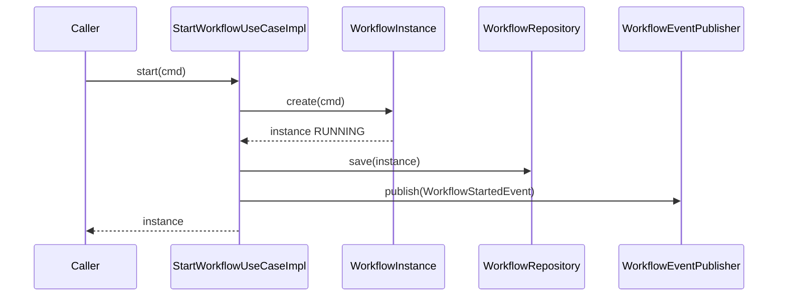

# System Design & Architecture

## Architecture Overview
**What is the high-level system structure?**

Ports & Adapters : le domaine est le centre ; les adaptateurs dépendent du domaine, jamais
l’inverse. Mono-module Maven ; frontière appliquée par ArchUnit sur `com.flowforge`.

```mermaid
flowchart TB
  subgraph config["infrastructure.config"]
    DC[DomainConfig]
  end

  subgraph domain["com.flowforge.domain.workflow"]
    PIN["port.in<br/>StartWorkflowUseCase"]
    UC["usecase<br/>StartWorkflowUseCaseImpl"]
    MODEL["model<br/>WorkflowInstance, WorkflowStatus<br/>StartWorkflowCommand, WorkflowStartedEvent<br/>InvalidStateException"]
    PREPO["port.out<br/>WorkflowRepository"]
    PPUB["port.out<br/>WorkflowEventPublisher"]
  end

  subgraph infra["infrastructure"]
    REPO["persistence.workflow<br/>InMemoryWorkflowRepository"]
    PUB["flowable<br/>InMemoryWorkflowEventPublisher"]
  end

  DC -->|@Bean useCase| UC
  DC -->|@Bean| REPO
  DC -->|@Bean| PUB
  UC -.implements.-> PIN
  UC --> MODEL
  UC --> PREPO
  UC --> PPUB
  REPO -.implements.-> PREPO
  PUB -.implements.-> PPUB
```

### Flux `start`



### Responsabilités

| Zone | Rôle |
|---|---|
| `domain.workflow.model` | `record`s métier, commande, événement, exception d’état |
| `domain.workflow.port.in` | Interface `StartWorkflowUseCase` |
| `domain.workflow.usecase` | `StartWorkflowUseCaseImpl` (pur Java, ctor injection) |
| `domain.workflow.port.out` | `WorkflowRepository`, `WorkflowEventPublisher` |
| `infrastructure.persistence.workflow` | `InMemoryWorkflowRepository` (cible future JPA) |
| `infrastructure.flowable` | `InMemoryWorkflowEventPublisher` (cible future Flowable) |
| `infrastructure.config` | `DomainConfig` — câblage `@Bean` uniquement |

### Stack

Java 25 · Spring Boot 4.1 · ArchUnit · Lombok — **sans** activer JPA / Flowable / Security
pour le runtime de cette feature (exclusions autoconfig temporaires, voir Design Decisions).

## Data Models
**What data do we need to manage?**

Tous en `record` (décision n° 17). Package : `com.flowforge.domain.workflow.model`.

| Type | Champs / comportement |
|---|---|
| `WorkflowStatus` | enum : `RUNNING`, `COMPLETED` (extensible plus tard) |
| `StartWorkflowCommand` | `processKey: String`, `tenantId: String` |
| `WorkflowInstance` | `id: UUID`, `processKey`, `tenantId`, `status` |
| `WorkflowStartedEvent` | `instance: WorkflowInstance` |
| `InvalidStateException` | `RuntimeException` domaine (message) |

### Comportement `WorkflowInstance`

- Fabrique : `static WorkflowInstance create(StartWorkflowCommand cmd)` → `id` aléatoire,
  statut `RUNNING`.
- Transition : `WorkflowInstance complete()` retourne une **nouvelle** instance
  `COMPLETED` si statut courant `RUNNING` ; sinon lève `InvalidStateException`.
- `@Builder` Lombok autorisé sur le `record` pour alignement décision n° 17 ; la fabrique
  `create` reste le chemin nominal du use case (pas d’obligation d’exposer le builder
  hors tests).

Pas de schéma SQL (adaptateurs in-memory).

## API Design
**How do components communicate?**

### Port entrant

```text
com.flowforge.domain.workflow.port.in.StartWorkflowUseCase
  WorkflowInstance start(StartWorkflowCommand cmd)
```

Contrat : `save` **puis** `publish` ; si `save` échoue, pas de `publish`.

### Ports sortants

```text
com.flowforge.domain.workflow.port.out.WorkflowRepository
  void save(WorkflowInstance instance)
  Optional<WorkflowInstance> findById(UUID id)

com.flowforge.domain.workflow.port.out.WorkflowEventPublisher
  void publish(WorkflowStartedEvent event)
```

### Adaptateurs in-memory

- `InMemoryWorkflowRepository` : `ConcurrentHashMap<UUID, WorkflowInstance>` ;
  `save` remplace par id ; `findById` renvoie une copie logique (le `record` est immutable).
- `InMemoryWorkflowEventPublisher` : liste concurrente des événements (inspectable en test
  via package-visible ou méthode `List<WorkflowStartedEvent> published()` réservée aux tests
  — préférer package-private + test same-package, ou laisser le test vérifier via mock
  du port en unitaire pur).

### HTTP / auth

Aucun. Point 24 différé.

### `DomainConfig`

```text
com.flowforge.infrastructure.config.DomainConfig  (@Configuration)
  @Bean WorkflowRepository workflowRepository()
  @Bean WorkflowEventPublisher workflowEventPublisher()
  @Bean StartWorkflowUseCase startWorkflowUseCase(WorkflowRepository, WorkflowEventPublisher)
```

Le use case est exposé par son **interface** port.in. Aucune annotation Spring dans `domain`.

## Component Breakdown
**What are the major building blocks?**

- **Rename** : `com.monapp` → `com.flowforge` (sources + tests ArchUnit).
- **Packages** : arbre documenté + `infrastructure.config` ;
  hors workflow = `package-info` seulement.
- **Tranche** : modèle / ports / `*Impl` / in-memory / `DomainConfig`.
- **ArchUnit** : 3 règles sur `com.flowforge` ; retirer `allowEmptyShould(true)` sur la
  règle `usecase` dès qu’une `*Impl` existe.
- **Docs** : javadoc sur `DomainConfig` + section dans
  `docs/ai/implementation/2026-07-31-feature-architecture-hexagonale.md`.
- **Hors scope** : REST, Flowable réel, JPA, `CompleteTaskUseCase`, autres contextes métier.

## Design Decisions
**Why did we choose this approach?**

| Décision | Choix | Alternatives écartées |
|---|---|---|
| Périmètre | Socle + câblage + tranche workflow in-memory | Socle seul ; 5 contextes complets ; Flowable réel |
| Package racine | `com.flowforge` | garder `com.monapp` |
| Build | Mono-module + ArchUnit (n° 27) | Module Maven `domain` |
| Modèle | `record` + fabrique / transition immutable (n° 17) | Classe mutable ; JPA dans domain |
| Exception d’état | `InvalidStateException` dans `workflow.model` | Package `domain.shared` prématuré |
| Commande / event | Dans `workflow.model` | Sous-packages `command` / `event` (overkill V1) |
| Profondeur | Pas de REST (n° 24 différé) | Controller stub |
| Naming | Interface `port.in` + `*Impl` (n° 9) | `@Service` dans domain |
| In-memory packages | Packages cibles finaux (`persistence.workflow`, `flowable`) | Package `infrastructure.memory` temporaire |
| Autoconfig Boot | Exclusions temporaires DataSource/JPA/Liquibase/Security/OAuth2/Mail/Flowable dans `application.yml` | Profil `test` only (rejété : empêche un smoke local simple du câblage) |
| Thread-safety stubs | `ConcurrentHashMap` / structures concurrentes | Collections non sync (inadapté si bean singleton) |

### Alternatives revalidées en revue

- Module `domain` séparé : redondant avec ArchUnit (n° 27).
- Publisher in-memory hors `flowable` : compliquerait le remplacement localisé.
- `@SpringBootTest` obligatoire : non — requirements autorisent unitaires purs ; smoke
  config optionnel.

## Non-Functional Requirements
**How should the system perform?**

- **Maintenabilité :** remplacement d’un adaptateur fichier-par-fichier dans son package cible.
- **Testabilité :** use case unitaire sans Spring ; ArchUnit en CI.
- **CI :** `./mvnw test` rouge si règle hexa violée.
- **Fiabilité stubs :** beans singleton thread-safe pour usage concurrent basique.
- **Perf / scale / sécu runtime :** N/A (pas d’IO métier).
- **Rollout :** merge PR branche feature ; pas de feature flag ; exclusions autoconfig à
  retirer au fil des features infra (JPA, Security, Flowable).

## Requirements coverage (phase 3)

| Exigence | Couverture design |
|---|---|
| Domaine pur + ArchUnit | Architecture + ArchUnit + NFR CI |
| Packages `com.flowforge` + arbre | Component breakdown |
| Tranche StartWorkflow + in-memory + DomainConfig | Overview, API, models |
| Rename `com.monapp` → `com.flowforge` | Component breakdown |
| Tests sans `@SpringBootTest` | NFR testabilité + décisions |
| Doc pattern câblage | Component breakdown (javadoc + implementation doc) |
| Non-goals REST / Flowable / autres contextes | API HTTP N/A + hors scope |
| Ordre save puis publish | API Design + sequence diagram |
| Edge `complete()` | Data Models |
| Contraintes Java 25 / Boot 4.1 / n° 9·17·27 | Stack + Design Decisions |

## Review notes (phase 3)

- Diagramme de séquence ajouté ; responsabilités packages cibles précisées.
- Modèle : fabrique + immutabilité ; exception locale au bounded context workflow.
- Autoconfig : exclusions temporaires documentées (à retirer feature par feature).
- Aucun retour arrière requirements nécessaire.
- **Prochaine phase :** planning initial (`dev-planning` / phase 4).
