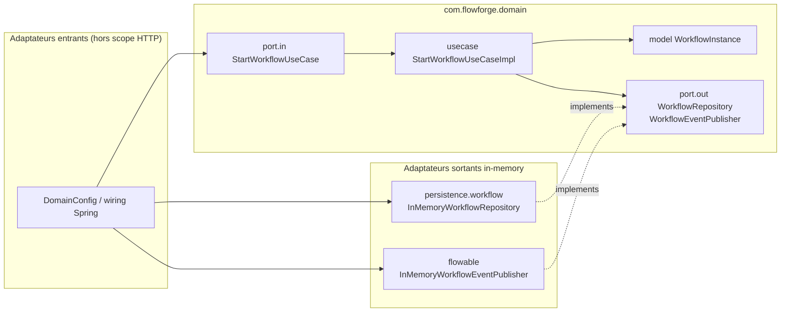

# System Design & Architecture

## Architecture Overview
**What is the high-level system structure?**

Ports & Adapters (hexagone) : le domaine est le centre ; les adaptateurs dépendent du
domaine, jamais l’inverse. Mono-module Maven ; la frontière est appliquée par ArchUnit.



### Responsabilités

| Zone | Rôle |
|---|---|
| `domain.workflow.model` | État métier pur (`record`) |
| `domain.workflow.port.in` | Contrat use case (interface) |
| `domain.workflow.usecase` | Orchestration (`*Impl`) |
| `domain.workflow.port.out` | Persistence / événements (interfaces) |
| `infrastructure.persistence.workflow` | `InMemoryWorkflowRepository` (remplacé plus tard par JPA) |
| `infrastructure.flowable` | `InMemoryWorkflowEventPublisher` (remplacé plus tard par Flowable) |
| `infrastructure.config.DomainConfig` | `@Bean` : use case ← ports out |

### Stack (déjà dans `pom.xml`)

Java 25 · Spring Boot 4.1 · ArchUnit · Lombok — sans activer JPA/Flowable pour cette feature.

## Data Models
**What data do we need to manage?**

Modèle minimal pour la tranche workflow (évolutif dans la feature workflow-engine) :

- `WorkflowInstance` (`record`) : `id`, `processKey`, `tenantId`, `status`
- `WorkflowStatus` : au minimum `RUNNING`, `COMPLETED` (autres valeurs plus tard)
- `StartWorkflowCommand` : `processKey`, `tenantId`
- Événement domaine minimal : `WorkflowStartedEvent(WorkflowInstance)`

Transitions : `WorkflowInstance.create(cmd)` → `RUNNING` ; `complete()` autorisé seulement
depuis `RUNNING`, sinon exception domaine.

Pas de schéma SQL dans cette feature (adaptateurs in-memory).

## API Design
**How do components communicate?**

### Ports entrants

```text
StartWorkflowUseCase
  WorkflowInstance start(StartWorkflowCommand cmd)
```

### Ports sortants

```text
WorkflowRepository
  void save(WorkflowInstance instance)
  Optional<WorkflowInstance> findById(UUID id)

WorkflowEventPublisher
  void publish(WorkflowStartedEvent event)
```

### HTTP / auth

Aucun endpoint REST dans cette feature. Auth N/A.

## Component Breakdown
**What are the major building blocks?**

- **Backend packages** : rename `com.monapp` → `com.flowforge` ; conserver l’arbre documenté
  (domain × 5 contextes ; infrastructure × web/persistence/flowable/pdf/storage/notification/connector/config).
  Hors workflow : `package-info` seulement.
- **Tranche livrée** : workflow domain + in-memory adapters (packages cibles finaux) + `DomainConfig`.
- **ArchUnit** : `ArchitectureRulesTest` sur `com.flowforge`.
- **Frontend / DB / tiers** : hors scope.
- **`CompleteTaskUseCase`** : hors scope ; `WorkflowInstance.complete()` reste pour les tests d’état.

## Design Decisions
**Why did we choose this approach?**

| Décision | Choix | Alternatives écartées |
|---|---|---|
| Périmètre | Socle + câblage + tranche workflow in-memory | Socle seul ; full 5 contextes ; Flowable réel |
| Package | `com.flowforge` | `com.monapp` (doc analyse — rename volontaire) |
| Build | Mono-module + ArchUnit (décision 27) | Module `domain` Maven séparé |
| Modèle domaine | `record` + `@Builder` (décision 17) | Classes mutables / JPA dans le domaine |
| Profondeur | Pas de REST (point 24 différé) | Controller stub ; adaptateur Flowable |
| Naming use case | Interface dans `port.in`, `*Impl` dans `usecase` (décision 9) | `@Service` Spring dans le domaine |

## Non-Functional Requirements
**How should the system perform?**

- **Maintenabilité :** remplacement d’un adaptateur sans toucher au use case.
- **Testabilité :** use cases unitaires < 100 ms, sans Spring context.
- **CI :** `./mvnw test` inclut ArchUnit ; échec = build rouge.
- **Perf / scalabilité / sécu runtime :** N/A pour cette fondation (pas d’IO réseau métier).
