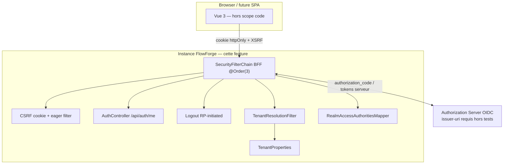
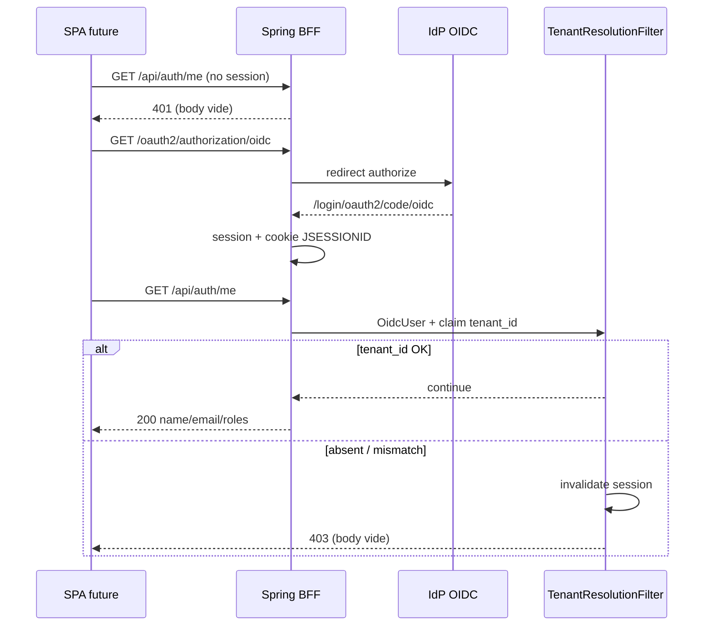
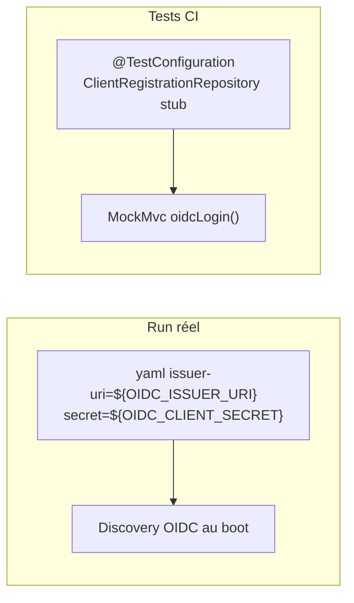

# System Design & Architecture

## Architecture Overview
**What is the high-level system structure?**

Tranche **BFF OIDC + garde tenant** : Spring Boot est BFF (session cookie) et
expose `/api/auth/*`. Pas de resource-server M2M ni chaîne webhooks. Le browser
ne voit jamais le JWT.



### Flux login + /me



### Flux boot OIDC (prod/local vs tests)



### Responsabilités

| Zone | Rôle |
|---|---|
| `infrastructure.security` | `SecurityConfig` — chaîne BFF `@Order(3)`, CSRF eager filter, logout handler, entry point 401 |
| `infrastructure.security.oidc` | `RealmAccessAuthoritiesMapper` (`GrantedAuthoritiesMapper`) |
| `infrastructure.tenant.TenantResolutionFilter` | Skip si anonyme ; sinon vérifie `tenant_id` ; mismatch/absent → **invalidate session + 403** |
| `infrastructure.web.auth.AuthController` | `GET /api/auth/me` |
| `infrastructure.config.SecurityCookieProperties` | `app.security.cookie.secure` (défaut `true`) |
| `application.yml` | Retrait exclusions Security/OAuth2 ; client `registrationId=oidc` ; `forward-headers` ; cookies |
| Tests | Stub `ClientRegistrationRepository` — **pas** de discovery HTTP |

### Stack

Java 25 · Spring Boot 4.1 · Spring Security 7 · OAuth2 Client — **sans**
oauth2-resource-server ; JPA/Flowable/Mail restent exclus.

## Data Models
**What data do we need to manage?**

Pas de persistence métier. Modèles runtime :

| Type | Emplacement | Comportement |
|---|---|---|
| Session HTTP | Servlet container | `JSESSIONID` httpOnly, SameSite=Lax, secure via propriété |
| `OidcUser` | Spring Security | Claims `tenant_id`, `realm_access` |
| `AuthUserResponse` | `web.auth` dto | `name`, `email`, `List<String> roles` (sans `ROLE_`) |
| `SecurityCookieProperties` | config | `boolean secure` défaut `true` |

## API Design
**How do components communicate?**

### Endpoints

| Méthode | Path | Auth | Réponse |
|---|---|---|---|
| GET | `/api/auth/me` | session | 200 `{name,email,roles}` ; **401** anonyme body vide ; **403** tenant body vide (+ session invalidée) |
| POST | `/api/auth/logout` | session + CSRF | RP-initiated logout IdP |
| GET | `/oauth2/authorization/oidc` | public | démarre authorization_code |

Erreurs API : **status HTTP seul**, pas de corps JSON (contrat SPA = codes).

### Configuration (cible)

```yaml
server:
  forward-headers-strategy: framework
  servlet:
    session:
      cookie:
        same-site: lax
        secure: ${app.security.cookie.secure:true}

app:
  tenant:
    id: tenant_dev
  security:
    cookie:
      secure: true   # false en local HTTP

spring:
  security:
    oauth2:
      client:
        registration:
          oidc:
            client-id: ${OIDC_CLIENT_ID:mon-app}
            client-secret: ${OIDC_CLIENT_SECRET}   # requis — pas de défaut
            scope: openid, profile, email
            authorization-grant-type: authorization_code
            provider: oidc
        provider:
          oidc:
            issuer-uri: ${OIDC_ISSUER_URI}         # requis hors tests — pas de défaut localhost
```

Placeholders **sans** valeur par défaut pour `OIDC_ISSUER_URI` / `OIDC_CLIENT_SECRET` :
échec explicite au boot si absents en run réel. Tests : stub repository, pas de
résolution de ces propriétés pour la discovery.

### SecurityFilterChain

| Order | Chaîne | Cette feature |
|---|---|---|
| 1 | M2M resource-server | **Réservé** — non implémenté |
| 2 | Webhooks | **Réservé** — non implémenté |
| 3 | BFF | **Implémenté** |

Chaîne BFF `@Order(3)` :

1. CSRF cookie non-httpOnly + `CsrfTokenRequestAttributeHandler` (pas XOR) + eager-load filter
2. `oauth2Login` + `userAuthoritiesMapper(RealmAccessAuthoritiesMapper)`
3. Logout `/api/auth/logout` + `OidcClientInitiatedLogoutSuccessHandler` (`{baseUrl}/`)
4. `authorizeHttpRequests` : endpoints OAuth2 publics ; reste `authenticated`
5. `AuthenticationEntryPoint` : `/api/**` → **401 body vide** ; sinon redirect login
6. `TenantResolutionFilter` après auth : skip anonyme ; sinon claim `tenant_id` ;
   KO → `session.invalidate()` + **403 body vide**

### Mapping rôles

```text
realm_access.roles: ["WORKFLOW_ADMIN", ...]
        → GrantedAuthority("ROLE_WORKFLOW_ADMIN")
/me.roles → ["WORKFLOW_ADMIN"]  (strip préfixe ROLE_)
```

Hook Spring : `oauth2Login.userInfoEndpoint.userAuthoritiesMapper` (ou équivalent
OIDC user service câblant le même mapper).

### Contrat SPA (doc pour feature `frontend`)

```javascript
axios.defaults.withCredentials = true;
axios.defaults.xsrfCookieName = 'XSRF-TOKEN';
axios.defaults.xsrfHeaderName = 'X-XSRF-TOKEN';
// login : window.location = '/oauth2/authorization/oidc'
// /api/auth/me → 401 = non connecté ; 403 = mauvais tenant (session déjà invalidée)
```

## Component Breakdown
**What are the major building blocks?**

```text
com.flowforge.infrastructure
├── config
│   ├── TenantProperties / TenantConfig     # existants
│   └── SecurityCookieProperties            # nouveau
├── security
│   ├── SecurityConfig                      # @Order(3) BFF chain
│   ├── CsrfCookieEagerLoadFilter
│   ├── ApiAuthenticationEntryPoint         # 401 vide sur /api/**
│   └── oidc.RealmAccessAuthoritiesMapper
├── tenant
│   ├── TenantIdValidator                   # existant
│   └── TenantResolutionFilter              # invalidate + 403
└── web.auth
    ├── AuthController
    └── AuthUserResponse
```

- **Frontend :** hors scope code ; contrat documenté ci-dessus.
- **IdP :** Keycloak (ou autre) via `issuer-uri` — hors CI.
- **Inchangé :** `DomainConfig`, domaine workflow, exclusions JPA/Flowable.
- **Hors scope code :** M2M, webhooks chain, `@PreAuthorize`, Spring Session, Pinia.

## Design Decisions
**Why did we choose this approach?**

| Décision | Choix | Alternatives écartées |
|---|---|---|
| Pattern | BFF + session cookie | JWT dans SPA |
| Périmètre | Tranche A+ | BFF only ; analyse + M2M |
| `registrationId` | `oidc` | `keycloak` (analyse) |
| Non-auth API | 401 body vide | Toujours redirect ; JSON problem+json |
| Erreurs API | Status seul | Corps JSON / RFC 7807 |
| Rôles | `realm_access` → `ROLE_*` | Différer ; sans préfixe |
| Boot OIDC | `issuer-uri` réel + stub tests | Endpoints explicites partout ; profil `oidc` |
| Secrets / issuer | Placeholders **requis** sans défaut | Défauts localhost |
| Ordre chaînes | BFF `@Order(3)` | Ordre défaut ; stubs 1–2 |
| Tenant KO | Invalidate session + 403 | 403 seul ; RP-logout immédiat |
| Cookie secure | `app.security.cookie.secure` | Toujours true / toujours false |
| Proxy | `forward-headers` ON | Tout commenté |

### Alternatives revalidées (phase 3)

- Discovery OIDC aussi en tests : rejette — casse CI sans IdP.
- Défaut `issuer-uri` localhost : rejette — masque une mauvaise config ops.
- BFF sans `@Order` : acceptable mais écarté — alignement analyse / futures chaînes.
- JSON d’erreur riche : différé — SPA se base sur les status.
- Garder la session après tenant mismatch : rejette — session zombie.
- `RealmAccessRolesConverter` JWT resource-server : hors scope (pas de RS) ;
  mapper `GrantedAuthoritiesMapper` côté login OIDC.

## Non-Functional Requirements
**How should the system perform?**

- **Sécurité :** pas de JWT browser ; CSRF double-submit ; claim `tenant_id`
  obligatoire post-auth ; secrets via env ; cookies `Secure` en prod.
- **Testabilité :** suite verte sans IdP (stub + `oidcLogin()`) ; ArchUnit domaine
  sans Security.
- **Ops :** fail-fast si `OIDC_ISSUER_URI` / `OIDC_CLIENT_SECRET` absents hors tests ;
  callbacks OAuth corrects derrière proxy (`forward-headers`).
- **Compatibilité :** ne pas activer `context-path` ; ne pas retirer exclusions
  JPA/Flowable ; ne pas casser tests workflow / tenant existants.
- **Rollout :** PR `feature-authentification` ; Keycloak réel optionnel en local.
- **Scale :** session mémoire ; multi-répliques hors scope (décision n° 13 / 15).
- **Perf :** N/A — filtres O(1) sur claims.

## Écarts vs `docs/specs/03-authentification.md`

| Analyse | Cette feature |
|---|---|
| `registrationId` / URL `keycloak` | **`oidc`** |
| 3 chaînes implémentées | BFF `@Order(3)` seule ; 1–2 réservés |
| Exemple Pinia | Doc contrat seulement |
| Resource server connectors | Hors scope |
| Défauts yaml IdP implicites | **Pas de défaut** issuer/secret |

## Requirements coverage (phase 3)

| Exigence | Couverture design |
|---|---|
| Retrait exclusions Security/OAuth2 | Stack + yaml + components |
| Chaîne BFF oauth2Login + CSRF + logout | SecurityFilterChain |
| `GET /api/auth/me` | API + AuthController |
| 401 sur `/api/**` | Entry point + API (body vide) |
| `registrationId=oidc` | API config + SPA contrat |
| Mapper `realm_access` → `ROLE_*` ; JSON sans préfixe | Mapping rôles + `/me` |
| `TenantResolutionFilter` 403 | Filtre + invalidate session |
| `forward-headers` ON ; path commenté | yaml |
| Cookie secure configurable | SecurityCookieProperties |
| Tests sans IdP | Boot diagram + stub repository |
| Non-goals M2M / webhooks / SPA / RBAC | Component hors scope |
| Contrat SPA secondaire | Section contrat SPA |
| Préparer chaînes futures | `@Order(3)` + table orders |

## Review notes (phase 3)

| Point | Résolution |
|---|---|
| Template design README | Sections overview, models, API, components, decisions, NFR |
| Boot OIDC vs CI | **issuer-uri réel + ClientRegistrationRepository stub en tests** |
| `@Order` BFF | **`@Order(3)`** ; 1–2 réservés documentés |
| Variables OIDC | **Requis sans défaut** (`OIDC_ISSUER_URI`, `OIDC_CLIENT_SECRET`) |
| Corps 401/403 | **Vides** — status seul |
| Session tenant KO | **Invalidate + 403** |
| Naming mapper | **`RealmAccessAuthoritiesMapper`** (plus de « Converter » ambigu) |
| Couverture requirements | Table ci-dessus — goals / success criteria couverts |
| Retour requirements | Aucun gap bloquant |

- Aucune question d’architecture ouverte pour la tranche A+.
- **Lifecycle tranche A+ :** phases 1–9 terminées — prêt à merger.
