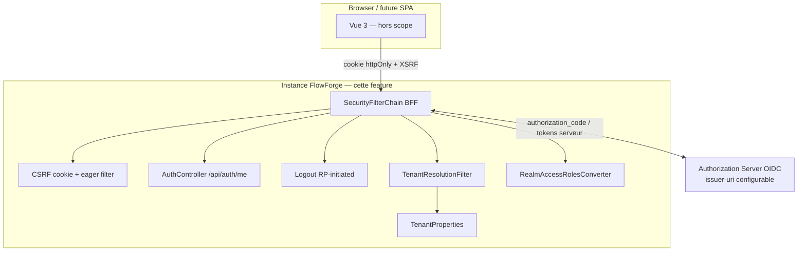
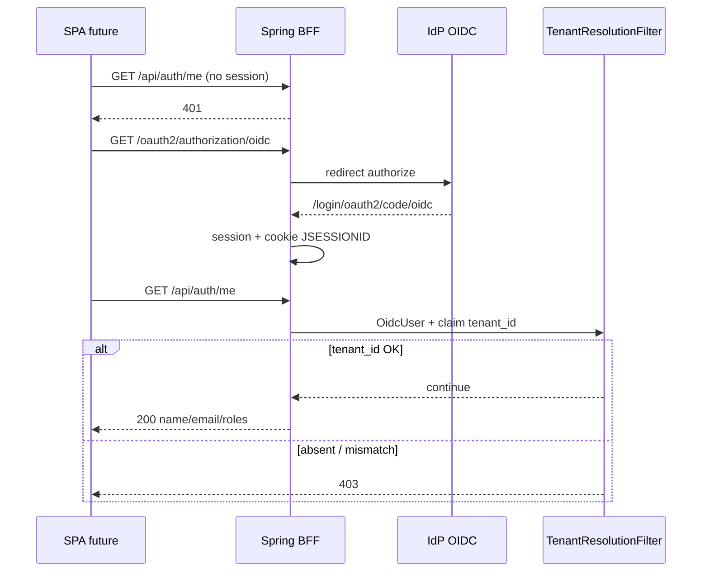

# System Design & Architecture

## Architecture Overview
**What is the high-level system structure?**

Tranche **BFF OIDC + garde tenant** : Spring Boot est BFF (session cookie) et
expose `/api/auth/*`. Pas de resource-server M2M ni chaîne webhooks dans cette
feature. Le browser ne voit jamais le JWT.



### Flux login + /me



### Responsabilités

| Zone | Rôle |
|---|---|
| `infrastructure.security` (nouveau) | `SecurityConfig` / `SecurityFilterChain` BFF, CSRF eager filter, logout handler, entry points |
| `infrastructure.security.oidc` | Converter `realm_access.roles` → `ROLE_*` |
| `infrastructure.tenant.TenantResolutionFilter` | 403 si claim `tenant_id` ≠ `TenantProperties.id()` |
| `infrastructure.web.AuthController` | `GET /api/auth/me` |
| `infrastructure.config` | `SecurityCookieProperties` (`app.security.cookie.secure`) ; `TenantProperties` inchangé |
| `application.yml` | Retrait exclusions Security/OAuth2 ; OAuth2 client `registrationId=oidc` ; `forward-headers-strategy` ; cookies |

### Stack

Java 25 · Spring Boot 4.1 · Spring Security 7 · OAuth2 Client — **sans**
oauth2-resource-server, sans DataSource/JPA/Flowable (exclusions conservées).

## Data Models
**What data do we need to manage?**

Pas de persistence métier. Modèles runtime :

| Type | Emplacement | Comportement |
|---|---|---|
| Session HTTP | Servlet container | Cookie `JSESSIONID` httpOnly, SameSite=Lax, secure configurable |
| `OidcUser` | Spring Security | Identité + claims (`tenant_id`, `realm_access`) |
| `AuthUserResponse` | web/dto | `name`, `email`, `List<String> roles` (sans `ROLE_`) |
| `SecurityCookieProperties` | config | `boolean secure` (défaut `true`) |

## API Design
**How do components communicate?**

### Endpoints

| Méthode | Path | Auth | Réponse |
|---|---|---|---|
| GET | `/api/auth/me` | session | 200 `{name,email,roles}` ; 401 anonyme ; 403 tenant |
| POST | `/api/auth/logout` | session + CSRF | RP-initiated logout IdP |
| GET | `/oauth2/authorization/oidc` | public | démarre authorization_code |

### Configuration (cible)

```yaml
server:
  forward-headers-strategy: framework
  servlet:
    session:
      cookie:
        same-site: lax
        secure: ${app.security.cookie.secure:true}

app:
  tenant:
    id: tenant_dev
  security:
    cookie:
      secure: true   # false en local HTTP

spring:
  security:
    oauth2:
      client:
        registration:
          oidc:
            client-id: ${OIDC_CLIENT_ID:mon-app}
            client-secret: ${OIDC_CLIENT_SECRET:}
            scope: openid, profile, email
            authorization-grant-type: authorization_code
        provider:
          oidc:
            issuer-uri: ${OIDC_ISSUER_URI:https://localhost/realms/flowforge}
```

### SecurityFilterChain (ordre)

Une seule chaîne dans cette tranche (`@Order` bas / défaut) :

1. CSRF cookie non-httpOnly + `CsrfTokenRequestAttributeHandler` (pas XOR) + filtre eager-load
2. `oauth2Login` defaults (`registrationId=oidc`)
3. Logout `/api/auth/logout` + `OidcClientInitiatedLogoutSuccessHandler` (`{baseUrl}/`)
4. `authorizeHttpRequests` : endpoints OAuth2 login publics ; reste `authenticated`
5. `AuthenticationEntryPoint` : `/api/**` → 401 ; sinon redirect login
6. `TenantResolutionFilter` après authentification (skip si anonyme)

### Mapping rôles

```text
ID token / userinfo claim realm_access.roles: ["WORKFLOW_ADMIN", ...]
        → GrantedAuthority("ROLE_WORKFLOW_ADMIN")
/me.roles → ["WORKFLOW_ADMIN"]  (strip ROLE_)
```

## Components
**Packages (cible)**

```text
com.flowforge.infrastructure
├── config
│   ├── TenantProperties          # existant
│   ├── TenantConfig              # existant
│   └── SecurityCookieProperties  # nouveau
├── security
│   ├── SecurityConfig
│   ├── CsrfCookieEagerLoadFilter
│   ├── ApiAuthenticationEntryPoint
│   └── oidc
│       └── RealmAccessAuthoritiesMapper
└── tenant
    ├── TenantIdValidator         # existant
    └── TenantResolutionFilter    # nouveau
com.flowforge.infrastructure.web
└── AuthController
```

Le domaine (`domain.*`) **n’importe pas** Spring Security.

## Design Decisions

| Décision | Choix | Pourquoi |
|---|---|---|
| Pattern auth | BFF + session cookie | Pas de JWT browser (XSS) |
| Périmètre | Tranche A+ (sans M2M) | Ferme contrat tenant ; évite dépendre connecteurs |
| `registrationId` | `oidc` | URL neutre ; provider via `issuer-uri` |
| Non-auth API | 401 | Contrat SPA `/me` |
| Rôles | `realm_access` → `ROLE_*` | Compatible futur `hasRole` |
| Tests | Mock OIDC | CI sans Keycloak |
| Headers proxy | `forward-headers` ON | Callbacks OAuth derrière path tenant |
| Cookie secure | Propriété | HTTP local vs HTTPS prod |

## Security Considerations

- Cookie session httpOnly ; CSRF double-submit pour mutations.
- Tokens OIDC restent côté serveur (session client OAuth2).
- Claim `tenant_id` obligatoire post-auth (décision n° 2 / 14).
- Secrets IdP via env (`OIDC_CLIENT_SECRET`, `OIDC_ISSUER_URI`).
- `secure` cookies en prod ; ne jamais committer de secret.

## Performance

N/A critique — filtre O(1) sur claims ; session mémoire locale.

## Écarts vs `analysis doc/03-authentification.md`

| Analyse | Cette feature |
|---|---|
| `registrationId` / URL `keycloak` | **`oidc`** |
| 3 chaînes (M2M, webhooks, BFF) | **BFF seule** |
| Exemple Pinia | Hors scope (`frontend`) |
| Resource server connectors | Hors scope |
