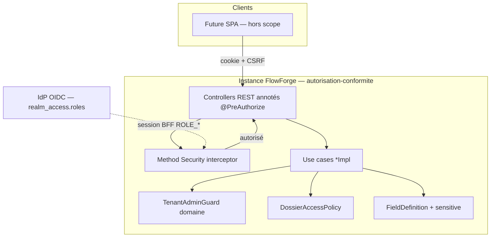
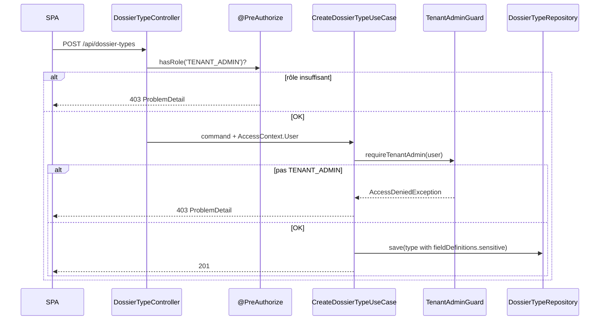
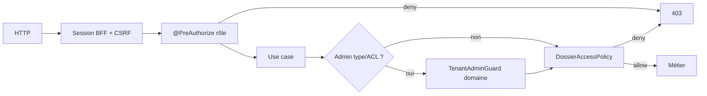

# System Design & Architecture

## Architecture Overview
**What is the high-level system structure?**

Tranche **autorisation-conformite** : method security au bord HTTP, garde
admin factorisée dans le domaine, flag `FieldDefinition.sensitive`
(métadonnée). Pas de nouveau bounded context — durcissement des couches
existantes `dossier` / `workflow` / security.



### Flux admin type (double garde)



### Couches authz (cible)



### Stack

Java 25 · Spring Boot 4.1 · Spring Security 7 (`@EnableMethodSecurity`) ·
domaine pur · JPA JSON `fieldDefinitions` · H2 IT · ArchUnit.

### Responsabilités

| Zone | Rôle |
|---|---|
| `domain.dossier.TenantAdminGuard` (nouveau) | `requireTenantAdmin(AccessContext.User)` — Java pur |
| `domain.dossier.DossierAccessPolicy` | Inchangé (VIEW/EDIT / bypass / Service) |
| `domain.dossier.model.FieldDefinition` | + `boolean sensitive` (défaut false) |
| Controllers `infrastructure.web.*` | `@PreAuthorize` ; plus d’appel au guard infra |
| `infrastructure.web.dossier.TenantAdminGuard` | **Supprimé** après bascule |
| Security config | `@EnableMethodSecurity` sur config existante |
| Advice / handlers | Mapper refus method security + domaine → 403 ProblemDetail |

## Data Models
**What data do we need to manage?**

### `FieldDefinition` (évolution)

```java
public record FieldDefinition(
    String name,
    String label,
    FieldType type,
    boolean required,
    String defaultValue,
    List<String> options,
    String group,
    boolean sensitive  // NEW — défaut false
) {}
```

| Règle | Détail |
|---|---|
| Défaut | `false` si omis (compact ctor / désérialisation JSON) |
| Persistance | Inclus dans le document JSON `dossier_type.field_definitions` — **pas** de changeset SQL colonne |
| Validation champs | `DossierFieldValidator` **ignore** `sensitive` (pas d’effet sur required/type) |
| Lecture dossier | Valeurs **en clair** même si `sensitive=true` (V1) |

### Rôles V1 (point 19 — clos)

| Rôle | Autorité Spring | Portée typique |
|---|---|---|
| `TENANT_ADMIN` | `ROLE_TENANT_ADMIN` | Config types, ACL, templates futurs |
| `WORKFLOW_ADMIN` | `ROLE_WORKFLOW_ADMIN` | Config workflow, tâches admin ; bypass ACL type |
| `DOSSIER_MANAGER` | `ROLE_DOSSIER_MANAGER` | Mutation dossiers si grant EDIT |
| `DOSSIER_VIEWER` | `ROLE_DOSSIER_VIEWER` | Lecture si grant VIEW |
| `API_SERVICE` | `ROLE_API_SERVICE` | M2M connecteurs (hors endpoints dossier) |

### Stockage objet (contrainte doc — hors code)

Aucun modèle livré ici. Cible future : port abstrait (ex. `ObjectStoragePort`)
avec adaptateurs **S3** (primaire) et **filesystem** ; **interdit** de coupler
le domaine à MinIO.

## API Design
**How do components communicate?**

### Matrice `@PreAuthorize` (controllers existants)

| Surface | Annotation cible | Notes |
|---|---|---|
| `POST/PATCH /api/dossier-types` | `hasRole('TENANT_ADMIN')` | Remplace `TenantAdminGuard` infra |
| `POST/DELETE …/acl` | `hasRole('TENANT_ADMIN')` | Idem |
| `GET /api/dossier-types`, `GET …/{code}` | authentifié (chaîne BFF) ; pas de rôle admin obligatoire | Filtrage ACL / bypass dans use case |
| `POST/GET/PATCH /api/dossiers/**` | authentifié ; pas de `@PreAuthorize` rôle métier unique | `DossierAccessPolicy` décide |
| Workflow type-config mutateurs | `hasAnyRole('TENANT_ADMIN','WORKFLOW_ADMIN')` | Aligner le check manuel actuel |
| Complete task / start workflow | authentifié + policy dossier selon design workflow déjà livré | Annoter si un rôle minimum est déjà implicite ; sinon rester sur policy |

Les expressions utilisent `hasRole` / `hasAnyRole` (préfixe `ROLE_` géré par
Spring).

### Contrat `FieldDefinition` JSON

```json
{
  "name": "ssn",
  "label": "N° sécu",
  "type": "STRING",
  "required": false,
  "defaultValue": null,
  "options": [],
  "group": null,
  "sensitive": true
}
```

`sensitive` omis → `false`. Aucun nouvel endpoint.

### Erreurs

| Cause | HTTP | Corps |
|---|---|---|
| Method security deny | 403 | `ProblemDetail` (handler Spring / advice projet) |
| `AccessDeniedException` domaine | 403 | Déjà mappé (point 24 partiel) |
| Non authentifié `/api/**` | 401 | Inchangé (BFF) |

## Component Breakdown
**What are the major building blocks?**

1. **Security config** — `@EnableMethodSecurity` (proxy mode défaut OK).
2. **Domain `TenantAdminGuard`** — remplace les `requireTenantAdmin` privés
   dupliqués dans create/update type, grant/revoke.
3. **Controllers** — annotations + suppression injections guard infra.
4. **`FieldDefinition` + mappers/DTO/tests** — 8e composant du record ;
   mise à jour constructeurs tests.
5. **Exception bridging** — vérifier qu’un refus `@PreAuthorize` ne remonte
   pas en 500 ; aligner avec advice existant si besoin
   (`AuthorizationDeniedException` / AccessDenied Spring).
6. **Docs TODO / DEFERRED** — §19 clos, §23 partiel ; note stockage.

### Frontend

Hors scope. La SPA lira `sensitive` pour UX future (badge, masquage client) —
non imposé ici.

## Design Decisions
**Why did we choose this approach?**

| ID | Décision | Alternatives écartées |
|---|---|---|
| D-SCOPE | Authz + `sensitive` meta ; pas §21–22 | Tranche conformité complète (bloque sur storage) |
| D-ROLES | 5 rôles V1 figés | Fusion WORKFLOW→TENANT ; rôles additionnels |
| D-PRE | `@PreAuthorize` controllers only | Annoter use cases ; tout SpEL+policy |
| D-SENS | Flag meta, pas de masquage | Masquage non-admin ; masquage strict admin-only |
| D-GUARD | Guard domaine + HTTP annotations | Double garde non factorisée ; controller seul |
| D-STORE | Doc S3/FS anti-MinIO, pas de port code | Skeleton port ; adaptateur FS no-op |

### Patterns

- Hexagonal : authz rôle au bord ; règles ACL dans le domaine.
- Défense en profondeur admin : HTTP + domaine.
- Évolution JSON document plutôt que migration colonnaire.

## Non-Functional Requirements
**How should the system perform?**

- **Security :** refus rôle avant métier ; pas d’élévation via body ; Service
  M2M toujours refusé sur dossiers.
- **Compat :** types JSON existants sans `sensitive` restent valides (`false`).
- **Reliability :** aucune nouvelle dépendance runtime ; pas d’IO objet.
- **Observability :** pas de nouveau MDC imposé (TODO §29 hors scope) ;
  403 déjà visibles côté HTTP.
- **Performance :** négligeable (checks mémoire / SpEL method security).
