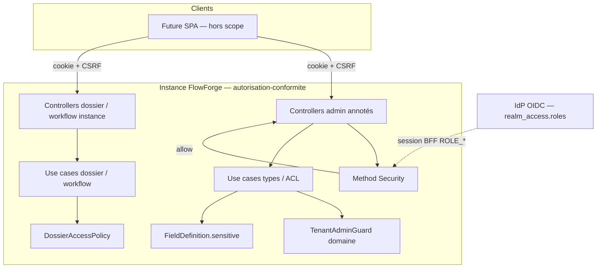
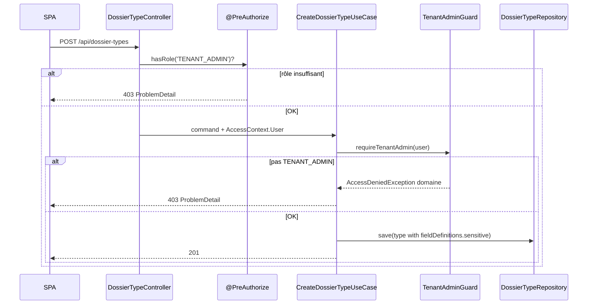
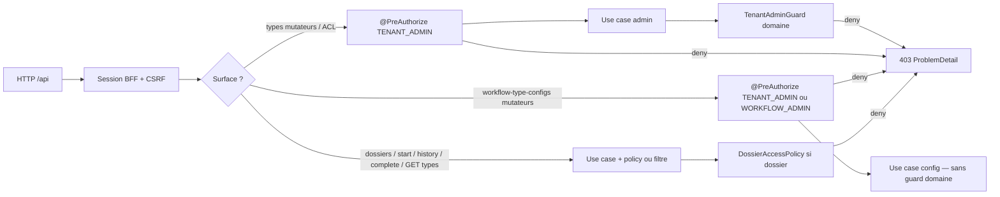

# System Design & Architecture

## Architecture Overview
**What is the high-level system structure?**

Tranche **autorisation-conformite** alignée requirements `reviewed`
(surface livrable + Q7–Q9) : method security au bord HTTP sur les surfaces
**admin**, garde `TenantAdminGuard` domaine pour types/ACL, flag
`FieldDefinition.sensitive` (métadonnée). Pas de nouveau bounded context.



### Flux admin type (double garde)



### Couches authz (cible — trois chemins)



### Stack

Java 25 · Spring Boot 4.1 · Spring Security 7 (`@EnableMethodSecurity`) ·
domaine pur · JPA JSON `fieldDefinitions` · H2 IT · ArchUnit · BFF existant
(`SecurityConfig`).

### Responsabilités

| Zone | Rôle |
|---|---|
| `domain.dossier.TenantAdminGuard` (nouveau) | `requireTenantAdmin(AccessContext.User)` → `AccessDeniedException` domaine |
| `domain.dossier.DossierAccessPolicy` | Inchangé (VIEW/EDIT / bypass / Service) |
| `domain.dossier.model.FieldDefinition` | + `boolean sensitive` (défaut false) |
| `DossierConfig` | Bean `TenantAdminGuard` injecté dans use cases admin |
| Controllers admin types/ACL | `@PreAuthorize("hasRole('TENANT_ADMIN')")` ; plus de guard infra |
| `WorkflowTypeConfigController` | `@PreAuthorize("hasAnyRole('TENANT_ADMIN','WORKFLOW_ADMIN')")` sur mutateurs ; **supprimer** `requireWorkflowAdmin` |
| Controllers dossiers + `DossierWorkflow*` + `WorkflowTask*` | **Aucune** annotation rôle ; ACL via `DossierAccessPolicy` / `DossierAccessGuard` (PR #18) |
| `infrastructure.web.dossier.DossierAccessGuard` | **Existant (PR #18)** — `requireViewable` / `requireEditable` ; à **conserver** (ne pas réintroduire le couple find+assert dupliqué) |
| `infrastructure.web.dossier.TenantAdminGuard` | **Supprimé** |
| `SecurityConfig` | Ajouter `@EnableMethodSecurity` |
| Advice method security | Bridging Spring deny → 403 ProblemDetail (voir D-403) |

## Data Models
**What data do we need to manage?**

### `FieldDefinition` (évolution)

```java
public record FieldDefinition(
    String name,
    String label,
    FieldType type,
    boolean required,
    String defaultValue,
    List<String> options,
    String group,
    boolean sensitive
) {
    // Constructeur de confort (call sites Java existants) :
    // déléguer au canonique avec sensitive=false
}
```

| Règle | Détail |
|---|---|
| Défaut Java | Constructeur / factory sans `sensitive` → `false` |
| Défaut JSON | Propriété absente → `false` (boolean primitif Jackson) ; `null` évité (primitif) |
| Persistance | Document JSON `field_definitions` — **pas** de changeset SQL colonne |
| Validation | `DossierFieldValidator` **ignore** `sensitive` |
| Écriture API | Uniquement via create/update type (`TENANT_ADMIN`) |
| Lecture dossier | Valeurs **en clair** si `sensitive=true` (V1) |

### Rôles V1 (point 19 — clos)

| Rôle | Autorité Spring | Portée typique |
|---|---|---|
| `TENANT_ADMIN` | `ROLE_TENANT_ADMIN` | Config types, ACL ; aussi workflow-config |
| `WORKFLOW_ADMIN` | `ROLE_WORKFLOW_ADMIN` | Workflow-config ; bypass ACL type ; **pas** CRUD types/ACL |
| `DOSSIER_MANAGER` | `ROLE_DOSSIER_MANAGER` | Mutation dossiers **si** grant EDIT |
| `DOSSIER_VIEWER` | `ROLE_DOSSIER_VIEWER` | Lecture **si** grant VIEW |
| `API_SERVICE` | `ROLE_API_SERVICE` | M2M connecteurs (hors endpoints dossier) |

### Stockage objet (contrainte doc — hors code)

Port abstrait futur (ex. `ObjectStoragePort`) : adaptateur **S3** primaire,
**filesystem** alternatif ; **interdit** de coupler le domaine à MinIO.
Aucun type / bean dans cette tranche.

## API Design
**How do components communicate?**

### Matrice authz (alignée requirements — surface livrable)

| Surface | `@PreAuthorize` | Garde domaine / policy |
|---|---|---|
| `POST` / `PATCH /api/dossier-types` | `hasRole('TENANT_ADMIN')` | `TenantAdminGuard` |
| `POST` / `DELETE …/acl…` | `hasRole('TENANT_ADMIN')` | `TenantAdminGuard` |
| `GET /api/dossier-types`, `GET …/{code}` | *(aucune)* — session BFF | Filtrage / `DossierAccessPolicy` use case |
| `POST` / `GET` / `PATCH /api/dossiers/**` | *(aucune)* | `DossierAccessPolicy` |
| `POST` / `PATCH /api/workflow-type-configs` | `hasAnyRole('TENANT_ADMIN','WORKFLOW_ADMIN')` | *(aucune — use case sans AccessContext)* |
| `GET /api/workflow-type-configs` (+ `/{key}`) | *(aucune)* — session BFF | — |
| `POST /api/dossiers/{id}/workflows` | *(aucune)* | `DossierAccessGuard.requireEditable` |
| `GET /api/dossiers/{id}/workflows` | *(aucune)* | `DossierAccessGuard.requireViewable` |
| `POST /api/workflow-tasks/{id}/complete` | *(aucune)* | `DossierAccessGuard.requireEditable` |

SpEL : `hasRole` / `hasAnyRole` (préfixe `ROLE_` géré par Spring).

### Contrat `FieldDefinition` JSON

```json
{
  "name": "ssn",
  "label": "N° sécu",
  "type": "STRING",
  "required": false,
  "defaultValue": null,
  "options": [],
  "group": null,
  "sensitive": true
}
```

`sensitive` omis → `false`. Aucun nouvel endpoint.

### Erreurs

| Cause | Type Java typique | HTTP | Corps |
|---|---|---|---|
| Method security deny | `AuthorizationDeniedException` et/ou `org.springframework.security.access.AccessDeniedException` | 403 | `ProblemDetail` via advice dédié (D-403) |
| Guard / policy deny | `com.flowforge.domain.dossier.model.AccessDeniedException` | 403 | Handlers dossier/workflow **existants** |
| Non authentifié `/api/**` | entry point BFF | 401 | Inchangé (body vide) |

## Component Breakdown
**What are the major building blocks?**

```text
domain/dossier
├── TenantAdminGuard                    # NEW
├── DossierAccessPolicy                 # inchangé
├── model/FieldDefinition               # + sensitive
└── usecase/*Type* *Acl*                # injecte TenantAdminGuard

infrastructure
├── security/SecurityConfig             # + @EnableMethodSecurity
├── web/security/MethodSecurityExceptionHandler  # NEW — 403 ProblemDetail
├── web/dossier/*Controller             # @PreAuthorize ; - TenantAdminGuard infra
├── web/workflow/WorkflowTypeConfigController    # @PreAuthorize ; - requireWorkflowAdmin
└── config/DossierConfig                # bean TenantAdminGuard
```

1. **Security config** — `@EnableMethodSecurity` sur `SecurityConfig` (ou
   méta-config adjacente).
2. **Domain `TenantAdminGuard`** — Java pur ; bean Spring via `DossierConfig`.
3. **Controllers** — annotations selon matrice ; suppression guard infra +
   `requireWorkflowAdmin`.
4. **`FieldDefinition`** — 8e composant + ctor confort `sensitive=false` ;
   mise à jour call sites / tests.
5. **D-403 bridging** — `@RestControllerAdvice` package web (ou security)
   mappant les exceptions d’autorisation **Spring** → 403 ProblemDetail
   (`title`/`detail` stables pour les tests). Ne pas casser les handlers
   domaine existants (types FQCN distincts).
6. **Docs TODO / DEFERRED** — §19 clos ; §23 partiel ; note S3/FS.

### Frontend

Hors scope. La SPA pourra lire `sensitive` plus tard — non imposé.

## Design Decisions
**Why did we choose this approach?**

| ID | Décision | Alternatives écartées |
|---|---|---|
| D-SCOPE | Authz + `sensitive` meta ; pas §21–22 | Conformité complète |
| D-ROLES | 5 rôles V1 figés | Fusion WORKFLOW→TENANT ; rôles + |
| D-PRE | `@PreAuthorize` controllers only | Annoter use cases ; SpEL+policy |
| D-SENS | Flag meta, pas de masquage | Masquage non-admin / strict |
| D-GUARD | Guard domaine types/ACL + HTTP | Controller seul ; double garde non factorisée |
| D-WF-CFG | HTTP `hasAnyRole` seul sur mutateurs config | Guard domaine workflow-admin |
| D-WF-INST | Pas de `@PreAuthorize` rôle sur start/history/complete | Rôle minimum HTTP |
| D-DOS-ROLE | MANAGER/VIEWER via ACL EDIT/VIEW | `@PreAuthorize` par rôle dossier |
| D-STORE | Doc S3/FS anti-MinIO, pas de port code | Skeleton port ; FS no-op |
| D-403 | Advice Spring authz → ProblemDetail 403 | AccessDeniedHandler filter-only ; 500 défaut ; JSON ad hoc |
| D-SENS-DEF | `boolean` + ctor confort `false` | `Boolean` nullable ; migration SQL |

### Alternatives revalidées (phase 3)

- Annoter start/complete avec `DOSSIER_MANAGER` : **rejeté** — casse bypass
  admin et ignore l’ACL type (Q7).
- Guard domaine pour workflow-config : **différé** — use cases sans
  `AccessContext` (Q8).
- `@PreAuthorize` MANAGER vs VIEWER sur `PATCH …/status` : **rejeté** — la
  sémantique est le grant EDIT (Q9).
- `AccessDeniedHandler` seul sur la filter chain : **insuffisant** pour les
  denials method security levés dans le dispatcher — advice MVC requis (D-403).
- Colonne SQL `sensitive` : **rejeté** — déjà dans JSON document.

### Patterns

- Hexagonal : rôle HTTP au bord ; ACL dans le domaine.
- Défense en profondeur **uniquement** sur types/ACL (HTTP + domaine).
- Évolution JSON document plutôt que migration colonnaire.

## Non-Functional Requirements
**How should the system perform?**

- **Security :** refus rôle admin avant métier ; pas d’élévation via body ;
  Service M2M toujours refusé sur dossiers ; 401 vs 403 préservés.
- **Compat :** types JSON sans `sensitive` → `false` ; call sites Java via ctor
  confort.
- **Testabilité :** MockMvc `oidcLogin()` + autorités `ROLE_*` ; assert 403
  ProblemDetail method security ; assert valeur dossier en clair.
- **Reliability :** aucune nouvelle dépendance runtime ; pas d’IO objet.
- **Observability :** pas de nouveau MDC (TODO §29 hors scope).
- **Performance :** négligeable.
- **Rollout :** branche `cursor/autorisation-conformite-f54c` / PR ; pas de
  feature flag.

## Coverage vs requirements

| Requirements | Design |
|---|---|
| Point 19 / 5 rôles | Table rôles V1 |
| `@EnableMethodSecurity` + surface livrable | Matrice API + composants |
| `TenantAdminGuard` domaine + suppression infra | Responsabilités + breakdown |
| Workflow-config annotation / - manuel | D-WF-CFG + matrice |
| Pas de rôle HTTP sur dossiers / start/complete | D-WF-INST / D-DOS-ROLE |
| `sensitive` meta, écriture TENANT_ADMIN | Data model + API |
| 403 ProblemDetail double source | Table erreurs + D-403 |
| Contrainte S3/FS anti-MinIO | Section stockage |
| Non-goals §21–22 / port / masquage | D-SCOPE / D-SENS / D-STORE |
| Tests MockMvc / Jacoco / ArchUnit | NFR testabilité |

**Écarts requirements non couverts :** aucun bloquant.

## Review notes (phase 3)

| Point | Résolution |
|---|---|
| Matrice draft « annoter si… » start/complete | Remplacée par **aucune** annotation (Q7 / D-WF-INST) |
| Diagramme couches unique `@PreAuthorize` | Refait en **trois chemins** |
| Asymétrie workflow-config | Documentée D-WF-CFG |
| Bridging 403 method security | **D-403** advice Spring authz |
| Défaut `sensitive` | **D-SENS-DEF** boolean + ctor confort |
| Template README | Sections + coverage + review notes |
| Questions architecture bloquantes | **Aucune** |

### Intégration main (PR #18 — 2026-08-03)

Avant phase 5 : `origin/main` fusionné (`fix(workflow): TX2 atomique +
simplifications`). Impacts utiles pour cette feature :

- **`DossierAccessGuard`** factorise load+ACL sur start/history/complete —
  T5 ne doit **pas** le défaire.
- Exceptions typées not-found workflow (`WorkflowTypeConfigNotFoundException`,
  etc.) — handlers déjà alignés ; D-403 reste centré sur les denials **Spring**.
- `requireWorkflowAdmin` toujours présent sur type-config — cible T5 inchangée.

**Prochaine phase :** exécution du plan (phase 5) — planning `ready`.
