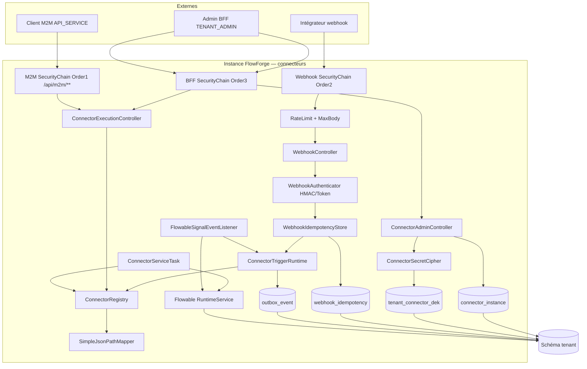
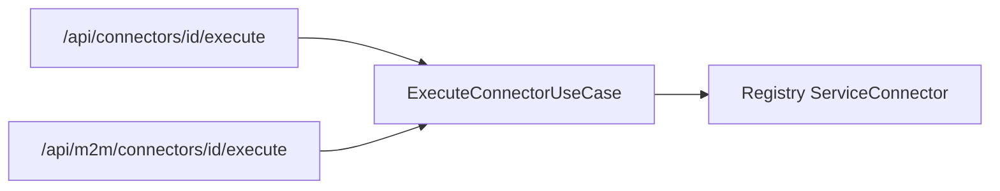

# System Design & Architecture

## Architecture Overview
**What is the high-level system structure?**

Tranche **connecteurs** alignée requirements `reviewed` + décisions phase 3
(DD-EXECUTE-ROUTE, DD-SIGNAL-HOOK, DD-JSONPATH, DD-NAME-UQ) : registry,
instances chiffrées, webhooks `http-rest`, `flowable-signal` TRIGGER/SERVICE,
outbox producteur, chaînes Security M2M + webhook + BFF.



### Stack

Java 25 · Spring Boot 4.1 · Flowable 8 · Spring Security (3 chaînes) ·
`spring-boot-starter-oauth2-resource-server` (**à ajouter** pour M2M) ·
Spring Data JPA · Liquibase · H2 MODE=PostgreSQL IT · ArchUnit.
**Pas** de dépendance Jayway JsonPath (DD-JSONPATH).

### Responsabilités

| Zone | Rôle |
|---|---|
| `domain.connector` | Models, ports in/out, use cases admin + trigger + execute |
| `infrastructure.connector.registry` | `ConnectorRegistry` + discovery |
| `infrastructure.connector.builtin` | `http-rest`, `flowable-signal` + `SimpleJsonPathMapper` |
| `infrastructure.persistence.connector` | JPA + cipher + soft-delete filters |
| `infrastructure.web.connector` | Webhook / admin / execute (dual mapping) |
| `infrastructure.security` | M2M `@Order(1)` `/api/m2m/**`, webhook `@Order(2)`, BFF `@Order(3)` |
| `infrastructure.flowable` | `ConnectorServiceTask` + `FlowableSignalEventListener` |

---

## Data Models

### Domaine

```text
ConnectorInstanceData(id, tenantId, name, connectorType, enabled, config)
  // deletedAt = concern persistence ; repos ne renvoient pas soft-deleted
  // sauf findIncludingDeleted pour PATCH restore
WorkflowTriggerEvent(processKey, dossierTypeCode, dossierFields, variables,
                     existingDossierReference?)
ConfigField(name, label, type, required, defaultValue, options, helpText)
WebhookAuthType: HMAC_SHA256 | SHARED_SECRET_TOKEN
```

`config` (`http-rest` / signal) :

| Clé | Rôle |
|---|---|
| `webhookAuthType` | `HMAC_SHA256` \| `SHARED_SECRET_TOKEN` |
| `webhookSecret` | PASSWORD |
| `processKey` / `dossierTypeCode` | Défauts create |
| `mapping` | Objet déclaratif DD-MAP |
| `signalName` | `flowable-signal` |

### Mapping — **DD-MAP** + **DD-JSONPATH**

Schéma inchangé (requirements D-DEFAULTS). Résolution chemins :
**parser minimal maison** — `$`, `.field`, `[n]` uniquement ; pas de filtres
`?(...)`, ni scripts.

### Persistance

| Table | Colonnes / contraintes |
|---|---|
| `connector_instance` | id, tenant_id, name, connector_type, enabled, config jsonb, deleted_at, created_at, updated_at ; **unique partiel** `(tenant_id, name) WHERE deleted_at IS NULL` (**DD-NAME-UQ**) |
| `tenant_connector_dek` | tenant_id PK, dek_wrapped, key_version, updated_at |
| `webhook_idempotency` | (instance_id, idem_key) PK, created_at, response_status ; TTL logique 24h |

---

## Crypto (D-CRYPTO)

Inchangé phase 2 : port + `EnvMasterKeyCipher` ; master-key Base64 32 bytes ;
Vault stub hors path. Password fields AES-GCM via DEK tenant.

---

## Webhook path

Inchangé : max-body 1 MiB, rate 120/min, `Idempotency-Key` requis,
HMAC `X-Signature-256`, token `X-Webhook-Token`, auth KO **401**,
disabled/soft-deleted **404**, ACK **202** après commit outbox.

---

## Security chains — **DD-EXECUTE-ROUTE**

| Order | Matcher | Session / CSRF | Auth |
|---|---|---|---|
| 1 | `/api/m2m/**` | Stateless | JWT resource server `client_credentials` ; `tenant_id` == `TenantProperties.id()` ; role `API_SERVICE` |
| 2 | `/api/webhooks/**` | Stateless | Auth métier HMAC/token (pas OIDC) |
| 3 | Other (dont `/api/connectors/**`) | BFF + CSRF | OIDC ; execute BFF = `TENANT_ADMIN` |

**Deux URLs execute** (même use case) :

| Path | Chaîne | Authz |
|---|---|---|
| `POST /api/connectors/{id}/execute` | BFF Order 3 | `TENANT_ADMIN` + CSRF |
| `POST /api/m2m/connectors/{id}/execute` | M2M Order 1 | JWT `API_SERVICE` |

Admin catalogue / CRUD : BFF + `@PreAuthorize("hasRole('TENANT_ADMIN')")`.



---

## flowable-signal — **DD-SIGNAL-HOOK**

### TRIGGER

Bean `FlowableSignalEventListener` enregistré sur le moteur (event dispatcher
Flowable) :

1. Filtre les événements liés aux **signaux** (activity/signal fired —
   type exact validé à l’impl + smoke).
2. Extrait le **nom de signal**.
3. Charge les `ConnectorInstance` enabled non soft-deleted de type
   `flowable-signal` dont `config.signalName` matche.
4. Pour chacune : construit un payload minimal (variables d’exécution
   disponibles) → mapping config ou event fixe → `ConnectorTriggerRuntime`
   (outbox only).

Idempotence TRIGGER signal : hors `Idempotency-Key` HTTP — dédup optionnelle
par `(signalName, executionId, instanceId)` **nice-to-have** ; V1 accepte
rejeu moteur (documenté). Suivi outbox / collision = déjà géré relais.

### SERVICE

`RuntimeService.signalEventReceived` (ou API Flowable 8 équivalente) avec
`signalName` config / override body ; `ConnectorServiceTask` lit
`connectorInstanceId` process variable.

Smoke BPMN : process qui **émet** un signal (SERVICE) et/ou déclenche
l’événement consommé par le listener (TRIGGER) — au moins un chemin IT.

---

## API Design

### Admin

Bodies create/patch inchangés. Soft delete / PATCH restore (phase 2).
Conflit nom actif → **409** (unique partiel).

### Execute body (BFF et M2M)

```json
{
  "signalName": "optional-override",
  "processInstanceId": "...",
  "variables": {}
}
```

---

## Component Breakdown

| Composant | Responsabilité |
|---|---|
| `ConnectorRegistry` | Index type → definition |
| `HttpRestTriggerConnector` | Mapping + events |
| `SimpleJsonPathMapper` | Parser `$` / `.` / `[n]` |
| `FlowableSignalConnector` | TRIGGER+SERVICE |
| `FlowableSignalEventListener` | Accroche moteur → runtime |
| `ConnectorTriggerRuntime` | Dossier + outbox |
| `EnvMasterKeyCipher` | AES-GCM + DEK |
| Authenticators + idempotency + filters | Webhook harden |
| `ConnectorExecutionController` | Dual `@RequestMapping` BFF + M2M |
| Controllers admin / webhook | ProblemDetail |

---

## Design Decisions

| Id | Décision | Notes |
|---|---|---|
| DD-MAP | JSONPath déclaratif | Pas SpEL |
| DD-JSONPATH | Parser maison minimal | Pas Jayway |
| DD-HARDEN | 1 MiB / 120/min / 24h | In-memory rate |
| DD-MASK | Secrets masqués GET | |
| DD-404 | Disabled / soft-deleted → 404 | |
| DD-SOFT | Soft delete + PATCH restore | |
| DD-NAME-UQ | Unique partiel name | WHERE deleted_at IS NULL |
| DD-EXECUTE-ROUTE | Dual URL BFF + `/api/m2m/...` | Évite conflit chaînes |
| DD-M2M | Resource server Order 1 | Dep oauth2-resource-server |
| DD-CIPHER | Env master-key | Vault stub |
| DD-SIGNAL-HOOK | FlowableEventListener global | Filtre signalName |
| DD-HEADERS | X-Signature-256 / X-Webhook-Token / Idempotency-Key | |

### Alternatives écartées (phase 3)

| Sujet | Écarté | Pourquoi |
|---|---|---|
| Execute une URL auth composite | Complexe Security | Dual URL plus clair |
| Listener BPMN-only signal | Couverture partielle | Listener global retenu |
| Jayway JsonPath | Dep + surface | Parser maison suffit |
| Unique name strict | Bloque réemploi après soft delete | Unique partiel |

---

## Non-Functional Requirements

- **Sécurité :** 3 chaînes disjointes par matcher ; resource-server M2M ;
  secrets chiffrés ; pas de log config claire complète.
- **Fiabilité :** ACK après commit outbox ; idempotence HTTP webhooks.
- **Perf :** bornes D-DEFAULTS.
- **Ops :** `app.connector.crypto.master-key` obligatoire hors test ;
  rate limit multi-pod best-effort.

---

## Requirements coverage

| Requirement | Design |
|---|---|
| D-SCOPE builtins | Registry + http-rest + flowable-signal |
| D-CRYPTO | Cipher + DEK table |
| D-ADMIN / soft delete / restore | Admin API + deleted_at + PATCH |
| D-WEBHOOK-AUTH / headers / 401 | Authenticators + DD-HEADERS |
| D-MAP / D-DEFAULTS | mapping + SimpleJsonPathMapper |
| D-HARDEN | filters + properties |
| D-TARGET | runtime create + existing |
| D-IDEM / D-IDEM-HDR | webhook_idempotency + header requis |
| D-SIGNAL / invoke / auth | Listener + ServiceTask + dual execute |
| D-EXECUTE-AUTH | DD-EXECUTE-ROUTE dual paths |
| D-NAME (implicite) | DD-NAME-UQ |

---

## Open design items

| # | Item | Disposition |
|---|---|---|
| O1 | JSONPath impl | **Clos** — DD-JSONPATH 1 |
| O2 | Accroche signal | **Clos** — DD-SIGNAL-HOOK 1 |
| O3 | Purge job idempotency | **Différé** — TTL au read V1 |
| O4 | Matcher M2M | **Clos** — `/api/m2m/**` |
| O5 | Type d’événement Flowable exact | **Clos** — `ACTIVITY_SIGNALED` + SignalSmokeIT |
| O6 | Dédup TRIGGER signal (executionId) | **Nice** — follow-up I1 phase 9 |

**Phase 3 close** (2026-08-03) — statut `reviewed`.

**Suite :** Phase 4 — Create Initial Plan (`dev-planning`).

## References

- Requirements `2026-07-31-feature-connecteurs.md` (`reviewed`)
- `analysis doc/06-connecteurs.md`, `03-authentification.md`
- Design `workflow-engine` (outbox / TriggerOutboxPayload)
