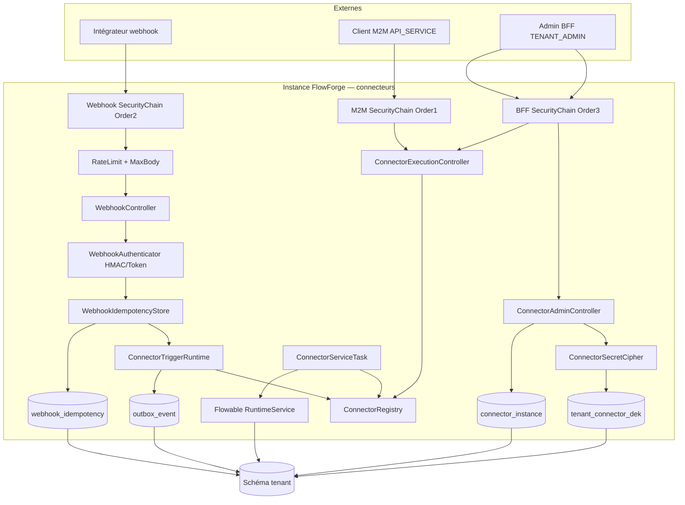
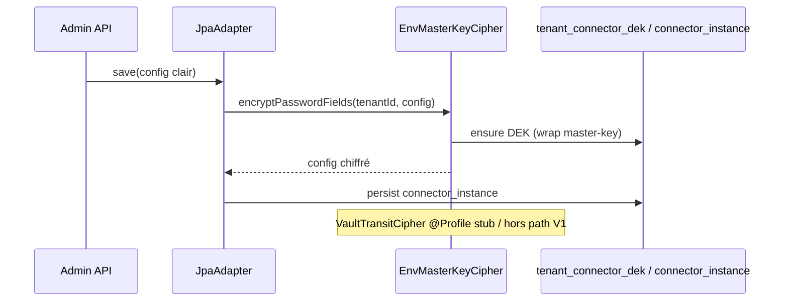
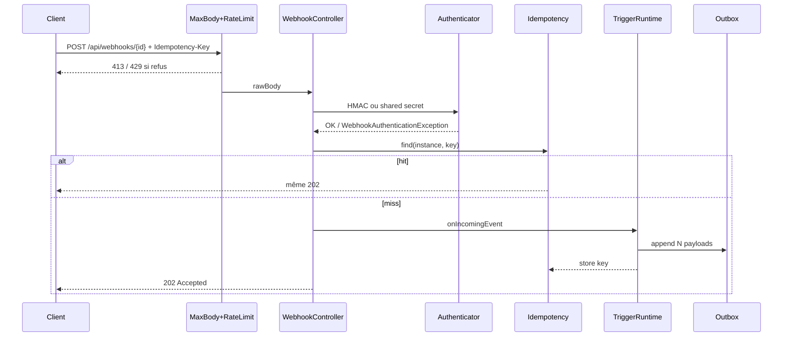

# System Design & Architecture

## Architecture Overview
**What is the high-level system structure?**

Tranche **connecteurs** alignée requirements `draft` (D-SCOPE…D-EXECUTE-AUTH) :
registry + instances chiffrées, webhooks `http-rest`, `flowable-signal`
TRIGGER/SERVICE, outbox producteur, chaînes Security M2M + webhook.



### Stack

Java 25 · Spring Boot 4.1 · Flowable 8 · Spring Security (3 chaînes) ·
Spring Data JPA · Liquibase · H2 MODE=PostgreSQL IT · ArchUnit.

### Responsabilités

| Zone | Rôle |
|---|---|
| `domain.connector` | Models, ports in/out, use cases admin + trigger + execute |
| `infrastructure.connector.registry` | `ConnectorRegistry` + discovery |
| `infrastructure.connector.builtin` | `http-rest`, `flowable-signal` |
| `infrastructure.persistence.connector` | JPA + cipher decrypt on load |
| `infrastructure.web.connector` | Webhook / admin / execute controllers |
| `infrastructure.security` | M2M `@Order(1)`, webhook `@Order(2)`, BFF `@Order(3)` |
| `infrastructure.flowable` | `ConnectorServiceTask` JavaDelegate |

---

## Data Models

### Domaine

```text
ConnectorInstanceData(id, tenantId, name, connectorType, enabled, config)
WorkflowTriggerEvent(processKey, dossierTypeCode, dossierFields, variables,
                     existingDossierReference?)
ConfigField(name, label, type, required, defaultValue, options, helpText)
WebhookAuthType: HMAC_SHA256 | SHARED_SECRET_TOKEN
  (IP_ALLOWLIST réservé, non implémenté → reject config)
```

`config` (Map) porte notamment pour `http-rest` TRIGGER :

| Clé | Rôle |
|---|---|
| `webhookAuthType` | `HMAC_SHA256` \| `SHARED_SECRET_TOKEN` |
| `webhookSecret` | PASSWORD — HMAC ou token |
| `processKey` | Défaut process (surchargeable par règle) |
| `dossierTypeCode` | Type à créer si pas de ref existante |
| `mapping` | Objet déclaratif — voir ci-dessous |
| `signalName` | Pour `flowable-signal` (émission / écoute) |

### Mapping déclaratif (`mapping`) — **DD-MAP**

```json
{
  "mode": "array_or_object",
  "itemsPath": "$",
  "fields": {
    "claimNumber": "$.claim.id",
    "amount": "$.claim.amount"
  },
  "variables": {
    "source": "$.meta.source"
  },
  "existingDossierReferencePath": "$.dossierRef",
  "processKeyPath": "$.processKey",
  "dossierTypeCodePath": null
}
```

- Corps objet → 1 événement ; tableau (ou `itemsPath`) → N.
- Si `existingDossierReferencePath` résout une valeur non vide →
  `GetDossierUseCase` + `AccessContext.system("connector-trigger")` ;
  sinon `CreateDossierUseCase` avec fields mappés.
- Chemins : sous-ensemble JSONPath simple (`$.a.b`, index optionnel) —
  **pas** de script/SpEL (D-MAP).

### Persistance

| Table | Colonnes clés |
|---|---|
| `connector_instance` | id UUID PK, tenant_id, name, connector_type, enabled, config jsonb, created_at, updated_at |
| `tenant_connector_dek` | tenant_id PK, dek_wrapped bytea/text, key_version, updated_at |
| `webhook_idempotency` | instance_id, idem_key, created_at, response_status ; PK (instance_id, idem_key) ; TTL job optionnel |

Champs `PASSWORD` du JSON `config` chiffrés AES-GCM au repos (DEK tenant).

---

## Crypto (D-CRYPTO)



- Property : `app.connector.crypto.master-key` (Base64 32 bytes) — **obligatoire**
  hors profil test (test = clé fixe documentée).
- Rotation DEK / Vault : interfaces prêtes, use case rotation **hors scope**.

---

## Webhook path



- Instance absente / `enabled=false` → **404**.
- Auth KO → **401** ProblemDetail (pas de détail oracle).
- Après commit TX → 202 corps vide (ou `{accepted:true}` minimal).

### Rate limit / body — **DD-HARDEN**

| Property | Défaut | Effet |
|---|---|---|
| `app.connector.webhook.max-body-bytes` | `1048576` (1 MiB) | 413 |
| `app.connector.webhook.rate-limit-per-minute` | `120` | 429 / instance |
| `app.connector.webhook.idempotency-ttl` | `24h` | purge / rejet expire |

Compteur rate limit : `ConcurrentHashMap` in-memory (A14).

---

## Security chains

| Order | Matcher | Session / CSRF | Auth |
|---|---|---|---|
| 1 | `/api/connectors/*/execute` (et futurs M2M) | Stateless | JWT resource server `client_credentials` ; `tenant_id` == `TenantProperties.id()` ; role `API_SERVICE` |
| 2 | `/api/webhooks/**` | Stateless | Aucune session ; auth métier HMAC/token |
| 3 | Other | BFF + CSRF | OIDC existant |

Admin `/api/connectors/**` (hors execute) et `/api/connector-definitions` :
chaîne BFF + `@PreAuthorize("hasRole('TENANT_ADMIN')")`.

---

## flowable-signal

### TRIGGER

Écoute / subscription runtime : adaptateur qui, sur signal Flowable nommé
(`signalName` config), construit un payload minimal et appelle
`ConnectorTriggerRuntime` (même outbox). Détail d’accroche Flowable
(`RuntimeService` signal listener vs event listener) — implémentation avec
smoke test.

### SERVICE

`execute(instance, inputParams)` :

- Lit `signalName` (+ `executionId` / `processInstanceId` / variables depuis
  `inputParams`).
- Émet via `RuntimeService.signalEventReceived` (ou API Flowable 8
  équivalente).
- Retourne map résultat (`signaled: true`, nom).

`ConnectorServiceTask` : résout `connectorInstanceId` depuis variables
process, charge instance (tenant), caste `ServiceConnector`, merge résultats
en variables.

---

## API Design

### Admin create/patch body

```json
{
  "name": "Claims inbound",
  "connectorType": "http-rest",
  "enabled": true,
  "config": { "...": "..." }
}
```

GET détail : `config.webhookSecret` → `"********"` (ou omission +
`secretConfigured: true`).

### Execute body

```json
{
  "signalName": "optional-override",
  "processInstanceId": "...",
  "variables": {}
}
```

---

## Component Breakdown

| Composant | Responsabilité |
|---|---|
| `ConnectorRegistry` | Index `type → definition` |
| `HttpRestTriggerConnector` | Parse + mapping → events |
| `FlowableSignalConnector` | TRIGGER+SERVICE |
| `ConnectorTriggerRuntime` | resolve/create dossier + outbox |
| `EnvMasterKeyCipher` | AES-GCM + DEK wrap |
| `HmacWebhookAuthenticator` / `SharedSecretWebhookAuthenticator` | Auth |
| `WebhookIdempotencyStore` | Dédup |
| `WebhookBodyLimitFilter` / `WebhookRateLimitFilter` | Hardening |
| Controllers | HTTP + ProblemDetail |

---

## Design Decisions

| Id | Décision | Notes |
|---|---|---|
| DD-MAP | JSONPath simple déclaratif | Pas SpEL |
| DD-HARDEN | Properties max-body + rate/min | In-memory |
| DD-MASK | Masquage secrets lecture | Jamais clair API |
| DD-404 | Disabled → 404 webhook | Anti-oracle |
| DD-M2M | Resource server JWT Order(1) | Claim tenant_id |
| DD-CIPHER | Interface + Env impl | Vault stub profile |
| DD-SIGNAL-HOOK | Listener Flowable → runtime | Smoke IT |

---

## Non-Functional Requirements

- **Sécurité :** triple chaîne ; secrets chiffrés ; pas de log de config
  déchiffrée complète.
- **Fiabilité :** ACK après commit outbox ; idempotence retries.
- **Perf :** 1 MiB body max ; 120 req/min/instance défaut.
- **Ops :** master-key obligatoire prod ; doc limitation multi-pod rate limit.

---

## Requirements coverage

| Requirement / décision | Design |
|---|---|
| D-SCOPE + builtins | Registry + http-rest + flowable-signal |
| D-CRYPTO | Cipher port + env + DEK table |
| D-ADMIN | PreAuthorize TENANT_ADMIN |
| D-WEBHOOK-AUTH | HMAC + shared secret authenticators |
| D-MAP | mapping JSON config |
| D-HARDEN | filters + properties |
| D-TARGET | runtime create + existing ref |
| D-IDEM | webhook_idempotency table |
| D-SIGNAL / invoke / auth | ServiceTask + execute + M2M+BFF |

---

## Open design items

| # | Item | Disposition |
|---|---|---|
| O1 | Dialecto JSONPath exact (lib vs parser maison) | Tranché à l’impl — préférer parser minimal maison si dep lourde |
| O2 | Accroche exacte listener signal Flowable 8 | Tranché à l’impl + smoke |
| O3 | Purge job idempotency | Nice — TTL au read suffit V1 |
| O4 | Matcher Ant exact M2M execute | `/api/connectors/*/execute` |

## References

- `analysis doc/06-connecteurs.md`
- Requirements `2026-07-31-feature-connecteurs.md`
- Design `workflow-engine` (outbox / TriggerOutboxPayload)
- Security follow-ups authentification (chaînes 1/2)
