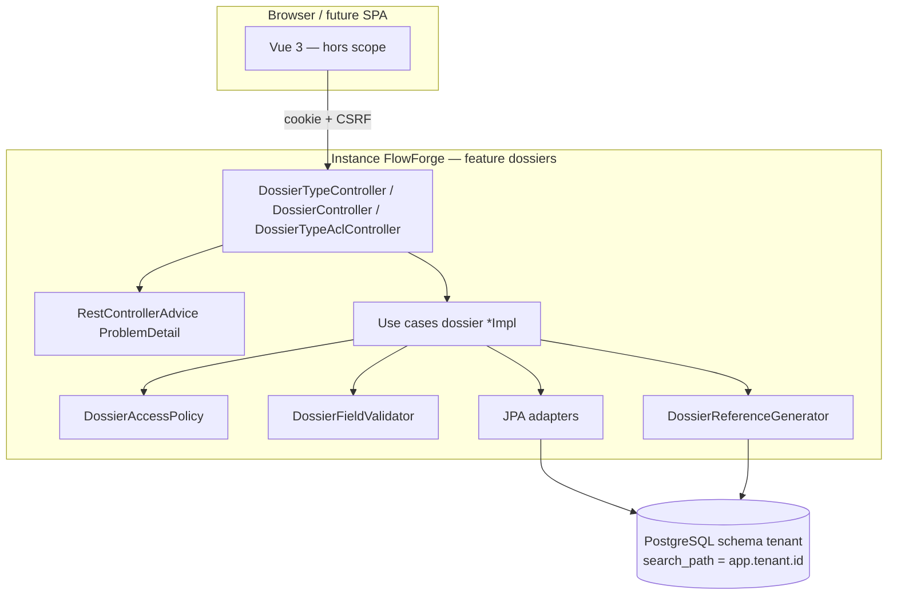
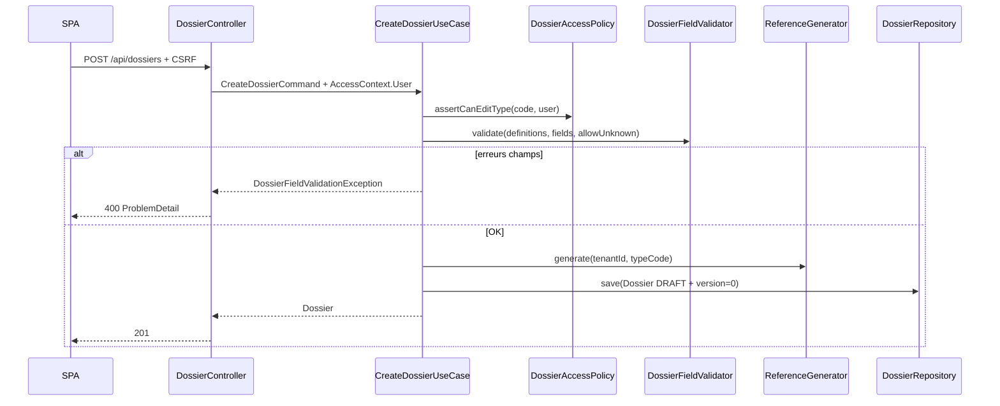

# System Design & Architecture

## Architecture Overview
**What is the high-level system structure?**

Tranche **B — dossiers persistés + API REST + ACL type** : le domaine `dossier`
reste pur ; JPA/Liquibase vivent en infrastructure ; les contrôleurs REST
s’appuient sur la session BFF existante. Pas de Flowable, pas d’éléments fichier.



### Flux création dossier



### Responsabilités

| Zone | Rôle |
|---|---|
| `domain.dossier.model` | Records + enums + `DossierFieldValidator` + `AccessContext` |
| `domain.dossier.DossierAccessPolicy` | VIEW/EDIT / bypass admins / System |
| `domain.dossier.port.in` | Interfaces use cases |
| `domain.dossier.usecase` | `*Impl` — orchestration, transitions statut |
| `domain.dossier.port.out` | Repositories + `DossierReferenceGenerator` |
| `infrastructure.persistence.dossier` | `*JpaEntity`, adapters, `SequentialReferenceGenerator` |
| `infrastructure.web.dossier` | Controllers + DTOs + `ProblemDetail` advice |
| Liquibase | Changelog `tenant-init` tables dossiers |
| `application.yml` | Retrait exclusions JDBC/JPA/Liquibase ; datasource ; search_path |

### Stack

Java 25 · Spring Boot 4.1 · Spring Data JPA · Liquibase · PostgreSQL (runtime) ·
H2 mode PostgreSQL (tests) · Security BFF existant · ArchUnit.

## Data Models
**What data do we need to manage?**

### Domaine (records)

| Type | Champs clés |
|---|---|
| `DossierType` | id, tenantId, code, label, workflowKey, active, allowUnknownFields, fieldDefinitions |
| `FieldDefinition` | name, label, type (`STRING\|NUMBER\|DATE\|BOOLEAN\|SELECT\|FILE`), required, defaultValue, options, group |
| `Dossier` | id, tenantId, reference, dossierTypeCode, label, status, fields, currentWorkflowLinkId (toujours null en B), version, createdBy/At, updatedBy/At, closedBy/At |
| `DossierStatus` | `DRAFT → OUVERT → EN_COURS ↔ SUSPENDU → CLOTURE → ARCHIVE` (+ annulation vers `CLOTURE`) |
| `AccessContext` | sealed : `User(userId, roles)`, `System(reason)`, `Service(clientId)` |
| `DossierTypeAclEntry` | tenantId, dossierTypeCode, subjectUserId, permission (`VIEW\|EDIT`) |
| `DossierPermission` | VIEW, EDIT (EDIT ⇒ VIEW) |

`currentWorkflowLinkId` est présent pour compatibilité modèle analyse mais **reste
null** (pas de table link en B).

### Tables Liquibase (schéma tenant)

| Table | Contraintes |
|---|---|
| `dossier_type` | PK id ; UNIQUE(tenant_id, code) ; jsonb `field_definitions` |
| `dossier` | PK id ; UNIQUE(tenant_id, reference) ; version (optimistic lock) ; jsonb `fields` ; FK logique type via code |
| `dossier_type_acl` | UNIQUE(tenant_id, dossier_type_code, subject_user_id) ; permission |
| `dossier_reference_seq` | PK (tenant_id, dossier_type_code, year) ; `last_value` |

### Génération de référence

```
DOS-{dossierTypeCode}-{UTC year}-{seq zero-padded 6}
```

Implémentation : `UPDATE dossier_reference_seq SET last_value = last_value + 1
… RETURNING last_value` (upsert ligne année si absente).

## API Design
**How do components communicate?**

### Endpoints

| Méthode | Path | Authz | Réponse |
|---|---|---|---|
| POST | `/api/dossier-types` | `TENANT_ADMIN` | 201 type |
| GET | `/api/dossier-types` | authentifié ; filtré VIEW (admins : tous) | 200 liste |
| GET | `/api/dossier-types/{code}` | VIEW ou bypass | 200 / 403 / 404 |
| POST | `/api/dossiers` | EDIT sur type | 201 dossier `DRAFT` |
| GET | `/api/dossiers/{id}` | VIEW | 200 / 403 / 404 |
| GET | `/api/dossiers?ref={reference}` | VIEW | 200 / 403 / 404 |
| PATCH | `/api/dossiers/{id}/status` | EDIT ; body `{status, expectedVersion?}` | 200 / 409 |
| POST | `/api/dossier-types/{code}/acl` | `TENANT_ADMIN` | 204 |
| DELETE | `/api/dossier-types/{code}/acl/{userId}` | `TENANT_ADMIN` | 204 |

Tous les `/api/**` : session BFF ; mutateurs = CSRF. Anonyme → 401 (comportement
auth existant).

### Erreurs — `ProblemDetail` (RFC 7807)

| Cas | status | type / detail |
|---|---|---|
| Validation champs | 400 | erreurs par champ (extension `errors[]`) |
| ACL refus | 403 | access denied |
| Introuvable | 404 | not found |
| Transition illégale / version stale / code type dupliqué / ref unique | 409 | conflict |

### Transitions de statut autorisées

```
DRAFT → OUVERT
OUVERT → EN_COURS | CLOTURE
EN_COURS → SUSPENDU | CLOTURE
SUSPENDU → EN_COURS | CLOTURE
CLOTURE → ARCHIVE
ARCHIVE → (terminal)
```

Toute autre transition → 409.

## Component Breakdown
**What are the major building blocks?**

### Packages cibles

```
domain/dossier/
  model/          # records, enums, validator, AccessContext
  DossierAccessPolicy.java
  port/in/        # use case interfaces
  port/out/       # repositories + reference generator
  usecase/        # *Impl

infrastructure/persistence/dossier/
  *JpaEntity, Spring Data repos, *JpaAdapter, SequentialReferenceGenerator

infrastructure/web/dossier/
  controllers, request/response DTOs, DossierExceptionHandler
```

### Use cases (B)

- `CreateDossierTypeUseCase` / `GetDossierTypeUseCase` / `ListDossierTypesUseCase`
  (update = désactivation via champ `active` sur create-or-update ou endpoint
  dédié PATCH type — **PATCH type** inclus comme mise à jour admin :
  `PUT/PATCH /api/dossier-types/{code}` pour label/workflowKey/fields/active —
  rattaché au CRUD types de l’option API 1)
- `CreateDossierUseCase` / `GetDossierUseCase`
- `UpdateDossierStatusUseCase`
- `GrantDossierTypeAccessUseCase` / `RevokeDossierTypeAccessUseCase`

### Configuration

- Lever exclusions DataSource, HibernateJpa, DataJpaRepositories, Liquibase.
- Datasource URL/user/password via env ; Hikari `connection-init-sql` search_path.
- Tests : H2 `MODE=PostgreSQL` ; changelog identique ; OIDC stub existant.

## Design Decisions
**Why did we choose this approach?**

| Décision | Choix | Alternatives écartées |
|---|---|---|
| Périmètre | Tranche B | A in-memory ; C analyse complète |
| Concurrence / ref | TODO 26 option 1 | séquences DDL dynamiques ; MAX+1 |
| ACL | Décision 20 complète dès B | no-op ; sans AccessContext |
| API | Surface option 1 + ProblemDetail | liste paginée ; no REST |
| Tests DB | H2 mode PostgreSQL | Testcontainers ; exclusions gardées |
| Statut initial | `DRAFT` | `OUVERT` direct ; client-chosen |
| Admin types | `TENANT_ADMIN` only | aussi `DOSSIER_MANAGER` |
| `FieldDefinition` | record (décision 17) | `@Value` analyse |
| Soft-delete type | `active=false` | DELETE physique |

## Non-Functional Requirements
**How should the system perform?**

- **Sécurité :** auth BFF ; ACL type ; System bypass réservé infra future ;
  pas d’exposition JPA au domaine.
- **Intégrité :** unicité référence ; optimistic locking ; transitions statut.
- **Multi-tenant :** schéma via search_path instance ; `tenantId` dénormalisé
  sur lignes pour défense en profondeur.
- **Fiabilité tests :** `./mvnw test` sans PostgreSQL externe ni Testcontainers.
- **Observabilité :** hors scope point 29 ; logger erreurs validation en warn.
- **Perf :** N/A formel ; index UNIQUE sur `(tenant_id, reference)` et codes type.
