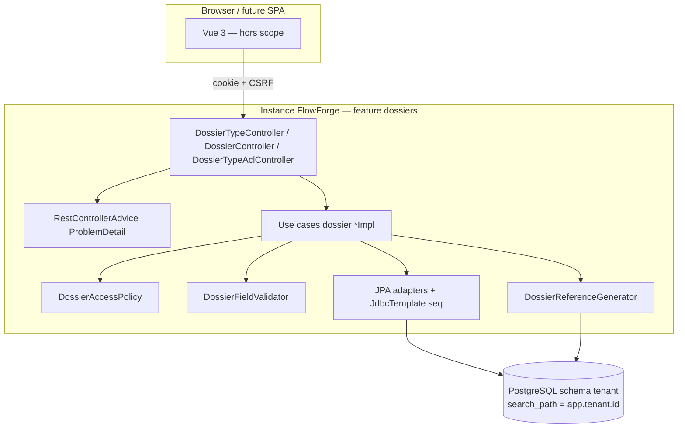
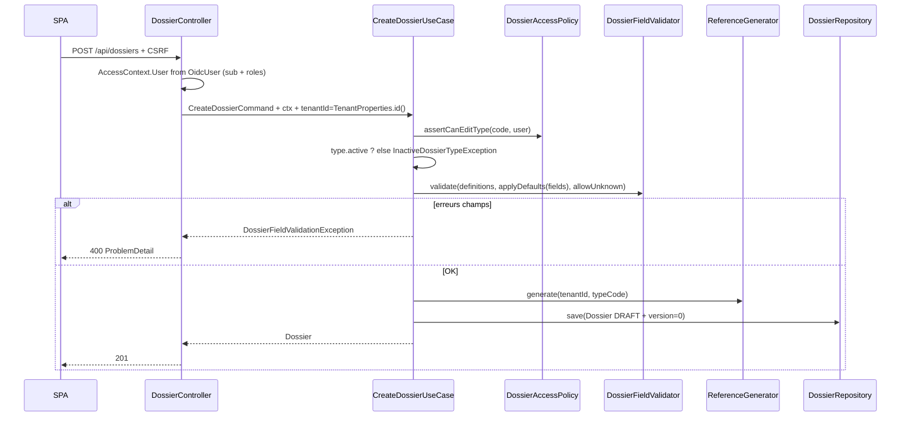
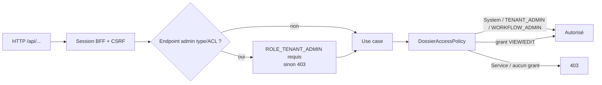

# System Design & Architecture

## Architecture Overview
**What is the high-level system structure?**

Tranche **B — dossiers persistés + API REST + ACL type** : le domaine `dossier`
reste pur ; JPA/Liquibase vivent en infrastructure ; les contrôleurs REST
s’appuient sur la session BFF existante. Pas de Flowable, pas d’éléments fichier.



### Flux création dossier



### Flux authz (couches)



### Responsabilités

| Zone | Rôle |
|---|---|
| `domain.dossier.model` | Records + enums + `DossierFieldValidator` + `AccessContext` + transitions |
| `domain.dossier.DossierAccessPolicy` | VIEW/EDIT / bypass admins / System ; Service refus |
| `domain.dossier.port.in` | Interfaces use cases |
| `domain.dossier.usecase` | `*Impl` — orchestration |
| `domain.dossier.port.out` | Repositories + `DossierReferenceGenerator` |
| `infrastructure.persistence.dossier` | `*JpaEntity`, adapters, `SequentialReferenceGenerator` (JdbcTemplate) |
| `infrastructure.web.dossier` | Controllers + DTOs + gate `TENANT_ADMIN` + `ProblemDetail` advice |
| Liquibase | `db/changelog/` — tables dossiers uniquement |
| `application.yml` | Retrait exclusions JDBC/JPA/Liquibase ; datasource ; search_path ; `ddl-auto: none` |

### Stack

Java 25 · Spring Boot 4.1 · Spring Data JPA · Liquibase · PostgreSQL (runtime) ·
H2 mode PostgreSQL (tests, dépendance `com.h2database:h2` test) · Security BFF
existant · ArchUnit. **Pas** de `@EnableMethodSecurity` dans cette tranche.

## Data Models
**What data do we need to manage?**

### Domaine (records)

| Type | Champs clés |
|---|---|
| `DossierType` | id, tenantId, code, label, workflowKey, active, allowUnknownFields, fieldDefinitions |
| `FieldDefinition` | name, label, type (`STRING\|NUMBER\|DATE\|BOOLEAN\|SELECT\|FILE`), required, defaultValue, options, group — `FILE` = valeur string (ref storage), pas d’upload en B |
| `Dossier` | id, tenantId, reference, dossierTypeCode, label, status, fields, currentWorkflowLinkId (**toujours null** en B), version, createdBy/At, updatedBy/At, closedBy/At |
| `DossierStatus` | transitions ci-dessous |
| `AccessContext` | sealed : `User(userId, roles)`, `System(reason)`, `Service(clientId)` |
| `DossierTypeAclEntry` | tenantId, dossierTypeCode, subjectUserId, permission (`VIEW\|EDIT`) |
| `DossierPermission` | VIEW, EDIT (`EDIT` ⇒ `VIEW`) |

`userId` / `subjectUserId` = claim OIDC `sub`. Rôles policy = noms realm **sans**
préfixe `ROLE_` (strip depuis `GrantedAuthority` côté web).

### Defaults champs

À la création, pour chaque `FieldDefinition` avec `defaultValue` non null : si la
clé est absente de `fields`, injecter la valeur par défaut **avant** validation.

### Tables Liquibase (schéma tenant)

| Table | Contraintes |
|---|---|
| `dossier_type` | PK id ; UNIQUE(tenant_id, code) ; colonne JSON `field_definitions` |
| `dossier` | PK id ; UNIQUE(tenant_id, reference) ; `version` NOT NULL ; JSON `fields` ; index (tenant_id, dossier_type_code) |
| `dossier_type_acl` | UNIQUE(tenant_id, dossier_type_code, subject_user_id) ; permission CHECK VIEW\|EDIT |
| `dossier_reference_seq` | PK (tenant_id, dossier_type_code, year) ; `last_value` BIGINT NOT NULL |

**Schéma PostgreSQL** (`app.tenant.id`) : **pré-existe** (ops / provisioning) —
Liquibase ne fait que les tables. Tests H2 : `CREATE SCHEMA IF NOT EXISTS`
dans init SQL de test, puis `SET SCHEMA`.

**JSON :** Hibernate `@JdbcTypeCode(SqlTypes.JSON)` + type Liquibase `jsonb`
(compatible H2 `MODE=PostgreSQL`). Écarts documentés en implementation si besoin.

### Génération de référence

```
DOS-{dossierTypeCode}-{UTC year}-{seq zero-padded 6}
```

`SequentialReferenceGenerator` via **JdbcTemplate** (pas d’entité JPA pour la seq) :

1. `INSERT … ON CONFLICT DO NOTHING` (ou équivalent H2) pour la clé année ;
2. `UPDATE … SET last_value = last_value + 1 RETURNING last_value`.

Année = `Year.now(ZoneOffset.UTC)`.

### Versioning dossier

- Colonne `version` + `@Version` JPA sur `DossierJpaEntity`.
- Champ `version` exposé sur le record domaine / DTO.
- `PATCH …/status` : si `expectedVersion` fourni et ≠ version courante → 409
  avant mutation ; sinon s’appuyer sur `@Version` (OptimisticLockException → 409).

## API Design
**How do components communicate?**

### Endpoints

| Méthode | Path | Authz | Réponse |
|---|---|---|---|
| POST | `/api/dossier-types` | `ROLE_TENANT_ADMIN` (gate web) | 201 |
| PATCH | `/api/dossier-types/{code}` | `ROLE_TENANT_ADMIN` ; **code immuable** (path only) | 200 |
| GET | `/api/dossier-types` | authentifié ; filtré VIEW (`TENANT_ADMIN`/`WORKFLOW_ADMIN` : tous) | 200 |
| GET | `/api/dossier-types/{code}` | VIEW ou bypass admin | 200 / 403 / 404 |
| POST | `/api/dossiers` | EDIT (policy) ; body `dossierTypeCode`, `label` requis, `fields` ; `tenantId` = `TenantProperties.id()` | 201 `DRAFT` |
| GET | `/api/dossiers/{id}` | VIEW ou bypass | 200 / 403 / 404 |
| GET | `/api/dossiers?ref={reference}` | VIEW ou bypass | 200 / 403 / 404 |
| PATCH | `/api/dossiers/{id}/status` | EDIT ; `{status, expectedVersion?}` | 200 / 409 |
| POST | `/api/dossier-types/{code}/acl` | `ROLE_TENANT_ADMIN` ; body `{subjectUserId, permission}` ; idempotent | 204 |
| DELETE | `/api/dossier-types/{code}/acl/{userId}` | `ROLE_TENANT_ADMIN` | 204 |

Mutateurs : CSRF BFF. Anonyme → 401. Pas de `@PreAuthorize` /
`@EnableMethodSecurity` — gate admin = vérification explicite des autorités
dans les controllers (ou helper web dédié).

### Mapping `AccessContext`

```text
OidcUser.getSubject() → User.userId
Authorities ROLE_* → roles sans préfixe
```

Appels use case depuis REST : toujours `AccessContext.User` (jamais System en B
via HTTP). `System` / `Service` réservés aux adaptateurs futurs.

### Erreurs — `ProblemDetail` (RFC 7807)

| Cas | status | Notes |
|---|---|---|
| Validation champs | 400 | extension `errors: [{field, code, message}]` |
| Body invalide / label manquant | 400 | |
| ACL / pas TENANT_ADMIN / Service | 403 | |
| Type / dossier introuvable | 404 | |
| Transition illégale | 409 | |
| Version stale / OptimisticLock | 409 | |
| Code type dupliqué / ref unique | 409 | |
| Type `active=false` à la création dossier | **409** | état incompatible |
| Grant ACL | 204 même si déjà présent | idempotent |

### Transitions de statut autorisées

```
DRAFT → OUVERT
OUVERT → EN_COURS | CLOTURE
EN_COURS → SUSPENDU | CLOTURE
SUSPENDU → EN_COURS | CLOTURE
CLOTURE → ARCHIVE
ARCHIVE → (terminal)
```

Sur passage à `CLOTURE` : renseigner `closedBy` / `closedAt` (et `updated*`).
Sur toute transition : `updatedBy` / `updatedAt`.

## Component Breakdown
**What are the major building blocks?**

### Packages cibles

```text
domain/dossier/
  model/          # records, enums, validator, AccessContext, DossierStatusTransitions
  DossierAccessPolicy.java
  port/in/        # use case interfaces
  port/out/       # repositories + DossierReferenceGenerator
  usecase/        # *Impl

infrastructure/persistence/dossier/
  *JpaEntity, Spring Data repos, *JpaAdapter,
  SequentialReferenceGenerator (JdbcTemplate)

infrastructure/web/dossier/
  *Controller, *Request/*Response, AccessContextFactory,
  TenantAdminGuard, DossierExceptionHandler

infrastructure/config/
  DossierConfig (ou extension DomainConfig) — beans use cases
```

### Use cases (B)

| Use case | Rôle |
|---|---|
| `CreateDossierTypeUseCase` | Création type (admin) |
| `UpdateDossierTypeUseCase` | PATCH type — pas de changement de `code` |
| `GetDossierTypeUseCase` / `ListDossierTypesUseCase` | Lecture + filtre ACL |
| `CreateDossierUseCase` | DRAFT + validation + ref |
| `GetDossierUseCase` | get id / get by ref + policy |
| `UpdateDossierStatusUseCase` | transitions + version + closed* |
| `GrantDossierTypeAccessUseCase` / `RevokeDossierTypeAccessUseCase` | ACL |

### Configuration (cible)

```yaml
spring:
  autoconfigure:
    exclude:
      # DataSource / JPA / Liquibase RETIRÉS de la liste
      - org.springframework.boot.mail.autoconfigure.MailSenderAutoConfiguration
      # … Flowable exclusions inchangées …
  datasource:
    url: ${SPRING_DATASOURCE_URL}
    username: ${SPRING_DATASOURCE_USERNAME}
    password: ${SPRING_DATASOURCE_PASSWORD}
    hikari:
      connection-init-sql: SET search_path TO ${app.tenant.id}, public
  jpa:
    hibernate:
      ddl-auto: none
    open-in-view: false
  liquibase:
    change-log: classpath:db/changelog/db.changelog-master.yaml

app:
  tenant:
    id: tenant_dev
```

Tests (`src/test/resources`) : H2 `MODE=PostgreSQL;DATABASE_TO_LOWER=TRUE` ;
init schema ; OIDC stub existant ; pas de `connection-init-sql` PG si H2
utilise `SET SCHEMA`.

### Dépendance test

Ajouter `com.h2database:h2` en `test` scope (absent du `pom` aujourd’hui).

## Design Decisions
**Why did we choose this approach?**

| Décision | Choix | Alternatives écartées |
|---|---|---|
| Périmètre | Tranche B | A in-memory ; C analyse complète |
| Concurrence / ref | TODO 26 option 1 ; JdbcTemplate seq | séquences DDL dynamiques ; MAX+1 ; seq via JPA entity |
| ACL | Décision 20 complète dès B | no-op ; sans AccessContext |
| Gate admin | Check `ROLE_TENANT_ADMIN` web explicite | `@EnableMethodSecurity` / `@PreAuthorize` (reporté autorisation-conformite) |
| API | Surface requirements + ProblemDetail | liste paginée ; no REST |
| Tests DB | H2 mode PostgreSQL + dep h2 | Testcontainers ; exclusions gardées |
| Type inactif | **409** à la création | 400 |
| Defaults champs | Appliqués si clé absente | Ignorés jusqu’à PATCH fields |
| JSON | `SqlTypes.JSON` + liquibase `jsonb` | CLOB opaque ; colonnes éclatées |
| Schéma tenant | Pré-existe (ops) | Liquibase `CREATE SCHEMA` |
| ddl-auto | `none` | `update` |
| Soft-delete type | `active=false` | DELETE physique |
| `FieldDefinition` | record | `@Value` analyse |

### Alternatives revalidées (phase 3)

- `@EnableMethodSecurity` dès B : écarté — auth a reporté `@PreAuthorize` ;
  gate web suffit pour 2 endpoints admin.
- Testcontainers malgré option 2 : écarté — clarifications phase 1.
- `expectedVersion` obligatoire : écarté — optionnel ; `@Version` reste filet.
- Changer `code` via PATCH : écarté — immuable.
- Créer le schéma via Liquibase : écarté — responsabilité provisioning
  (décision 13).

## Non-Functional Requirements
**How should the system perform?**

- **Sécurité :** auth BFF ; ACL type ; System bypass hors HTTP ; pas de JPA
  dans le domaine ; admin types strictement `TENANT_ADMIN`.
- **Intégrité :** unicité référence ; optimistic locking ; transitions statut ;
  type inactif non créable.
- **Multi-tenant :** search_path instance ; `tenantId` dénormalisé sur lignes.
- **Fiabilité tests :** `./mvnw test` sans PostgreSQL externe ni Testcontainers.
- **Observabilité :** hors scope point 29 ; log warn validation / ACL deny.
- **Perf :** N/A formel ; index UNIQUE `(tenant_id, reference)` et codes type.
- **Rollout :** PR `feature-dossiers` ; datasource env obligatoire dès activation JPA.

## Écarts vs `docs/specs/04-dossiers.md`

| Analyse | Cette feature |
|---|---|
| Éléments, relations, workflow links, AttachWorkflow | **Hors scope B** |
| `FieldDefinition` `@Value` | **record** (décision 17) |
| Exemple `%tY` sur Instant | **Year UTC** via `Year.now(UTC)` |
| Surface API quasi absente | **Tableau endpoints** requirements |
| ACL + policy | **Inclus dès B** |
| Persistence implicite PG only | Runtime PG + **tests H2** |

## Requirements coverage (phase 3)

| Exigence | Couverture design |
|---|---|
| Domaine pur + records + validator + policy | Data models + packages |
| Ports / use cases CRUD type + dossier + status + ACL | Use cases table |
| JPA adapters + référence atomique UTC | Persistence + SequentialReferenceGenerator |
| Retrait exclusions JDBC/JPA/Liquibase ; Flowable exclus | Configuration yaml |
| Tables + contraintes TODO 26 | Tables Liquibase + versioning |
| Surface API + ProblemDetail | API Design |
| ACL décision 20 (System/Service/admins/EDIT⇒VIEW) | Authz diagram + policy |
| Création DRAFT ; tenantId instance ; label requis | Flux création + API |
| Type inactive bloque create | 409 + flux |
| FILE string only | FieldDefinition note |
| TENANT_ADMIN seul admin types | Gate web + endpoints |
| Tests H2 + ArchUnit + Jacoco | Stack + dep h2 + NFR |
| Non-goals éléments/Flowable/MinIO/pagination | Écarts analyse + hors scope packages |
| Defaults / closed* / code immuable | Sections defaults + transitions + PATCH |

## Review notes (phase 3)

| Point | Résolution |
|---|---|
| Template design README | Overview (+ mermaid), models, API, components, decisions, NFR |
| Couverture requirements | Table ci-dessus — goals / stories / success criteria couverts |
| Authz TENANT_ADMIN | Gate web explicite — pas de method security |
| Type inactif HTTP | **409** |
| JSON / H2 | `SqlTypes.JSON` + `jsonb` Liquibase ; risque écart noté |
| Schéma tenant | Pré-existe ops ; tests créent schema H2 |
| Seq référence | JdbcTemplate + UTC `Year` |
| Use case update type | `UpdateDossierTypeUseCase` explicite |
| Dep H2 | À ajouter en test scope |
| Retour requirements | Aucun gap bloquant |

- Aucune question d’architecture ouverte pour la tranche B.
- **Lifecycle tranche B :** phases 1–9 terminées — prêt à merger.
