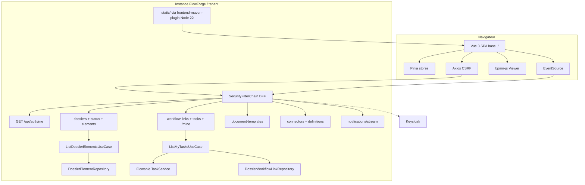

# System Design & Architecture

## Architecture Overview
**What is the high-level system structure?**

SPA Vue 3 TS embarquée (**D-PACK**, **DD-NODE = A** Node 22) ; BFF
même origine ; vague 1 puis vague 2 (**D-SEQ**). Requirements
**`reviewed`**. Backend deltas : `/me`+`id` ; `/workflow-tasks/mine`
(**DD-INBOX-DTO**, **DD-INBOX-AUTHZ**) ;
`/dossiers/{id}/elements` (**DD-ELEMENTS-DTO**) ; SPA fallback
(**A-SPA-FALLBACK**) ; Vite `base: './'` (**DD-BASE**).



### Stack

Vue 3 + Vite (`base: './'`) + TS strict · PrimeVue (tokens maquette) ·
Pinia · Vue Router · Axios · bpmn-js Viewer · Vitest / VTU · Playwright
(**D-E2E**) · ESLint/Prettier · vue-tsc · **frontend-maven-plugin +
Node 22 LTS**.

### Packages FE

| Zone | Rôle |
|---|---|
| `frontend/src/app` | Bootstrap, router, guards rôles UX |
| `frontend/src/stores` | `auth`, `dossier`, `tasks`, `notifications`, `admin/*` |
| `frontend/src/api` | Clients Axios typés manuels (**A-OPENAPI**) |
| `frontend/src/views/pilotage` | Supervision, DossierDetail, MobileTasks, CreateDossier |
| `frontend/src/views/admin` | Types, ACL, Templates, Connectors, WorkflowTypeConfigs |
| `frontend/src/components/workflow` | BpmnViewer, TaskList, HistoryTimeline, StartWorkflowDialog |
| `frontend/src/components/dossier` | DynamicFields, SensitiveValue, ElementsList, StatusSelect |
| `frontend/src/styles` | Tokens CSS maquette |

### Backend touchpoints (hexagone)

| Change | Package / détail |
|---|---|
| `AuthUserResponse(id, name, email, roles)` | `infrastructure.web.auth` — `id = OidcUser.getSubject()` |
| `ListMyTasksUseCase` (**A-HEX-INBOX**) | `domain.workflow.port.in` + impl ; port out query tasks ; adapter Flowable `taskAssignee(sub)` ; enrichissement link/dossier ; plafond 100 |
| `WorkflowTaskController` `GET /mine` | Authz : authentifié (**DD-INBOX-AUTHZ**) ; pas de `?assigneeId=` admin |
| `ListDossierElementsUseCase` (**A-HEX-ELEMENTS**) | `domain.dossier` ; `findByDossierIdOrderByAddedAtAsc` ; authz lecture dossier |
| `GET /api/dossiers/{id}/elements` | DTO sans `storageRef` (**DD-ELEMENTS-DTO**) |
| SPA fallback | WebMvc `PathResourceResolver` → `index.html` hors `/api/**` |
| `pom.xml` | frontend-maven-plugin Node **22** ; `npm ci` + `build` ; copy `dist` → `static/` ; gitignore bundles |

---

## Data Models

### Client (TypeScript)

```typescript
interface AuthUser {
  id: string; // OIDC sub
  name: string | null;
  email: string | null;
  roles: string[];
}

interface DossierCreateRequest {
  dossierTypeCode: string;
  label: string;
  fields: Record<string, unknown>;
}

interface UpdateDossierStatusRequest {
  status: 'DRAFT' | 'OUVERT' | 'EN_COURS' | 'SUSPENDU' | 'CLOTURE' | 'ARCHIVE';
  expectedVersion: number;
}

/** DD-INBOX-DTO = A */
interface MyWorkflowTask {
  taskId: string;
  name: string;
  assigneeId: string;
  createdAt: string | null;
  processInstanceId: string;
  dossierId: string;
  dossierReference: string;
  linkId: string;
}

/** DD-ELEMENTS-DTO = A — pas de storageRef */
interface DossierElementView {
  id: string;
  type: string;
  label: string;
  addedBy: string;
  addedAt: string;
  workflowStepId: string | null;
  metadata: Record<string, unknown>;
  downloadable: boolean;
}

interface WorkflowDiagramView {
  bpmnXml: string;
  activeIds: string[];
  completedIds: string[];
  failedIds: string[];
}
```

Aligner `DossierSummary` / detail sur `DossierResponse` backend
(`id`, `reference`, `dossierTypeCode`, `label`, `status`, `fields`,
`currentWorkflowLinkId`, `version`, audit timestamps).

Pas de JWT en localStorage ; session cookie + `XSRF-TOKEN`.

### Flux inbox

```mermaid
sequenceDiagram
  participant FE as SPA
  participant API as WorkflowTaskController
  participant UC as ListMyTasksUseCase
  participant FL as Flowable TaskService
  participant LINK as DossierWorkflowLinkRepository
  participant DOS as DossierRepository

  FE->>API: GET /api/workflow-tasks/mine
  API->>UC: list(sub)
  UC->>FL: taskAssignee(sub) active
  loop each task (max 100)
    UC->>FL: dossierId variable
    alt missing dossierId
      UC--xUC: skip task
    else
      UC->>LINK: by processInstanceId
      UC->>DOS: reference
    end
  end
  UC-->>FE: MyWorkflowTask[]
```

---

## API Design

### Auth / session
- `GET /api/auth/me` → `{ id, name, email, roles }`
- Logout Boot ; Axios CSRF defaults

### Vague 1
| API | Notes design |
|---|---|
| `GET /api/dossier-types` | Create form |
| `POST /api/dossiers` | `dossierTypeCode`, `label`, `fields` |
| `GET /api/dossiers/{id}` · `?ref=` | Détail / Supervision resolve |
| `PATCH /api/dossiers/{id}/status` | `status` + `expectedVersion` (**D-STATUS**) |
| `GET /api/dossiers/{id}/elements` | **DD-ELEMENTS-DTO** |
| `GET/POST /api/dossiers/{id}/workflows` | Start : body `processDefinitionKey` + header **`Idempotency-Key`** (**DD-START**, **A-START-IDEM**) ; variables `{}` |
| Viz `/api/workflow-links/{id}/…` | diagram/history/tasks/dossier/reassign |
| `GET /api/workflow-tasks/mine` | **DD-INBOX-DTO** ; plafond 100 ; authz A |
| `POST /api/workflow-tasks/{id}/complete` | `variables: {}` (**D-COMPLETE**) |
| `GET /api/dossier-elements/{id}/content` | Download si `downloadable` |
| `GET /api/notifications/stream` | SSE same-origin cookies |

### Vague 2
CRUD types(+ACL TA), templates, connectors (`config` mask +
`secretConfigured` — **A-CONN-SECRET**), workflow-type-configs
(+ `observerUserIds`).

Erreurs : `ProblemDetail`.

### Context-path / Vite (**DD-BASE = A**)
- Build : `base: './'` (assets relatifs).
- Axios : résoudre le préfixe API à partir de `document.baseURI` /
  `import.meta.env.BASE_URL` pour rester sous le context-path si Boot
  l’active ; chemins d’auth OAuth relatifs à la même origine.
- V1 : yaml context-path encore commenté — tester aussi le cas
  `context-path=/ {tenantId}/` en checklist manuelle.

---

## Component Breakdown

### Routes

| Path | Vague | Vue |
|---|---|---|
| `/supervision` | 1 | Supervision MVP |
| `/dossiers/new` | 1 | CreateDossier |
| `/dossiers/:id` | 1 | DossierDetail (+ StatusSelect, StartWorkflowDialog, ElementsList, viz) |
| `/tasks` | 1 | MobileTasks ← `/mine` |
| `/admin/dossier-types` | 2 | Types + ACL |
| `/admin/templates` | 2 | Templates |
| `/admin/connectors` | 2 | Connectors |
| `/admin/workflow-types` | 2 | WorkflowTypeConfigs |

Nav : Pilotage (Supervision, Tâches) + Admin si rôles ; **pas** Rapports.

### StartWorkflowDialog (**DD-START = C**)
1. Valeur par défaut = `dossierType.workflowKey`.
2. Option « Autre processus… » → liste `GET /api/workflow-type-configs`.
3. POST avec `Idempotency-Key` (UUID) + `processDefinitionKey`.

### Sensitive / Elements / bpmn-js
Inchangés vs Phase 2 sync ; elements consomme le nouveau DTO.

---

## Design Decisions

| Id | Décision | Alternatives | Raison |
|---|---|---|---|
| **DD-INBOX-DTO = A** | DTO enrichi (dossierId, reference, linkId) ; skip sans dossierId ; max 100 ; no pagination | B minimal / C paginé | UX Mes tâches complète |
| **DD-INBOX-AUTHZ = A** | Authentifié ; filtre assignee=sub uniquement | B query assignee admin / C role gate | Pas de fuite ; SPA humaine |
| **DD-BASE = A** | Vite `base: './'` + résolution API vs context-path | B build-per-tenant / C ignore path | Même artefact N instances |
| **DD-START = C** | Défaut type.workflowKey + picker autre config | A only default / B picker only | Flexibilité contrôlée |
| **DD-ELEMENTS-DTO = A** | Pas de `storageRef` ; `downloadable` | B expose ref / C trop minimal | Moins d’info-disclosure |
| **DD-NODE = A** | Node 22 LTS dans frontend-maven-plugin | B 20 / C unpinned | Aligné env + reproductible |
| DD-PACK | frontend-maven-plugin → static/ | CI copy / commit bundles | D-PACK A |
| DD-ME | `id`+`name` dans `/me` | — | D-ME + code |
| DD-SEQ / DD-ADMIN / DD-MOCK / DD-SENS / DD-E2E / DD-COMPLETE / DD-STATUS | cf. requirements | — | Phase 1–2 |

### Couverture requirements → design

| Requirement | Design |
|---|---|
| Socle SPA + packaging | Stack + DD-PACK + DD-NODE + DD-BASE |
| Auth `/me` + CSRF | Auth touchpoint + Axios |
| Création / détail / status / viz / complete / reassign | Routes + API table |
| Inbox Mes tâches | DD-INBOX-* + sequence + store `tasks` |
| Elements liste + download + Ajouter disabled | DD-ELEMENTS-DTO + components |
| Start workflow | DD-START + Idempotency-Key |
| SSE + Supervision MVP + no Rapports | Routes / nav / notifications |
| Sensitive mask | SensitiveValue |
| Vague 2 admin | Routes admin + A-CONN-SECRET |
| Qualité / E2E mock | NFR + D-E2E |

---

## Non-Functional Requirements

- Sécurité : pas de JWT JS ; CSRF ; XSS escape ; pas de `storageRef` ;
  secrets connecteurs maskés ; inbox scoped sub.
- A11y basique ; UI fr (**A-I18N**).
- CI : Node 22 via plugin dans `./mvnw verify` ; typecheck/lint/test ;
  Playwright mock session.
- Perf : lazy admin + bpmn-js ; inbox ≤ 100.
- Fiabilité SSE : fail-soft + reconnect soft FE.

## Risks

| Risque | Mitigation |
|---|---|
| Context-path casse API | DD-BASE checklist manuelle |
| Jointure inbox lente | Plafond 100 ; index PI→link si besoin |
| Scope vague 2 | D-SEQ : T21 avant M7 |
| Node download CI | Cache plugin / `.m2` |

## Assumptions (Phase 3)

| Id | Hypothèse |
|---|---|
| **A-HEX-INBOX** | Use case + ports dans `domain.workflow` |
| **A-HEX-ELEMENTS** | Use case dans `domain.dossier` |
| **A-SPA-FALLBACK** | Resource resolver → `index.html` |
| **A-START-IDEM** | FE génère UUID Idempotency-Key |
| **A-CONN-SECRET** | UI suit mask API existante |
| **A-INBOX-CAP** | Plafond 100 suffisant V1 ; pagination = follow-up |

## Next

Phase 5 — Execute Plan (`dev-implementation`). Planning `ready` (T1–T28).
