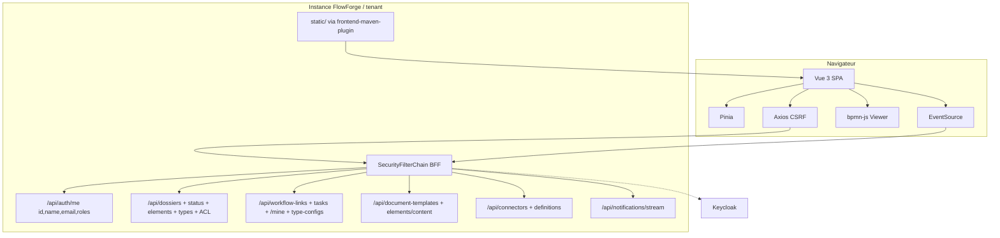

# System Design & Architecture

## Architecture Overview
**What is the high-level system structure?**

SPA Vue 3 TS embarquée (**D-PACK = A**) ; BFF même origine ; vague 1
instructeur puis vague 2 admin (**D-SEQ = A**). Requirements
**`reviewed`** (Phase 2). Backend deltas : `AuthUserResponse.id`
(**D-ME**) ; `GET /api/workflow-tasks/mine` (**D-INBOX**) ;
`GET /api/dossiers/{id}/elements` (**D-ELEMENTS-API**) ; fallback SPA
`index.html` (**A-HISTORY**) si absent.



### Stack

Vue 3 + Vite + TS strict · PrimeVue (tokens maquette) · Pinia ·
Vue Router · Axios · bpmn-js Viewer · Vitest / VTU · Playwright
(**D-E2E = A**) · ESLint/Prettier · vue-tsc · frontend-maven-plugin.

### Packages FE

| Zone | Rôle |
|---|---|
| `frontend/src/app` | Bootstrap, router, guards rôles UX |
| `frontend/src/stores` | `auth`, `dossier`, `notifications`, `admin/*` |
| `frontend/src/api` | Clients Axios typés manuels (**A-OPENAPI**) |
| `frontend/src/views/pilotage` | Supervision, DossierDetail, MobileTasks, CreateDossier |
| `frontend/src/views/admin` | Types, ACL, Templates, Connectors, WorkflowTypeConfigs |
| `frontend/src/components/workflow` | BpmnViewer, TaskList, HistoryTimeline |
| `frontend/src/components/dossier` | DynamicFields, SensitiveValue, ElementsList |
| `frontend/src/styles` | Tokens CSS maquette |

### Backend touchpoints (cette feature)

| Change | Détail |
|---|---|
| `AuthUserResponse` + `AuthController` | Ajouter `id` = `OidcUser.getSubject()` ; garder `name` (pas `fullName`) |
| `GET /api/workflow-tasks/mine` | Inbox tâches actives assignées au `sub` (**D-INBOX**) — use case + port Flowable |
| `GET /api/dossiers/{id}/elements` | Liste métadonnées éléments (**D-ELEMENTS-API**) via repo existant |
| WebMvc / Security | Servir `static/` ; fallback non-`/api/**` → `index.html` |
| `pom.xml` | `frontend-maven-plugin` : `npm ci` + `npm run build` + copy `dist` → `static/` ; gitignore bundles |

---

## Data Models

```typescript
interface AuthUser {
  id: string; // OIDC sub
  name: string | null;
  email: string | null;
  roles: string[];
}

interface DossierCreateRequest {
  dossierTypeCode: string;
  label: string;
  fields: Record<string, unknown>;
}

interface MyWorkflowTask {
  taskId: string;
  name: string;
  assigneeId: string;
  createdAt: string | null;
  dossierId: string;
  dossierReference?: string;
  linkId?: string;
}

interface DossierSummary {
  id: string;
  reference: string;
  typeCode: string;
  status: string;
  fields: Record<string, unknown>;
  version: number;
}

interface FieldDefinition {
  key: string;
  label: string;
  type: string;
  required?: boolean;
  sensitive?: boolean;
  // …aligné backend
}

interface WorkflowDiagramView {
  bpmnXml: string;
  activeIds: string[];
  completedIds: string[];
  failedIds: string[];
}
```

Pas de JWT en localStorage ; session cookie + `XSRF-TOKEN`.

---

## API Design

### Auth / session
- `GET /api/auth/me` → inclut **`id`**
- Logout Boot existant ; Axios CSRF defaults

### Vague 1
| API | Usage |
|---|---|
| `GET/POST /api/dossier-types` | Liste types pour création (GET) |
| `POST /api/dossiers` | Création (`dossierTypeCode`, `label`, `fields`) |
| `GET /api/dossiers/{id}` · `?ref=` | Détail / resolve |
| `PATCH /api/dossiers/{id}/status` | Changement statut (**D-STATUS**) + `expectedVersion` |
| `GET /api/dossiers/{id}/elements` | Liste éléments (**D-ELEMENTS-API**) |
| `GET/POST /api/dossiers/{id}/workflows` | Links + start |
| `GET …/workflow-links/{id}/diagram\|history\|tasks\|dossier` | Viz |
| `POST …/tasks/{taskId}/reassign` | Admin WF |
| `GET /api/workflow-tasks/mine` | Inbox (**D-INBOX**) |
| `POST /api/workflow-tasks/{taskId}/complete` | Complete `variables: {}` (**D-COMPLETE**) |
| `GET /api/dossier-elements/{id}/content` | Download |
| `GET /api/notifications/stream` | SSE |

### Vague 2
| API | Usage |
|---|---|
| CRUD `/api/dossier-types` + ACL | Admin types |
| CRUD `/api/document-templates` (+ activate/archive/new-version) | Templates |
| CRUD `/api/connectors` + `GET /api/connector-definitions` | Connecteurs |
| CRUD `/api/workflow-type-configs` | Config WF + observers |

Hors V1 UI : `/api/notification-webhooks`, génération PDF UI, métriques SLA.

Erreurs : `ProblemDetail`.

---

## Component Breakdown

### Routes

| Path | Vague | Vue |
|---|---|---|
| `/supervision` | 1 | Supervision MVP (ref/id + créer) |
| `/dossiers/new` | 1 | CreateDossier |
| `/dossiers/:id` | 1 | DossierDetail |
| `/tasks` | 1 | MobileTasks (`assigneeId === auth.id`) |
| `/admin/dossier-types` | 2 | Types + ACL |
| `/admin/templates` | 2 | Templates |
| `/admin/connectors` | 2 | Connectors |
| `/admin/workflow-types` | 2 | WorkflowTypeConfigs |

Nav : Pilotage (Supervision, Tâches) + Admin (si rôles) ; **pas** Rapports.

### Sensitive fields (**D-SENSITIVE**)
Composant `SensitiveValue` : si `field.sensitive && !isTenantAdmin` →
`••••` ; sinon valeur. Création : saisie normale (pas de mask input
sauf UX optionnelle).

### Elements (**D-ELEMENTS**)
Liste métadonnées ; lien download content ; bouton Ajouter `disabled`
+ tooltip « bientôt ».

### bpmn-js
Viewer lazy ; overlays active/completed/failed ; destroy on unmount.

---

## Design Decisions

| Id | Décision | Raison |
|---|---|---|
| DD-PACK | frontend-maven-plugin | D-PACK A / verify unique |
| DD-ME | `id` = sub dans `/me` ; champ `name` | D-ME A + code existant |
| DD-INBOX | Endpoint `/workflow-tasks/mine` | D-INBOX B |
| DD-ELEMENTS-API | `GET /dossiers/{id}/elements` | D-ELEMENTS-API A |
| DD-STATUS | UI PATCH status | D-STATUS A |
| DD-COMPLETE | Complete sans formulaire variables | D-COMPLETE A |
| DD-SEQ | 2 vagues | D-SEQ A |
| DD-ADMIN | Types+ACL, templates, connectors, WF configs | D-ADMIN-RES A |
| DD-MOCK | Pas Rapports / pas faux KPI | D-MOCKGAP A |
| DD-SENS | Mask sauf TA | D-SENSITIVE A |
| DD-E2E | Mock session CI | D-E2E A |
| DD-TYPES | TS manuel | A-OPENAPI |
| DD-UI | PrimeVue + tokens maquette | Stack + UX mock prime |

---

## Non-Functional Requirements

- Sécurité : pas de JWT JS ; CSRF ; XSS escape champs ; secrets
  connecteurs non réaffichés.
- A11y basique ; UI fr (**A-I18N**).
- CI : `npm run typecheck && lint && test` dans plugin ou phase Maven ;
  Playwright mock ; `./mvnw verify`.
- Perf : lazy admin routes + bpmn-js.

## Risks

| Risque | Mitigation |
|---|---|
| Scope vague 2 large | D-SEQ : ne pas bloquer vague 1 |
| Node sur agents Maven | Documenter version Node ; cache npm CI |
| Context-path | `base` Vite relatif |
| Drift DTO admin | Fixtures depuis IT MockMvc existantes |

## Next

Phase 2 — Review Requirements, puis Phase 3 Design review.
