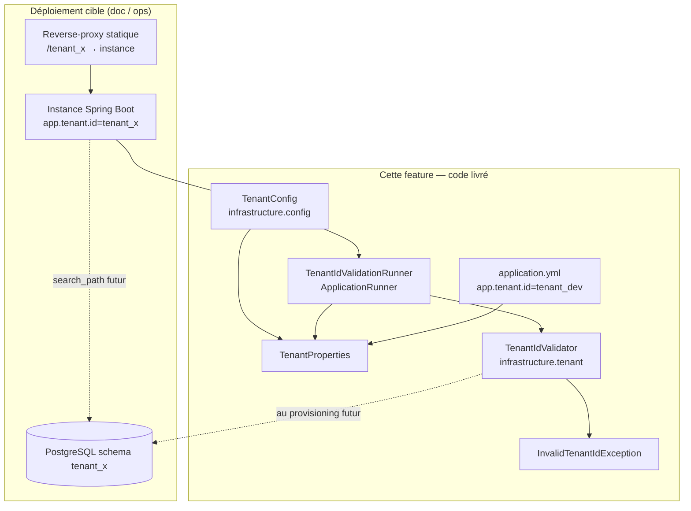
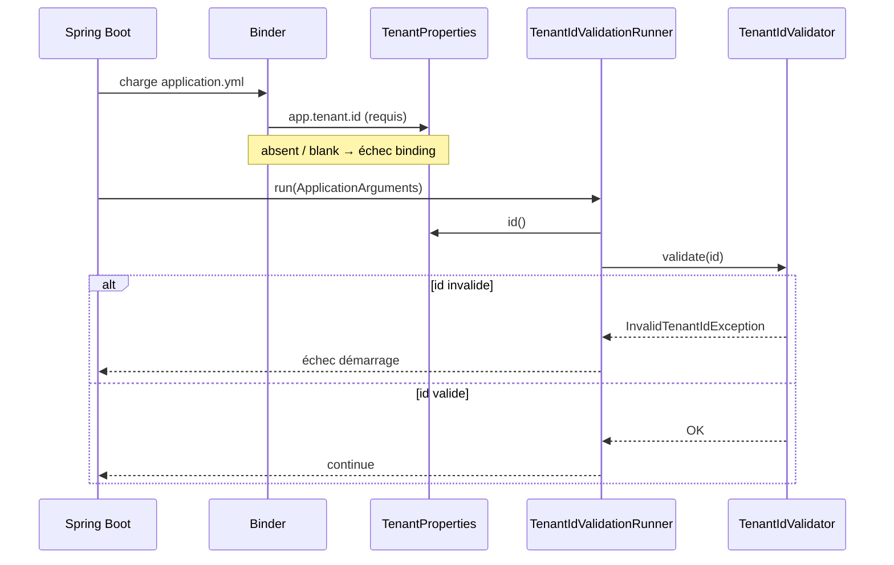
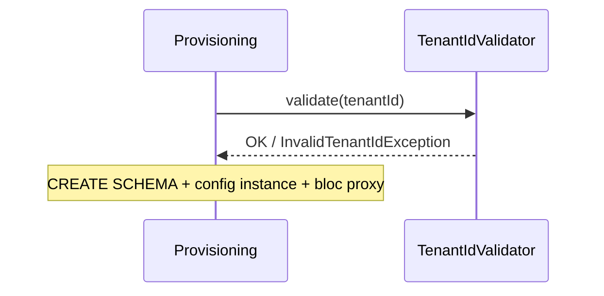

# System Design & Architecture

## Architecture Overview
**What is the high-level system structure?**

Tranche **socle multi-tenant config-driven** (décisions n° 13 / 14) sans activer
PostgreSQL ni Security. Le tenant est une propriété d’instance ; le modèle cible
(schéma + path + proxy) est documenté pour les features aval.



### Flux démarrage (cette feature)



### Flux provisioning (cible, hors code de cette feature)



### Responsabilités

| Zone | Rôle |
|---|---|
| `infrastructure.config.TenantProperties` | `record` `@ConfigurationProperties(prefix="app.tenant")` — `id` `@NotBlank` |
| `infrastructure.config.TenantConfig` | `@Configuration` + `@EnableConfigurationProperties(TenantProperties.class)` ; déclare le runner |
| `infrastructure.config.TenantIdValidationRunner` | `ApplicationRunner` : `TenantIdValidator.validate(tenantProperties.id())` |
| `infrastructure.tenant.TenantIdValidator` | Validation regex (provisioning + démarrage) |
| `infrastructure.tenant.InvalidTenantIdException` | `RuntimeException` avec id fautif (nullable-safe message) |
| `DomainConfig` | **Inchangé** — câblage workflow only |
| `application.yml` | `app.tenant.id: tenant_dev` ; path / `connection-init-sql` **commentés** |
| Docs design/implementation | Contrat reverse-proxy chemin + instance dédiée |

### Stack

Java 25 · Spring Boot 4.1 · Configuration Properties · Validation
(`spring-boot-starter-validation` déjà présent) — **sans** DataSource / JPA /
Liquibase / Security / Flowable (exclusions autoconfig conservées).

## Data Models
**What data do we need to manage?**

Pas d’entité métier persistée dans cette tranche.

| Type | Emplacement | Champs / comportement |
|---|---|---|
| `TenantProperties` | `infrastructure.config` | `record TenantProperties(@NotBlank String id)` |
| `TenantIdValidator` | `infrastructure.tenant` | `validate(String)` statique ; pattern `^[a-z][a-z0-9_]{2,62}$` |
| `InvalidTenantIdException` | `infrastructure.tenant` | `RuntimeException` — message inclut l’id reçu (ou `"null"`) |

### Domaine workflow (inchangé structurellement)

- `StartWorkflowCommand.tenantId` / `WorkflowInstance.tenantId` restent des champs
  domaine fournis par l’appelant.
- Fixtures de test : `tenant_a` (conforme regex) à la place de `tenant-a`.
- Règle aval (doc) : les adaptateurs HTTP / messaging devront injecter
  `TenantProperties.id()` dans la commande.

## API Design
**How do components communicate?**

### Configuration

```yaml
app:
  tenant:
    id: tenant_dev   # actif — unique par instance déployée

# Cible (non actif) — blocs commentés dans application.yml (pas de profil Spring) :
# server:
#   servlet:
#     context-path: /${app.tenant.id}
#   forward-headers-strategy: framework
# spring:
#   datasource:
#     hikari:
#       connection-init-sql: SET search_path TO ${app.tenant.id}, public
```

```text
com.flowforge.infrastructure.config.TenantConfig  (@Configuration)
  @EnableConfigurationProperties(TenantProperties.class)
  @Bean ApplicationRunner tenantIdValidationRunner(TenantProperties)
      → new TenantIdValidationRunner(properties)
```

`TenantIdValidationRunner` implémente `ApplicationRunner` et délègue à
`TenantIdValidator`. `DomainConfig` n’est pas modifié.

Double barrière fail-fast :

1. Binding : `@NotBlank` sur `id` (propriété absente / blank → échec contexte).
2. Runner : regex via `TenantIdValidator` (ex. `tenant-a` → échec démarrage).

### Validator

```text
TenantIdValidator.validate(String tenantId)
  → void | throws InvalidTenantIdException
```

Aucun endpoint HTTP. Aucun filtre servlet.

### Contrat reverse-proxy (documentation)

```apache
ProxyPass        "/tenant_a" "http://127.0.0.1:8081/tenant_a"
ProxyPassReverse "/tenant_a" "http://127.0.0.1:8081/tenant_a"
```

Le préfixe n’est pas réécrit : même path côté client et instance (quand
`context-path` sera activé). Webhooks / M2M / SPA partagent ce routage (n° 14).

### Auth (hors scope — contrat)

`TenantResolutionFilter` (feature `authentification`) comparera
`OidcUser.claim("tenant_id")` à `TenantProperties.id()` → 403 si mismatch / absent.

## Component Breakdown
**What are the major building blocks?**

- **Config tenant :** `TenantProperties`, `TenantConfig`, `TenantIdValidationRunner`.
- **Tenant infra :** package `infrastructure.tenant` (`package-info`, validator,
  exception).
- **YAML :** `app.tenant.id` ; blocs cibles path / search_path commentés.
- **Tests fixtures :** remplacement `tenant-a` → `tenant_a` dans tests workflow.
- **Docs :** reverse-proxy + règles d’usage pour features aval.
- **Inchangé :** `DomainConfig` / tranche workflow.
- **Hors scope code :** bootstrap schéma, Liquibase, filtre OIDC, Flowable tenantId,
  outillage provisioning.

## Design Decisions
**Why did we choose this approach?**

| Décision | Choix | Alternatives écartées |
|---|---|---|
| Périmètre V1 feature | Socle config + validator (tranche A) | Runtime DB complet ; filtre OIDC inclus |
| `context-path` | Commenté, inactif par défaut | Activation immédiate (casse URLs/tests) |
| Domaine workflow | Inchangé + fixtures `tenant_a` | Couplage use case → `TenantProperties` |
| Packages | Properties dans `config` ; validator dans `tenant` | Tout dans `config` ; validator en `domain` |
| Câblage Spring | **`TenantConfig` dédié** + `ApplicationRunner` | Étendre `DomainConfig` ; `@PostConstruct` sur properties |
| Binding `id` | `@NotBlank` + regex au boot | Défaut silencieux ; validation provisioning only |
| Path / search_path inactifs | Blocs **commentés** dans yaml | Profil Spring `tenant` |
| Isolation | Instance dédiée + schéma (n° 13) — doc | ThreadLocal / SPI Hibernate multi-tenant |
| Routage | Chemin + proxy statique (n° 14) — doc | Sous-domaine ; port dédié |

### Alternatives revalidées (phase 3)

- Validator en domaine : rejette — contrainte PostgreSQL/ops, pas règle métier.
- Étendre `DomainConfig` : rejette — mélange câblage workflow et tenant.
- `@PostConstruct` sur `TenantProperties` : rejette — validation de boot moins
  explicite / testable qu’un `ApplicationRunner` dédié.
- Activer `connection-init-sql` sans DataSource : inutile tant que JDBC est exclu.
- Provisioning outillé (point 31) : différé explicitement.

## Non-Functional Requirements
**How should the system perform?**

- **Sécurité (fondation) :** pas de sélection de schéma depuis une entrée HTTP ; id
  d’instance figé ; validation regex au boot et avant SQL de provisioning futur.
- **Ops :** onboarding = provisioning (schéma + instance + bloc proxy), pas un API
  runtime dans cette feature.
- **Testabilité :** validator 100 % unitaire sans Spring ; smoke
  `TenantConfig` / binding / runner (sans DataSource).
- **Compatibilité :** ne pas casser `DomainConfigTest` ni le serving racine actuel
  (`context-path` non activé).
- **Rollout :** merge PR `feature-multi-tenant` ; activation path/datasource feature
  par feature (décommenter yaml).
- **Perf / scale :** N/A pour la tranche ; scaling répliques = évolution documentée
  dans l’analyse.

## Requirements coverage (phase 3)

| Exigence | Couverture design |
|---|---|
| `TenantProperties` / `app.tenant.id` requis | Data models `@NotBlank` + API config |
| Validator + regex + exception | Data models, API validator |
| Validation regex au démarrage | `TenantIdValidationRunner` + sequence boot |
| YAML path / search_path commentés | API Design yaml |
| Doc reverse-proxy | API contrat proxy |
| Fixtures `tenant_a` | Data models workflow |
| Non-goals DB / OIDC / Liquibase / Flowable | Component hors scope + décisions |
| Packages config + tenant | Responsabilités |
| Fail-fast id absent / invalide | Double barrière binding + runner |
| `DomainConfig` non mélangé | Décision `TenantConfig` dédié |
| Pattern pour features aval | Auth contrat + règle adaptateurs |
| UX N/A / perf N/A / rollout PR | NFR |

## Review notes (phase 3)

| Point | Résolution |
|---|---|
| Template design README | Sections architecture, models, API, components, decisions, NFR |
| Ambiguïté ApplicationRunner vs PostConstruct / DomainConfig | **Acté : `TenantConfig` + `TenantIdValidationRunner`** |
| Sequence boot manquante | Ajoutée (binding → runner → validator) |
| Couverture requirements | Table phase 3 — tous les success criteria / goals couverts |
| Retour requirements | Aucun gap bloquant ; pas de retour phase 2 |
| Diagrammes mermaid | Overview + boot + provisioning |

- Aucune question d’architecture ouverte pour la tranche A.
- **Prochaine phase :** planning initial (`dev-planning` / phase 4).
