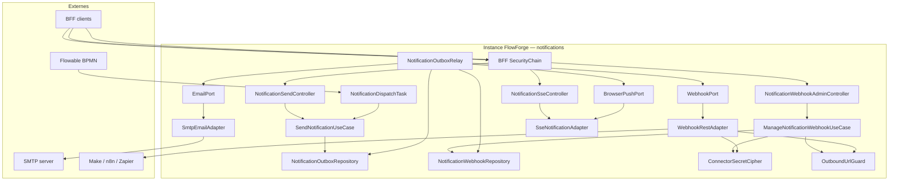

# System Design & Architecture

## Architecture Overview
**What is the high-level system structure?**

Tranche **notifications** (requirements `reviewed`) : dispatcher hexagonal,
outbox dédiée + `nextAttemptAt` + lock batch, trois adaptateurs (SMTP,
RestClient single-shot, SSE multi-emitter + heartbeat), admin webhooks,
ServiceTask Flowable, API send async + stream. Retry = outbox only
(**D-RETRY 2** / **D-BACKOFF 1**).



### Stack

Java 25 · Spring Boot 4.x · Flowable 8 · Spring Mail · Spring RestClient ·
Spring Data JPA · Liquibase · H2 MODE=PostgreSQL IT · ArchUnit · GreenMail
(test) optionnel. **Pas** de `spring-retry` requis V1 (D-RETRY 2).

### Responsabilités

| Zone | Rôle |
|---|---|
| `domain.notification.port.in` | `SendNotificationUseCase`, `ManageNotificationWebhookUseCase` |
| `domain.notification.port.out` | `EmailPort`, `WebhookPort`, `BrowserPushPort`, `NotificationOutboxRepository`, `NotificationWebhookRepository` |
| `domain.notification.usecase` | Validation + fan-out outbox ; admin CRUD ; **pas d’I/O réseau canal** |
| `domain.notification.model` | `NotificationEvent`, `NotificationChannel`, outbox/webhook records |
| `domain.connector.port.out` | `ConnectorSecretCipher` **étendu** `encrypt`/`decrypt` string (**DD-CIPHER 2**) |
| `infrastructure.notification` | SMTP, WebhookRest+SSRF+HMAC+envelope, SSE adapter+heartbeat, relay+purge |
| `infrastructure.flowable` | `NotificationDispatchTask` |
| `infrastructure.web.notification` | Controllers admin / send / stream + handlers |
| `infrastructure.persistence.notification` | JPA + Liquibase `006-notification-tables` |

Le use case d’envoi **n’appelle pas** les ports de canal : uniquement écriture
outbox. Le relais charge la config webhook, appelle les ports, gère
attempts / `nextAttemptAt` / DEAD / purge.

`NoOpWorkflowEventPublisher` **inchangé** (D-PUBLISHER).

---

## Data Models
**What data do we need to manage?**

### Domaine

```text
NotificationChannel { EMAIL, WEBHOOK, BROWSER }

NotificationEvent(
  List<NotificationChannel> channels,          // dédup A12
  String to?, String subject?, String body?,   // EMAIL — tous requis si canal
  String userId?,                              // BROWSER = OIDC sub
  UUID webhookConfigId?,                       // WEBHOOK
  Map<String,Object> payload                   // WEBHOOK+BROWSER; défaut {}
)

SendNotificationUseCase.send(event) -> List<UUID> outboxIds

ManageNotificationWebhookUseCase
  create / get / list / update / softDelete / restore

NotificationOutboxRecord(
  UUID id,
  NotificationChannel channel,
  NotificationOutboxStatus status,  // PENDING | PROCESSED | DEAD
  String payloadJson,
  int attempts,                     // ++ on failure; DEAD when >= maxAttempts (3)
  Instant nextAttemptAt,
  String lastError?,
  Instant createdAt, Instant updatedAt, Instant processedAt?
)

NotificationWebhookConfig(
  UUID id, String name, String targetUrl,
  String secretCiphertext?, boolean enabled,
  Instant deletedAt?, Instant createdAt, Instant updatedAt
)

ConnectorSecretCipher  // étendu
  encryptPasswordFields / decryptPasswordFields  // existant
  encrypt(tenantId, plaintext) -> ciphertext     // DD-CIPHER 2
  decrypt(tenantId, ciphertext) -> plaintext
```

### Snapshot outbox par canal (payloadJson)

- **EMAIL :** `{ "to", "subject", "body" }`
- **WEBHOOK :** `{ "webhookConfigId", "payload": {…} }`
- **BROWSER :** `{ "userId", "payload": {…} }`

### Envelope HTTP webhook sortant (**DD-ENVELOPE = 1**)

```json
{
  "type": "notification",
  "outboxId": "<uuid>",
  "at": "<ISO-8601>",
  "payload": { }
}
```

HMAC-SHA256 (**A9**) calculé sur les **bytes exacts** de ce JSON sérialisé
(`Content-Type: application/json`).

### Persistance Liquibase `006-notification-tables`

**`notification_webhook`** — colonnes phase 2 inchangées (soft delete A7).

**`notification_outbox`**

| Colonne | Type | Notes |
|---|---|---|
| id | UUID PK | |
| tenant_id | VARCHAR NOT NULL | |
| channel | VARCHAR NOT NULL | |
| status | VARCHAR NOT NULL | PENDING/PROCESSED/DEAD |
| payload_json | JSON/JSONB | |
| attempts | INT NOT NULL | défaut 0 |
| next_attempt_at | TIMESTAMPTZ NOT NULL | initial = createdAt |
| last_error | VARCHAR NULL | |
| created_at / updated_at | TIMESTAMPTZ | |
| processed_at | TIMESTAMPTZ NULL | |

Index : `(status, next_attempt_at)` pour éligibilité.

---

## API Design
**How do components communicate?**

### Admin webhooks

```http
POST /api/notification-webhooks → 201
{ "name", "targetUrl", "secret?", "enabled?" }

PATCH /api/notification-webhooks/{id}
{ "name?", "targetUrl?", "secret?", "enabled?", "restore?" }  // restore:true (pattern connecteurs)

DELETE /api/notification-webhooks/{id}  // soft delete
```

Secret masqué en réponse. `OutboundUrlGuard` à l’écriture (create/patch URL).

### Send

```http
POST /api/notifications/send
{ "channels": ["EMAIL","WEBHOOK"], "to", "subject", "body",
  "userId", "webhookConfigId", "payload": {} }
→ 202 { "outboxIds": ["…"] }
```

### SSE

```http
GET /api/notifications/stream
Accept: text/event-stream
event: notification
data: {"id":"…","payload":{…},"at":"…"}

: ping   (ou event: ping) toutes les ~15–30s  // DD-HEARTBEAT 2
```

**DD-SSE-MULTI = 2** : `Map<sub, Set<SseEmitter>>` — fan-out à tous les
emitters du `sub` ; completion retire l’emitter du set.

### Ports out

```text
EmailPort.send(to, subject, body)                 // text/plain
WebhookPort.send(WebhookDeliveryCommand cmd)      // 1 HTTP ; envelope+HMAC
  // cmd: targetUrl, secretPlain?, outboxId, at, payloadMap
BrowserPushPort.push(userId, eventMap) -> boolean // true si ≥1 emitter livré

NotificationOutboxRepository
  savePending(...)
  lockNextPending(batchSize) -> List<...>   // DD-LOCK 1 ; éligibles only
  markProcessed / markDead / recordFailure(id, error, maxAttempts)
  purgeTerminalOlderThan(retention)         // PROCESSED + DEAD (DD-PURGE 1)
```

`recordFailure` : `attempts++` ; si `attempts < maxAttempts` → reste PENDING
avec `nextAttemptAt = now + backoff(attempts)` (1s/2s/4s) ; sinon `DEAD`.

### Webhook adapter

1. `OutboundUrlGuard.assertSafe(url)` (A13 profils test/local).
2. Sérialiser envelope DD-ENVELOPE ; HMAC si secret (A9).
3. Un appel RestClient POST ; pas de redirect ; timeout config.
4. Exception → relais `recordFailure`.

### Flowable

`NotificationDispatchTask` : variables requirements → `NotificationEvent` →
`SendNotificationUseCase` ; contexte system delegate si convention projet.

### Config (`app.notification`)

```text
outbox.batch-size=20
outbox.max-attempts=3
outbox.poll-delay=1s
outbox.retention=7d          // DD-PURGE
webhook.connect-timeout / read-timeout
sse.heartbeat-interval=15s   // DD-HEARTBEAT
mail.*                       // Spring Mail
```

---

## Component Breakdown
**What are the major building blocks?**

1. Domain validation + `SendNotificationUseCase` fan-out.
2. `ManageNotificationWebhookUseCase` + cipher + SSRF validate.
3. Persistence JPA + Liquibase 006.
4. Canal adapters : SMTP, WebhookRest, Sse (+ heartbeat scheduler).
5. `NotificationOutboxRelay` : lock → dispatch → failure/backoff → purge.
6. HTTP controllers BFF + `NotificationDispatchTask`.
7. Extension `ConnectorSecretCipher` + impl `EnvMasterKeyCipher`.

---

## Design Decisions
**What choices have we made and why?**

| Id | Décision | Rationale |
|---|---|---|
| DD-OUTBOX-SEP | Table séparée du workflow | Cycles de vie distincts |
| DD-UC-NO-IO | Use case send sans I/O canal | Testabilité / outbox |
| DD-SOFT-DEL | Soft delete + restore webhooks | Aligné connecteurs |
| DD-SSRF-GUARD | Guard infra dédié | Domaine pur |
| DD-CIPHER | Étendre `ConnectorSecretCipher` encrypt/decrypt | API claire (choix stakeholder) |
| DD-SSE-MEM | Emitters in-JVM | Instance=tenant ; multi-réplica hors V1 |
| DD-SSE-MULTI | Set d’emitters / sub | Multi-onglets |
| DD-HEARTBEAT | Ping SSE périodique | Proxies idle |
| DD-RETRY-OUTBOX | Retry via attempts + nextAttemptAt | D-RETRY / D-BACKOFF |
| DD-LOCK | `lockNextPending` batch | Aligné workflow ; safe scale |
| DD-PURGE | TTL PROCESSED+DEAD | Aligné retention workflow |
| DD-ENVELOPE | `{type,outboxId,at,payload}` | HMAC + ops |
| DD-PAYLOAD-BOTH | payload → webhook + SSE | D-PAYLOAD |
| DD-PUBLISHER-NOOP | Publisher inchangé | D-PUBLISHER |
| DD-EMAIL-STRICT | to+subject+body, text/plain | D-EMAIL-VAL |

### Alternatives écartées (phase 3)

| Sujet | Écarté | Pourquoi |
|---|---|---|
| Envelope | Payload brut / meta headers | Moins traçable / signature partielle |
| Cipher | Helper map only / crypto ad hoc | Stakeholder veut API encrypt/decrypt |
| Heartbeat | Aucun / timeout court | Coupures proxy / chatty |
| Purge | Différer / garder DEAD forever | Dette disque |
| Lock | Select sans claim / lease verbeux | Course / complexité |
| SSE multi | last-wins / 409 | Mauvaise UX onglets |

---

## Non-Functional Requirements
**How should the system perform?**

- **Security :** authz D-AUTHZ ; CSRF mutateurs ; secrets chiffrés ; SSRF ;
  HMAC sortant ; pas de secret en logs/API.
- **Reliability :** outbox + lock + backoff + DEAD ; BROWSER skip ≠ DEAD.
- **Scalability V1 :** mono-instance/tenant (déc. 13) ; SSE mémoire +
  multi-emitter ; chemin multi-réplica SSE documenté hors V1 (A4).
- **Performance soft :** timeout webhook ; batch relais borné ; heartbeat
  léger ; pas de SLA CI sur latence SMTP.
- **Operability :** retention 7j ; logs `tenantId`/canal/outboxId ; métriques
  riches Micrometer hors gate (A5).

---

## Requirements coverage

| Requirements | Design |
|---|---|
| D-SCOPE B / 3 canaux + outbox | Architecture + relay |
| D-WH-CFG / admin CRUD | Manage UC + API |
| D-HTTP / send 202 + SSE | Controllers |
| D-AUTHZ | Security NFR + PreAuthorize |
| D-OUTBOX / D-FANOUT / D-RETRY / D-BACKOFF | Model + recordFailure + nextAttemptAt |
| D-SSE / D-PAYLOAD | Adapter multi-emitter + payload SSE |
| D-SSRF / D-SECRET / A9 | Guard + cipher étendu + HMAC envelope |
| D-EMAIL / D-EMAIL-VAL | SmtpEmailAdapter text/plain |
| D-FLOWABLE / D-SEND / D-PUBLISHER | Task + send API ; NoOp inchangé |
| A7 soft-delete / A11 mail / A13 http test | Admin + stack + guard |
| Success criteria Liquibase / Jacoco | 006 + testing sync |

---

## Open design items

| # | Item | Disposition |
|---|---|---|
| DQ1 | Cipher API | **Clos** — DD-CIPHER 2 |
| DQ2 | Heartbeat SSE | **Clos** — DD-HEARTBEAT 2 (~15–30s) |
| DQ3 | Purge outbox | **Clos** — DD-PURGE 1 (7d défaut) |
| DQ4 | Envelope webhook | **Clos** — DD-ENVELOPE 1 |
| DQ5 | Lock outbox | **Clos** — DD-LOCK 1 |
| DQ6 | Multi-onglets SSE | **Clos** — DD-SSE-MULTI 2 |

**Phase 3 close** (2026-08-07) — design `reviewed`.  
**Phase 4 close** (2026-08-07) — planning `ready` (T1–T16).  
**Phase 5–7 close** (2026-08-07) — implementation `checked` / aligned ;
A13 SSRF précisé (http loopback only).  
**Prochaine phase :** 8 — Write Tests.

## Sources

- Requirements `notifications` `reviewed` (2026-08-07)
- `docs/specs/09-notifications.md`, `01-architecture-hexagonale.md`
- Code : `OutboxRelayScheduler`, `JpaOutboxRepositoryAdapter.recordFailure`,
  `ConnectorSecretCipher`, `WorkflowProperties.Outbox`
