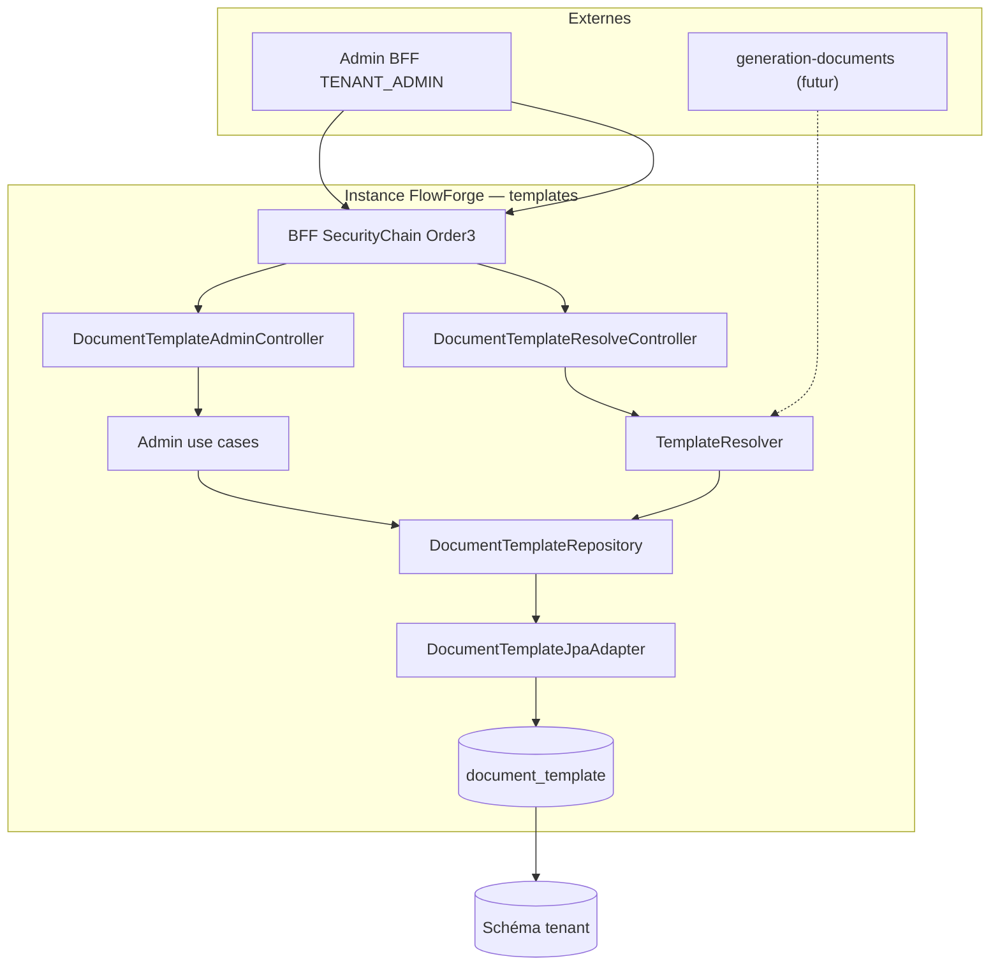

# System Design & Architecture

## Architecture Overview
**What is the high-level system structure?**

Tranche **templates-documents** (requirements draft) : stockage versionné
Thymeleaf en PostgreSQL, résolution multi-variants, API admin
`TENANT_ADMIN`. PDF / Flowable ServiceTask hors scope
(`generation-documents`).



### Stack

Java 25 · Spring Boot 4.x · Spring Security BFF · Spring Data JPA ·
Liquibase · H2 MODE=PostgreSQL IT · ArchUnit. **Pas** de Flying Saucer /
jsoup / MinIO dans cette tranche.

### Responsabilités

| Zone | Rôle |
|---|---|
| `domain.document.model` | `DocumentTemplate`, `TemplateStatus`, `TemplateResolutionRequest` |
| `domain.document.port.out` | `DocumentTemplateRepository` |
| `domain.document.port.in` | Ports admin + resolve |
| `domain.document.usecase` | Create / patch / activate / archive / new-version / list / get / resolve |
| `infrastructure.persistence.document` | JPA entity + adapter + mapper |
| `infrastructure.web.document` | Controllers REST admin + resolve |

---

## Data Models
**What data do we need to manage?**

### Domaine (pur Java — décision n° 17)

```text
DocumentTemplate(
  UUID id,
  String templateKey,      // requis
  String variantKey,       // nullable = défaut
  String locale,           // nullable = défaut
  String label,
  int version,             // 1..n monotone par combinaison
  TemplateStatus status,   // DRAFT | ACTIVE | ARCHIVED
  String htmlContent,
  String tenantId,
  Instant createdAt,
  Instant updatedAt,
  String updatedBy
)
```

### Persistance

Table `document_template` :

| Colonne | Type | Notes |
|---|---|---|
| id | UUID PK | |
| tenant_id | VARCHAR NOT NULL | |
| template_key | VARCHAR NOT NULL | |
| variant_key | VARCHAR NULL | null = défaut |
| locale | VARCHAR NULL | null = défaut |
| label | VARCHAR | |
| version | INT NOT NULL | |
| status | VARCHAR NOT NULL | DRAFT/ACTIVE/ARCHIVED |
| html_content | TEXT NOT NULL | |
| created_at / updated_at | TIMESTAMPTZ | |
| updated_by | VARCHAR | |

Contraintes :

- Unique partiel ACTIVE (**DD-ACTIVE-UQ**) :
  `(tenant_id, template_key, COALESCE(variant_key,''), COALESCE(locale,''))
  WHERE status = 'ACTIVE'`
- Unique version (**DD-VER-UQ**) :
  `(tenant_id, template_key, COALESCE(variant_key,''), COALESCE(locale,''),
  version)`

Liquibase : `004-document-template-tables.yaml`.

---

## API Design
**What are the interfaces?**

Aligné requirements surface. Corps JSON (esquisse) :

**POST create**
```json
{
  "templateKey": "contrat",
  "variantKey": "premium",
  "locale": "fr",
  "label": "Contrat premium FR",
  "htmlContent": "<html th:text=\"${title}\">...</html>"
}
```
→ 201 `DRAFT`, `version` = max existant + 1 (ou 1).

**PATCH draft** — `label` et/ou `htmlContent` ; statut ≠ DRAFT → 409.

**POST activate / archive / new-version** — body vide ; new-version
retourne le nouveau `DRAFT`.

**GET resolve?templateKey=&variantKey=&locale=** → 200 template ACTIVE
résolu (contenu inclus) ou 404.

Erreurs `ProblemDetail` : 400 validation, 401/403 sécurité, 404 inconnu,
409 conflit cycle de vie / unique ACTIVE.

---

## Components & Services

| Composant | Comportement |
|---|---|
| `CreateDocumentTemplateUseCase` | Valide ; version = max+1 ; status DRAFT |
| `UpdateDocumentTemplateUseCase` | DRAFT only |
| `ActivateDocumentTemplateUseCase` | TX : archive ACTIVE courante → ACTIVE nouvelle |
| `ArchiveDocumentTemplateUseCase` | ACTIVE → ARCHIVED |
| `NewDocumentTemplateVersionUseCase` | Clone html/label/keys → nouveau DRAFT |
| `List/GetDocumentTemplateUseCase` | Lecture tenant courant |
| `TemplateResolver` / `ResolveDocumentTemplateUseCase` | Cascade 4 niveaux |

`tenantId` toujours `TenantProperties.id()` — jamais depuis le body client.

---

## Design Decisions

| Id | Décision | Rationale |
|---|---|---|
| DD-ACTIVE-UQ | Index unique partiel ACTIVE + COALESCE | Garantit 1 ACTIVE même sous concurrence |
| DD-VER-UQ | Unique (combinaison, version) | Empêche doublons de version |
| DD-ACTIVATE-TX | Archive + activate dans une TX | Cohérence cycle de vie |
| DD-RESOLVE-ORDER | Ordre cascade analyse § résolution | Spécificité décroissante |
| DD-NO-SOFT-DELETE | Pas de `deleted_at` | ARCHIVED suffit (D-DELETE) |
| DD-MAX-HTML | 1 MiB `htmlContent` | Bornes alignées connecteurs |
| DD-PKG | Package `document` existant | Placeholders déjà réservés |

### Alternatives écartées

- Fichiers classpath / Git pour templates — pas de multi-tenant versionné.
- Édition in-place ACTIVE — casse audit / génération en cours.
- Soft-delete + ARCHIVED — redondant.

---

## Security & Performance

- `@PreAuthorize("hasRole('TENANT_ADMIN')")` sur tous les endpoints.
- CSRF sur mutateurs BFF.
- Pas de chaîne Security nouvelle (BFF Order 3 suffit).
- Contenu HTML potentiellement large : borne 1 MiB ; pas d’index full-text V1.
- Resolve : jusqu’à 4 lectures ; acceptable V1 ; optimisation OR-query
  possible follow-up.

## Open design items

| # | Item | Disposition |
|---|---|---|
| O1 | Endpoint resolve séparé vs query sur collection | **Resolve dédié** (clarity) |
| O2 | Retourner htmlContent dans list | **Oui V1** (admin) ; mask ultérieur si besoin |
| O3 | Optimistic locking `@Version` JPA | **Nice** — follow-up si conflits PATCH fréquents |
| O4 | Compile Thymeleaf à l’activate | **Différé** (D-VALIDATE) |
