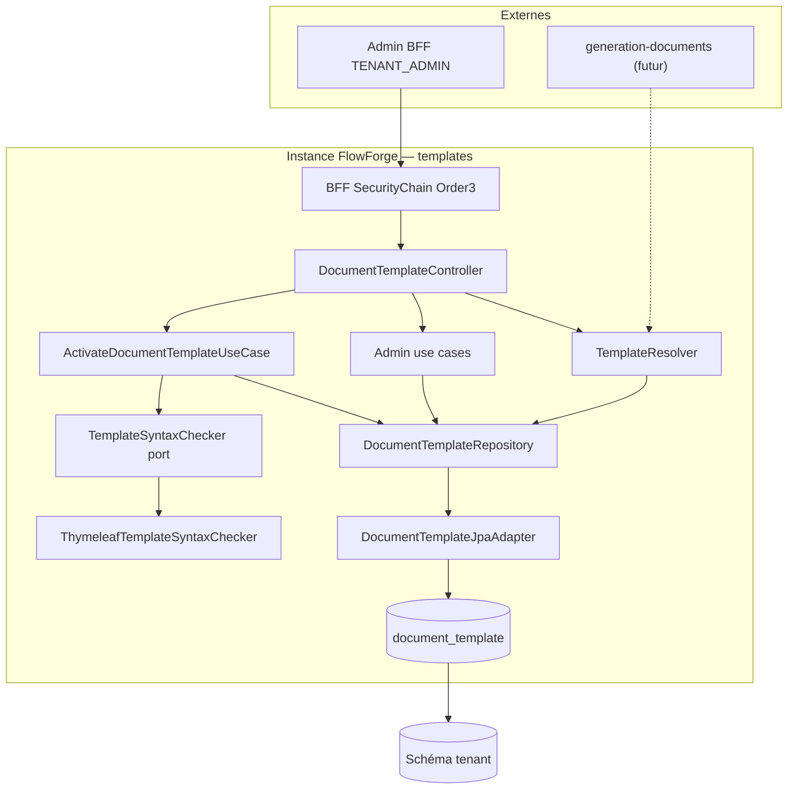

# System Design & Architecture

## Architecture Overview
**What is the high-level system structure?**

Tranche **templates-documents** (requirements `reviewed`) : stockage versionné
Thymeleaf en PostgreSQL, résolution multi-variants, API admin
`TENANT_ADMIN`. PDF / Flowable ServiceTask hors scope
(`generation-documents`).



### Stack

Java 25 · Spring Boot 4.x · Spring Security BFF · Spring Data JPA ·
Liquibase · H2 MODE=PostgreSQL IT · ArchUnit ·
`spring-boot-starter-thymeleaf` (**déjà au pom**) pour le checker syntaxe.
**Pas** de Flying Saucer / jsoup / MinIO dans cette tranche.

### Responsabilités

| Zone | Rôle |
|---|---|
| `domain.document.model` | `DocumentTemplate`, `TemplateStatus`, `TemplateResolutionRequest` |
| `domain.document.port.out` | `DocumentTemplateRepository`, `TemplateSyntaxChecker` |
| `domain.document.port.in` | Ports admin + resolve |
| `domain.document.usecase` | Create / patch / activate / archive / new-version / list / get / resolve |
| `infrastructure.document` | `ThymeleafTemplateSyntaxChecker` (StringTemplateResolver, syntaxe only) |
| `infrastructure.persistence.document` | JPA entity + adapter + mapper + ranked resolve query |
| `infrastructure.web.document` | `DocumentTemplateController` (admin + resolve) |

---

## Data Models
**What data do we need to manage?**

### Domaine (pur Java — décision n° 17)

```text
DocumentTemplate(
  UUID id,
  String templateKey,      // requis
  String variantKey,       // nullable = défaut
  String locale,           // nullable = défaut
  String label,
  int version,             // 1..n monotone par combinaison
  TemplateStatus status,   // DRAFT | ACTIVE | ARCHIVED
  String htmlContent,
  String tenantId,
  Instant createdAt,
  Instant updatedAt,
  String updatedBy
)
```

### Persistance

Table `document_template` :

| Colonne | Type | Notes |
|---|---|---|
| id | UUID PK | |
| tenant_id | VARCHAR NOT NULL | |
| template_key | VARCHAR NOT NULL | |
| variant_key | VARCHAR NULL | null = défaut |
| locale | VARCHAR NULL | null = défaut |
| label | VARCHAR | |
| version | INT NOT NULL | |
| status | VARCHAR NOT NULL | DRAFT/ACTIVE/ARCHIVED |
| html_content | TEXT NOT NULL | max app **5 MiB** |
| created_at / updated_at | TIMESTAMPTZ | |
| updated_by | VARCHAR | |
| *(H2 only)* active_* generated | | Pour unique ACTIVE — **DD-H2-UQ** |

Contraintes (**D-UQ**) :

- **PostgreSQL — DD-ACTIVE-UQ :**
  ```sql
  CREATE UNIQUE INDEX uq_template_active
    ON document_template (
      tenant_id, template_key,
      COALESCE(variant_key, ''), COALESCE(locale, '')
    )
    WHERE status = 'ACTIVE';
  ```
- **PostgreSQL — DD-VER-UQ :**
  unique
  `(tenant_id, template_key, COALESCE(variant_key,''), COALESCE(locale,''), version)`
- **H2 — DD-H2-UQ :** colonnes générées du type
  `active_variant_key = CASE WHEN status='ACTIVE' THEN COALESCE(variant_key,'') ELSE NULL END`
  (idem locale / key / tenant) + `CREATE UNIQUE INDEX` dessus — même pattern
  que `002` / `003`.
- **Pas** de unique global `(tenant, key, variant, locale)` sans version.

Liquibase : `004-document-template-tables.yaml`.

Pas de `@Version` JPA V1 (**DD-NO-OPTLOCK**).

---

## API Design
**What are the interfaces?**

Aligné requirements surface. Un seul controller
`DocumentTemplateController` sous `/api/document-templates`
(**DD-ONE-CONTROLLER**).

**POST create**
```json
{
  "templateKey": "contrat",
  "variantKey": "premium",
  "locale": "fr",
  "label": "Contrat premium FR",
  "htmlContent": "<html th:text=\"${title}\">...</html>"
}
```
→ 201 `DRAFT`, `version` = max existant + 1 (ou 1). Blank variant/locale → null.

**PATCH draft** — `label` et/ou `htmlContent` ; statut ≠ DRAFT → 409 ;
clés immuables.

**GET list** — résumé sans `htmlContent` ; `?includeContent=true` + filtre
`templateKey` (**D-LIST**).

**GET `/{id}`** — détail complet ; `{id}` UUID.

**POST activate / archive / new-version** — body vide.
Activate : `TemplateSyntaxChecker.check(html)` puis TX archive+activate.
Syntaxe KO → 400, reste DRAFT.

**GET `/resolve?templateKey=&variantKey=&locale=`** — path littéral ;
contenu inclus ; 404 si aucun ACTIVE.

Erreurs `ProblemDetail` : 400 validation / Thymeleaf syntaxe, 401/403,
404, 409 cycle de vie / unique ACTIVE / unique version.

---

## Components & Services

| Composant | Comportement |
|---|---|
| `CreateDocumentTemplateUseCase` | Valide blank/taille ; version = max+1 ; DRAFT |
| `UpdateDocumentTemplateUseCase` | DRAFT only ; label/html |
| `ActivateDocumentTemplateUseCase` | Checker port → TX archive ACTIVE → ACTIVE |
| `ArchiveDocumentTemplateUseCase` | ACTIVE → ARCHIVED |
| `NewDocumentTemplateVersionUseCase` | Clone → nouveau DRAFT version+1 |
| `ListDocumentTemplateUseCase` | Filtre key ; strip html sauf flag |
| `GetDocumentTemplateUseCase` | Par id + tenant |
| `ResolveDocumentTemplateUseCase` / `TemplateResolver` | Délègue ranked query repo |
| `TemplateSyntaxChecker` (port) | `void check(String html)` ou erreur métier |
| `ThymeleafTemplateSyntaxChecker` | `StringTemplateResolver` + parse **sans** variables métier (**DD-THYMELEAF-SCOPE**) |
| `DocumentTemplateJpaAdapter` | CRUD + `findBestActive(tenant, key, variant, locale)` |

`tenantId` toujours `TenantProperties.id()` — jamais depuis le body.

### Resolve ranked (**DD-RESOLVE-SQL**)

Une requête ACTIVE du tenant + `template_key`, scorée :

| Priorité | Match |
|---|---|
| 1 | `variant_key` IS NOT DISTINCT FROM :variant AND `locale` IS NOT DISTINCT FROM :locale |
| 2 | variant match AND locale IS NULL |
| 3 | variant IS NULL AND locale match |
| 4 | variant IS NULL AND locale IS NULL |

`ORDER BY score LIMIT 1` (ou équivalent JPQL/Criteria/native). Null request
variant/locale = demande du défaut (niveaux 2–4 selon analyse).

---

## Design Decisions

| Id | Décision | Rationale |
|---|---|---|
| DD-ACTIVE-UQ | Index unique partiel ACTIVE + COALESCE (PG) | 1 ACTIVE sous concurrence |
| DD-VER-UQ | Unique (combinaison, version) | Pas de doublon version |
| DD-H2-UQ | Generated columns + unique (H2) | Parité IT ; pattern 002/003 |
| DD-ACTIVATE-TX | Archive + activate atomiques | Cohérence cycle de vie |
| DD-RESOLVE-SQL | Une requête ranked/OR | Confirmé stakeholder DQ4 |
| DD-RESOLVE-ORDER | Scores 1→4 analyse | Spécificité décroissante |
| DD-THYMELEAF-SCOPE | Syntaxe seule, pas de vars métier | Confirmé DQ1 |
| DD-CHECKER-PORT | Port out + adaptateur infra | Confirmé DQ2 ; ArchUnit |
| DD-LIST-CONTENT | `?includeContent=true` | D-LIST 3 |
| DD-MAX-HTML | 5 MiB | A1 stakeholder |
| DD-NO-SOFT-DELETE | Pas de `deleted_at` | D-DELETE |
| DD-NO-OPTLOCK | Pas de `@Version` V1 | Confirmé DQ5 |
| DD-ONE-CONTROLLER | Un controller admin+resolve | Surface bornée |
| DD-PKG | Package `document` existant | Placeholders prêts |

### Alternatives écartées

| Approche | Verdict |
|---|---|
| 4 `findActive` séquentiels | Écartée (DQ4 → ranked) |
| Checker appelé depuis le controller | Écartée (hexagone) |
| Process Thymeleaf avec contexte vide | Écartée (trop strict) |
| `@Version` / ETag V1 | Différé |
| Unique applicatif sans index | Écartée (races) |

---

## Non-Functional Requirements

### Security
- `@PreAuthorize("hasRole('TENANT_ADMIN')")` sur tous les endpoints.
- CSRF sur mutateurs BFF.
- Pas de nouvelle SecurityChain.
- Checker : pas d’évaluation d’expressions métier / I/O externes.

### Performance
- HTML jusqu’à 5 MiB ; liste sans contenu par défaut.
- Resolve : **1** round-trip ranked.
- Activate : parse Thymeleaf + 1 TX.

### Reliability
- Unicité ACTIVE / version au niveau SQL.
- Race activate / version → map `DataIntegrityViolation` → 409.

---

## Requirements coverage

| Requirements | Design |
|---|---|
| D-SCOPE CRUD + resolve | Controllers + use cases + repo |
| D-MODEL / D-NULL / A7 | Record + normalisation blank→null |
| D-VERSION / D-MULTI-DRAFT / D-EDIT | Use cases lifecycle |
| D-RESOLVE cascade | DD-RESOLVE-SQL ranked scores 1–4 |
| D-RESOLVE-API / PATH | GET `/resolve` littéral |
| D-ADMIN | `@PreAuthorize` TENANT_ADMIN |
| D-DELETE ARCHIVED | Pas soft-delete / DELETE |
| D-UQ | DD-ACTIVE-UQ + DD-VER-UQ + DD-H2-UQ |
| D-VALIDATE parse activate | DD-THYMELEAF-SCOPE + DD-CHECKER-PORT |
| D-LIST includeContent | DD-LIST-CONTENT |
| A1 5 MiB | DD-MAX-HTML |
| Non-goals PDF/Flowable | Hors composants |

## Open design items

| # | Item | Disposition |
|---|---|---|
| O1 | Resolve path | **Clos** — path littéral |
| O2 | htmlContent liste | **Clos** — DD-LIST-CONTENT |
| O3 | Optimistic locking | **Clos différé** — DD-NO-OPTLOCK V1 |
| O4 | Compile activate | **Clos** — DD-THYMELEAF-ACTIVATE / SCOPE |
| O5 | Portée parse | **Clos stakeholder** — syntaxe only (DQ1) |
| O6 | Placement checker | **Clos stakeholder** — port out (DQ2) |
| O7 | H2 vs PG unique | **Clos stakeholder** — dual SQL (DQ3) |
| O8 | Cascade SQL | **Clos stakeholder** — ranked (DQ4) |
| O9 | Détail JPQL vs native ranked | **Impl** — adapter libre si scores respectés |

**Phase 3 close** (2026-08-03) — statut `reviewed`.
**Phase 4** — plan de tâches (`dev-planning`).
