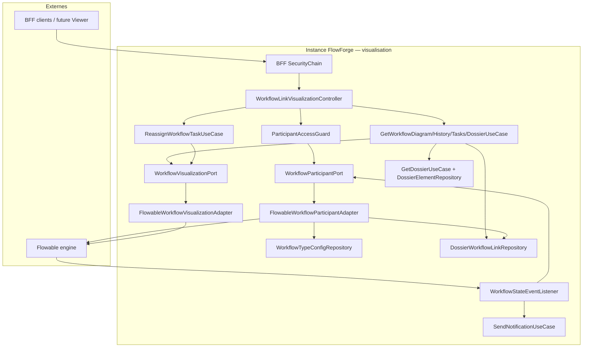

# System Design & Architecture

## Architecture Overview
**What is the high-level system structure?**

Tranche **visualisation-workflow** (requirements `draft`) : lecture runtime
Flowable (diagramme XML + états + historique + tâches), réassignation
admin, résolution des participants (initiateur / assignés / observateurs),
panneau dossier lié, et push SSE `WORKFLOW_STATE_CHANGED`. **Pas d’UI Vue**
(D-SCOPE A).



### Stack

Java 25 · Spring Boot 4.x · Flowable 8 (`RepositoryService`,
`RuntimeService`, `HistoryService`, `TaskService`, `BpmnXMLConverter`) ·
Spring Data JPA · Liquibase · notifications SSE existantes · ArchUnit ·
H2 MODE=PostgreSQL IT.

### Responsabilités

| Zone | Rôle |
|---|---|
| `domain.workflow.port.out` | `WorkflowVisualizationPort`, `WorkflowParticipantPort` |
| `domain.workflow.port.in` | Get diagram/history/tasks/dossier ; Reassign task |
| `domain.workflow.usecase` | Authz participant / admin ; orchestration ; **pas d’I/O HTTP** |
| `domain.workflow.model` | `WorkflowDiagramView`, `ActivityHistoryEntry`, `WorkflowTaskView` ; étendre `WorkflowTypeConfig` |
| `infrastructure.flowable` | `FlowableWorkflowVisualizationAdapter`, `FlowableWorkflowParticipantAdapter`, `WorkflowStateEventListener` |
| `infrastructure.web.workflow` | Controller viz + handler 409 RESERVED |
| `infrastructure.persistence.workflow` | Colonne / JSON `observer_user_ids` + mapping config |

---

## Data Models
**What data do we need to manage?**

### Domaine

```text
WorkflowDiagramView(
  String bpmnXml,
  List<String> activeIds,
  List<String> completedIds,
  List<String> failedIds
)

ActivityHistoryEntry(
  String activityId, String name, String assignee?,
  Instant startTime, Instant endTime?, Long durationMs?
)

WorkflowTaskView(
  String taskId, String name, String assignee?,
  String taskDefinitionKey?, Instant createTime
)

WorkflowTypeConfig(… existing …, List<String> observerUserIds)  // D-OBS-ID

WorkflowVisualizationPort
  getDiagram(processInstanceId, tenantId) -> WorkflowDiagramView
  getHistory(processInstanceId, tenantId) -> List<ActivityHistoryEntry>
  listActiveTasks(processInstanceId, tenantId) -> List<WorkflowTaskView>
  reassignTask(taskId, assigneeId, tenantId)

WorkflowParticipantPort
  findParticipantUserIds(linkId) -> List<String>  // distinct subs
```

### Résolution participants (**DD-PART**)

Pour un `DossierWorkflowLink` avec `processInstanceId` :

1. `startUserId` historic process (si non blank)
2. Assignees tâches actives + historiques (non blank), distinct
3. `WorkflowTypeConfig.observerUserIds` pour
   `(tenantId, processDefinitionKey)` (défaut `[]`)

Bypass TA/WA : **hors** du port — appliqué dans le guard HTTP / use case
(`AccessContext.User.roles`).

Si link RESERVED : participants = observateurs config + (pas d’initiateur
Flowable) ; les endpoints viz renvoient **409** avant lecture moteur
(D-RESERVED) — le guard peut court-circuiter après résolution link.

### Persistance Liquibase `007-workflow-type-config-observers`

| Table | Colonne | Type | Notes |
|---|---|---|---|
| `workflow_type_config` | `observer_user_ids` | JSON | NOT NULL, défaut `[]` |

Pas de nouvelle table. Migration additive.

### Dossier panel

Réutilise `Dossier` + `DossierElement`. Ajout port :

```text
DossierElementRepository.findByDossierIdOrderByAddedAtAsc(dossierId)
  -> List<DossierElement>
```

`relations` : liste vide constante V1 (pas de modèle relation).

---

## API Design
**How do components communicate?**

### Visualisation (nouveau controller)

Base : `/api/workflow-links/{linkId}`

```http
GET /diagram → 200 WorkflowDiagramView
GET /history → 200 ActivityHistoryEntry[]
GET /tasks → 200 WorkflowTaskView[]
GET /dossier → 200 { dossier, elements, relations: [] }
POST /tasks/{taskId}/reassign
Content-Type: application/json
X-CSRF-TOKEN: …
{ "assigneeId": "<oidc-sub>" }
→ 204
```

### Authz

| Endpoint | Règle |
|---|---|
| GET * | Authentifié + (`participant` **ou** TA/WA) |
| POST reassign | TA \| WA + CSRF |

| Cas | Status |
|---|---|
| Anonyme | 401 |
| Link absent / autre tenant | 404 |
| Non participant (GET) | 403 |
| Non WA/TA (reassign) | 403 |
| RESERVED | 409 |
| assigneeId blank | 400 |
| task inconnue / mauvaise instance | 404 |

### Admin config (existant, étendu)

Requêtes create/update `WorkflowTypeConfig` acceptent
`observerUserIds: string[]` ; réponses l’incluent. Validation : pas de
blank ; dédup case-sensitive ; défaut `[]`.

### SSE payload (**DD-SSE**)

```json
{
  "type": "WORKFLOW_STATE_CHANGED",
  "payload": {
    "linkId": "<uuid>",
    "processInstanceId": "<flowable-id>"
  }
}
```

Canal `BROWSER`, `userId` = chaque participant. Events Flowable :
`TASK_ASSIGNED`, `ACTIVITY_COMPLETED`, `PROCESS_COMPLETED`.
`isFailOnException = false`.

Résolution `linkId` depuis `processInstanceId` via
`DossierWorkflowLinkRepository` (méthode find-by-processInstanceId à
ajouter si absente).

---

## Component Breakdown
**What are the major building blocks?**

1. **Models + ports** — views, visualization + participant ports,
   exceptions (`WorkflowLinkReservedException`, reuse not-found /
   access-denied).
2. **Use cases** — load link → check reserved → check participant →
   delegate port ; reassign checks WA/TA.
3. **Flowable adapters** — XML via `BpmnXMLConverter` ; active ids ;
   completed finished activities ; failedIds `deleteReason` startsWith
   `"error"` ; tasks via `TaskService` ; reassign `setAssignee`.
4. **Participant adapter** — historic + runtime queries + config
   observers.
5. **Persistence 007** — `observer_user_ids` ; element list-by-dossier ;
   link find-by-processInstanceId.
6. **HTTP controller** + `ProblemDetail` mapping 409.
7. **WorkflowStateEventListener** → `SendNotificationUseCase`.

### Package layout

```
domain/workflow/port/out/WorkflowVisualizationPort.java
domain/workflow/port/out/WorkflowParticipantPort.java
domain/workflow/port/in/GetWorkflowDiagramUseCase.java
… History / Tasks / LinkDossier / Reassign …
domain/workflow/model/WorkflowDiagramView.java
… ActivityHistoryEntry, WorkflowTaskView …
domain/workflow/model/WorkflowTypeConfig.java  # + observerUserIds
infrastructure/flowable/FlowableWorkflowVisualizationAdapter.java
infrastructure/flowable/FlowableWorkflowParticipantAdapter.java
infrastructure/flowable/WorkflowStateEventListener.java
infrastructure/web/workflow/WorkflowLinkVisualizationController.java
db/changelog/changes/007-workflow-type-config-observers.yaml
```

---

## Design Decisions

| Id | Décision | Rationale |
|---|---|---|
| DD-URL | Paths `/api/workflow-links/{linkId}` | D-ID B ; stable dès réserve |
| DD-XML | XML natif Flowable, zéro conversion | Analyse ; bpmn-js futur |
| DD-PART | Port participants + bypass rôles en bordure | D-AUTHZ/PARTICIPANT |
| DD-OBS | JSON `observer_user_ids` sur config | D-OBS / D-OBS-ID |
| DD-FAIL | `deleteReason` préfixe `error` | D-FAIL A |
| DD-SSE | Listener → notif BROWSER existante | D-SSE A ; pas nouveau canal |
| DD-REL | `relations: []` constant | Lot relations différé |
| DD-GUARD | 404/403/409 alignés | D-DENY / D-RESERVED |

### Écarts vs analyse `10-visualisation-workflow.md`

| Analyse | Design V1 |
|---|---|
| `/api/workflows/{instanceId}/…` | `/api/workflow-links/{linkId}/…` |
| Composant Vue `WorkflowViewer` | Hors scope → `frontend` |
| Observateurs « configurés » (vague) | `WorkflowTypeConfig.observerUserIds` |

---

## Security & Performance

- **Authn** BFF OIDC existant ; mutateur CSRF.
- **Authz** participant pour lecture ; WA/TA pour reassign.
- **Tenant** : toutes les queries Flowable filtrées
  `processInstanceTenantId` / config `tenantId`.
- **Perf** : pas de cache V1 ; diagram = 1 conversion XML + 3 queries
  history/runtime ; acceptable pour consultation humaine.
- **Listener** non bloquant (`isFailOnException=false`) ; fan-out N
  notifs outbox (coût accepté).

## Sources

- Requirements `visualisation-workflow` (draft, décisions 2026-08-10)
- `analysis doc/10-visualisation-workflow.md`
- Code existant : `DossierWorkflowController`, `WorkflowEnginePort`,
  `SendNotificationUseCase`, `WorkflowTypeConfig`
