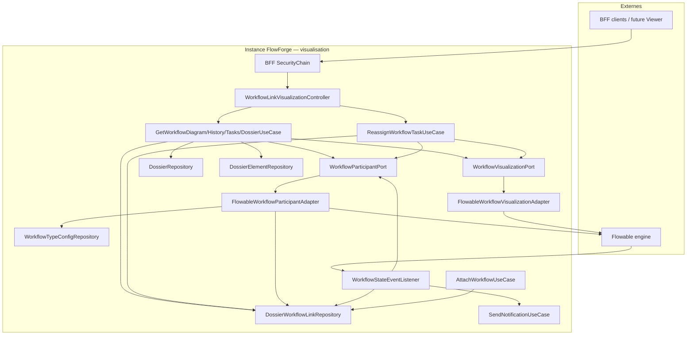

# System Design & Architecture

## Architecture Overview
**What is the high-level system structure?**

Tranche **visualisation-workflow** (requirements `reviewed`) : lecture runtime
Flowable (diagramme XML + états + historique + tâches), réassignation
admin, résolution des participants (`startedBy` / initiateur / assignés /
observateurs), panneau dossier lié, et push SSE `WORKFLOW_STATE_CHANGED`.
**Pas d’UI Vue** (D-SCOPE A). Authz dans les **use cases**
(DD-AUTHZ-LAYER A).



### Stack

Java 25 · Spring Boot 4.x · Flowable 8 (`RepositoryService`,
`RuntimeService`, `HistoryService`, `TaskService`, `BpmnXMLConverter`,
`FlowableEventListener`) · Spring Data JPA · Liquibase · notifications
SSE existantes · ArchUnit · H2 MODE=PostgreSQL IT.

### Responsabilités

| Zone | Rôle |
|---|---|
| `domain.workflow.port.out` | `WorkflowVisualizationPort`, `WorkflowParticipantPort` |
| `domain.workflow.port.in` | Get diagram/history/tasks/dossier ; Reassign task |
| `domain.workflow.usecase` | **Authz** participant / admin ; orchestration ; **pas d’I/O HTTP** |
| `domain.workflow.model` | Views ; étendre `WorkflowTypeConfig` |
| `domain.dossier.model` | Étendre `DossierWorkflowLink` + `startedBy` |
| `domain.dossier.port.in` | `AttachWorkflowUseCase.reserve(..., startedBy)` |
| `infrastructure.flowable` | Visualization + Participant adapters ; `WorkflowStateEventListener` |
| `infrastructure.web.workflow` | Controller mince → UC ; handler 409 |
| `infrastructure.persistence` | Liquibase 007 ; repos |

---

## Data Models
**What data do we need to manage?**

### Domaine

```text
WorkflowDiagramView(
  String bpmnXml,
  List<String> activeIds,
  List<String> completedIds,
  List<String> failedIds
)

ActivityHistoryEntry(
  String activityId, String name, String assignee?,
  Instant startTime, Instant endTime?, Long durationMs?
)

WorkflowTaskView(
  String taskId, String name, String assignee?,
  String taskDefinitionKey?, Instant createTime
)

WorkflowTypeConfig(… existing …, List<String> observerUserIds)

DossierWorkflowLink(… existing …, String startedBy?)  // R3 ; null interdit à la création V1

AttachWorkflowUseCase
  reserve(dossierId, processDefinitionKey, triggerRef, startedBy)
  reserveOrResume(dossierId, processDefinitionKey, triggerRef, startedBy)

WorkflowVisualizationPort
  getDiagram(processInstanceId, tenantId) -> WorkflowDiagramView
  getHistory(processInstanceId, tenantId) -> List<ActivityHistoryEntry>
  listActiveTasks(processInstanceId, tenantId) -> List<WorkflowTaskView>
  reassignTask(taskId, assigneeId, tenantId)
  // Optionnel helper: assertTaskOnInstance(taskId, processInstanceId)

WorkflowParticipantPort
  findParticipantUserIds(link) -> List<String>  // ou linkId ; distinct
```

### Résolution participants (**DD-PART** / R3)

Union distincte, blanks ignorés :

1. `link.startedBy` **toujours** (sauf si blank — ne devrait pas) ;
   `"system:outbox"` ne matche aucun `sub` humain (A11)
2. Si `processInstanceId` présent : `startUserId` historic + assignees
   runtime + historic
3. `WorkflowTypeConfig.observerUserIds` pour
   `(tenantId, processDefinitionKey)` (défaut `[]`)

Bypass TA/WA : **dans l’use case** (`AccessContext.User.roles`), pas dans
le port.

Si `processInstanceId` absent : participants = `startedBy` + observers ;
endpoints **moteur** → **409** (R1) ; `GET …/dossier` OK.

### Persistance Liquibase `007-workflow-viz-columns`

| Table | Colonne | Type | Notes |
|---|---|---|---|
| `workflow_type_config` | `observer_user_ids` | JSON | NOT NULL, défaut `[]` |
| `dossier_workflow_link` | `started_by` | VARCHAR(128) | NULL pour lignes legacy ; NOT NULL pour nouveaux inserts applicatifs |

Index utile : `(tenant_id, process_instance_id)` si absent (lookup listener).

### Dossier panel (**DD-DOSSIER-LOAD = A**)

**Ne pas** appeler `GetDossierUseCase` (ACL type). Après authz participant :

```text
dossier = DossierRepository.findById(link.dossierId)
elements = DossierElementRepository.findByDossierIdOrderByAddedAtAsc(...)
relations = []
```

---

## API Design
**How do components communicate?**

### Visualisation (controller mince)

Base : `/api/workflow-links/{linkId}`

```http
GET /diagram → 200 WorkflowDiagramView   # 409 si pas de processInstanceId
GET /history → 200 ActivityHistoryEntry[]
GET /tasks → 200 WorkflowTaskView[]
GET /dossier → 200 { dossier, elements, relations: [] }  # OK sans PI (R1)
POST /tasks/{taskId}/reassign
{ "assigneeId": "<oidc-sub>" }
→ 204
```

Controller : résout `Authentication` → `AccessContext.User`, délègue UC.
Pas de `ParticipantAccessGuard` séparé (DD-AUTHZ-LAYER A).

### Authz (dans UC)

| Endpoint | Règle UC |
|---|---|
| GET * | Authentifié + (`sub ∈ participants` **ou** TA/WA) |
| POST reassign | TA \| WA + CSRF (web) |

| Cas | Status |
|---|---|
| Anonyme | 401 |
| Link absent / autre tenant | 404 |
| Non participant (GET) | 403 |
| Non WA/TA (reassign) | 403 |
| `processInstanceId` null (diagram/history/tasks/reassign) | 409 |
| assigneeId blank | 400 |
| task inconnue / mauvaise instance | 404 |
| PI présent mais instance Flowable absente | 404 |

### Admin config (existant, étendu)

`POST|PATCH /api/workflow-type-configs` : `observerUserIds` ; validation
blank + dédup ; défaut `[]`. Authz TA|WA inchangée.

### Producteurs `startedBy` (**DD-STARTEDBY-SRC = A**)

| Producteur | Valeur |
|---|---|
| `ManualStartOrchestrator` / HTTP start | OIDC `sub` de l’appelant |
| `OutboxRelayScheduler` | `"system:outbox"` |
| `reserveOrResume` replay | conserve `startedBy` existant (ne pas écraser) |

### SSE payload (**DD-SSE** / R2)

```text
SendNotificationUseCase.send(
  channels=[BROWSER],
  userId=participantSub,
  payload={ type: WORKFLOW_STATE_CHANGED, linkId, processInstanceId }
)
```

Relay → SSE `{ id, at, payload }`. Events :
`TASK_ASSIGNED`, `ACTIVITY_COMPLETED`, `PROCESS_COMPLETED`.
`isFailOnException = false`. Lookup link via
`findByProcessInstanceId(+ tenant)`.

Enregistrement listener : bean Spring +
`EngineConfigurationConfigurer` / `SpringProcessEngineConfiguration`
`setEventListeners` (pattern projet Flowable existant si présent).

---

## Component Breakdown
**What are the major building blocks?**

1. **Models** — views ; `WorkflowTypeConfig.observerUserIds` ;
   `DossierWorkflowLink.startedBy`.
2. **Ports + use cases** — authz dans UC ; viz port sur `processInstanceId` ;
   participant port sur link.
3. **AttachWorkflow** — signatures + persistence `startedBy` ; wiring
   orchestrator / outbox.
4. **Flowable adapters** — XML natif ; états ; failedIds ; tasks ; reassign.
5. **Persistence 007** — colonnes + `findByDossierId` elements +
   `findByProcessInstanceId` link.
6. **HTTP controller** + `ProblemDetail` 409
   (`WorkflowProcessInstanceMissingException` ou nom équivalent).
7. **WorkflowStateEventListener** → notif BROWSER.

### Package layout

```
domain/workflow/port/out/WorkflowVisualizationPort.java
domain/workflow/port/out/WorkflowParticipantPort.java
domain/workflow/port/in/GetWorkflowDiagramUseCase.java
… History / Tasks / LinkDossier / Reassign …
domain/workflow/model/WorkflowDiagramView.java
… ActivityHistoryEntry, WorkflowTaskView …
domain/workflow/model/WorkflowTypeConfig.java
domain/dossier/model/DossierWorkflowLink.java          # + startedBy
domain/dossier/port/in/AttachWorkflowUseCase.java      # + startedBy arg
infrastructure/flowable/FlowableWorkflowVisualizationAdapter.java
infrastructure/flowable/FlowableWorkflowParticipantAdapter.java
infrastructure/flowable/WorkflowStateEventListener.java
infrastructure/web/workflow/WorkflowLinkVisualizationController.java
application/workflow/ManualStartOrchestrator.java      # pass sub
infrastructure/flowable/OutboxRelayScheduler.java      # system:outbox
db/changelog/changes/007-workflow-viz-columns.yaml
```

---

## Design Decisions
**Why did we choose this approach?**

| Id | Décision | Rationale |
|---|---|---|
| DD-URL | Paths `/api/workflow-links/{linkId}` | D-ID B |
| DD-XML | XML natif Flowable | Analyse ; bpmn-js futur |
| DD-PART | Port participants pur (liste subs) | D-AUTHZ B |
| DD-STARTEDBY | Colonne `started_by` sur link | R3 — accès RESERVED |
| DD-STARTEDBY-PART | Toujours dans participants | Starter reste lecteur |
| DD-STARTEDBY-SRC | Arg explicite ; outbox `system:outbox` | Pas de thread-local |
| DD-AUTHZ-LAYER | Authz dans use cases | Hexagone testable |
| DD-DOSSIER-LOAD | Repos directs (pas GetDossier UC) | A10 / anti double ACL |
| DD-OBS | JSON `observer_user_ids` | D-OBS / D-OBS-ID |
| DD-FAIL | `deleteReason` préfixe `error` | D-FAIL A |
| DD-SSE | Listener → BROWSER existant | D-SSE A |
| DD-SSE-TYPE | `type` dans payload | R2 / A8 |
| DD-REL | `relations: []` | Lot relations différé |
| DD-GUARD | 404/403/409 ; dossier sans PI = 200 | D-DENY / R1 |
| DD-MIG | Un changelog `007` observers + started_by | Une migration feature |

### Alternatives design (phase 3)

| Sujet | Écarté | Retenu |
|---|---|---|
| Accès RESERVED | ACL dossier VIEW ; observers only | **`startedBy`** (C) |
| `startedBy` dans participants | Fallback / sans PI only | **Toujours** (A) |
| Couche authz | Guard HTTP / double | **Use cases** (A) |
| Source startedBy | Nullable / thread-local | **Arg explicite** (A) |
| Load dossier | GetDossierUseCase / bypass flag | **Repos** (A) |

### Écarts vs analyse `10-visualisation-workflow.md`

| Analyse | Design V1 |
|---|---|
| `/api/workflows/{instanceId}/…` | `/api/workflow-links/{linkId}/…` |
| Composant Vue `WorkflowViewer` | Hors scope → `frontend` |
| Observateurs « configurés » | `WorkflowTypeConfig.observerUserIds` |
| Authz participants seule | + `startedBy` + bypass TA/WA |

---

## Non-Functional Requirements
**How should the system perform?**

- **Security :** BFF OIDC ; CSRF mutateurs ; tenant filter Flowable ;
  pas d’énumération cross-tenant (404).
- **Performance :** pas de cache V1 ; diagram = conversion XML + queries
  history/runtime ; consultation humaine.
- **Reliability :** listener fail-soft ; fan-out outbox notif (retry
  canal BROWSER existant / skip sans emitter).
- **Scalability :** instance=tenant ; SSE multi-réplica hors scope
  (notifications A4).
- **Operability :** logs `tenantId`, `linkId`, `processInstanceId` ;
  Micrometer riche hors V1.

## Coverage vs requirements

| Exigence | Design |
|---|---|
| D-SCOPE A | Pas d’UI |
| D-AUTHZ / PARTICIPANT / R3 | DD-PART + startedBy |
| D-OBS / OBS-ID | DD-OBS + 007 |
| D-API / D-ID | Controller paths |
| D-SSE / R2 | Listener + payload.type |
| D-REASSIGN-AUTHZ | UC reassign |
| D-DENY / R1 | Status table |
| D-FAIL | DD-FAIL |
| D-DOSSIER-PAYLOAD | Panel + relations [] |
| A10 / A12 | DD-DOSSIER-LOAD / DD-AUTHZ-LAYER |

**Phase 3 close** (2026-08-10) — statut `reviewed` ; DD-* ci-dessus ;
aucune question design bloquante restante.

## Sources

- Requirements `visualisation-workflow` `reviewed` (+ phase3_sync R3)
- `docs/specs/10-visualisation-workflow.md`
- Code : `AttachWorkflowUseCase`, `ManualStartOrchestrator`,
  `OutboxRelayScheduler`, `GetDossierUseCaseImpl`,
  `NotificationOutboxRelay`, `WorkflowTypeConfigController`
