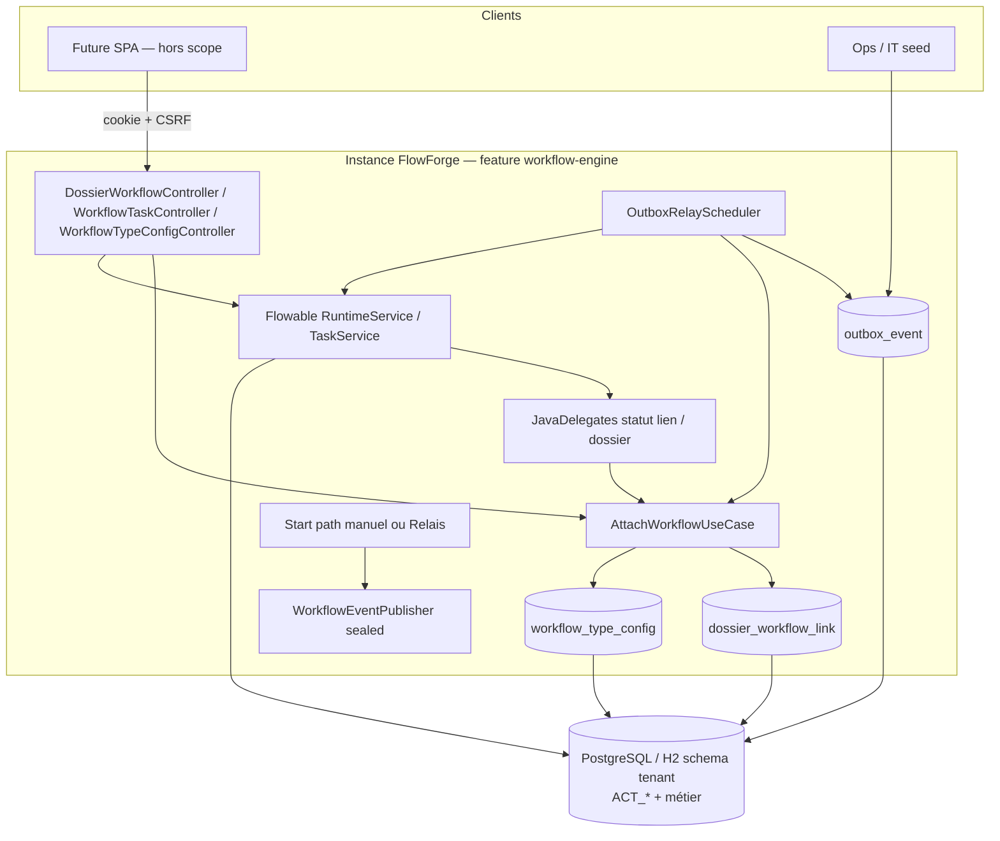
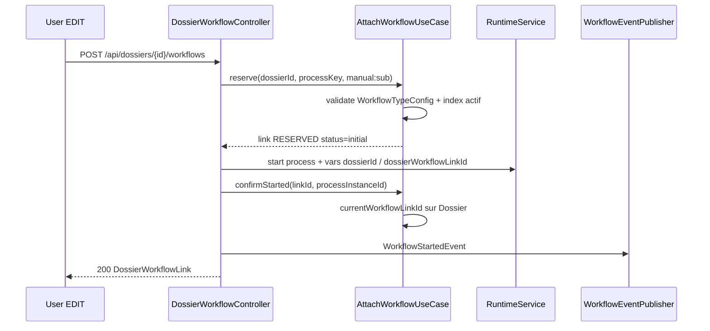
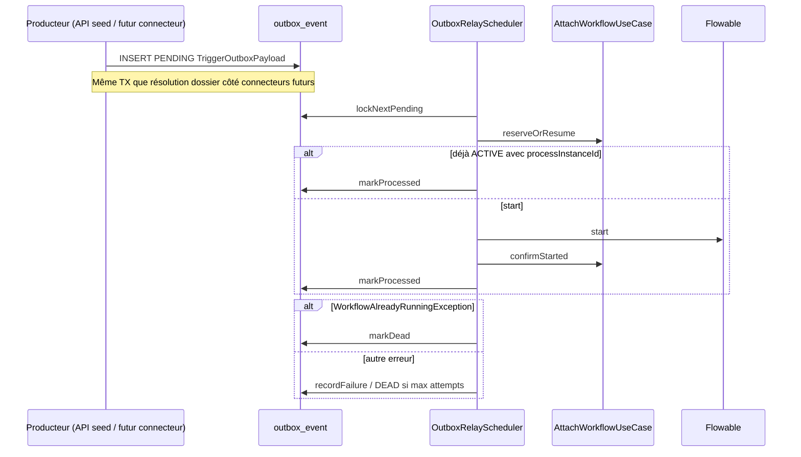

# System Design & Architecture

## Architecture Overview
**What is the high-level system structure?**

Tranche **workflow-engine** : activer Flowable 8 sur le schéma tenant, lier
les dossiers via `DossierWorkflowLink`, durabiliser les triggers via outbox +
relais, exposer une API minimale de démarrage / historique / tâches.
Producteur connecteurs hors scope — port outbox prêt à brancher.



### Flux démarrage manuel (API)



### Flux outbox + relais (async)



### Responsabilités

| Zone | Rôle |
|---|---|
| `domain.workflow.model` | `WorkflowTypeConfig`, status defs, `WorkflowEvent` sealed, commandes |
| `domain.workflow.port.in` | Start / CompleteTask / UpdateWorkflowLinkStatus (+ configs) |
| `domain.workflow.port.out` | Repos config, outbox, event publisher, moteur (port si utile) |
| `domain.dossier.model` | `DossierWorkflowLink` record |
| `domain.dossier.port.in` | `AttachWorkflowUseCase`, `GetDossierWorkflowHistoryUseCase` |
| `infrastructure.flowable` | Adaptateurs Runtime/Task, delegates, config async executor |
| `infrastructure.persistence.workflow` | Outbox + WorkflowTypeConfig JPA |
| `infrastructure.persistence.dossier` | `DossierWorkflowLink` JPA + MAJ `currentWorkflowLinkId` |
| `infrastructure.web.workflow` | Controllers REST + ProblemDetail |

## Data Models
**What data do we need to manage?**

### Domaine

- `DossierWorkflowLink` — champs analyse (`processInstanceId` nullable jusqu’à
  confirm, `sequence`, `status`, `triggerRef`, `startedAt` / `endedAt` /
  `endReason`).
- `WorkflowTypeConfig` — `workflowKey`, `label`, `statusDefinitions[]`
  (`code`, `label`, `initial`, `outcome`).
- `StatusOutcome` — `NONE | COMPLETED | CANCELLED | FAILED`.
- `WorkflowEvent` sealed — `Started` / `Completed` / `Failed`.
- `OutboxEvent` / `TriggerOutboxPayload` — `dossierId`,
  `connectorInstanceId?`, `processKey`, `variables`, `triggerRef`.
- `OutboxStatus` — `PENDING | PROCESSED | DEAD`.

### Persistance (Liquibase tenant)

- `dossier_workflow_link` + index partiel
  `uq_dossier_workflow_link_active (dossier_id) WHERE ended_at IS NULL`.
- `workflow_type_config` (`tenant_id`, `workflow_key` unique, jsonb statuses).
- `outbox_event` (`event_id` PK, type, payload jsonb/text, status, attempts,
  last_error, created_at, processed_at).
- Colonne / usage `dossier.current_workflow_link_id` (déjà prévue modèle B).
- Tables Flowable `ACT_*` gérées par le moteur (même schéma / search_path).

## APIs & Interfaces

### Ports (extrait)

```text
AttachWorkflowUseCase
  reserve(dossierId, processDefinitionKey, triggerRef) -> DossierWorkflowLink
  reserveOrResume(...) -> DossierWorkflowLink
  confirmStarted(linkId, processInstanceId)

GetDossierWorkflowHistoryUseCase
  getHistory(dossierId) -> List<DossierWorkflowLink>

CompleteTaskUseCase
UpdateWorkflowLinkStatusUseCase.update(linkId, status, activityId?)

OutboxRepository
  savePending / lockNextPending / markProcessed / markDead / recordFailure

WorkflowTypeConfigRepository.findByWorkflowKey / save
WorkflowEventPublisher.publish(WorkflowEvent)
```

### REST

Aligné requirements (revue phase 2) :

| Méthode | Path | Authz |
|---|---|---|
| POST | `/api/dossiers/{id}/workflows` | EDIT (sync reserve→start→confirm) |
| GET | `/api/dossiers/{id}/workflows` | VIEW |
| POST | `/api/workflow-tasks/{taskId}/complete` | EDIT sur type du dossier lié |
| POST/PATCH/GET | `/api/workflow-type-configs…` | mutate : TENANT_ADMIN\|WORKFLOW_ADMIN ; GET : authentifié |

DTOs JSON alignés records. Erreurs : collision → 409 ; statut inconnu → 400 ;
not found → 404. Pas d’API enqueue outbox. Glossaire lien RESERVED/ACTIVE/
TERMINATED = dérivé colonnes (`process_instance_id` / `ended_at`), pas d’enum
`state` (A6).

## Components & Modules

1. **Activation Flowable** — retirer exclusions ; `async-executor-activate: true` ;
   `lock-time` / acquire wait depuis analyse ; `process.definition-location`
   ou déploiement classpath smoke BPMN.
2. **AttachWorkflow** — transactionnel ; traduit violation unique →
   `WorkflowAlreadyRunningException` ; pose statut `initial` ; incrémente
   `sequence`.
3. **OutboxRelay** — `@Scheduled` ; batch size configurable ; mono-tenant ;
   pas de `FOR UPDATE SKIP LOCKED` obligatoire en V1 single-replica.
4. **Delegates** — `updateWorkflowLinkStatusTask` lit
   `dossierWorkflowLinkId` + `targetWorkflowStatus` ; si `outcome != NONE`
   renseigne `endedAt` et libère l’index actif ; optionnellement
   `updateDossierStatusTask` pour `Dossier.status`.
5. **Remplacement stubs** — supprimer câblage
   `InMemoryWorkflowRepository` / publisher production ; garder tests unitaires
   avec fakes.

## Design Decisions

| Décision | Choix | Pourquoi |
|---|---|---|
| Moteur | Flowable 8 CE | Déjà acté analyse / pom |
| Durabilité triggers | Outbox + polling | Décisions 7 / 16 ; pas de broker |
| Start API manuel | Synchrone reserve→start→confirm | UX immédiate ; outbox pour async |
| Concurrence lien | Index unique partiel | Atomique, aligné templates |
| Events | Sealed `WorkflowEvent` | Décision 6 — extensible |
| Tenant | `TenantProperties.id()` | Décision 13 — relais hors HTTP |
| Producteur connecteurs | Hors scope | Feature `connecteurs` |

## Security Considerations

- Endpoints sous session BFF + CSRF (comme dossiers).
- Authz : ACL type dossier pour start/history/complete ; admins bypass ;
  config types workflow réservée `TENANT_ADMIN` / `WORKFLOW_ADMIN`.
- `AccessContext.System` pour relais / delegates (bypass ACL).
- Pas d’exposition Flowable UI ; pas de grant par instance process.
- Variables process : pas de secrets ; payloads outbox = événement normalisé.

## Performance Considerations

- Relais : `fixedDelay` + batch ; index status/created_at sur outbox.
- Purge périodique `PROCESSED` (job simple).
- Async executor Flowable activé ; tuning charge multi-répliques hors V1.
- IT smoke process volontairement minimal (peu de wait jobs).

## References

- Requirements : `docs/ai/requirements/2026-07-31-feature-workflow-engine.md`
- Analyse : `analysis doc/05-workflow-engine.md`, `04-dossiers.md`
- Décisions : TODO 6, 7, 11, 13, 16, 17, 20, 27
