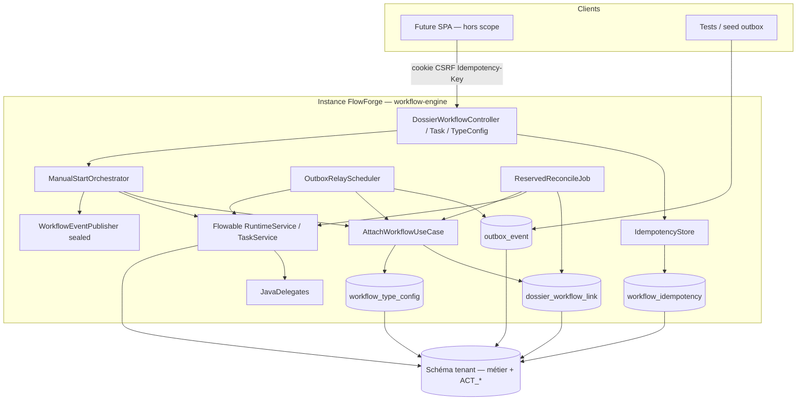
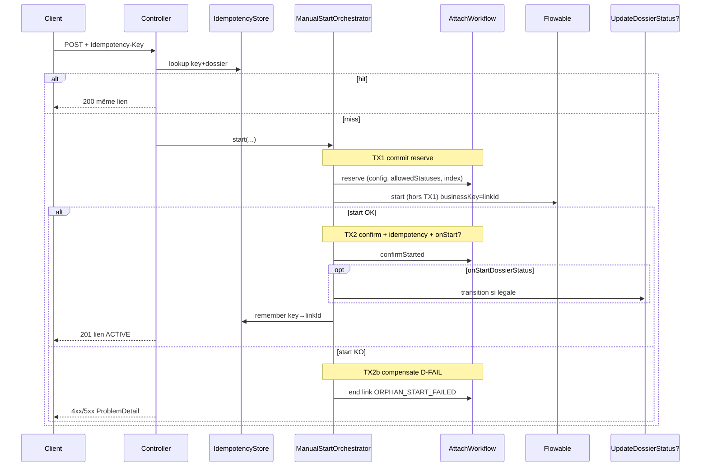

# System Design & Architecture

## Architecture Overview
**What is the high-level system structure?**

Tranche **workflow-engine** alignée requirements `reviewed` (D-START…D-FAIL) :
Flowable 8, `DossierWorkflowLink`, outbox+relais, API start/history/complete/
config, réconciliation RESERVED, idempotence HTTP.



### Stack

Java 25 · Spring Boot 4.1 · Flowable 8.0.x · Spring Data JPA · Liquibase ·
PostgreSQL (runtime) · H2 MODE=PostgreSQL (IT) · Security BFF existant ·
ArchUnit. Domaine pur (décision 17).

### Responsabilités

| Zone | Rôle |
|---|---|
| `domain.dossier` | `DossierWorkflowLink` ; `AttachWorkflow*` ; history |
| `domain.workflow` | `WorkflowTypeConfig` (+ allowed statuses, onStart) ; events sealed ; CompleteTask ; UpdateWorkflowLinkStatus ; outbox ports |
| `application` / use cases | `ManualStartOrchestrator` (reserve→start→confirm / D-FAIL) |
| `infrastructure.flowable` | Runtime/Task adapters, delegates, smoke BPMN, async executor |
| `infrastructure.persistence.*` | JPA link/config/outbox/idempotency ; retire stubs prod |
| `infrastructure.web.workflow` | REST + ProblemDetail + `Idempotency-Key` |

---

## Start paths (D-START)

### Manuel synchrone — **DD-TX = option 2** (acté)



**DD-TX acté :** transactions applicatives distinctes — **jamais**
`Flowable.start` dans la même TX JPA que `reserve` (Flowable commit `ACT_*`
séparément).

| Étape | TX | Contenu |
|---|---|---|
| 1 | TX1 | `reserve` + validations (config, ACL controller, allowedStatuses) — **commit** |
| 2 | hors TX JPA | `RuntimeService.start…` avec **`businessKey = linkId`** (**DD-BKEY** acté) |
| 3a | TX2 | `confirmStarted` + idempotency + `onStartDossierStatus?` |
| 3b | TX2b | compensation `endedAt` + `ORPHAN_START_FAILED` |

Écartées : TX unique ; outbox forcée sur API manuelle (contre D-START).

### Outbox + relais (non-humain)

Inchangé vs décisions 7/16 : producteur n’appelle pas Flowable ; relais
`reserveOrResume` → start → confirm → `markProcessed` ; collision → `DEAD` ;
retry puis `DEAD` après `max-attempts`.

### D-ORPHAN — job `ReservedReconcileJob`

- Sélection : liens `ended_at IS NULL AND process_instance_id IS NULL AND started_at < now - reserve-timeout`.
- Corrélation (**DD-BKEY = option 1**) :
  `RuntimeService.createProcessInstanceQuery().processInstanceBusinessKey(linkId.toString())`.
- Si instance trouvée → `confirmStarted` (+ onStart si pertinent / idempotent).
- Sinon retente `start` une fois ; si encore KO → `ORPHAN_TIMEOUT` + end link.
- Défaut timeout : **5 min** (`app.workflow.reserve-timeout`).

---

## Data Models

### Domaine

| Type | Champs clés |
|---|---|
| `DossierWorkflowLink` | id, dossierId, tenantId, processInstanceId?, processDefinitionKey, sequence, status (métier), triggerRef, startedAt, endedAt?, endReason? |
| `WorkflowTypeConfig` | id, tenantId, workflowKey, label, statusDefinitions[], **allowedDossierStatuses[]** (non vide), **onStartDossierStatus?** |
| `WorkflowStatusDefinition` | code, label, initial, outcome (`NONE\|COMPLETED\|CANCELLED\|FAILED`) |
| `WorkflowEvent` sealed | Started / Completed / Failed |
| `TriggerOutboxPayload` | dossierId, connectorInstanceId?, processKey, variables, triggerRef |
| `OutboxStatus` | PENDING \| PROCESSED \| DEAD |

Glossaire RESERVED / ACTIVE / TERMINATED = dérivé colonnes (A6) — pas d’enum
`state`.

### Tables Liquibase (schéma tenant)

| Table | Points clés |
|---|---|
| `dossier_workflow_link` | index partiel `uq_dossier_workflow_link_active (dossier_id) WHERE ended_at IS NULL` |
| `workflow_type_config` | UNIQUE(tenant_id, workflow_key) ; jsonb statusDefinitions + allowedDossierStatuses ; on_start_dossier_status nullable |
| `outbox_event` | PK event_id ; status ; attempts ; payload ; index (status, created_at) |
| `workflow_idempotency` | PK (tenant_id, dossier_id, idempotency_key) ; link_id ; created_at ; TTL ≥ reserve-timeout |

`dossier.current_workflow_link_id` mis à jour à confirm ; cleared/updated quand
lien termine selon règles Attach (design : pointer le lien actif ou null si
terminé — **actif seulement**).

Tables `ACT_*` : Flowable (même schema / search_path).

### Config runtime (défauts V1)

```yaml
app:
  workflow:
    reserve-timeout: 5m
    outbox:
      batch-size: 20
      max-attempts: 5
      poll-delay: 1s
      processed-retention: 7d
flowable:
  async-executor-activate: true
  # lock / acquire : valeurs analyse 05 ; affiner après smoke IT
```

### Smoke BPMN

- Fichier classpath : `processes/smoke-process.bpmn20.xml`
- Key : `smokeProcess`
- Flux : start → userTask `smokeTask` → serviceTask `updateWorkflowLinkStatusTask`
  (statut terminal config) → end
- Variables injectées : `dossierId`, `dossierWorkflowLinkId` (+ `tenantId` si utile lecture seule)

Seed config IT : `allowedDossierStatuses = [OUVERT, EN_COURS, SUSPENDU]`,
un statut `initial`, un terminal `COMPLETED`.

---

## API Design

| Méthode | Path | Authz | Notes |
|---|---|---|---|
| POST | `/api/dossiers/{id}/workflows` | EDIT (+ bypass admins) | Header **`Idempotency-Key` requis** ; 201 ACTIVE ; 200 si replay clé ; 409 collision / autre clé |
| GET | `/api/dossiers/{id}/workflows` | VIEW | history `sequence` ASC |
| POST | `/api/workflow-tasks/{taskId}/complete` | EDIT sur type dossier lié | variables : mêmes clés réservées interdites |
| POST | `/api/workflow-type-configs` | TENANT_ADMIN \| WORKFLOW_ADMIN | 201 ; validate allowedStatuses non vide + un `initial` |
| PATCH | `/api/workflow-type-configs/{workflowKey}` | idem | key path immuable |
| GET | `/api/workflow-type-configs` | authentifié | liste |
| GET | `/api/workflow-type-configs/{workflowKey}` | authentifié | détail |

**Body start :** `{ "processDefinitionKey": "...", "variables"?: {} }`  
Refus 400 si variables contiennent `dossierId` \| `dossierWorkflowLinkId` \|
`tenantId`.  
404 si config absente ; 404/ProblemDetail si définition BPMN absente après
échec start (D-FAIL).  
`DossierType.workflowKey` = hint UI seulement (D-KEY).

Pas d’API enqueue outbox.

### Ports (extrait)

```text
AttachWorkflowUseCase: reserve / reserveOrResume / confirmStarted / abortReserved(linkId, reason)
GetDossierWorkflowHistoryUseCase
ManualStartOrchestrator (application) — orchestre DD-TX
CompleteTaskUseCase
UpdateWorkflowLinkStatusUseCase
WorkflowTypeConfigRepository + use cases CRUD
OutboxRepository
IdempotencyStore
WorkflowEnginePort (start / completeTask / findByBusinessKey) — adapte Flowable
WorkflowEventPublisher.publish(WorkflowEvent)
```

Stubs `InMemoryWorkflowRepository` / publisher typé `WorkflowStartedEvent` :
retirés du câblage prod ; `WorkflowInstance` in-memory déprécié / retiré au
profit Flowable + link.

---

## Component Breakdown

1. **Flowable activation** — retirer exclusions process ; vérifier ordre
   Liquibase vs schema Flowable au premier IT (Boot 4) ; `ddl-auto: none` reste.
2. **AttachWorkflow** — sequence max+1 ; statut initial ; index partiel →
   `WorkflowAlreadyRunningException` ; `abortReserved` pour D-FAIL / orphan.
3. **ManualStartOrchestrator** — DD-TX + D-VARS injection + D-DOSSIER-STATUS.
4. **OutboxRelay** — `@Scheduled` fixedDelay ; mono-tenant ; single-replica V1.
5. **ReservedReconcileJob** — D-ORPHAN.
6. **IdempotencyFilter/aspect** — sur POST start uniquement en V1.
7. **Delegates** — `updateWorkflowLinkStatusTask` requis ;
   `updateDossierStatusTask` mince wrapping use case dossier.
8. **Events** — sealed + publisher no-op ou in-memory list pour tests.

---

## Design Decisions

| Id | Choix | Statut |
|---|---|---|
| D-START…D-FAIL | Voir requirements | **Acté** phase 2 |
| **DD-TX** | reserve commit → Flowable.start hors TX → confirm/compensate | **Acté** (opt. 2) |
| **DD-BKEY** | `businessKey = dossierWorkflowLinkId` (UUID string) | **Acté** (opt. 1) |
| **DD-IDEM** | Table dédiée `workflow_idempotency` ; TTL ≥ reserve-timeout | **Acté** (opt. 1) |
| DD-SMOKE | `smokeProcess` classpath + userTask + delegate statut | Proposé |
| DD-OUTBOX | batch 20, max-attempts 5, poll 1s, retention 7d | Proposé (Q3 req) |
| DD-STUBS | Retrait câblage in-memory prod | Proposé |
| Engine | Flowable 8 CE | Acté analyse |
| Concurrence | Index unique partiel | Acté analyse |

### Alternatives (design)

| Sujet | Alt. | Pourquoi écartée |
|---|---|---|
| TX unique reserve+start | Simplicité | Flowable TX séparée → instance orpheline |
| businessKey = dossierId | Simple | Plusieurs runs successifs / collision corrélation |
| Idempotency en cache mémoire | Léger | Perdu au restart ; multi-réplique futur |

---

## Non-Functional Requirements

### Security

- Session BFF + CSRF ; `Idempotency-Key` non secret mais unique par client attempt.
- ACL type (D-AUTHZ) ; System context pour relais/jobs/delegates.
- Pas Flowable UI ; pas de secrets dans variables.

### Reliability

- D-FAIL + D-ORPHAN ; outbox retry/DLQ ; purge PROCESSED.
- Logs structurés : linkId, dossierId, eventId, processInstanceId (TODO 29 métriques hors scope).

### Performance

- Smoke IT minimal ; async executor on ; pas de cible latence formelle.
- Index outbox (status, created_at) ; index partial link.

### Scalability

- Mono-tenant / single-replica V1 ; SKIP LOCKED documenté pour plus tard.

---

## Requirements coverage

| Exigence | Design |
|---|---|
| Flowable + tables | Activation + Liquibase + ACT_* |
| Link + Attach | Domaine + index + ports |
| Outbox + relais | OutboxRelay + defaults |
| D-START hybride | ManualStartOrchestrator + outbox |
| D-KEY / D-AUTHZ / D-STATUS / D-VARS | API + config model |
| D-IDEM | workflow_idempotency |
| D-ORPHAN / D-FAIL | Job + abortReserved + DD-TX |
| D-DOSSIER-STATUS | onStart après confirm |
| Complete task + delegate | ports + smoke BPMN |
| Non-goals connecteurs/UI/liste tâches | respectés |

---

## Open design items

| # | Item | Disposition |
|---|---|---|
| DD-TX | Frontières TX start sync | **Clos** — option 2 |
| DD-BKEY | Corrélation instance ↔ link | **Clos** — businessKey = linkId |
| DD-IDEM | Persistance Idempotency-Key | **Question ouverte** |
| DD-SMOKE / DD-OUTBOX / DD-STUBS | Détails techniques | Proposés |

## References

- Requirements : `docs/ai/requirements/2026-07-31-feature-workflow-engine.md` (`reviewed`)
- Analyse : `05-workflow-engine.md`, `04-dossiers.md`
- Décisions TODO : 6, 7, 11, 13, 16, 17, 20, 27
