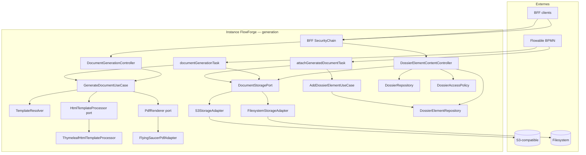

# System Design & Architecture

## Architecture Overview
**What is the high-level system structure?**

Tranche **generation-documents** (requirements `reviewed`) : pipeline PDF
Thymeleaf → Flying Saucer, port stockage S3/FS, deux JavaDelegates Flowable,
`DossierElement` `PRODUCED_DOC`, API generate (mémoire) + download (ACL).



### Stack

Java 25 · Spring Boot 4.1.x · Flowable 8 · Thymeleaf (pom) ·
jsoup 1.22.x · flying-saucer-pdf 10.4.x · AWS SDK S3 2.x (**déjà au
`pom.xml`**) · Spring Data JPA · Liquibase · H2 MODE=PostgreSQL IT ·
ArchUnit.

**Pas** de Playwright. **Pas** de client MinIO nommé — S3 SDK + endpoint
config (DEFERRED §0).

### Responsabilités

| Zone | Rôle |
|---|---|
| `domain.document.port.in` | `GenerateDocumentUseCase` |
| `domain.document.port.out` | `PdfRenderer`, `HtmlTemplateProcessor`, `DocumentStoragePort` |
| `domain.document.usecase` | Orchestration resolve → process → render (**sans** Spring/Thymeleaf/jsoup) |
| `domain.dossier.model` | `DossierElement`, `ElementType` (V1: `PRODUCED_DOC`) |
| `domain.dossier.port.in` | `AddDossierElementUseCase`, get-by-id élément |
| `domain.dossier.port.out` | `DossierElementRepository` |
| `infrastructure.document` | `ThymeleafHtmlTemplateProcessor` |
| `infrastructure.pdf` | `FlyingSaucerPdfAdapter` (jsoup XHTML + ITextRenderer) |
| `infrastructure.storage` | `FilesystemStorageAdapter`, `S3StorageAdapter` |
| `infrastructure.flowable` | `DocumentGenerationTask`, `AttachGeneratedDocumentTask` |
| `infrastructure.web.document` | Controllers generate + element content + handlers |
| `infrastructure.persistence.dossier` | `DossierElementJpaEntity` + adapter |

---

## Data Models
**What data do we need to manage?**

### Domaine — document (ports)

```text
HtmlTemplateProcessor.process(html, variables) -> String   // DQ1

PdfRenderer.render(html) -> byte[]   // DQ5: adapter fait jsoup HTML→XHTML

DocumentStoragePort
  store(tenantId, contentType, bytes) -> storageRef
  retrieve(tenantId, storageRef) -> byte[]
  exists(tenantId, storageRef) -> boolean   // DQ3
  // delete hors V1 (TODO §22)

GenerateDocumentCommand(templateKey, variantKey?, locale?, variables)
GenerateDocumentUseCase.generate(cmd) -> byte[]   // pas de store
```

Écart vs analyse `store(byte[])` : signature porte `tenantId` +
`contentType` (cloisonnement — revue pré-implémentation).

### Filtrage variables (**DQ2** / DD-VARS-FILTER)

Avant `HtmlTemplateProcessor`, retirer les clés plateforme :
`dossierId`, `dossierWorkflowLinkId`, `tenantId`, `generatedDocumentId`,
`documentType`, `documentVariant`, `documentLocale`.  
HTTP : body `variables` (null → `{}`) déjà « métier » — pas de strip
supplémentaire sauf si les mêmes clés y apparaissent (alors strip aussi).

### Domaine — dossier élément

```text
ElementType { PRODUCED_DOC }          // V1 — DD-ENUM-V1

DossierElement(
  UUID id,
  UUID dossierId,
  String tenantId,
  ElementType type,
  String label,
  String storageRef,                  // A2 — {tenantId}/{uuid}.pdf
  Map<String,Object> metadata,        // DQ4 — voir ci-dessous
  String addedBy,                     // "system" en task
  Instant addedAt,
  String workflowStepId               // activityId BPMN, nullable
)
```

**Metadata PRODUCED_DOC (DQ4 / DD-META)** — écrit à l’attach :

```json
{
  "templateKey": "contrat",
  "contentType": "application/pdf",
  "variantKey": "premium",
  "locale": "fr"
}
```

`variantKey` / `locale` omis ou `null` si absents. Pas d’autres clés V1.

### Persistance

Table `dossier_element` — Liquibase `005-dossier-element-tables.yaml` :

| Colonne | Type | Notes |
|---|---|---|
| id | UUID PK | |
| dossier_id | UUID NOT NULL | FK **logique** (pas de contrainte SQL — pattern existant) |
| tenant_id | VARCHAR NOT NULL | |
| type | VARCHAR NOT NULL | `PRODUCED_DOC` |
| label | VARCHAR NOT NULL | |
| storage_ref | VARCHAR NULL | requis pour PRODUCED_DOC |
| metadata | JSONB (H2: JSON) | |
| added_by | VARCHAR NOT NULL | |
| added_at | TIMESTAMPTZ NOT NULL | |
| workflow_step_id | VARCHAR NULL | |

Index : `(tenant_id, dossier_id)`, `(tenant_id, id)`.  
Pas d’unicité `storage_ref` (**A15**). Pas de table `generated_document`
(**A5**).

---

## API Design
**What are the interfaces?**

### HTTP

**POST `/api/documents/generate`** —
`@PreAuthorize("hasAnyRole('TENANT_ADMIN','WORKFLOW_ADMIN','DOSSIER_MANAGER')")`
+ CSRF BFF.

```json
{
  "templateKey": "contrat",
  "variantKey": "premium",
  "locale": "fr",
  "variables": { "title": "Demo", "amount": 1200 }
}
```

→ `200` `Content-Type: application/pdf`. Pas de store / `storageRef`.  
Resolve miss → **404** ; validation / Thymeleaf eval → **400**.

**GET `/api/dossier-elements/{id}/content`** — authentifié ;
`DossierAccessPolicy.assertCanView` (**A12**) ; `retrieve` → `200` PDF +
`Content-Disposition: attachment` (**A13**).  
403 ACL ; 404 élément/storage ; **409** type ≠ `PRODUCED_DOC` ou
`storageRef` null.

Pas d’HTTP create élément (**A11**).

### Flowable — `documentGenerationTask`

1. Lit `documentType` (requis), `documentVariant`, `documentLocale`.
2. Construit map variables = `exec.getVariables()` filtrée (**DQ2**).
3. `GenerateDocumentUseCase.generate(...)`.
4. `DocumentStoragePort.store(tenantId, "application/pdf", pdf)`.
5. `exec.setVariable("generatedDocumentId", storageRef)`.

### Flowable — `attachGeneratedDocumentTask`

1. `dossierId` UUID string (**A10**).
2. `generatedDocumentId` ; `exists(tenantId, ref)` (**DQ3**) — false → échec.
3. `AddDossierElementUseCase` + `AccessContext.system("flowable-delegate")`
   (**A9**) → `PRODUCED_DOC`, label **A3**, metadata **DQ4**,
   `workflowStepId = currentActivityId`, `addedBy = "system"`.

Erreurs → exceptions propagées Flowable (échec activité).

---

## Component Breakdown
**What are the major building blocks?**

1. **GenerateDocumentUseCaseImpl** — `TemplateResolver` →
   `HtmlTemplateProcessor` → `PdfRenderer` (domaine pur).
2. **ThymeleafHtmlTemplateProcessor** — `SpringTemplateEngine` +
   `StringTemplateResolver` ; **évalue** les expressions (≠ checker
   syntax-only).
3. **FlyingSaucerPdfAdapter** — jsoup HTML→XHTML (**DQ5**) +
   `ITextRenderer` ThreadLocal/pool.
4. **FilesystemStorageAdapter** — root config ; store/retrieve/exists ;
   anti path-traversal ; défaut IT/dev.
5. **S3StorageAdapter** — AWS SDK v2 ; `HeadObject` pour exists ; endpoint
   override config.
6. **StorageConfig** — `@ConditionalOnProperty app.storage.type=filesystem|s3`.
7. **DossierElementJpaAdapter** — save + findById (+ tenant).
8. **Tasks** — beans
   `${documentGenerationTask}` / `${attachGeneratedDocumentTask}`.

### Dépendances Maven

**Déjà présentes** dans `pom.xml` (pas d’ajout version à inventer) :
`flying-saucer-pdf`, `jsoup`, `software.amazon.awssdk:s3`.

---

## Design Decisions

| Id | Décision | Rationale |
|---|---|---|
| DD-HTP-PORT | Port `HtmlTemplateProcessor` + adapter Thymeleaf | **DQ1** ; ArchUnit ; miroir checker |
| DD-VARS-FILTER | Strip clés plateforme avant merge | **DQ2** |
| DD-EXISTS | `DocumentStoragePort.exists` ; attach l’utilise | **DQ3** |
| DD-META | Metadata fixe templateKey/contentType/variant?/locale? | **DQ4** |
| DD-JSOUP-PDF | jsoup dans `FlyingSaucerPdfAdapter` | **DQ5** |
| DD-PORT-SIG | `store(tenantId, contentType, bytes)` | Cloisonnement tenant |
| DD-NO-REG | Pas de table generated_document | A5 |
| DD-HTTP-MEM | POST generate sans store | D-HTTP-STORE |
| DD-ACL-VIEW | `assertCanView` + bypass admin | A12 |
| DD-FS-DEFAULT | `app.storage.type=filesystem` défaut | A6 |
| DD-S3-NAME | Adapter `S3*`, pas `Minio*` | DEFERRED §0 |
| DD-ENUM-V1 | `ElementType` = PRODUCED_DOC only V1 | D-ELEMENT-SCOPE |
| DD-LOGICAL-FK | Pas de FK SQL `dossier_id` | Pattern changelogs 001–004 |
| DD-TASK-NAMES | Beans documentGeneration / attachGenerated | Analyse 08 |
| DD-POM-DEPS | Réutiliser versions pom existantes | flying-saucer / jsoup / aws déjà là |

### Alternatives écartées

| Approche | Verdict |
|---|---|
| SpringTemplateEngine dans le use case domaine | Écartée (DQ1) |
| Toute la map Flowable au template | Écartée (DQ2) |
| retrieve-only / pas de check attach | Écartée (DQ3) |
| metadata vide ou libre | Écartée (DQ4) |
| jsoup dans use case / HtmlTemplateProcessor | Écartée (DQ5) |
| Playwright / MinIO client / HTTP store | Non-goals requirements |

---

## Non-Functional Requirements

### Security
- Generate : `hasAnyRole(TENANT_ADMIN, WORKFLOW_ADMIN, DOSSIER_MANAGER)`.
- Download : `DossierAccessPolicy` VIEW + bypass admin/System.
- CSRF sur POST generate.
- Pas d’HTTP par `storageRef` brut.
- Path traversal FS refusé ; clés objet générées serveur (UUID).
- Variables template : pas d’évaluation hors `HtmlTemplateProcessor`.

### Performance
- Cible soft analyse (A14) — pas de gate CI.
- `exists` léger à l’attach (HEAD / Files.exists).
- Pool `ITextRenderer` (non thread-safe).

### Reliability
- Attach échoue si `exists` false (pas d’élément orphelin storage manquant).
- Resolve/render errors → ProblemDetail 404/400.
- Pas d’unicité `storage_ref` (A15) — purge §22 ultérieure.

---

## Requirements coverage

| Requirements | Design |
|---|---|
| D-SCOPE + D-ENGINE | PdfRenderer Flying Saucer + GenerateDocumentUseCase |
| D-STORE | DocumentStoragePort + FS + S3 |
| D-ELEMENT / SCOPE | dossier_element + PRODUCED_DOC only |
| D-FLOWABLE | 2 tasks nommées |
| D-HTTP / STORE / ATTACH | POST mémoire ; pas attach HTTP |
| D-DOWNLOAD | GET by element id |
| D-AUTHZ + A12 | PreAuthorize + assertCanView bypass |
| D-VARS + mapping | documentType… + filter DQ2 |
| A1 stack | Thymeleaf port + jsoup-in-PDF + Flying Saucer |
| A2 storageRef | tenant/uuid.pdf |
| A3–A4 / A9–A11 / A13 / A15 | Tasks, ProblemDetail, System ctx, dispositions |
| A5 / A6 / A7 / A8 | No registry table ; FS IT ; no API_SERVICE ; fonts classpath |
| Non-goals preview/Playwright/purge | Hors composants |

---

## Open design items

| # | Item | Disposition |
|---|---|---|
| DQ1 | Placement Thymeleaf eval | **Clos stakeholder** — port HTP |
| DQ2 | Variables merge | **Clos stakeholder** — filter plateforme |
| DQ3 | exists vs retrieve | **Clos stakeholder** — `exists` |
| DQ4 | metadata shape | **Clos stakeholder** — minimal fixe |
| DQ5 | jsoup placement | **Clos stakeholder** — dans PDF adapter |
| O6 | Bornes taille JSON `variables` | **Impl** — validation raisonnable (ex. 1 MiB) |
| O7 | Versions libs | **Clos** — pom existant |

**Phase 3 close** (2026-08-03) — statut `reviewed` ; DQ1–DQ5.
**Phase 4** — plan de tâches (`dev-planning`).
