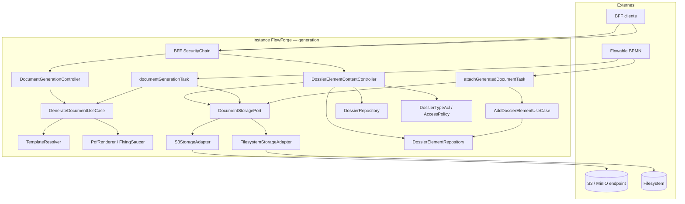

# System Design & Architecture

## Architecture Overview
**What is the high-level system structure?**

Tranche **generation-documents** (requirements `reviewed`) : pipeline PDF
Thymeleaf → Flying Saucer, port stockage S3/FS, deux JavaDelegates Flowable,
`DossierElement` `PRODUCED_DOC`, API generate (mémoire) + download (ACL).



### Stack

Java 25 · Spring Boot 4.x · Flowable · Thymeleaf (déjà au pom) ·
jsoup · flying-saucer-pdf · AWS SDK S3 v2 · Spring Data JPA · Liquibase ·
H2 MODE=PostgreSQL IT · ArchUnit.

**Pas** de Playwright, pas de SDK/API MinIO nommé dans le domaine
(S3 SDK + endpoint compatible).

### Responsabilités

| Zone | Rôle |
|---|---|
| `domain.document.port.in` | `GenerateDocumentUseCase` |
| `domain.document.port.out` | `PdfRenderer`, `DocumentStoragePort` |
| `domain.document.usecase` | Merge Thymeleaf + render PDF |
| `domain.dossier.model` | `DossierElement`, `ElementType` |
| `domain.dossier.port.in` | `AddDossierElementUseCase`, get élément |
| `domain.dossier.port.out` | `DossierElementRepository` |
| `infrastructure.pdf` | `FlyingSaucerPdfAdapter` (+ pool/ThreadLocal) |
| `infrastructure.storage` | `FilesystemStorageAdapter`, `S3StorageAdapter` |
| `infrastructure.flowable` | `DocumentGenerationTask`, `AttachGeneratedDocumentTask` |
| `infrastructure.web.document` | Controllers generate + element content |
| `infrastructure.persistence.dossier` | `DossierElementJpaEntity` + adapter |

---

## Data Models
**What data do we need to manage?**

### Domaine — document (ports)

```text
PdfRenderer.render(html: String) -> byte[]

DocumentStoragePort
  store(tenantId, contentType, bytes) -> storageRef
  retrieve(tenantId, storageRef) -> byte[]
  // delete hors V1 (TODO §22)

GenerateDocumentCommand(templateKey, variantKey?, locale?, variables)
GenerateDocumentUseCase.generate(cmd) -> byte[]   // pas de store
```

Écart volontaire vs snippet analyse `store(byte[])` : signature porte
`tenantId` + `contentType` pour le cloisonnement (revue pré-implémentation).

### Domaine — dossier élément

```text
ElementType { PRODUCED_DOC }          // V1 — autres valeurs différées
DossierElement(
  UUID id,
  UUID dossierId,
  String tenantId,
  ElementType type,                   // PRODUCED_DOC
  String label,
  String storageRef,                  // A2 — {tenantId}/{uuid}.pdf
  Map<String,Object> metadata,        // ex. templateKey, contentType
  String addedBy,                     // "system" en task Flowable
  Instant addedAt,
  String workflowStepId               // activityId BPMN, nullable
)
```

### Persistance

Table `dossier_element` — Liquibase `005-dossier-element-tables.yaml` :

| Colonne | Type | Notes |
|---|---|---|
| id | UUID PK | |
| dossier_id | UUID NOT NULL | FK logique vers `dossier` |
| tenant_id | VARCHAR NOT NULL | |
| type | VARCHAR NOT NULL | `PRODUCED_DOC` V1 |
| label | VARCHAR NOT NULL | |
| storage_ref | VARCHAR NULL | requis pour PRODUCED_DOC |
| metadata | JSONB / JSON | |
| added_by | VARCHAR NOT NULL | |
| added_at | TIMESTAMPTZ NOT NULL | |
| workflow_step_id | VARCHAR NULL | |

Index : `(tenant_id, dossier_id)`, `(tenant_id, id)`.

Pas de table `generated_document` (**A5**).

---

## API Design
**What are the interfaces?**

### HTTP

**POST `/api/documents/generate`** — rôles
`TENANT_ADMIN` \| `WORKFLOW_ADMIN` \| `DOSSIER_MANAGER` + CSRF BFF.

```json
{
  "templateKey": "contrat",
  "variantKey": "premium",
  "locale": "fr",
  "variables": { "title": "Demo", "amount": 1200 }
}
```

→ `200` `Content-Type: application/pdf` (bytes).  
Pas de header `storageRef`. Resolve cascade ACTIVE uniquement.
Échec resolve → 404 ; échec rendu/Thymeleaf → 400.

**GET `/api/dossier-elements/{id}/content`** — authentifié ;
charge élément → dossier → `DossierAccessPolicy.assertCanView` (ACL
`VIEW`/`EDIT`, bypass `TENANT_ADMIN` / `WORKFLOW_ADMIN` / System — **A12**) ;
`retrieve` storage → `200 application/pdf` + `Content-Disposition`
attachment (**A13**).  
403 si ACL KO ; 404 si élément / storage absent ; 409 si type ≠
`PRODUCED_DOC` ou `storageRef` null.

### Flowable — `documentGenerationTask` (`@Component`)

1. Lit `documentType` (requis), `documentVariant`, `documentLocale`.
2. `GenerateDocumentUseCase` avec `exec.getVariables()` comme map variables.
3. `DocumentStoragePort.store(tenantId, "application/pdf", pdf)`.
4. `exec.setVariable("generatedDocumentId", storageRef)`.

### Flowable — `attachGeneratedDocumentTask`

1. Résout dossier via `dossierId` UUID string (**A10** — pattern
   `UpdateDossierStatusDelegate`).
2. Lit `generatedDocumentId` ; vérifie présence objet (retrieve ou exists).
3. `AddDossierElementUseCase` + `AccessContext.system("flowable-delegate")`
   (**A9**) → `PRODUCED_DOC`, label **A3**,
   `workflowStepId = currentActivityId`, `addedBy = "system"`.
4. Metadata recommandée : `templateKey` / `contentType=application/pdf`
   si disponibles.
5. Pas d’HTTP create élément (**A11**).

Erreurs → exceptions métier propagées Flowable (échec activité).

---

## Component Breakdown
**What are the major building blocks?**

1. **GenerateDocumentUseCaseImpl** — `TemplateResolver` →
   `SpringTemplateEngine.process` (string template) → jsoup
   `HTML→XHTML` → `PdfRenderer.render`.
2. **FlyingSaucerPdfAdapter** — `ITextRenderer` ThreadLocal/pool
   (non thread-safe — analyse).
3. **FilesystemStorageAdapter** — root `app.storage.filesystem.root` ;
   écriture atomique ; refuse path traversal hors root.
4. **S3StorageAdapter** — AWS SDK v2 ; bucket + key = storageRef ;
   endpoint override pour MinIO/LocalStack **uniquement en config**.
5. **StorageConfig** — `@ConditionalOnProperty app.storage.type`.
6. **DossierElementJpaAdapter** — CRUD minimal (save, findById).
7. **Tasks** — JavaDelegate beans nommés pour expression
   `${documentGenerationTask}` / `${attachGeneratedDocumentTask}`.

### Dépendances Maven (à ajouter)

- `org.xhtmlrenderer:flying-saucer-pdf`
- `org.jsoup:jsoup`
- `software.amazon.awssdk:s3` (et BOM si besoin)

---

## Design Decisions

| Id | Décision | Rationale |
|---|---|---|
| DD-PORT-SIG | `store(tenantId, contentType, bytes)` | Cloisonnement tenant ; revue § storage |
| DD-NO-REG | Pas de table generated_document | Élément = registre métier V1 |
| DD-HTTP-MEM | POST generate sans store | Évite orphelins (D-HTTP-STORE) |
| DD-ACL-VIEW | Download via `assertCanView` + bypass admin | D-AUTHZ 3 ; A12 ; `implies` existant |
| DD-FS-DEFAULT | `app.storage.type=filesystem` défaut IT/dev | A6 |
| DD-S3-NAME | Adapter nommé S3, pas Minio* | DEFERRED §0 |
| DD-ENUM-V1 | `ElementType` V1 = PRODUCED_DOC only | Évite faux chemins ATTACHMENT |
| DD-THYME-EVAL | Évaluation complète à la génération | Différent du checker syntax-only activate |
| DD-TASK-NAMES | Beans `documentGenerationTask` / `attachGeneratedDocumentTask` | Aligné analyse 08 |

### Alternatives écartées

- Playwright V1 — coût browser / ops.
- HTTP store + TTL — complexité purge.
- Attach dans le use case generate — viole D-FLOWABLE / D-HTTP-ATTACH.
- MinIO client dédié — couplage interdit.

---

## Security & Performance

- CSRF sur POST generate (chaîne BFF Order 3).
- Pas d’accès storage par `storageRef` brut HTTP.
- Path traversal FS bloqué ; clés S3 = UUID généré serveur.
- Taille HTML template déjà bornée 5 MiB (templates) ; variables map
  bornée raisonnablement en validation (ex. profondeur / taille JSON — détail
  implémentation).
- Pool `ITextRenderer` ; images base64 préférées dans templates (analyse).
- Pas de rate-limit dédié V1 (TODO §30).

---

## Open design items (non-blocking)

- Exact BOM versions flying-saucer / jsoup / AWS SDK (tranches pom).
- Exists-check storage avant attach vs retrieve full.
- Contenu `metadata` JSON minimal vs vide.

**Phase 1** — design draft aligné requirements stakeholder.
**Phase 2** — revue requirements ; **Phase 3** — revue design formelle.
