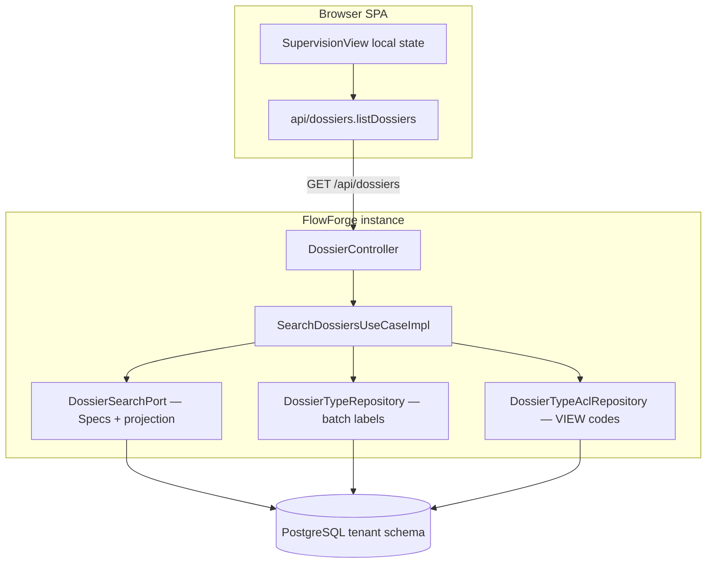
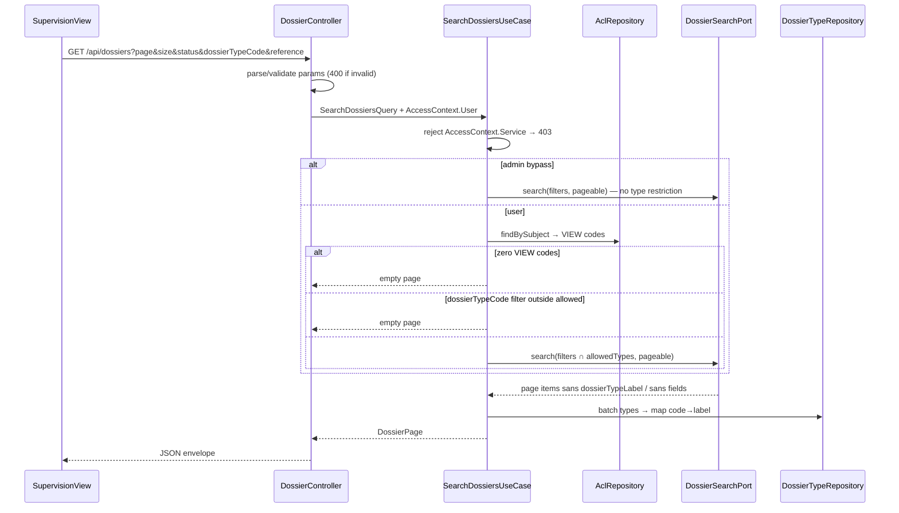

# System Design & Architecture

## Architecture Overview
**What is the high-level system structure?**

Tranche **liste / pagination dossiers** (TODO §24) : use case de recherche
paginée + port de projection JPA (Specs) + endpoint REST côte à côte avec
`GET ?ref=` ; Supervision Vue (état local) consomme la page et synchronise
l’URL.



### Flux liste



## Data Models
**What data do we need to manage?**

### Domaine (records)

```text
SearchDossiersQuery {
  status?: DossierStatus
  dossierTypeCode?: String
  referencePrefix?: String   // trim ; blank → absent
  page: int                  // >= 0
  size: int                  // 1..100
  sort: UPDATED_AT_DESC      // only supported value V1
}

DossierListItem {
  id: UUID
  reference: String
  label: String              // Dossier.label
  dossierTypeCode: String
  dossierTypeLabel: String   // filled by UC ; "" if type missing
  status: DossierStatus
  createdAt: Instant
  updatedAt: Instant
}

DossierPage {
  content: List<DossierListItem>
  page: int
  size: int
  totalElements: long
  totalPages: int
}
```

Pas de `fields` dans `DossierListItem` (D-ITEM / DQ4).

### Persistance

Tables existantes `dossier` + `dossier_type`. Aucune nouvelle table.

**Index Liquibase (tenant-migration) — DQ3 = A :**

| Index | But |
|---|---|
| `(updated_at DESC)` | tri par défaut |
| `(dossier_type_code, updated_at DESC)` | filtre type + tri |
| `(status, updated_at DESC)` | filtre statut + tri |

Pas d’index fonctionnel `lower(reference)` en V1 (A1).

Préfixe référence : `LOWER(reference) LIKE LOWER(:prefix) || '%'` dans la
Specification.

## API Design
**How do components communicate?**

### `GET /api/dossiers` — liste (nouveau)

**Routage Spring (D-ROUTE) :** `@GetMapping(params = "ref")` inchangé =
get-by-ref. Nouveau `@GetMapping` **sans** `ref` = liste. Si `ref` présent
(même avec `page=…`) → get-by-ref.

| Query | Règle |
|---|---|
| `page` | défaut `0` ; `< 0` → 400 |
| `size` | défaut `20` ; hors **`1..100`** → 400 |
| `sort` | absent ou `updatedAt,desc` OK ; autre → 400 |
| `status` | absent OK ; sinon enum sinon 400 |
| `dossierTypeCode` | absent OK ; hors ACL → page vide |
| `reference` | absent/blank → ignoré ; sinon préfixe CI |

**Authz :** BFF humain. `AccessContext.Service` → 403 (même pattern que
`ListDossierTypesUseCaseImpl`). Résultat ∩ types VIEW ; admins bypass.
Chaîne M2M (décision n° 14) ne cible pas cet endpoint en nominal.

**Réponse 200 :**

```json
{
  "content": [
    {
      "id": "…",
      "reference": "DOS-FAC-2026-000042",
      "label": "Facture Acme",
      "dossierTypeCode": "FAC",
      "dossierTypeLabel": "Facture",
      "status": "OUVERT",
      "createdAt": "2026-08-01T10:00:00Z",
      "updatedAt": "2026-08-12T15:30:00Z"
    }
  ],
  "page": 0,
  "size": 20,
  "totalElements": 42,
  "totalPages": 3
}
```

**Erreurs :** 401 anonyme ; 403 service ; 400 ProblemDetail (validation).

### Inchangé

| Endpoint | Comportement |
|---|---|
| `GET /api/dossiers?ref=` | un dossier complet (redaction `fields`) |
| `GET /api/dossiers/{id}` | inchangé |

### Frontend (DQ5 = A)

- `listDossiers(params)` dans `api/dossiers.ts` → envelope typée.
- **État local** `SupervisionView` ; URL = source de vérité
  (`status`, `dossierTypeCode`, `reference`, `page` ; `size` optionnel ;
  pas de `sort` dans l’URL).
- Select types : `GET /api/dossier-types` (déjà filtré VIEW).
- Select status : enum FE existant.
- Formulaire ouvrir-par-ref/UUID conservé (`getById` / `getByRef`).
- **Ne pas** étendre `useDossierStore` pour la search V1.

## Component Breakdown
**What are the major building blocks?**

| Couche | Composant |
|---|---|
| Domain in | `SearchDossiersUseCase` |
| Domain | `SearchDossiersUseCaseImpl` + records query/page/item |
| Domain out | `DossierSearchPort` |
| Domain out (reuse) | `DossierTypeAclRepository`, `DossierTypeRepository` |
| Infra | `JpaDossierSearchAdapter` : `JpaSpecificationExecutor` + projection colonnes (pas de `fields`) ; Specs composables |
| Web | `DossierController` list mapping + DTOs |
| FE | `listDossiers`, `SupervisionView.vue` (local state) |
| DB | Liquibase `008-…` indexes (3) |

### Port contract (DQ4)

```text
DossierSearchPort.search(
  tenantId,
  filter: { status?, dossierTypeCodes: Set<String> /* allowed ∩ optional type */, referencePrefix? },
  page, size
) → DossierPage   // items with dossierTypeLabel="" ; UC fills labels
```

- `dossierTypeCodes` vide après ACL → UC short-circuit (pas d’appel port).
- Admin bypass → port sans restriction de type (ou set null = all).
- Adapter : `count(spec)` + query Criteria/projection avec `spec.toPredicate`.

## Design Decisions
**Why did we choose this approach?**

| Id | Choix | Écarté |
|---|---|---|
| **DQ1** | `JpaSpecificationExecutor` + Specs | Criteria manuel seul ; JPQL optional-null |
| **DQ2** | Labels type en **batch UC** | JOIN SQL ; N+1 `findByCode` |
| **DQ3** | **3 indexes** Liquibase | Index unique `updated_at` ; + `lower(reference)` |
| **DQ4** | Port → items **sans `fields`** | Page de `Dossier` complets |
| **DQ5** | État **local** Supervision | Pinia dossier mélangé ; store search dédié |
| Offset | page/size | Cursor |
| `ref` vs `reference` | params distincts | Dual-mode sur `ref` |
| Hors ACL | 200 vide | 403 |

## Requirements coverage (Phase 3)

| Requirements | Design |
|---|---|
| D-SCOPE API+FE+filtres | Endpoint + Supervision + Specs filters |
| D-FILTERS / D-PARAMS / D-VALID | API table + validation |
| D-ITEM / R1–R2 | `DossierListItem` + labels |
| D-PAGE | envelope + size 1..100 + sort |
| D-ACL / Service 403 | UC mirror `ListDossierTypes` |
| D-UX / R5 | FE local + URL sync |
| D-ROUTE | Spring `params=ref` precedence |
| Non-goals OpenAPI/fields/M2M | Explicit hors design V1 |
| A1–A4 | Indexes, offset count, soft label, URL size |

## Non-Functional Requirements
**How should the system perform?**

- **Perf :** pas de chargement JSON `fields` ; p95 liste filtrée < 300 ms IT/H2 ;
  indexes DQ3 sur PG.
- **Sécu :** pas de `fields` ; ACL VIEW ; 403 Service ; validation stricte.
- **Fiabilité :** get-by-`ref` non régressé ; pages hors plage = content vide.
- **Observabilité :** hors scope (§29).
