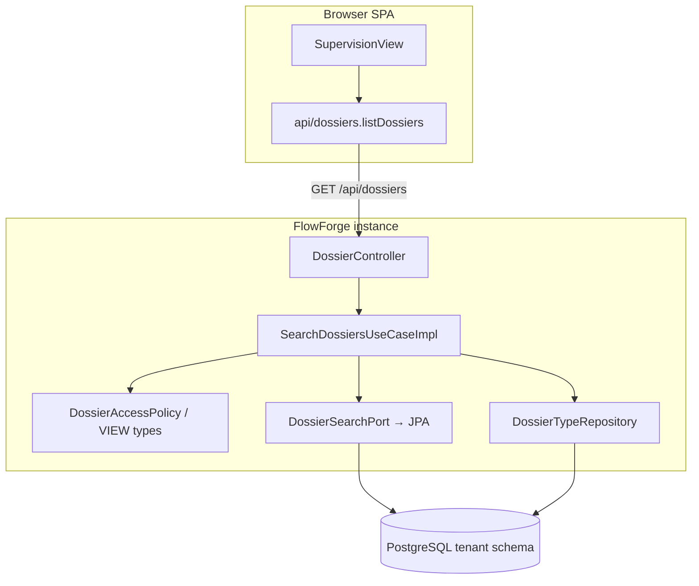
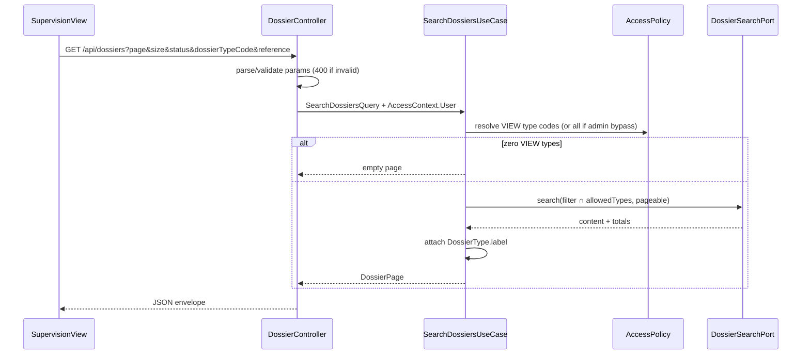

# System Design & Architecture

## Architecture Overview
**What is the high-level system structure?**

Tranche **liste / pagination dossiers** (TODO §24) : nouvel use case de
recherche paginée + adaptateur JPA + endpoint REST côte à côte avec
`GET ?ref=` existant ; Supervision Vue consomme la page et synchronise l’URL.



### Flux liste



## Data Models
**What data do we need to manage?**

### Domaine (records)

```text
SearchDossiersQuery {
  status?: DossierStatus
  dossierTypeCode?: String
  referencePrefix?: String   // already normalized trim ; blank → absent
  page: int                  // >= 0
  size: int                  // 1..100
  sort: UPDATED_AT_DESC      // only supported value V1
}

DossierListItem {
  id: UUID
  reference: String
  label: String              // Dossier.label (métier)
  dossierTypeCode: String
  dossierTypeLabel: String   // DossierType.label ; "" if missing
  status: DossierStatus
  createdAt: Instant
  updatedAt: Instant
}

DossierPage {
  content: List<DossierListItem>
  page: int
  size: int
  totalElements: long
  totalPages: int
}
```

Pas de `fields` dans `DossierListItem` (D-ITEM).

### Persistance

Tables existantes `dossier` + `dossier_type`. Aucune nouvelle table.

**Index Liquibase (tenant-migration)** recommandés :

| Index | But |
|---|---|
| `(updated_at DESC)` | tri par défaut |
| `(dossier_type_code, updated_at DESC)` | filtre type + tri |
| `(status, updated_at DESC)` | filtre statut + tri |

Préfixe `reference` : `LOWER(reference) LIKE LOWER(:prefix)||'%'` — index
fonctionnel optionnel V1 (`lower(reference)`) si mesures le justifient ;
sinon seq scan acceptable sous A1.

## API Design
**How do components communicate?**

### `GET /api/dossiers` — liste (nouveau)

**Condition de routage Spring :** mapping **sans** `ref`
(ex. `@GetMapping` + absence de `params=ref` ; le mapping
`@GetMapping(params="ref")` existant conserve la priorité pour get-by-ref).

| Query | Règle |
|---|---|
| `page` | défaut `0` ; `< 0` → 400 |
| `size` | défaut `20` ; hors **`1..100`** (y compris `0`) → 400 |
| `sort` | absent ou `updatedAt,desc` OK ; autre → 400 |
| `status` | absent OK ; sinon enum `DossierStatus` sinon 400 |
| `dossierTypeCode` | absent OK ; sinon filtre exact (hors ACL → page vide) |
| `reference` | absent/blank → ignoré ; sinon préfixe CI |

**Authz :** session BFF humaine. `AccessContext.Service` / rôle effectif
service → 403. Résultat ∩ types VIEW (admins bypass).

**Réponse 200 :**

```json
{
  "content": [
    {
      "id": "…",
      "reference": "DOS-FAC-2026-000042",
      "label": "Facture Acme",
      "dossierTypeCode": "FAC",
      "dossierTypeLabel": "Facture",
      "status": "OUVERT",
      "createdAt": "2026-08-01T10:00:00Z",
      "updatedAt": "2026-08-12T15:30:00Z"
    }
  ],
  "page": 0,
  "size": 20,
  "totalElements": 42,
  "totalPages": 3
}
```

Routage : `@GetMapping(params = "ref")` conserve get-by-ref ; mapping liste
sans `ref` (priorité Spring sur `params=ref` quand présent).

**Erreurs :** 401 anonyme ; 403 service ; 400 ProblemDetail (validation).

### Inchangé

| Endpoint | Comportement |
|---|---|
| `GET /api/dossiers?ref=` | un dossier complet (redaction `fields` via get existant) |
| `GET /api/dossiers/{id}` | inchangé |

### Frontend

- `listDossiers(params)` → envelope typée.
- `SupervisionView` : filtres + table + pagination ; `useRoute`/`router.replace`
  pour sync `status`, `dossierTypeCode`, `reference`, `page` (`size` optionnel
  dans l’URL ; défaut 20 si absent ; `sort` non synchronisé V1).
- Select types : réutiliser `GET /api/dossier-types` (déjà filtré VIEW).
- Select status : enum FE existant.
- Formulaire ouvrir-par-ref/UUID conservé (appelle toujours getById / getByRef).

## Component Breakdown
**What are the major building blocks?**

| Couche | Composant |
|---|---|
| Domain in | `SearchDossiersUseCase` |
| Domain | `SearchDossiersUseCaseImpl` + query/page records |
| Domain out | `DossierSearchPort` (search + count ou page unique) |
| Infra | `JpaDossierSearchAdapter` (Criteria/JPQL) |
| Web | `DossierController` list mapping + DTOs envelope/item |
| FE | `api/dossiers.ts`, `SupervisionView.vue`, store léger optionnel |
| DB | Liquibase indexes |

## Design Decisions
**Why did we choose this approach?**

| Décision | Choix | Alternatives écartées |
|---|---|---|
| Offset page | Simple, aligné Spring Data, volume V1 (A1) | Cursor (B) — plus cher FE |
| `ref` vs `reference` | Évite de casser get-by-ref | Réutiliser `ref` en mode dual — ambigu |
| Label type dans UC | Join/batch après search | Embed label en SQL only — OK aussi si adapter le fait |
| Empty vs 403 hors ACL | Pas d’énumération (D-ACL A) | 403 (fuite d’existence) |
| Pas de `fields` liste | Sécurité + perf | Full dossier + redactor |

## Non-Functional Requirements
**How should the system perform?**

- **Perf :** p95 liste filtrée < 300 ms sur jeu IT/H2 ; cible PG mono-instance
  tenant avec indexes ci-dessus.
- **Sécu :** pas de `fields` ; ACL VIEW ; 403 M2M ; validation stricte enums.
- **Fiabilité :** get-by-`ref` non régressé ; pages hors plage = content vide.
- **Observabilité :** hors scope (§29) — logs DEBUG query params OK en dev.
