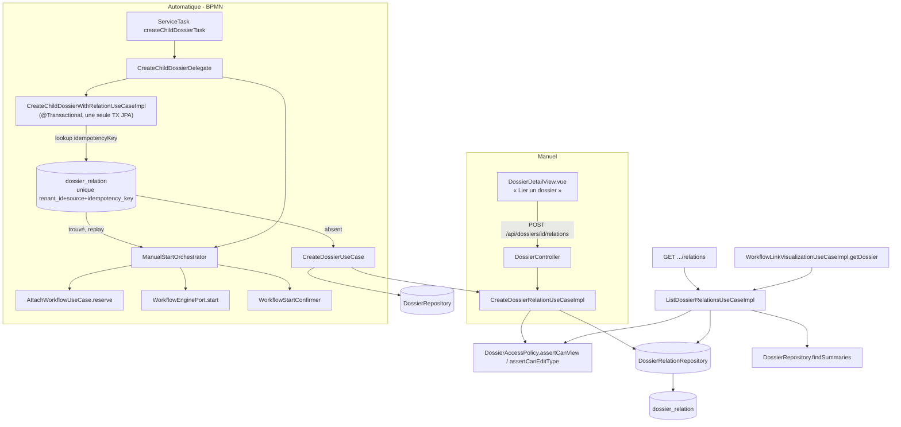

# System Design & Architecture

## Architecture Overview
**What is the high-level system structure?**

Deux chemins de création convergent vers le même modèle domaine
`DossierRelation` : la création manuelle (API/UI) et le `ServiceTask` BPMN
qui, lui, crée en plus un nouveau dossier et démarre un workflow dessus en
réutilisant l'orchestrateur de démarrage manuel existant.



**Composants clés :**
- `CreateDossierRelationUseCaseImpl` (domaine `dossier`) — valide et persiste
  une relation ; réutilisé aussi bien par le contrôleur HTTP que par le
  `ServiceTask`.
- `ListDossierRelationsUseCaseImpl` (domaine `dossier`) — requête
  bidirectionnelle + filtrage ACL, réutilisée par `DossierController` et par
  `WorkflowLinkVisualizationUseCaseImpl.getDossier`.
- `CreateChildDossierDelegate` (infrastructure `flowable`) — nouveau
  `JavaDelegate`, orchestre création dossier enfant + relation + démarrage
  workflow en trois appels vers des use cases déjà indépendamment testés.
- `CreateChildDossierWithRelationUseCaseImpl` (domaine `dossier`, nouveau,
  `@Transactional`) — **résolution Q1/D-IDEMPOTENCY, affinée pendant la
  Phase 2** : contrairement au démarrage du workflow (qui touche un
  système externe, Flowable — d'où le split reserve/confirm de
  `ManualStartOrchestrator`), créer le dossier enfant et sa relation sont
  **deux écritures dans la même base**, donc atomisables dans une seule
  transaction JPA classique. Pas besoin d'un store séparé : la colonne
  `idempotency_key` (nullable) sur `dossier_relation` elle-même, protégée
  par une contrainte unique partielle, sert à la fois de verrou et de
  preuve de complétion. Algorithme : `SELECT` par
  `(tenantId, sourceDossierId, idempotencyKey)` → si trouvé, relation déjà
  créée, renvoyer son `targetDossierId` (replay, aucune écriture) ; sinon,
  créer dossier + relation dans la même transaction (la contrainte unique
  protège aussi contre une course entre deux jobs concurrents). Le
  `ServiceTask` appelle ensuite `ManualStartOrchestrator.start(...)`, qui a
  sa propre protection (existante) contre le rejeu du démarrage de
  workflow sur un `childDossierId` déjà connu.

## Data Models
**What data do we need to manage?**

Reprise conforme de `analysis doc/04-dossiers.md` (déjà spécifié, non
modifié ici) :

```java
// domain/dossier/model — pur Java, aucune annotation JPA (décision n° 17)
public record DossierRelation(
    UUID    id,
    UUID    sourceDossierId,
    UUID    targetDossierId,
    String  tenantId,
    RelationType type,   // PARENT_CHILD, SUBSEQUENT, LINKED, DUPLICATE, MERGED_INTO
    String  createdBy,
    Instant createdAt,
    String  idempotencyKey   // null si créée manuellement ; sinon "processInstanceId:activityId"
) {}
```

```java
public enum RelationType { PARENT_CHILD, SUBSEQUENT, LINKED, DUPLICATE, MERGED_INTO }
```

```sql
-- db/changelog/changes/009-dossier-relation-tables.yaml
CREATE TABLE dossier_relation (
    id                 UUID PRIMARY KEY,
    tenant_id          VARCHAR(63)  NOT NULL,
    source_dossier_id  UUID         NOT NULL REFERENCES dossier(id),
    target_dossier_id  UUID         NOT NULL REFERENCES dossier(id),
    type               VARCHAR(32)  NOT NULL,
    created_by         VARCHAR(255) NOT NULL,
    created_at         TIMESTAMPTZ  NOT NULL,
    -- NULL pour une relation créée manuellement ; sinon "processInstanceId:activityId"
    -- du ServiceTask qui l'a créée (D-IDEMPOTENCY).
    idempotency_key    VARCHAR(255),
    CONSTRAINT chk_dossier_relation_not_self CHECK (source_dossier_id <> target_dossier_id),
    CONSTRAINT uq_dossier_relation UNIQUE (tenant_id, source_dossier_id, target_dossier_id, type)
);

CREATE INDEX idx_dossier_relation_source ON dossier_relation (tenant_id, source_dossier_id);
CREATE INDEX idx_dossier_relation_target ON dossier_relation (tenant_id, target_dossier_id);

-- Index unique partiel : seules les relations créées par un ServiceTask ont une clé.
CREATE UNIQUE INDEX uq_dossier_relation_idempotency
    ON dossier_relation (tenant_id, source_dossier_id, idempotency_key)
    WHERE idempotency_key IS NOT NULL;
```

- Le `CHECK` anti-auto-relation et les deux contraintes d'unicité sont la
  barrière de dernier recours ; l'use case valide déjà tout en amont (400
  clair plutôt que remonter la violation SQL brute), sauf la course entre
  deux jobs concurrents sur `idempotency_key` — volontairement laissée à
  la contrainte DB (dernier rempart naturel contre une vraie concurrence).
- `idempotency_key` reste `null` (et donc hors de l'index partiel) pour
  toute relation créée manuellement — aucun impact sur `uq_dossier_relation`
  ni sur les critères d'unicité déjà en place.
- Pas de `ON DELETE CASCADE` — une relation ne doit pas disparaître
  silencieusement (les dossiers ne sont de toute façon jamais supprimés en
  dur, seulement archivés).

### `DossierRelationView` (résultat de liste, orienté « dossier courant »)

**Résolution Q2/D-DTO (Phase 2)** — pas de duplication : un seul type
domaine `DossierRelationView` dans `domain.dossier.model`, réutilisé tel
quel par `workflow`. `WorkflowLinkDossierView.relations` passe de
`List<Object>` à `List<DossierRelationView>` — même précédent que
`WorkflowLinkDossierView` qui expose déjà `Dossier`/`DossierElement`
(domaine, pas DTO HTTP) ; le contrôleur HTTP mappe ce même type domaine
vers `DossierRelationResponse` (JSON) à la frontière web, comme pour tout
le reste de l'API dossier.

```java
// domain/dossier/model
public record DossierRelationView(
    UUID id,
    RelationType type,
    RelationDirection direction,   // OUTGOING | INCOMING, relatif au dossier interrogé
    DossierListItem relatedDossier, // réutilise le résumé existant de pagination-dossiers — pas de fields
    String createdBy,
    Instant createdAt
) {}

public enum RelationDirection { OUTGOING, INCOMING }
```

`DossierListItem` (déjà livré par `pagination-dossiers`) est réutilisé tel
quel pour `relatedDossier` — il exclut déjà structurellement `fields`, donc
aucun risque de fuite de champ sensible par ce nouveau chemin sans travail
supplémentaire.

## API Design
**How do components communicate?**

| Méthode | Path | Authz | Réponse |
|---|---|---|---|
| POST | `/api/dossiers/{id}/relations` | `assertCanEdit` sur le dossier `{id}` **et** `assertCanView` sur le dossier cible (D-CREATE-ACL, Phase 2) | 201, `DossierRelationResponse` |
| GET | `/api/dossiers/{id}/relations` | `assertCanView` sur le dossier `{id}` + filtrage ACL par relation | 200, `List<DossierRelationResponse>` |

```json
// POST /api/dossiers/{sourceId}/relations
{ "targetDossierId": "…", "type": "PARENT_CHILD" }

// 201 réponse (et items de la liste GET)
{
  "id": "…",
  "type": "PARENT_CHILD",
  "direction": "OUTGOING",
  "relatedDossier": {
    "id": "…", "reference": "DOS-FAC-2026-000099", "label": "Facture Acme",
    "dossierTypeCode": "FAC", "dossierTypeLabel": "Facture",
    "status": "OUVERT", "createdAt": "…", "updatedAt": "…"
  },
  "createdBy": "…",
  "createdAt": "…"
}
```

Erreurs : `ProblemDetail` 400 (`targetDossierId`/`type` manquant ou
invalide, auto-relation), 403 (pas d'EDIT sur la source **ou** pas de VIEW
sur la cible — même convention que `GetDossierUseCaseImpl` :
`AccessDeniedException` pour un dossier du même tenant non autorisé), 404
(dossier source ou cible introuvable **ou** d'un autre tenant —
`DossierNotFoundException`), 409 (relation dupliquée — mappé depuis la
violation de contrainte unique).

`WorkflowLinkVisualizationUseCaseImpl.getDossier()` appelle
`ListDossierRelationsUseCase.list(dossierId, actor)` à la place de
`List.of()` — même filtrage ACL que l'endpoint HTTP, aucune logique
dupliquée.

## Component Breakdown
**What are the major building blocks?**

**Backend (domaine `dossier`) :**
- `domain/dossier/model/{DossierRelation, RelationType, DossierRelationView, RelationDirection}.java`
- `domain/dossier/port/out/DossierRelationRepository.java` — `save`,
  `findByDossier(UUID dossierId)` (source OU cible, une seule requête),
  `findByIdempotencyKey(String tenantId, UUID sourceDossierId, String idempotencyKey)`.
- `domain/dossier/port/in/{CreateDossierRelationUseCase, ListDossierRelationsUseCase, CreateChildDossierWithRelationUseCase}.java`
- `domain/dossier/usecase/{CreateDossierRelationUseCaseImpl, ListDossierRelationsUseCaseImpl, CreateChildDossierWithRelationUseCaseImpl}.java`
  — ce dernier est `@Transactional`, appelé uniquement par le `ServiceTask`
  (jamais par le contrôleur HTTP, qui utilise `CreateDossierRelationUseCase`
  seul pour la création manuelle sur un dossier déjà existant).
- `infrastructure/persistence/dossier/{DossierRelationJpaEntity, DossierRelationJpaAdapter, SpringDataDossierRelationRepository}.java`
- `infrastructure/web/dossier/{DossierRelationResponse, CreateDossierRelationRequest}.java` — DTO HTTP, extension de `DossierController` existant (pas de nouveau `@RestController`).

**Backend (infrastructure `flowable`) :**
- `infrastructure/flowable/CreateChildDossierDelegate.java` (bean
  `createChildDossierTask`) — dépend de
  `CreateChildDossierWithRelationUseCase` et `ManualStartOrchestrator`.
  Valide `relationType ∈ {PARENT_CHILD, SUBSEQUENT}` (D-SERVICETASK-TYPES)
  avant tout appel — échec immédiat et explicite sinon. Dérive
  `idempotencyKey = execution.getProcessInstanceId() + ":" + execution.getCurrentActivityId()`.

**Frontend :**
- `frontend/src/components/dossier/RelationsList.vue` — affichage lecture,
  utilisé à la fois dans `DossierDetailView.vue` et dans le panneau dossier
  de la visualisation workflow (`WorkflowVisualization*.vue`).
- `frontend/src/components/dossier/LinkDossierDialog.vue` — formulaire de
  création : recherche du dossier cible via `GET /api/dossiers` (réutilise
  le composant/store de recherche de `pagination-dossiers`), sélection du
  `type`, soumission `POST .../relations`.
- Store/API client : extension de `frontend/src/api/dossiers.ts` (ou
  équivalent) avec `listRelations`/`createRelation`.

## Design Decisions
**Why did we choose this approach?**

- **Réutiliser `ManualStartOrchestrator` plutôt que réimplémenter le
  démarrage du workflow enfant** dans le `ServiceTask` — évite de dupliquer
  la logique `reserve` → moteur → `confirm` → idempotence déjà durcie et
  testée pour le démarrage manuel. Le `ServiceTask` devient un simple
  appelant de trois use cases existants/nouveaux, pas un réimplémenteur.
- **`DossierListItem` réutilisé pour `relatedDossier`** plutôt qu'un
  `Dossier` complet — élimine par construction le risque de fuite de champ
  sensible sur ce nouveau chemin (cohérent avec la remédiation P0 de
  l'audit sécurité sur la redaction des champs sensibles).
- **Filtrage ACL silencieux (relation omise) plutôt qu'erreur** — même
  politique que `pagination-dossiers` D-ACL : un accès partiel produit un
  résultat partiel, jamais une erreur qui confirmerait indirectement
  l'existence d'un dossier hors périmètre.
- **`DossierRelationView` = type domaine unique du contexte `dossier`,
  jamais un DTO HTTP partagé avec `workflow`** — respecte la frontière
  hexagonale : le contexte `workflow` consomme un type du contexte
  `dossier` (déjà le cas pour `Dossier`/`DossierElement` dans
  `WorkflowLinkDossierView`), jamais l'inverse, et jamais un DTO de couche
  web.
- **Store d'idempotence dédié pour la création du dossier enfant, distinct
  de l'`IdempotencyStore` existant** — plutôt que de supposer une
  atomicité Flowable+JPA que le reste du code base ne suppose jamais
  (raison d'être du split reserve/confirm, DD-TX). Garde le `ServiceTask`
  sûr par construction en cas de retry du job executor, sans toucher à
  l'`IdempotencyStore` existant (qui reste scopé au démarrage de workflow
  sur un dossier déjà existant).
- **`ServiceTask` restreint à `PARENT_CHILD`/`SUBSEQUENT`** — le domaine
  `DossierRelation` reste générique (5 types utilisables en création
  manuelle), seule la validation du délégué est plus stricte : `LINKED`/
  `DUPLICATE`/`MERGED_INTO` n'ont de sens que pour relier deux dossiers
  déjà existants, jamais pour une création automatique.
- **`POST .../relations` exige VIEW sur la cible en plus d'EDIT sur la
  source** — ferme la possibilité, pour un détenteur d'EDIT sur un type,
  de faire apparaître dans les relations d'un dossier qu'il gère un
  dossier d'un autre type auquel il n'a même pas accès en lecture.
- **Alternative écartée : stocker les relations comme paires
  bidirectionnelles symétriques** (deux lignes miroir à la création). Rejeté
  — complexifie l'unicité et la cohérence en cas de type asymétrique
  (`PARENT_CHILD`) ; la vue `DossierRelationView` calcule la direction et le
  libellé à la lecture, une seule ligne stockée suffit.

## Non-Functional Requirements
**How should the system perform?**

- **Sécurité :** toute lecture **et création** de relation repasse par
  `DossierAccessPolicy` (VIEW sur la cible en plus d'EDIT sur la source,
  D-CREATE-ACL) — aucun contournement possible via le panneau workflow
  (même piège que le P0 corrigé en PR #39 sur
  `WorkflowLinkVisualizationUseCaseImpl.getDossier`). Isolation tenant
  systématique (`tenantId` de `TenantProperties`, jamais de l'entrée
  cliente) ; 404 sur dossier introuvable/hors tenant, 403 sur dossier du
  même tenant non autorisé (convention `GetDossierUseCaseImpl`, pas de
  masquage par 404 pour l'ACL intra-tenant).
- **Fiabilité :** le `ServiceTask` est protégé contre les retries Flowable
  par `ChildDossierCreationIdempotencyStore` (D-IDEMPOTENCY, résolu Phase
  2) — clé `(processInstanceId, activityId)` vérifiée avant
  `CreateDossierUseCase.create()`.
- **Performance :** `findByDossier` doit être une requête unique
  (`source_dossier_id = ? OR target_dossier_id = ?`), couverte par les deux
  index dédiés — pas de N+1 sur le panneau dossier (déjà chargé avec
  `elements`, `relations` s'ajoute au même endpoint sans requête
  supplémentaire côté frontend).
- **Scalabilité :** volume attendu faible par dossier (quelques relations
  au plus) — pas de pagination sur `GET .../relations` en V1.
