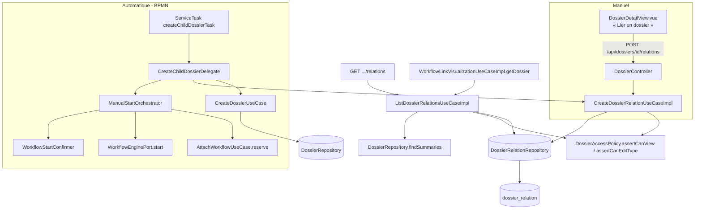

# System Design & Architecture

## Architecture Overview
**What is the high-level system structure?**

Deux chemins de création convergent vers le même modèle domaine
`DossierRelation` : la création manuelle (API/UI) et le `ServiceTask` BPMN
qui, lui, crée en plus un nouveau dossier et démarre un workflow dessus en
réutilisant l'orchestrateur de démarrage manuel existant.



**Composants clés :**
- `CreateDossierRelationUseCaseImpl` (domaine `dossier`) — valide et persiste
  une relation ; réutilisé aussi bien par le contrôleur HTTP que par le
  `ServiceTask`.
- `ListDossierRelationsUseCaseImpl` (domaine `dossier`) — requête
  bidirectionnelle + filtrage ACL, réutilisée par `DossierController` et par
  `WorkflowLinkVisualizationUseCaseImpl.getDossier`.
- `CreateChildDossierDelegate` (infrastructure `flowable`) — nouveau
  `JavaDelegate`, orchestre création dossier enfant + relation + démarrage
  workflow en trois appels vers des use cases déjà indépendamment testés.
- Aucun nouveau composant transverse : le design réutilise
  `ManualStartOrchestrator` tel quel plutôt que de dupliquer sa logique de
  démarrage/idempotence.

## Data Models
**What data do we need to manage?**

Reprise conforme de `analysis doc/04-dossiers.md` (déjà spécifié, non
modifié ici) :

```java
// domain/dossier/model — pur Java, aucune annotation JPA (décision n° 17)
public record DossierRelation(
    UUID    id,
    UUID    sourceDossierId,
    UUID    targetDossierId,
    String  tenantId,
    RelationType type,   // PARENT_CHILD, SUBSEQUENT, LINKED, DUPLICATE, MERGED_INTO
    String  createdBy,
    Instant createdAt
) {}
```

```java
public enum RelationType { PARENT_CHILD, SUBSEQUENT, LINKED, DUPLICATE, MERGED_INTO }
```

```sql
-- db/changelog/changes/009-dossier-relation-tables.yaml
CREATE TABLE dossier_relation (
    id                 UUID PRIMARY KEY,
    tenant_id          VARCHAR(63)  NOT NULL,
    source_dossier_id  UUID         NOT NULL REFERENCES dossier(id),
    target_dossier_id  UUID         NOT NULL REFERENCES dossier(id),
    type               VARCHAR(32)  NOT NULL,
    created_by         VARCHAR(255) NOT NULL,
    created_at         TIMESTAMPTZ  NOT NULL,
    CONSTRAINT chk_dossier_relation_not_self CHECK (source_dossier_id <> target_dossier_id),
    CONSTRAINT uq_dossier_relation UNIQUE (tenant_id, source_dossier_id, target_dossier_id, type)
);

CREATE INDEX idx_dossier_relation_source ON dossier_relation (tenant_id, source_dossier_id);
CREATE INDEX idx_dossier_relation_target ON dossier_relation (tenant_id, target_dossier_id);
```

- Le `CHECK` anti-auto-relation et la contrainte d'unicité sont la barrière
  de dernier recours ; l'use case valide déjà les deux en amont (400 clair
  plutôt que remonter la violation SQL brute).
- Pas de `ON DELETE CASCADE` — une relation ne doit pas disparaître
  silencieusement (les dossiers ne sont de toute façon jamais supprimés en
  dur, seulement archivés).

### `DossierRelationView` (résultat de liste, orienté « dossier courant »)

Réponse à **Q2** (requirements, ouverte) — décision : dupliquer un DTO
léger propre au contexte `dossier` plutôt que de faire dépendre `workflow`
d'un DTO HTTP. `WorkflowLinkDossierView.relations` passe de `List<Object>`
à `List<DossierRelationView>` (le type domaine, pas le DTO JSON du
contrôleur — cohérent avec le reste de `WorkflowLinkDossierView`, qui
expose déjà `Dossier`/`DossierElement` domaine, pas des DTO HTTP).

```java
// domain/dossier/model
public record DossierRelationView(
    UUID id,
    RelationType type,
    RelationDirection direction,   // OUTGOING | INCOMING, relatif au dossier interrogé
    DossierListItem relatedDossier, // réutilise le résumé existant de pagination-dossiers — pas de fields
    String createdBy,
    Instant createdAt
) {}

public enum RelationDirection { OUTGOING, INCOMING }
```

`DossierListItem` (déjà livré par `pagination-dossiers`) est réutilisé tel
quel pour `relatedDossier` — il exclut déjà structurellement `fields`, donc
aucun risque de fuite de champ sensible par ce nouveau chemin sans travail
supplémentaire.

## API Design
**How do components communicate?**

| Méthode | Path | Authz | Réponse |
|---|---|---|---|
| POST | `/api/dossiers/{id}/relations` | `assertCanEdit` sur le dossier `{id}` (même politique que `PATCH /status`) | 201, `DossierRelationResponse` |
| GET | `/api/dossiers/{id}/relations` | `assertCanView` sur le dossier `{id}` + filtrage ACL par relation | 200, `List<DossierRelationResponse>` |

```json
// POST /api/dossiers/{sourceId}/relations
{ "targetDossierId": "…", "type": "PARENT_CHILD" }

// 201 réponse (et items de la liste GET)
{
  "id": "…",
  "type": "PARENT_CHILD",
  "direction": "OUTGOING",
  "relatedDossier": {
    "id": "…", "reference": "DOS-FAC-2026-000099", "label": "Facture Acme",
    "dossierTypeCode": "FAC", "dossierTypeLabel": "Facture",
    "status": "OUVERT", "createdAt": "…", "updatedAt": "…"
  },
  "createdBy": "…",
  "createdAt": "…"
}
```

Erreurs : `ProblemDetail` 400 (`targetDossierId`/`type` manquant ou
invalide, auto-relation), 403 (pas d'EDIT sur la source), 404 (dossier
source ou cible introuvable **ou** hors tenant — jamais 403 sur la cible,
pour ne pas confirmer l'existence cross-tenant), 409 (relation dupliquée —
mappé depuis la violation de contrainte unique).

`WorkflowLinkVisualizationUseCaseImpl.getDossier()` appelle
`ListDossierRelationsUseCase.list(dossierId, actor)` à la place de
`List.of()` — même filtrage ACL que l'endpoint HTTP, aucune logique
dupliquée.

## Component Breakdown
**What are the major building blocks?**

**Backend (domaine `dossier`) :**
- `domain/dossier/model/{DossierRelation, RelationType, DossierRelationView, RelationDirection}.java`
- `domain/dossier/port/out/DossierRelationRepository.java` — `save`,
  `findByDossier(UUID dossierId)` (source OU cible, une seule requête).
- `domain/dossier/port/in/{CreateDossierRelationUseCase, ListDossierRelationsUseCase}.java`
- `domain/dossier/usecase/{CreateDossierRelationUseCaseImpl, ListDossierRelationsUseCaseImpl}.java`
- `infrastructure/persistence/dossier/{DossierRelationJpaEntity, DossierRelationJpaAdapter, SpringDataDossierRelationRepository}.java`
- `infrastructure/web/dossier/{DossierRelationResponse, CreateDossierRelationRequest}.java` — DTO HTTP, extension de `DossierController` existant (pas de nouveau `@RestController`).

**Backend (infrastructure `flowable`) :**
- `infrastructure/flowable/CreateChildDossierDelegate.java` (bean
  `createChildDossierTask`) — dépend de `CreateDossierUseCase`,
  `CreateDossierRelationUseCase`, `ManualStartOrchestrator`.

**Frontend :**
- `frontend/src/components/dossier/RelationsList.vue` — affichage lecture,
  utilisé à la fois dans `DossierDetailView.vue` et dans le panneau dossier
  de la visualisation workflow (`WorkflowVisualization*.vue`).
- `frontend/src/components/dossier/LinkDossierDialog.vue` — formulaire de
  création : recherche du dossier cible via `GET /api/dossiers` (réutilise
  le composant/store de recherche de `pagination-dossiers`), sélection du
  `type`, soumission `POST .../relations`.
- Store/API client : extension de `frontend/src/api/dossiers.ts` (ou
  équivalent) avec `listRelations`/`createRelation`.

## Design Decisions
**Why did we choose this approach?**

- **Réutiliser `ManualStartOrchestrator` plutôt que réimplémenter le
  démarrage du workflow enfant** dans le `ServiceTask` — évite de dupliquer
  la logique `reserve` → moteur → `confirm` → idempotence déjà durcie et
  testée pour le démarrage manuel. Le `ServiceTask` devient un simple
  appelant de trois use cases existants/nouveaux, pas un réimplémenteur.
- **`DossierListItem` réutilisé pour `relatedDossier`** plutôt qu'un
  `Dossier` complet — élimine par construction le risque de fuite de champ
  sensible sur ce nouveau chemin (cohérent avec la remédiation P0 de
  l'audit sécurité sur la redaction des champs sensibles).
- **Filtrage ACL silencieux (relation omise) plutôt qu'erreur** — même
  politique que `pagination-dossiers` D-ACL : un accès partiel produit un
  résultat partiel, jamais une erreur qui confirmerait indirectement
  l'existence d'un dossier hors périmètre.
- **`DossierRelationView` dupliqué en domaine `dossier`, pas un DTO HTTP
  partagé avec `workflow`** — respecte la frontière hexagonale : le
  contexte `workflow` consomme un type du contexte `dossier` (déjà le cas
  pour `Dossier`/`DossierElement` dans `WorkflowLinkDossierView`), jamais
  l'inverse, et jamais un DTO de couche web.
- **Alternative écartée : stocker les relations comme paires
  bidirectionnelles symétriques** (deux lignes miroir à la création). Rejeté
  — complexifie l'unicité et la cohérence en cas de type asymétrique
  (`PARENT_CHILD`) ; la vue `DossierRelationView` calcule la direction et le
  libellé à la lecture, une seule ligne stockée suffit.

## Non-Functional Requirements
**How should the system perform?**

- **Sécurité :** toute lecture de relation repasse par
  `DossierAccessPolicy` — aucun contournement possible via le panneau
  workflow (même piège que le P0 corrigé en PR #39 sur
  `WorkflowLinkVisualizationUseCaseImpl.getDossier`). Isolation tenant
  systématique (`tenantId` de `TenantProperties`, jamais de l'entrée
  cliente) ; 404 (pas 403) sur cible cross-tenant.
- **Fiabilité :** le `ServiceTask` doit être sûr en cas de retry Flowable —
  **point ouvert Q1** (requirements), à verrouiller avant implémentation
  (Phase 2/3) : clé d'idempotence dérivée de
  `(processInstanceId, activityId)` à vérifier avant `CreateDossierUseCase`.
- **Performance :** `findByDossier` doit être une requête unique
  (`source_dossier_id = ? OR target_dossier_id = ?`), couverte par les deux
  index dédiés — pas de N+1 sur le panneau dossier (déjà chargé avec
  `elements`, `relations` s'ajoute au même endpoint sans requête
  supplémentaire côté frontend).
- **Scalabilité :** volume attendu faible par dossier (quelques relations
  au plus) — pas de pagination sur `GET .../relations` en V1.
