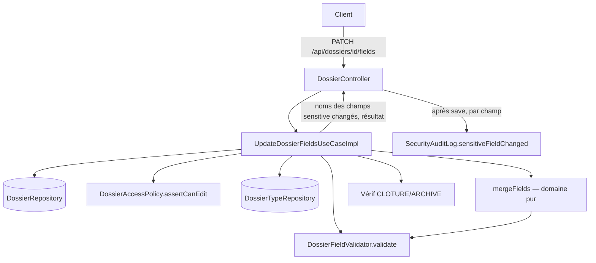

# System Design & Architecture

## Architecture Overview
**What is the high-level system structure?**

Extension minimale et symétrique à `PATCH /api/dossiers/{id}/status` :
aucune nouvelle table, aucun nouveau port `out`, un seul nouveau use case
qui réutilise `DossierFieldValidator` (déjà conçu pour valider un jeu de
champs complet) et `Dossier.withFields()` (déjà présent, ajouté lors du
fix P0 de redaction).



**Composants clés :**
- `UpdateDossierFieldsUseCaseImpl` (domaine `dossier.usecase`) — orchestre
  chargement, ACL, gate de statut, verrou optimiste, fusion, validation,
  sauvegarde. Un seul appel `repository.save()`, pas de coordination
  transactionnelle multi-écriture (contrairement à `ChildDossierRelationConfirmer`
  de `relations-dossiers` — ici une seule entité modifiée, le `@Transactional`
  de l'adaptateur JPA suffit).
- `DossierFieldMerger` (**tranché en Phase 3** — classe utilitaire domaine
  statique, `domain/dossier/DossierFieldMerger.java`, pas une méthode
  privée du use case) — regroupe les deux fonctions pures ci-dessous.
  Emplacement choisi par précédent direct : `DossierFieldRedactor` (même
  package `domain.dossier`, même forme — classe statique sans état)
  fait déjà exactement ce type de parcours de `List<FieldDefinition>` +
  test `isSensitive()` pour la lecture ; suivre le même patron pour
  l'écriture plutôt que d'enterrer la logique dans le use case.
  - `merge(Map<String,Object> existing, Map<String,Object> patch)` →
    nouveau `Map<String,Object>` : pour chaque entrée de `patch`, si la
    valeur est `null` la clé est **retirée** du résultat (jamais posée à
    `null` — voir note ci-dessous), sinon elle est posée/écrasée ; les
    clés de `existing` absentes de `patch` sont conservées telles
    quelles.
  - `changedSensitiveFieldNames(List<FieldDefinition> definitions, Map<String,Object> before, Map<String,Object> after)`
    → noms des champs `isSensitive()` dont la valeur diffère entre
    `before` et `after` (ajout, effacement, ou changement de valeur ;
    absent si valeur identique — pas d'événement pour un no-op).

  **Pourquoi "null efface la clé" n'est pas qu'un choix d'API (D-CLEAR) :**
  `Dossier`'s constructeur compact fait `fields = Map.copyOf(fields)` —
  `Map.copyOf`/`Map.of` **rejettent** toute valeur `null` (`NullPointerException`).
  Poser une clé à `null` dans le résultat de `merge()` ferait donc
  planter `Dossier.withFields(merged, ...)` à la construction. Retirer la
  clé n'est donc pas seulement la sémantique la plus propre (RFC 7396) —
  c'est la seule implémentation qui ne casse pas l'invariant déjà en
  place sur `Dossier` (même contrainte documentée dans le Javadoc de
  `DossierFieldRedactor`, qui retire la clé pour la même raison côté
  lecture).
- `SecurityAuditLog.sensitiveFieldChanged(...)` (**résolution
  D-SENSITIVE-AUDIT, Phase 2**) — nouvelle méthode sur la classe
  existante `infrastructure/security/SecurityAuditLog.java`. Jusqu'ici
  cette classe ne couvre que des **refus** (`tenant_mismatch`,
  `access_denied`, niveau WARN) ; ceci est la première **action légitime
  tracée** — niveau INFO pour la distinguer visuellement des refus dans
  les logs, même logger `SECURITY_AUDIT` pour rester agrégeable/alertable
  au même endroit. Log **uniquement** `dossierId`, `field` (nom) et
  l'auteur — **jamais** l'ancienne ni la nouvelle valeur.
  **Frontière hexagonale (piège identifié en Phase 2, avant Phase 3) :**
  `UpdateDossierFieldsUseCaseImpl` (`domain.dossier.usecase`) ne peut
  **pas** appeler `SecurityAuditLog` directement — celui-ci vit en
  `infrastructure.security`, ce serait une violation immédiate de
  `domain_never_depends_on_infrastructure` (`ArchitectureRulesTest`),
  la même catégorie d'erreur que celle corrigée en Phase 3 de
  `relations-dossiers`. Même patron déjà en place pour
  `AccessDeniedException` : le domaine ne connaît pas `SecurityAuditLog`,
  il expose juste le fait ; c'est `DossierExceptionHandler`
  (infrastructure) qui appelle `SecurityAuditLog.accessDenied(...)` en
  attrapant l'exception. Ici, pas d'exception (c'est un succès) — le
  domaine renvoie donc la liste des noms de champs `sensitive` réellement
  modifiés dans son résultat (calcul pur : diff entre l'ancien et le
  nouveau jeu de champs, croisé avec `FieldDefinition.isSensitive()`,
  aucune dépendance framework), et c'est `DossierController`
  (infrastructure, qui a déjà `HttpServletRequest`/`Authentication` sous
  la main) qui appelle `SecurityAuditLog.sensitiveFieldChanged(...)` pour
  chacun après le `save()`.

## Data Models
**What data do we need to manage?**

Aucun nouveau modèle — réutilisation intégrale de l'existant :
- `Dossier.fields` (déjà `Map<String, Object>`, immutable via `Map.copyOf`
  dans le constructeur compact).
- `Dossier.withFields(Map<String, Object>)` — déjà présent
  (`Dossier.java`), utilisé aujourd'hui uniquement par
  `DossierFieldRedactor` en lecture ; réutilisé ici en écriture.
- `DossierFieldValidator.validate(definitions, values, allowUnknownFields)`
  — déjà présent, appelé sur le jeu **fusionné** (pas seulement le patch),
  exactement comme à la création.
- `DossierType.fieldDefinitions()` / `allowUnknownFields()` — déjà
  présents, chargés via `DossierTypeRepository.findByCode`.

```java
// domain/dossier/usecase — nouveau, pas de nouvelle table/entité
public final class UpdateDossierFieldsUseCaseImpl implements UpdateDossierFieldsUseCase {
    // dossierRepository, dossierTypeRepository, accessPolicy, fieldValidator (new DossierFieldValidator())

    @Override
    public Dossier update(UpdateDossierFieldsCommand command, AccessContext ctx) {
        if (command.fieldsPatch() == null || command.fieldsPatch().isEmpty()) {
            throw new IllegalArgumentException("fields must not be empty"); // D-EMPTY-BODY, 400
        }
        Dossier dossier = dossierRepository.findById(command.dossierId())
                .orElseThrow(() -> new DossierNotFoundException(...));
        accessPolicy.assertCanEdit(dossier, ctx);

        if (dossier.status() == DossierStatus.CLOTURE || dossier.status() == DossierStatus.ARCHIVE) {
            throw new DossierConflictException("Dossier is closed: " + dossier.status());
        }
        if (command.expectedVersion() != null && !command.expectedVersion().equals(dossier.version())) {
            throw new DossierConflictException("Expected version " + command.expectedVersion()
                    + " but found " + dossier.version());
        }

        Map<String, Object> merged = DossierFieldMerger.merge(dossier.fields(), command.fieldsPatch());

        DossierType type = dossierTypeRepository.findByCode(dossier.tenantId(), dossier.dossierTypeCode())
                .orElseThrow(() -> new DossierNotFoundException(...)); // type must exist; inactive is fine (A2)
        var errors = fieldValidator.validate(type.fieldDefinitions(), merged, type.allowUnknownFields());
        if (!errors.isEmpty()) {
            throw new DossierFieldValidationException(errors);
        }

        // Pure domain computation — no framework/infrastructure dependency (D-SENSITIVE-AUDIT).
        List<String> sensitiveFieldsChanged = DossierFieldMerger.changedSensitiveFieldNames(
                type.fieldDefinitions(), dossier.fields(), merged);

        // withFields(Map, String, Instant) — new overload, see Design Decisions.
        Dossier updated = dossier.withFields(merged, command.updatedBy(), Instant.now());
        Dossier saved = dossierRepository.save(updated);
        return new UpdateDossierFieldsResult(saved, sensitiveFieldsChanged);
    }
}
```

`UpdateDossierFieldsUseCase.update(...)` renvoie
`UpdateDossierFieldsResult(Dossier dossier, List<String> sensitiveFieldsChanged)`
(nouveau petit record domaine) plutôt qu'un `Dossier` nu — c'est
`DossierController` qui, après réception, boucle sur
`sensitiveFieldsChanged` et appelle
`SecurityAuditLog.sensitiveFieldChanged(request, authentication, id, fieldName)`
pour chacun, puis renvoie `DossierResponse.from(result.dossier())` comme
d'habitude.

`Dossier.withFields(Map)` aujourd'hui **ne met pas à jour** `updatedBy`/
`updatedAt` (contrairement à `withStatus`, qui les prend en paramètre).
C'est un écart réel à combler — voir **Design Decisions**.

**`version` — aucun travail nécessaire (clarifié en Phase 3) :**
`DossierJpaEntity.version` porte `@Version` (verrou optimiste JPA/Hibernate,
confirmé dans `JpaDossierRepositoryAdapter` — le commentaire `// flush so
@Version is incremented before mapping back to the domain` documente déjà
ce comportement). Hibernate l'incrémente automatiquement à **chaque**
`UPDATE`, y compris un merge qui ne change rien en net — D-NOOP-VERSION
(« toujours avancé ») est donc une propriété automatique de l'appel à
`repository.save()`, pas quelque chose que le use case doit orchestrer
lui-même.

## API Design
**How do components communicate?**

| Méthode | Path | Authz | Réponse |
|---|---|---|---|
| PATCH | `/api/dossiers/{id}/fields` | `assertCanEdit` sur le dossier `{id}` (même politique que `PATCH .../status`) | 200, `DossierResponse` |

```json
// PATCH /api/dossiers/{id}/fields
{ "fields": { "montant": 1500, "commentaire": null }, "expectedVersion": 3 }
```

`commentaire: null` efface le champ (D-CLEAR) ; `montant` est
posé/écrasé ; tout autre champ existant (ex. `reference_externe`) reste
inchangé. `expectedVersion` optionnel, même contrat que `PATCH .../status`.

Erreurs : `ProblemDetail` 400 (`fields` absent/vide — D-EMPTY-BODY ;
validation champ échouée, `DossierFieldValidationException` avec
`errors[]`, même forme que la création), 403 (pas d'EDIT), 404 (dossier
introuvable/hors tenant), 409 (`expectedVersion` obsolète **ou** dossier
`CLOTURE`/`ARCHIVE` — les deux via `DossierConflictException`, message
distinct pour différencier les deux causes côté client).

## Component Breakdown
**What are the major building blocks?**

**Backend (domaine `dossier`) :**
- `domain/dossier/port/in/UpdateDossierFieldsUseCase.java` — interface +
  `record UpdateDossierFieldsCommand(UUID dossierId, Map<String,Object> fieldsPatch, String updatedBy, Long expectedVersion)`
  + `record UpdateDossierFieldsResult(Dossier dossier, List<String> sensitiveFieldsChanged)`.
- `domain/dossier/usecase/UpdateDossierFieldsUseCaseImpl.java`.
- `domain/dossier/DossierFieldMerger.java` (nouveau, tranché Phase 3) —
  `merge(...)` + `changedSensitiveFieldNames(...)`, même package/patron
  que `DossierFieldRedactor.java`.
- `domain/dossier/model/Dossier.java` — petit ajustement : `withFields`
  doit aussi poser `updatedBy`/`updatedAt` (voir Design Decisions) pour
  rester cohérent avec `withStatus`.

**Backend (infrastructure) :**
- `infrastructure/web/dossier/DossierApiDtos.java` — `record UpdateDossierFieldsRequest(Map<String, Object> fields, Long expectedVersion)`.
- `infrastructure/web/dossier/DossierController.java` — nouvelle méthode
  `@PatchMapping("/{id}/fields")`, même patron que `updateStatus` ; après
  l'appel au use case, boucle sur `result.sensitiveFieldsChanged()` et
  appelle `SecurityAuditLog.sensitiveFieldChanged(request, authentication, id, fieldName)`
  pour chacun (le contrôleur a déjà `HttpServletRequest`/`Authentication`
  pour les autres endpoints, même patron que `handleAccessDenied`).
- `infrastructure/security/SecurityAuditLog.java` — nouvelle méthode
  `sensitiveFieldChanged(HttpServletRequest, Authentication, UUID dossierId, String field)`,
  niveau INFO (voir Composants clés).
- `infrastructure/config/DossierConfig.java` — bean
  `UpdateDossierFieldsUseCase`.
- Aucun changement à `DossierExceptionHandler` — `DossierConflictException`
  et `DossierFieldValidationException` déjà mappés.

**Frontend :** hors scope V1 de cette feature — aucun composant UI
existant n'édite `fields` après création aujourd'hui (`CreateDossierView`
seulement) ; brancher un formulaire d'édition sur
`DossierDetailView.vue` est un follow-up FE, pas requis pour livrer
l'API. Si le produit veut l'UI immédiatement, le signaler pour l'ajouter
au scope avant la Phase 4 (planning).

## Design Decisions
**Why did we choose this approach?**

- **`DossierFieldMerger` en classe utilitaire domaine dédiée, pas des
  méthodes privées du use case** — trouvé en Phase 3 par précédent direct
  avec `DossierFieldRedactor` (même package, même forme statique). Deux
  bénéfices concrets : testable isolément sans mocker
  `UpdateDossierFieldsUseCaseImpl`, et découvrable au même endroit que le
  reste de la logique de champs (`DossierFieldValidator`,
  `DossierFieldRedactor`) plutôt qu'enterrée dans un use case précis.
- **Validation sur le jeu fusionné, jamais sur le patch seul** — réutilise
  `DossierFieldValidator.validate()` sans le modifier ; garantit qu'un
  effacement de champ `required` est rejeté (le champ apparaît manquant
  dans le jeu fusionné final), sans logique de validation "partielle" à
  écrire.
- **`Dossier.withFields` doit être étendu pour accepter `updatedBy`/`at`**
  — aujourd'hui `withFields(Map)` ne touche ni `updatedBy` ni `updatedAt`
  (seul `withStatus` le fait). Sans ce changement, un PATCH fields
  n'avancerait pas `updatedAt`, ce qui casserait le tri
  `updatedAt,desc` de `pagination-dossiers` (un dossier dont seuls les
  champs changent resterait "invisible" en haut de liste). Deux options :
  (a) ajouter `withFields(Map fields, String updatedBy, Instant at)` en
  plus de la surcharge existante (garde la compatibilité avec
  `DossierFieldRedactor`, qui n'a pas besoin de toucher `updatedBy`/`at`
  puisqu'il redacte une vue de lecture, pas un état persisté) ; (b)
  faire systématiquement `withFields(merged).withStatus(dossier.status(), updatedBy, at)`
  pour piggy-back sur la logique existante — rejeté, sémantiquement faux
  (pas un changement de statut) et fragile (dépend d'un détail
  d'implémentation de `withStatus`). **Retenu : option (a).**
- **Gate de statut vérifié indépendamment du verrou optimiste** — un
  dossier fermé est bloqué même si `expectedVersion` correspond
  exactement, pour un message d'erreur distinct et sans ambiguïté côté
  client (« dossier fermé » vs « quelqu'un d'autre a modifié le
  dossier »).
- **Pas de nouveau composant transactionnel** — contrairement à
  `relations-dossiers` (qui coordonnait deux écritures), ici une seule
  entité est modifiée ; le `@Transactional` déjà présent sur
  `JpaDossierRepositoryAdapter.save()` suffit, pas de risque de course
  identique à `ChildDossierRelationConfirmer`.
- **`UpdateDossierFieldsUseCase` renvoie un résultat enrichi
  (`UpdateDossierFieldsResult`) plutôt que d'appeler `SecurityAuditLog`
  depuis le domaine** — évite une violation `domain_never_depends_on_infrastructure`
  (même catégorie d'erreur trouvée en Phase 3 de `relations-dossiers`,
  cette fois anticipée dès la Phase 2). Suit le patron déjà établi pour
  `AccessDeniedException` : le domaine expose le fait (ici, la liste des
  champs sensibles changés — un calcul pur), l'infrastructure
  (`DossierController`, symétrique à `DossierExceptionHandler` pour les
  refus) décide comment le journaliser.

## Non-Functional Requirements
**How should the system perform?**

- **Sécurité :** même `DossierAccessPolicy.assertCanEdit` que le reste de
  l'API dossier — aucune nouvelle surface ACL (D-SENSITIVE-AUDIT : pas de
  restriction d'accès supplémentaire sur les champs `sensitive`, seulement
  une traçabilité ajoutée). Le PATCH écrit toujours la valeur réelle (pas
  de redaction à l'écriture) ; la redaction reste un concern de lecture
  (`DossierFieldRedactor`), inchangé par cette feature. Isolation tenant
  systématique (`tenantId` du dossier chargé, jamais de l'entrée cliente).
  Nouvel événement `SECURITY_AUDIT` (niveau INFO, métadonnées seulement)
  quand un champ `sensitive` change de valeur.
- **Fiabilité :** verrou optimiste `expectedVersion` optionnel (même
  contrat que `PATCH .../status`) protège contre les écritures
  concurrentes perdues ; pas de scénario de concurrence complexe comme
  `relations-dossiers` (une seule écriture, pas de création en cascade).
- **Performance :** aucun impact — une lecture + une écriture, comme
  `PATCH .../status`.
- **Compatibilité :** `GET /api/dossiers/{id}` et
  `GET /api/dossiers` (pagination) restent inchangés ; un dossier édité
  remonte naturellement dans le tri `updatedAt,desc` grâce à l'extension
  de `withFields`.
