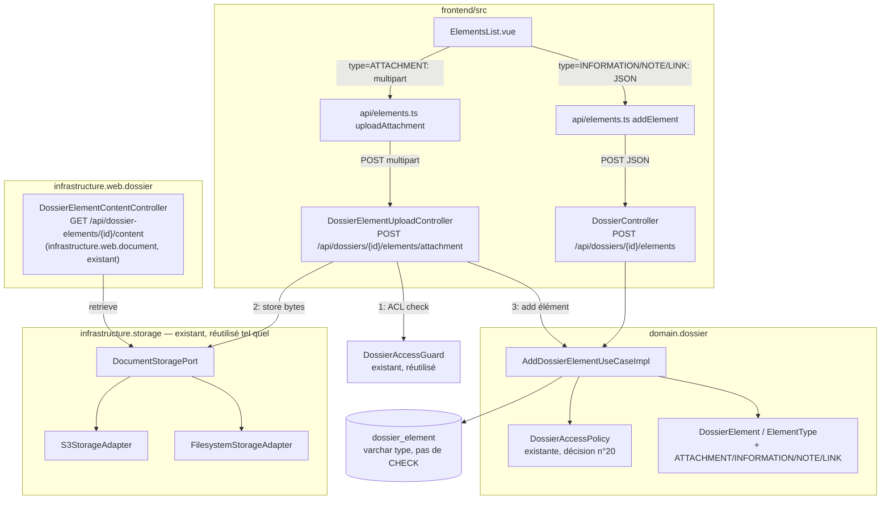

# System Design & Architecture — `elements-dossier`

> Complète l'existant (`DossierElement`, `DocumentStoragePort`, `S3StorageAdapter`,
> `FilesystemStorageAdapter`, livrés avec `generation-documents`) — aucun nouveau port de
> stockage, aucune nouvelle table d'ACL. Voir
> [requirements](../requirements/2026-08-16-feature-elements-dossier.md) pour le problème et le
> périmètre (non-goals : suppression, édition, antivirus, rétention/purge).

## Architecture Overview



**Composants clés**

- **`DossierElementUploadController`** (nouveau, `web.dossier`) : seul point d'entrée
  `multipart/form-data`, dédié à `ATTACHMENT`. Vérifie d'abord l'ACL via
  `DossierAccessGuard.requireEditable(dossierId, ctx)` (helper existant, déjà utilisé par les
  contrôleurs dossier — évite d'écrire un fichier en storage avant de savoir si la requête est
  autorisée), **puis** écrit le fichier via `DocumentStoragePort.store(tenantId, contentType,
  bytes)`, obtient un `storageRef` opaque, puis appelle `AddDossierElementUseCase.add(...)` avec
  ce `storageRef` (qui revalide l'ACL en interne — acceptable, double-check bon marché en mémoire,
  déjà le pattern des autres use cases appelés depuis un contrôleur ayant lui-même un guard).
- **`DossierController`** (existant, étendu) : nouvel endpoint JSON
  `POST /api/dossiers/{id}/elements` pour `INFORMATION` / `NOTE` / `LINK` — pas de fichier, pas
  de `storageRef`.
- **`AddDossierElementUseCaseImpl`** (existant, étendu) : la garde `Only PRODUCED_DOC is
  supported in V1` est remplacée par une validation par type (voir Design Decisions).
- **`DocumentStoragePort` / adaptateurs S3 / filesystem** : **inchangés**, réutilisés tels quels.
- **`DossierAccessPolicy`** : **inchangée**, réutilisée telle quelle (`assertCanEdit` pour
  ajouter, `assertCanView` pour lister/télécharger — déjà le cas pour `listElements` /
  `GetDossierElementUseCase`).

## Data Models

**`ElementType`** — extension de l'enum existant (`infrastructure` : colonne `varchar(32)` sans
`CHECK`, aucune migration Liquibase requise) :

```java
public enum ElementType {
    PRODUCED_DOC,  // existant, inchangé — ServiceTask uniquement
    ATTACHMENT,    // nouveau — upload utilisateur, storageRef renseigné
    INFORMATION,   // nouveau — bloc clé/valeur libre, storageRef null
    NOTE,          // nouveau — texte libre, storageRef null
    LINK           // nouveau — référence externe, storageRef null, jamais résolue serveur
}
```

`DossierElement` (record, inchangé structurellement) — usage du champ `metadata` déjà existant
par type :

| Type | `storageRef` | `metadata` (convention) |
|---|---|---|
| `PRODUCED_DOC` | requis (existant) | libre (existant, inchangé) |
| `ATTACHMENT` | requis — retourné par `DocumentStoragePort.store(...)` | `{"filename": string, "contentType": string, "sizeBytes": number}` |
| `INFORMATION` | `null` | objet clé/valeur libre fourni par l'appelant (plafonné en taille, voir NFR) |
| `NOTE` | `null` | `{"text": string}` (plafonné en longueur, voir NFR) |
| `LINK` | `null` | `{"url": string, "description": string?}` |

`DossierElementView.downloadable` (calcul existant, à généraliser) :

```java
boolean downloadable = (element.type() == ElementType.PRODUCED_DOC || element.type() == ElementType.ATTACHMENT)
        && element.storageRef() != null && !element.storageRef().isBlank();
```

Aucun changement de schéma `dossier_element` (table existante suffit : `type`, `storage_ref`
nullable, `metadata` jsonb déjà présents).

## API Design

**1. `POST /api/dossiers/{id}/elements`** (nouveau, JSON, `DossierController`) — `INFORMATION` /
`NOTE` / `LINK`.

```jsonc
// Request
{ "type": "NOTE", "label": "Rappel client", "metadata": { "text": "À relancer le 20/08" } }
// 201 Created → DossierElementView (même forme que GET .../elements)
```

Rejette `type=PRODUCED_DOC` et `type=ATTACHMENT` (400 — orientés vers leurs endpoints dédiés :
ServiceTask / upload multipart respectivement). Rejette (409) si le dossier est `CLOTURE`/`ARCHIVE`
(décision n°6).

**2. `POST /api/dossiers/{id}/elements/attachment`** (nouveau, `multipart/form-data`, nouveau
`DossierElementUploadController`) — `ATTACHMENT` uniquement.

```
Content-Type: multipart/form-data
  file: <bytes>        (requis, borné par NFR)
  label: "Justificatif" (requis)
```

→ `201 Created`, corps `DossierElementView`. Rejette fichier absent, taille hors borne, type MIME
hors allowlist (`InvalidDossierElementException` → 400/413, voir Non-Functional Requirements).
Rejette (409) si le dossier est `CLOTURE`/`ARCHIVE` (décision n°6) — le fichier est néanmoins déjà
stocké au moment où le 409 est levé (le contrôleur stocke avant d'appeler le use case, voir
Fiabilité) ; extension acceptée du risque d'objet orphelin déjà toléré pour `PRODUCED_DOC`, pas de
vérification de statut ajoutée en amont du `store(...)` pour éviter une double lecture dossier.

**3. `GET /api/dossier-elements/{id}/content`** (existant, `DossierElementContentController`,
généralisé) : sert désormais `PRODUCED_DOC` **et** `ATTACHMENT`, avec le `Content-Type` et le nom
de fichier réels tirés de `metadata` pour `ATTACHMENT` (au lieu du `application/pdf` en dur
actuel, conservé uniquement pour `PRODUCED_DOC`).

**Authentification/autorisation** : session BFF existante (`Authentication` → `AccessContext.User`
via `AccessContextFactory`, inchangé). ACL : `DossierAccessPolicy.assertCanEdit` sur les deux
endpoints d'ajout, `assertCanView` sur lecture/liste/téléchargement (déjà le comportement pour
`PRODUCED_DOC`/`listElements`).

## Component Breakdown

**Backend**

- `domain.dossier.model.ElementType` — 4 nouvelles valeurs.
- `domain.dossier.usecase.AddDossierElementUseCaseImpl` — validation par type (remplace la garde
  `PRODUCED_DOC`-only) ; garde de statut `CLOTURE`/`ARCHIVE` → `DossierConflictException` (409),
  appliquée uniquement quand `ctx instanceof AccessContext.User` (voir Design Decisions n°6).
- `domain.dossier.model.DossierElementView#from` — `downloadable` généralisé à `ATTACHMENT`.
- `infrastructure.web.dossier.DossierController` — nouvel endpoint JSON `POST .../elements`.
- `infrastructure.web.dossier.DossierElementUploadController` (nouveau) — endpoint multipart,
  orchestration `DossierAccessGuard.requireEditable` (existant, réutilisé) →
  `DocumentStoragePort.store` → `AddDossierElementUseCase.add`.
- `infrastructure.web.dossier.DossierExceptionHandler` — ajout du mapping
  `InvalidDossierElementException` → 400 (absent aujourd'hui pour ce package, seul
  `DocumentGenerationExceptionHandler` le gère actuellement côté `web.document`).
- `infrastructure.web.document.DossierElementContentController` — généralisation du
  `Content-Type`/nom de fichier servi, à partir de `metadata` pour `ATTACHMENT`.
- `infrastructure.config.DossierConfig` — pas de nouveau bean de use case (réutilisation de
  `AddDossierElementUseCase` déjà câblé) ; `DossierElementUploadController` injecte
  `DocumentStoragePort` déjà exposé par `StorageConfig`.
- Limite de taille multipart : propriétés Spring natives
  `spring.servlet.multipart.max-file-size` / `max-request-size` (pas de filtre dédié à écrire —
  contrairement à `DocumentGenerationBodySizeLimitFilter`/`WebhookBodySizeLimitFilter` qui
  protègent des corps JSON non-multipart ; Spring rejette nativement un multipart hors borne en
  413 via `MaxUploadSizeExceededException`, à mapper en `ProblemDetail` dans
  `DossierExceptionHandler`).
- Allowlist MIME : validation applicative dans `DossierElementUploadController` (liste de
  `contentType` acceptés, configurable via `@ConfigurationProperties`, cohérent avec
  `StorageProperties`).

**Frontend**

- `frontend/src/components/dossier/ElementsList.vue` — bouton "Ajouter" activé : sélecteur de
  type → sous-formulaire (file picker pour `ATTACHMENT`, champs dédiés pour les 3 autres).
- `frontend/src/api/elements.ts` — nouvelles fonctions `uploadAttachment(dossierId, file, label)`
  et `addElement(dossierId, command)`.
- `frontend/src/stores/dossier.ts` — action de rafraîchissement de la liste d'éléments après
  ajout (réutilise le pattern existant de fetch des éléments).
- `frontend/src/api/types.ts` — `ElementType` élargi côté TS, types de requête pour les deux
  nouveaux endpoints.

## Design Decisions

1. **Deux endpoints (JSON vs multipart) plutôt qu'un seul polymorphe.** Un unique
   `POST .../elements` acceptant à la fois JSON et multipart complexifierait le contrôleur
   (désérialisation conditionnelle) pour un gain nul — le FE connaît déjà le type choisi avant
   l'appel. Endpoint dédié `.../elements/attachment` pour le seul cas avec fichier binaire,
   symétrique à la séparation déjà en place entre `DossierController` (CRUD JSON) et
   `DossierElementContentController` (binaire).
2. **Réutilisation stricte de `DocumentStoragePort`/`DossierAccessPolicy`/`DossierElement`** —
   aucun nouveau port, aucune nouvelle table. Conforme à DEFERRED-FEATURES.md §0 (ne pas créer un
   second mécanisme de stockage) et à la décision n°20 (ACL par `DossierType`, pas par élément).
3. **Limite de taille via propriétés multipart Spring natives**, pas un filtre `Content-Length`
   maison — plus simple et plus fiable pour du multipart (les filtres existants
   `WebhookBodySizeLimitFilter`/`DocumentGenerationBodySizeLimitFilter` visaient des endpoints
   `@RequestBody` JSON exposés à un flux non authentifié/moins fiable ; ici l'endpoint est
   authentifié + CSRF, risque moindre, mais la borne reste nécessaire contre l'épuisement de
   ressources).
4. **`LINK` jamais résolu côté serveur.** Élimine par construction toute nouvelle surface SSRF —
   pas de `RestrictedResourceUserAgent`/`OutboundUrlGuard` à étendre à ce type. Seule une
   validation de forme (URI bien formée) est faite côté serveur.
5. **Pas de schéma de validation pour `INFORMATION`** (contrairement à `FieldDefinition` sur
   `DossierType`) — cohérent avec la nature "libre" documentée dans l'analyse doc ; seule une
   borne de taille anti-abus s'applique (NFR).
6. **Ajout manuel refusé sur dossier `CLOTURE`/`ARCHIVE` (409).** Résolu en Phase 2 (review
   requirements, confirmé avec l'utilisateur) par cohérence avec `UpdateDossierFieldsUseCaseImpl`
   (même liste `BLOCKED_STATUSES`, même `DossierConflictException`) — un dossier clos ne doit pas
   rester modifiable par un chemin (élément) alors qu'il est verrouillé par un autre (champs).
   `PRODUCED_DOC` reste explicitement hors de cette garde — comportement actuel
   (`AttachGeneratedDocumentTask`, appelé en `AccessContext.System` depuis un `ServiceTask`
   Flowable) inchangé, pour respecter le non-goal "aucune régression sur `PRODUCED_DOC`".
   Implémentation (deux discriminants équivalents envisagés, implémenté avec le premier) :
   - **Retenu — `ctx instanceof AccessContext.User`.** `PRODUCED_DOC` est toujours ajouté via
     `AccessContext.System`, jamais par un `User`, donc ce discriminant sur l'acteur suffit sans
     énumérer les 4 types humains ni les tenir synchronisés avec `ElementType`.
   - **Écarté — `command.type() != ElementType.PRODUCED_DOC`.** Fonctionnellement équivalent
     aujourd'hui, mais fige la garde sur le type plutôt que sur l'acteur qui l'a produite —
     moins direct : coder en dur l'exception au lieu de coder la règle réelle (garde = chemin
     humain).
   `BLOCKED_STATUSES` est dupliquée entre les deux use cases (2 occurrences) plutôt qu'extraite en
   constante partagée — YAGNI, à revisiter si un 3e usage apparaît.

## Non-Functional Requirements

**Sécurité**

- Taille max upload `ATTACHMENT` : **25 Mo** par défaut (`app.storage.upload.max-size`,
  configurable) — cohérent avec les autres bornes déjà posées sur les endpoints exposés
  (TODO §30).
- Allowlist MIME par défaut : `application/pdf`, `image/png`, `image/jpeg`,
  `application/vnd.openxmlformats-officedocument.*` (Word/Excel/PowerPoint), `text/plain` —
  configurable, pas figée en dur dans le contrôleur.
- Antivirus : **explicitement hors scope** (TODO §30, non traité ici — ne pas régresser
  silencieusement sur ce point ouvert déjà documenté).
- `INFORMATION`/`NOTE` : plafond de taille du JSON `metadata` (ex. 8 Ko) pour éviter l'abus d'un
  endpoint sans limite de fichier — valeur à confirmer en implémentation, pas bloquante pour le
  design.
- Aucune extension de la matrice ACL existante (décision n°20) : les 4 nouveaux types suivent
  strictement `DossierAccessPolicy`.

**Performance**

- Pas d'exigence nouvelle : upload synchrone (même modèle que `PRODUCED_DOC`), taille bornée à
  25 Mo évite les temps de réponse dégradés.

**Fiabilité**

- Séquence `store` puis `add` (non transactionnelle entre les deux, comme pour
  `AttachGeneratedDocumentTask` aujourd'hui) : un échec de `AddDossierElementUseCase.add(...)`
  après un `store(...)` réussi laisse un objet orphelin dans le storage. **Risque déjà accepté
  pour `PRODUCED_DOC`** (même schéma) — pas de compensation transactionnelle introduite par cette
  feature ; un futur job de nettoyage relèverait de TODO §22 (purge), non traité ici.
- La garde de statut (décision n°6) élargit prévisiblement ce risque pour `ATTACHMENT` : tenter un
  upload sur un dossier `CLOTURE`/`ARCHIVE` stocke systématiquement le fichier avant que le 409 ne
  soit levé (contrairement au cas `store` réussi + `add` en échec, qui est rare/accidentel, celui-ci
  est déterministe à chaque tentative sur un dossier clos). Accepté pour cette feature — vérifier le
  statut dans le contrôleur avant `store(...)` ajouterait une lecture dossier dupliquée avec celle du
  use case pour un cas d'usage attendu comme rare (dossier déjà clos), au bénéfice d'un futur job de
  purge (TODO §22) plutôt que d'une optimisation immédiate.
