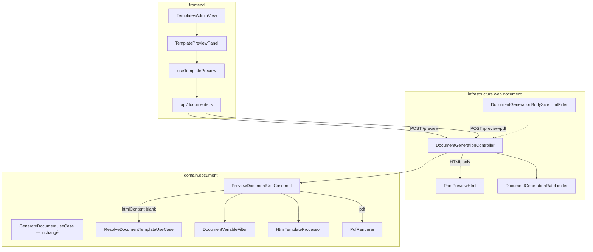

# System Design & Architecture — `preview-documents`

> Réutilise le pipeline Thymeleaf → Flying Saucer livré par `generation-documents`.
> Aucune table, aucun port de stockage, aucun nouveau moteur PDF.

## Architecture Overview



### Stack

Inchangée : Java 25 · Spring Boot 4.1 · Thymeleaf · Flying Saucer · Vue 3 +
TypeScript + Pinia. Pas de nouvelle dépendance Maven/npm.

### Responsabilités

| Zone | Rôle |
|---|---|
| `PreviewDocumentUseCase` | Résoudre la source HTML, merger Thymeleaf, exposer HTML évalué et PDF |
| `DocumentGenerationController` | Deux nouveaux POST ; rate limit ; CSRF / `@PreAuthorize` existants |
| `PrintPreviewHtml` | Enveloppe CSS A4 (adaptateur web, pas le domaine) |
| `DocumentGenerationBodySizeLimitFilter` | Matcher étendu à `/api/documents/preview*` |
| `TemplatePreviewPanel` | UI : iframe HTML sandbox + bouton PDF |
| `useTemplatePreview` | Debounce 400 ms, abort, object URL PDF, erreurs ProblemDetail |

`GenerateDocumentUseCase` **n'est pas modifié** — le preview a une source
optionnellement live que generate n'a pas.

## Data Models

Pas de nouvelle persistance.

```text
PreviewDocumentUseCase
  previewHtml(PreviewCommand) -> String   // HTML Thymeleaf évalué, sans wrapper CSS
  previewPdf(PreviewCommand)  -> byte[]   // Flying Saucer, même HTML évalué

PreviewCommand
  htmlContent   // nullable ; non-blank → source live
  templateKey   // requis si htmlContent blank
  variantKey    // optional, même sémantique que generate
  locale        // optional
  variables     // null → {}
```

Règle D-SOURCE (domaine) :

1. `htmlContent` non blank → `DocumentTemplateSupport.assertHtmlSize` (5 Mio,
   constante `DocumentConfig.MAX_HTML_BYTES`) puis process.
2. sinon `templateKey` requis → `resolveUseCase.resolve(...)` puis process
   `template.htmlContent()`.
3. sinon `TemplateValidationException` (`htmlContent or templateKey must not be blank`).

`variables` passent par `DocumentVariableFilter.forTemplateMerge`.

Le wrapper CSS n'entre **pas** dans `previewPdf` (vérité A4 = Flying Saucer
sur le HTML évalué, comme generate).

## API Design

| Méthode | Path | Authz | Réponse |
|---|---|---|---|
| POST | `/api/documents/preview` | TA \| WA \| DM + CSRF | `200 text/html;charset=UTF-8` |
| POST | `/api/documents/preview/pdf` | idem | `200 application/pdf` + `Content-Disposition: inline; filename="preview.pdf"` |

Body JSON commun :

```json
{
  "htmlContent": "<p th:text=\"${title}\">…</p>",
  "templateKey": "contrat",
  "variantKey": null,
  "locale": null,
  "variables": { "title": "Hello" }
}
```

Erreurs : mêmes mappings que generate (`DocumentGenerationExceptionHandler`
— ajouter le contrôleur s'il est scindé ; s'il reste le même bean, rien à
changer). 413 / 429 inchangés une fois le filtre/limiter étendus.

**Pas de store** : aucun appel `DocumentStoragePort` sur ces chemins
(asserté en test).

## Component Breakdown

### Backend

- `domain/document/port/in/PreviewDocumentUseCase.java` (nouveau)
- `domain/document/usecase/PreviewDocumentUseCaseImpl.java` (nouveau)
- `infrastructure/config/DocumentConfig.java` — bean
- `infrastructure/web/document/DocumentGenerationController.java` — 2 méthodes
- `infrastructure/web/document/PrintPreviewHtml.java` — wrap CSS analyse 07
- `DocumentGenerationBodySizeLimitFilter` — `POST` dont l'URI est
  `/api/documents/generate` **ou** commence par `/api/documents/preview`
- Rate limiter : appelé aussi depuis les nouvelles méthodes (même principal)

### Frontend

```
frontend/src/api/documents.ts          # previewHtml / previewPdf
frontend/src/composables/useTemplatePreview.ts
frontend/src/components/document/TemplatePreviewPanel.vue
frontend/src/views/admin/TemplatesAdminView.vue  # composition
frontend/e2e/pilotage.spec.ts          # mock + scénario admin templates
```

**Carte composants**

| Composant | Responsabilité | Contrat |
|---|---|---|
| `TemplatesAdminView` | CRUD existant + passe `htmlContent` / variables au panneau | composition |
| `TemplatePreviewPanel` | Affichage iframe HTML, bouton PDF, champ variables JSON | props `htmlContent: string` ; état local variables |
| `useTemplatePreview` | Debounce, POST, abort, `pdfUrl` object URL, `error` | `{ html, pdfUrl, loading, error, previewPdf() }` |

Pas de `v-html` (skill Vue) : iframe `srcdoc` + `sandbox` (chaîne vide =
aucune capability, donc pas de scripts).

PDF : `URL.createObjectURL` ; révoquer à chaque nouveau blob et au unmount.

## Design Decisions

| Id | Décision | Retenu | Écarté |
|---|---|---|---|
| D-SCOPE | Hybride HTML+PDF | Analyse 07 | HTML seul / PDF seul |
| D-SOURCE | Live ou resolve | htmlContent gagne | Sauvé uniquement |
| D-ENDPOINTS | Deux POST sous `/api/documents` | Cohérent generate | Query `?format=` sur generate |
| D-CSS-WEB | Wrapper dans l'adaptateur web | Domaine pur | CSS dans le use case |
| D-AUTHZ | Même `@PreAuthorize` que generate | Surface déjà ouverte | TA-only (casserait DM/WA) |
| D-PDF-UX | Bouton | CPU Flying Saucer | Debounce PDF |
| D-IFRAME | `sandbox` sans `allow-scripts` | XSS stocké N/A (réponse à soi) mais défense | `v-html` |

CSS injecté (analyse 07, uniquement réponse HTML) :

```css
@media screen {
    body    { background: #e0e0e0; padding: 20px; }
    .page   { background: white; width: 210mm; min-height: 297mm;
              margin: 0 auto 20px; padding: 20mm 15mm;
              box-shadow: 0 2px 8px rgba(0,0,0,0.2); }
}
```

Le HTML évalué est placé dans `<div class="page">…</div>` si le fragment
n'est pas déjà un document complet (`<!DOCTYPE` / `<html`). Un document
complet reçoit le `<style>` dans `<head>` (créé au besoin).

## Non-Functional Requirements

- **Perf :** HTML preview = Thymeleaf only (pas Flying Saucer). Debounce 400 ms
  + abort du fetch précédent. PDF on-demand.
- **Sécurité :** CSRF ; rôles ; rate limit ; body size ; iframe sandbox ;
  `RestrictedResourceUserAgent` inchangé sur le PDF ; `DocumentVariableFilter`
  inchangé ; pas de résolution d'URL depuis le HTML preview (le browser de
  l'auteur charge l'iframe sandbox — images externes possibles dans srcdoc
  selon UA ; accepté V1, même classe de risque qu'un auteur qui ouvre son
  propre HTML).
- **Fiabilité :** aucun write storage ; generate inchangé.
- **Test :** Jacoco projet ; Vitest + Playwright obligatoires.
