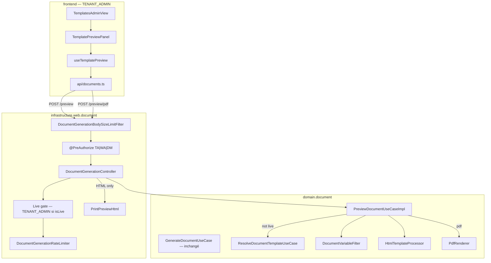

# System Design & Architecture — `preview-documents`

> Réutilise le pipeline Thymeleaf → Flying Saucer livré par `generation-documents`.
> Aucune table, aucun port de stockage, aucun nouveau moteur PDF.
> Revue Phase 3 contre requirements `reviewed` (D-AUTHZ = **B**).

## Architecture Overview



### Stack

Inchangée : Java 25 · Spring Boot 4.1 · Thymeleaf · Flying Saucer · Vue 3 +
TypeScript + Pinia. Pas de nouvelle dépendance Maven/npm.

### Responsabilités

| Zone | Rôle |
|---|---|
| `PreviewDocumentUseCase` | D-SOURCE + merge Thymeleaf + PDF ; **pas** de rôles Spring |
| `PreviewCommand.isLive()` | `htmlContent` non blank après trim (D-SOURCE) |
| `DocumentGenerationController` | Deux POST ; gate D-AUTHZ B **avant** limiter / use case |
| `PrintPreviewHtml` | Enveloppe CSS A4 (adaptateur web, D-CSS-WEB) |
| `DocumentGenerationBodySizeLimitFilter` | Matcher étendu à `/api/documents/preview` et `/preview/pdf` |
| `TemplatePreviewPanel` | UI TA : iframe HTML sandbox + bouton PDF |
| `useTemplatePreview` | Debounce 400 ms, abort, object URL PDF, erreurs ProblemDetail |

`GenerateDocumentUseCase` **n'est pas modifié**.

## Data Models

Pas de nouvelle persistance.

```text
PreviewDocumentUseCase
  previewHtml(PreviewCommand) -> String   // HTML Thymeleaf évalué, sans wrapper CSS
  previewPdf(PreviewCommand)  -> byte[]   // Flying Saucer, même HTML évalué

PreviewCommand
  htmlContent   // nullable ; isLive() ⇔ non blank après trim
  templateKey   // requis si !isLive()
  variantKey    // optional, même sémantique que generate
  locale        // optional
  variables     // null → {}
  boolean isLive()
```

Règle D-SOURCE (domaine, `previewHtml` / `previewPdf` partagent `resolveHtml`) :

1. `isLive()` → `DocumentTemplateSupport.assertHtmlSize` (5 Mio,
   `DocumentConfig.MAX_HTML_BYTES`) puis process. **Pas** de resolve.
2. sinon `templateKey` requis → `resolveUseCase.resolve(...)` puis process
   `template.htmlContent()`.
3. sinon `TemplateValidationException` (`htmlContent or templateKey must not be blank`).

`variables` → `DocumentVariableFilter.forTemplateMerge`.

Le wrapper CSS n'entre **pas** dans `previewPdf`.

**Plafond HTTP vs domaine :** `app.document.generate.max-body-bytes` = 256 Kio
s'applique au JSON entier (filtre). C'est le plafond effectif du preview HTTP.
`assertHtmlSize` 5 Mio reste une défense si le use case est appelé hors HTTP.
Hypothèse acceptée : un textarea V1 tient largement sous 256 Kio.

## API Design

| Méthode | Path | Authz | Réponse |
|---|---|---|---|
| POST | `/api/documents/preview` | Voir D-AUTHZ B | `200 text/html;charset=UTF-8` |
| POST | `/api/documents/preview/pdf` | Idem | `200 application/pdf` + `Content-Disposition: inline; filename="preview.pdf"` |

**D-AUTHZ B — deux couches, mêmes URLs (pas de 3ᵉ endpoint) :**

1. `@PreAuthorize("hasAnyRole('TENANT_ADMIN','WORKFLOW_ADMIN','DOSSIER_MANAGER')")`
   comme `/generate` → VIEWER 403, anonyme 401 (Spring).
2. **Après** parsing du body, **avant** rate-limit et use case : si
   `command.isLive()` et l'appelant n'a pas `ROLE_TENANT_ADMIN` →
   `org.springframework.security.access.AccessDeniedException`
   (« Live preview requires TENANT_ADMIN ») → 403 ProblemDetail via
   `MethodSecurityExceptionHandler` (déjà en place). Pas de Thymeleaf / PDF
   dans ce cas.

Conséquence D-SOURCE + B : WA/DM qui envoient `htmlContent` **et**
`templateKey` → 403 (le live gagne, donc gate TA).

Body JSON commun :

```json
{
  "htmlContent": "<p th:text=\"${title}\">…</p>",
  "templateKey": "contrat",
  "variantKey": null,
  "locale": null,
  "variables": { "title": "Hello" }
}
```

L'UI admin n'envoie que `htmlContent` + `variables` (l'auteur est TA).
`templateKey` seul reste un contrat API pour WA/DM.

Erreurs : mappings generate inchangés (`DocumentGenerationExceptionHandler`).
413 / 429 : filtre / limiter.

**Pas de store** : aucun `DocumentStoragePort` (asserté en test).

**Ordre dans la méthode controller :** parse body → `PreviewCommand` →
gate live → `rateLimiter.tryConsume` → use case → wrap CSS si HTML.

## Component Breakdown

### Backend

- `domain/document/port/in/PreviewDocumentUseCase.java` (+ `isLive()`)
- `domain/document/usecase/PreviewDocumentUseCaseImpl.java`
- `infrastructure/config/DocumentConfig.java` — bean
- `infrastructure/web/document/DocumentGenerationController.java` — 2 méthodes + gate
- `infrastructure/web/document/PrintPreviewHtml.java`
- `DocumentGenerationBodySizeLimitFilter` — `POST` dont l'URI vaut
  `/api/documents/generate` **ou** `/api/documents/preview` **ou**
  `/api/documents/preview/pdf` (égalité, pas un glob trop large)

### Frontend

```
frontend/src/api/documents.ts
frontend/src/composables/useTemplatePreview.ts
frontend/src/components/document/TemplatePreviewPanel.vue
frontend/src/views/admin/TemplatesAdminView.vue
frontend/e2e/pilotage.spec.ts
```

| Composant | Responsabilité | Contrat |
|---|---|---|
| `TemplatesAdminView` | CRUD existant ; passe `htmlContent` du form au panneau | composition |
| `TemplatePreviewPanel` | iframe HTML, bouton PDF, textarea variables JSON | prop `htmlContent: string` |
| `useTemplatePreview` | Debounce 400 ms, abort, object URL, error | `{ html, pdfUrl, loading, error, previewPdf() }` |

Pas de `v-html` : iframe `srcdoc` + `sandbox=""` (aucune capability).
PDF : `URL.createObjectURL` ; revoke à chaque blob et au unmount.
JSON variables invalide → erreur locale, pas d'HTTP.

Route `/admin/templates` déjà `meta.roles: ['TENANT_ADMIN']` — pas de
nouveau guard FE.

## Design Decisions

| Id | Décision | Retenu | Écarté |
|---|---|---|---|
| D-SCOPE | Hybride HTML+PDF | Analyse 07 | HTML seul / PDF seul |
| D-SOURCE | Live ou resolve | `isLive()` gagne | Sauvé uniquement |
| D-ENDPOINTS | Deux POST sous `/api/documents` | Cohérent generate | Query `?format=` ; 3ᵉ URL live |
| D-CSS-WEB | Wrapper web | Domaine pur | CSS dans le use case |
| D-AUTHZ | B | Live = TA ; key = TA/WA/DM | A (TA-only) ; C (tous live) |
| D-AUTHZ-GATE | Où ? | **Contrôleur** (rôles Spring) ; domaine sans `AccessContext` | `TenantAdminGuard` dans le use case document |
| D-PDF-UX | Bouton | CPU Flying Saucer | Debounce PDF |
| D-IFRAME | `sandbox=""` | Défense XSS | `v-html` |
| D-RATE-SPLIT | Quota HTML vs PDF | **Ouvert — voir Questions** | — |

CSS injecté (analyse 07, réponse HTML seulement) :

```css
@media screen {
    body    { background: #e0e0e0; padding: 20px; }
    .page   { background: white; width: 210mm; min-height: 297mm;
              margin: 0 auto 20px; padding: 20mm 15mm;
              box-shadow: 0 2px 8px rgba(0,0,0,0.2); }
}
```

Fragment → document + `<div class="page">`. Document complet (`<!DOCTYPE` /
`<html`) → `<style>` dans `<head>` (créé au besoin), pas de double wrapper
`.page`.

## Requirements coverage

| Requirement | Design |
|---|---|
| Preview HTML + CSS A4, no store | `/preview` + `PrintPreviewHtml` + pas de `DocumentStoragePort` |
| PDF inline, no store | `/preview/pdf` + `Content-Disposition: inline` |
| D-SOURCE live vs key | `PreviewCommand.isLive()` + use case |
| D-AUTHZ B | `@PreAuthorize` + gate live TA avant use case |
| UI admin debounce 400 ms + bouton PDF | `useTemplatePreview` + `TemplatePreviewPanel` |
| Variables filtrées | `DocumentVariableFilter` |
| Body size 413 | Filtre étendu aux deux paths |
| Rate limit 429 | **Q2 ci-dessous** — 30/min generate vs debounce 400 ms |
| Iframe sandbox | `sandbox=""` |
| Hexagone | Rôles au web ; Thymeleaf/FS hors domain |
| Non-goals (generate inchangé, pas de store, pas de détail dossier) | Respectés |

## Non-Functional Requirements

- **Perf :** HTML = Thymeleaf only. Debounce 400 ms + abort. PDF on-demand.
- **Sécurité :** CSRF ; D-AUTHZ B (gate avant rendu) ; body size ; iframe
  sandbox ; `RestrictedResourceUserAgent` sur le PDF ; pas de log du HTML /
  variables. Images externes dans `srcdoc` : accepté V1 (l'auteur preview
  son propre HTML).
- **Fiabilité :** aucun write storage ; generate inchangé.
- **Test :** Jacoco projet ; Vitest + Playwright. Scénarios authz : TA live
  200 ; WA/DM live 403 ; TA/WA/DM `templateKey` 200.

## Questions & Open Items

### Q2 — D-RATE-SPLIT (bloque la clôture Phase 3)

`app.document.generate.rate-limit-per-minute` = **30**. Un debounce HTML à
**400 ms** fait ~150 req/min pendant la saisie → 429 au bout de ~12 s.
Les requirements disent « réutiliser le rate limiter de generate ».

| Option | Principe | Trade-off |
|---|---|---|
| **A** | Même compteur 30/min pour generate + preview HTML/PDF | Conforme au texte D-RATE ; casse D-HTML-UX |
| **B** | Debounce 2 s pour tenir dans 30/min | UX dégradée vs analyse 07 |
| **C** (reco) | Mécanisme identique (fenêtre in-memory), **quotas séparés** : HTML `/preview` = **120/min** (comme webhooks) ; `/preview/pdf` **partage** le 30/min de generate (même coût Flying Saucer) | Esprit anti-abus conservé ; debounce 400 ms tenable ; PDF reste cher |

Recommandation : **C**. Nouvelle propriété
`app.document.preview.rate-limit-per-minute` (défaut 120). Le PDF preview
appelle le limiter generate existant (même clé principal, même fenêtre).
Le filtre **taille** 256 Kio reste partagé (D-RATE taille, pas de conflit).
