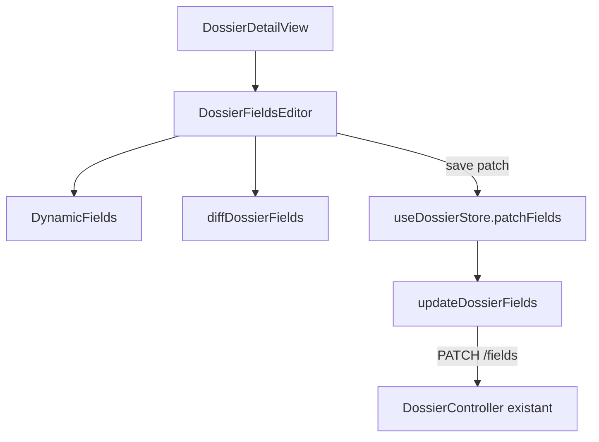

# System Design & Architecture — `edition-champs-dossier`

## Architecture Overview

Feature **frontend only**. Le backend `UpdateDossierFieldsUseCase` n'est
pas modifié. Le SPA consomme `PATCH /api/dossiers/{id}/fields`.



**Composants :**

| Composant | Responsabilité |
|---|---|
| `diffDossierFields` | Fonction pure : snapshot GET × draft → patch fusion (D-DIFF / D-CLEAR-UI) |
| `DossierFieldsEditor` | Section champs + bouton save ; draft local ; readonly vs edit |
| `DynamicFields` | Ajout prop `applyDefaults` (défaut `true` pour ne pas casser la création) |
| `updateDossierFields` | Client axios |
| `useDossierStore.patchFields` | Appel API + remplacement `dossier` (version à jour) |
| `DossierDetailView` | Composition : plus de `DynamicFields` inline |

### Component map (vue-best-practices)

- **DossierDetailView** — surface de composition (route view).
- **DossierFieldsEditor** — unique responsabilité : afficher / éditer /
  enregistrer les champs du dossier chargé.
  - Props : `definitions`, `fields`, `canEdit`, `locked`, `saving`, `error`.
  - Emits : `save` avec `Record<string, unknown>` (patch non vide).
- **DynamicFields** — inchangé fonctionnellement en création ; `applyDefaults`
  opt-out en édition.
- Pas de nouveau store. L'orchestration HTTP reste dans Pinia
  (`patchFields`), comme `patchStatus`.

## Data Models

Aucun nouveau modèle domaine. Côté FE :

```ts
// PATCH body — contrat existant
{ fields: Record<string, unknown>, expectedVersion: number }

// diffDossierFields(snapshot, draft, definitions) → patch
// - valeur identique → omise
// - draft blank et clé présente dans snapshot → null
// - draft blank et clé absente du snapshot → omise (sensitive redacté)
// - sinon → valeur draft
```

`BOOLEAN` : `false` n'est pas blank. `SELECT` / `STRING` / `DATE` /
`NUMBER` / `FILE` : `''` est blank.

## API Design

**Existant, non modifié :**

`PATCH /api/dossiers/{id}/fields`  
Body `{ fields, expectedVersion? }` → `DossierResponse`  
400 vide / validation ; 403 ACL ; 409 statut ou version ; 404.

Le client FE envoie toujours `expectedVersion`.

## Component Breakdown

### Frontend

- `frontend/src/dossier/diffDossierFields.ts` — utilitaire pur (testable
  sans Vue). Package `dossier/` plutôt que `components/` : ce n'est pas un
  SFC.
- `frontend/src/components/dossier/DossierFieldsEditor.vue`
- `frontend/src/components/dossier/DynamicFields.vue` — prop
  `applyDefaults?: boolean` (default `true`)
- `frontend/src/api/dossiers.ts` — `updateDossierFields`
- `frontend/src/stores/dossier.ts` — `patchFields`
- `frontend/src/views/pilotage/DossierDetailView.vue` — compose l'éditeur
- `frontend/e2e/pilotage.spec.ts` — mock PATCH `/fields` +
  `fieldDefinitions` sur le type CLAIM + E2E-22 / E2E-23

### Backend

Aucun fichier Java.

## Design Decisions

- **D-DIFF dans une fonction pure** plutôt que dans le SFC — testable
  isolément (redaction, clear, no-op).
- **`applyDefaults=false` en édition** — le watch actuel de
  `DynamicFields` poserait les `defaultValue` sur les clés absentes, y
  compris un champ `sensitive` redacté, et le diff l'enverrait.
- **Bouton dédié** « Enregistrer les champs » (pas d'auto-save) — même
  patron que le statut ; le PATCH vide est 400.
- **Pas de `shallowRef` nouveau** — le dépôt utilise `ref` partout ;
  rester cohérent (conventions FlowForge : patterns existants).

## Non-Functional Requirements

- Pas d'appel si diff vide (évite 400).
- Jamais logger/afficher la valeur d'un champ `sensitive` au-delà de
  `SensitiveValue` / des inputs déjà utilisés à la création.
- Erreurs via `toProblemDetail` existant.
- Couverture Vitest des zones touchées ; Playwright obligatoire.
