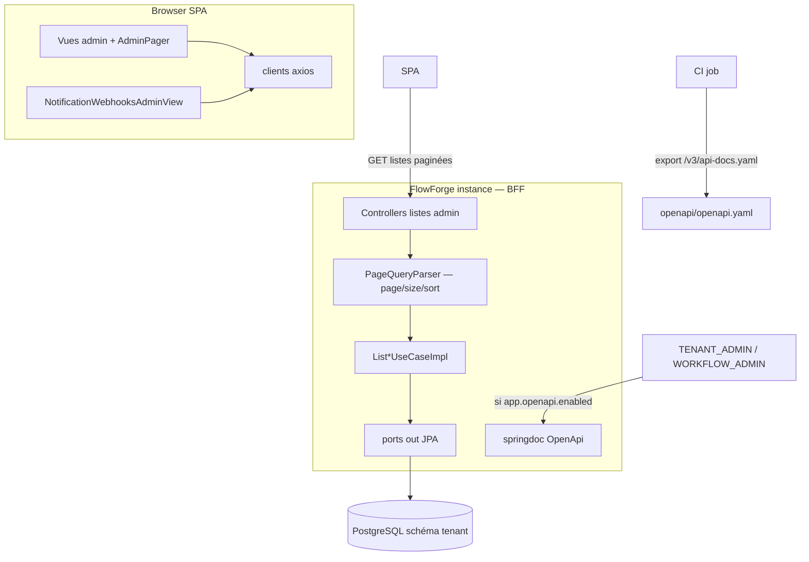
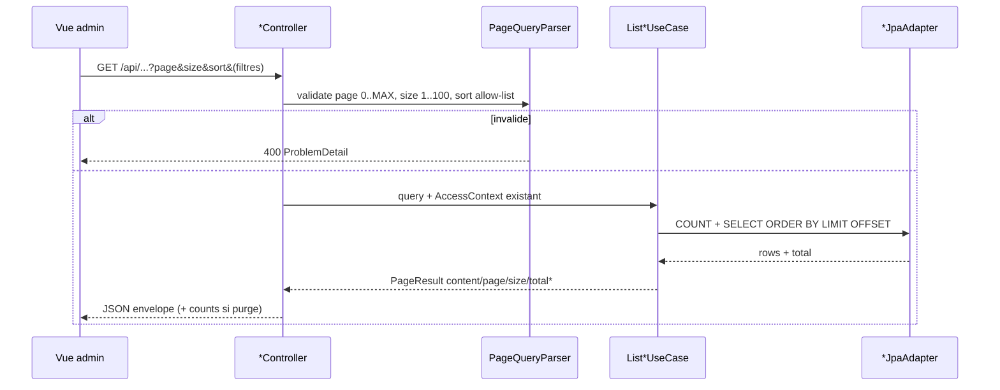
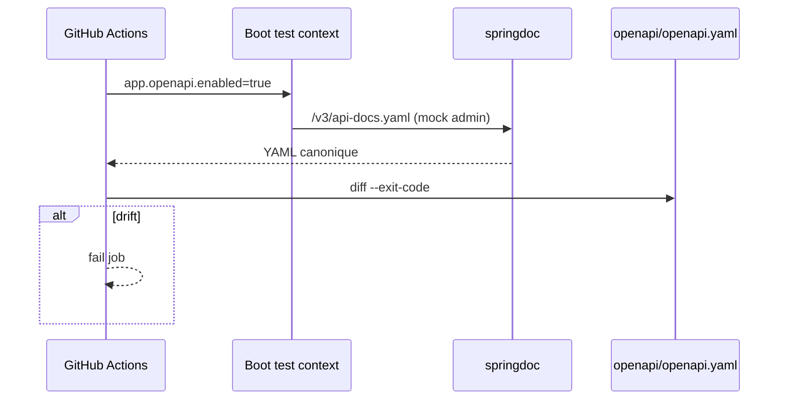

# System Design & Architecture — `openapi-pagination-admin`

## Architecture Overview
**What is the high-level system structure?**

Deux livrables couplés : (1) **pagination offset** des listes admin via use
cases domaine + envelope HTTP partagée ; (2) **contrat OpenAPI** springdoc
exporté et comparé en CI au YAML versionné.



### Flux liste admin



### Flux contrat OpenAPI



## Data Models

### Domaine (pur Java)

Introduire un type partagé **sans Spring** (ex. `com.flowforge.domain.shared.PageResult<T>`) :

```text
PageResult<T> {
  List<T> content
  int page
  int size
  long totalElements
  int totalPages   // ceil(totalElements / size), 0 si size<=0 interdit
}

PageQuery {
  int page            // défaut 0 ; 0..MAX_PAGE (même borne que SearchDossiersQuery)
  int size            // défaut 20 ; 1..100
  String sort         // exact match allow-list ressource
}
```

`ListPurgeOutboxUseCase.Page` actuelle `{ items, counts, limit }` devient :

```text
PurgeOutboxPage {
  PageResult<PurgeOutboxRecord> page   // ou fields aplatis
  Counts counts                        // globaux, indépendants de la page
}
```

HTTP purge : aplatir `{ content, page, size, totalElements, totalPages, counts }`.

Records métier existants inchangés (`DossierType`, `DocumentTemplate`,
`ConnectorInstanceData`, `WorkflowTypeConfig`, `NotificationWebhookConfig`).

Masquage secrets : **inchangé** (`withMaskedSecret`, config connecteur masquée).

### Persistence

- Requêtes liste : `ORDER BY` colonne du tri autorisé + `LIMIT`/`OFFSET`.
- `COUNT(*)` avec les **mêmes** filtres (pas les mêmes que la page vide ACL).
- Purge : réutiliser `idx_purge_outbox_status_created_at` (`status`, `created_at`).
- Pas de changeset Liquibase V1 sauf index manquant constaté en IT.

Filtres conservés :

- templates : `templateKey` optionnel, `includeContent` (hydratation contenu
  après page, ou colonne seulement si `true`).
- purge : `status` optionnel.

## API Design

### Envelope commune

```json
{
  "content": [],
  "page": 0,
  "size": 20,
  "totalElements": 0,
  "totalPages": 0
}
```

Query : `page`, `size`, `sort` (optionnel = défaut ressource). Noms alignés
`pagination-dossiers`. Invalide → 400 `ProblemDetail`.

### Endpoints listes (breaking)

| GET | Rôles (inchangés) | Tri défaut | Filtres |
|---|---|---|---|
| `/api/dossier-types` | auth humaine existante | `code,asc` | — |
| `/api/document-templates` | `TENANT_ADMIN` | `updatedAt,desc` | `templateKey`, `includeContent` |
| `/api/connectors` | `TENANT_ADMIN` | `name,asc` | — |
| `/api/workflow-type-configs` | OIDC (admin WF/tenant usage actuel) | `workflowKey,asc` | — |
| `/api/notification-webhooks` | `TENANT_ADMIN` | `name,asc` | — |
| `/api/purge-outbox` | `TENANT_ADMIN` | `createdAt,desc` | `status` |

`GET /api/connector-definitions` et collections dossier/tâches : **array** (D-NESTED).

CRUD hors liste : inchangé (POST/PATCH/DELETE webhooks déjà là).

### OpenAPI

- Dépendance `springdoc-openapi-starter-webmvc-ui` **compatible Boot 4.1**.
- `app.openapi.enabled` (défaut `false`) : si false, ne pas enregistrer les
  routes springdoc (ou matcher 404) — **pas** `permitAll`.
- Si true : `/v3/api-docs`, `/v3/api-docs.yaml`, `/swagger-ui.html` /
  `/swagger-ui/**` exigent `TENANT_ADMIN` **ou** `WORKFLOW_ADMIN` (chaîne BFF
  session + CSRF cookie comme le reste du SPA ; GET docs sans body).
- Annotations / `GroupedOpenApi` : schémas envelope, `ProblemDetail`,
  secrets `writeOnly`, pas d’exemples de secrets réels.
- Hors spec V1 : `text/event-stream`, `multipart/form-data`,
  `POST /api/webhooks/{instanceId}`.
- Artefact : `openapi/openapi.yaml` à la racine du repo (OpenAPI 3.1 ou 3.0
  selon l’export springdoc — **une** version, documentée dans le fichier).

### Sécurité

- Pas de nouvel anonymous matcher.
- Flag + rôles : défense en profondeur (C + B).
- SSRF webhooks : `OutboundUrlGuard` inchangé sur POST/PATCH.

## Component Breakdown

### Backend

- `PageQueryParser` (infra web) — factoriser avec `DossierListQueryParser`
  (allow-list `sort` paramétrable).
- DTO `PageResponse<T>` Jackson (infra) ; mapping depuis `PageResult`.
- `PurgeOutboxListResponse` étendu (plus `items`/`limit`).
- Use cases `list(...)` : signature paginée ; adapters JPA `Page` Spring
  **uniquement** dans infra, map → `PageResult`.
- `OpenApiSecurityConfig` / `OpenApiProperties` ; tests ArchUnit : springdoc
  reste dans `infrastructure`.

### Frontend

- Type TS générique `Page<T>` (déjà `DossierPage` — extraire ou dupliquer
  aligné).
- Clients : `dossierTypes.ts`, `admin.ts`, `workflows.ts`, `purgeOutbox.ts`,
  nouveau `notificationWebhooks.ts`.
- Helper **`listAllPages`** (**D-CATALOG = B**) : `size=100`, concatène
  `content` jusqu’à `totalElements`. Utilisé par `CreateDossierView`,
  `SupervisionView` (filtre type), `StartWorkflowDialog`. Les vues **admin**
  n’utilisent **pas** ce helper (une page + pager).
- Composant pager réutilisable (Précédent / Suivant / « Page x / y (n) »)
  + `useAdminListQuery` (hydratation `page` / `size` optionnel depuis la route).
- Vues : `DossierTypesAdminView`, `TemplatesAdminView`, `ConnectorsAdminView`,
  `WorkflowConfigsAdminView`, `PurgeOutboxAdminView` + **nouvelle**
  `NotificationWebhooksAdminView`.
- Nav `AppShell` : lien « Webhooks » si `isTenantAdmin`.
- Route `/admin/notification-webhooks`.
- Formulaire création : nom, URL, secret (password), enabled ; liste :
  `secretConfigured`, toggle, delete. Pas de restore.

### CI

- Job `build` ou step dédié : Boot test / `java` exporter → `diff` vs
  `openapi/openapi.yaml`.
- Documenter `./mvnw -Popenapi-export` (ou test `OpenApiContractIT`) pour
  régénérer le fichier commité.

## Design Decisions

| Id | Décision | Choix | Écarté |
|---|---|---|---|
| D-SCOPE | Lot V1 | OpenAPI + pagination admin + FE | OpenAPI-only |
| D-OPENAPI | Contrat | springdoc + YAML git | YAML manuel seul |
| D-COMPAT | Shape | Breaking envelope | Dual / twin paths |
| D-PAGE | Params | Identiques dossiers | Spring `Page` JSON |
| D-FE | Client | Axios manuel | Codegen V1 |
| D-SPEC | Couverture | Tout sauf SSE/multipart/ingress | Spec partielle listes |
| D-PURGE | Shape | Envelope + `counts` | Endpoint counts |
| D-DOCS-ACCESS | Runtime | Admins + flag off défaut | permitAll / always-on |
| D-SORT | Tri | Un `sort` exact / ressource | Multi-champs |
| D-CI | Gate | Fail on diff | Best-effort |
| D-UI / D-URL | SPA | Pager + query URL | size=100 silencieux |
| D-WEBHOOK-UI | Écran | CRUD dense Connecteurs | API-only |
| D-NESTED | Nested | Arrays documentés | Paginer elements/tasks |
| D-SECRETS | Spec | writeOnly + masque actuel | Strip GET secrets |
| D-FILTERS | Filtres | Existants seulement | `q=` / `enabled` |
| D-OPENAPI-DEFAULT | Flag | `app.openapi.enabled=false` | Profil `dev` implicite |
| D-CATALOG | Dropdowns | Concaténer les pages (`size=100` / round-trip) | `size=100` unique / `?all=` |

**Pagination SQL vs mémoire :** SQL `LIMIT/OFFSET` partout pour un contrat
uniforme (templates / purge peuvent croître). Catalogues petits : coût négligeable.

**Export CI vs plugin Maven :** préférer un IT qui tape le même
`OpenAPI` que la runtime (moins de dérive de config) plutôt qu’un plugin
isolé.

## Non-Functional Requirements

- **Perf :** une page admin ≤ 100 lignes ; COUNT + slice indexés pour purge.
- **Sécu :** pas de Swagger anonyme ; pas de secret en exemple OpenAPI ni logs.
- **Compat :** un déploiement SPA+API atomique (même artefact Boot).
- **Fiabilité :** 400 déterministe sur params ; 200 page vide.
- **Observabilité :** pas de nouvelles métriques (§29) ; logs d’accès
  swagger au niveau INFO optionnel.
