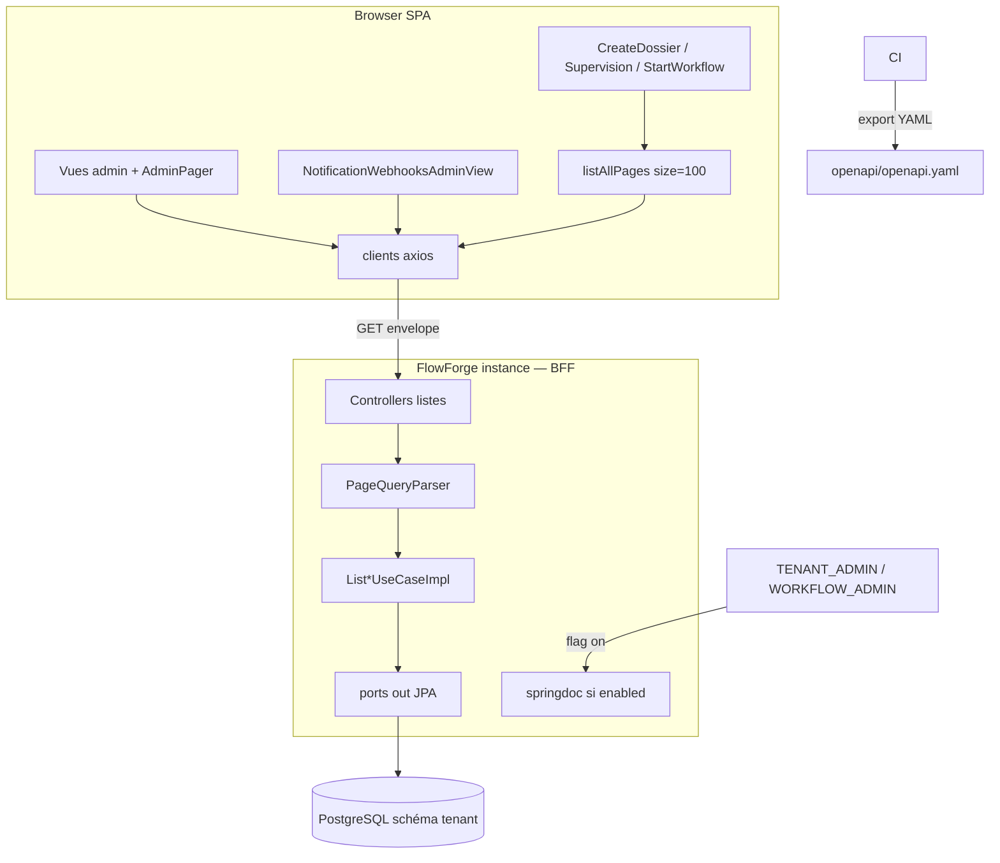
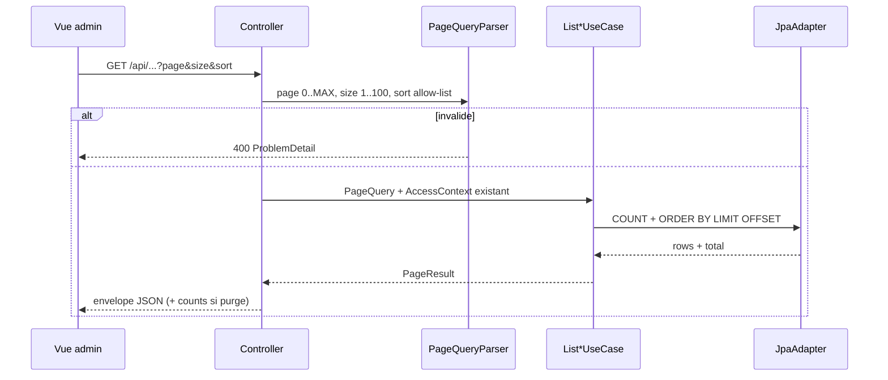
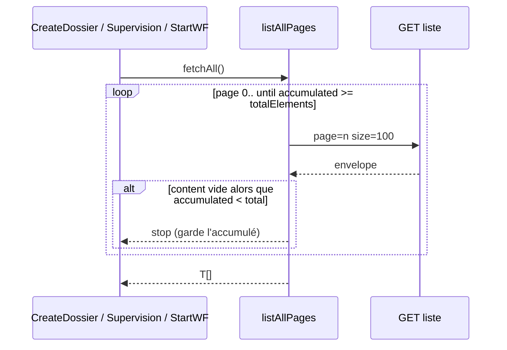
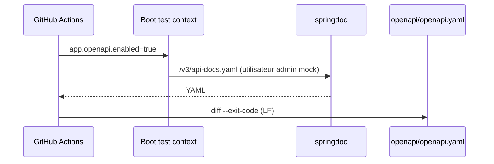

# System Design & Architecture — `openapi-pagination-admin`

> Phase 3 **reviewed** contre requirements reviewed. Alignement hexagone :
> `PageResult` pur Java ; springdoc / `Page` Spring Data **infra only**.

## Architecture Overview
**What is the high-level system structure?**

Deux livrables couplés : (1) **pagination offset** des listes admin via use
cases domaine + envelope HTTP partagée ; (2) **contrat OpenAPI** springdoc
exporté et comparé en CI au YAML versionné. Le SPA a deux modes de
consommation : **pager** (écrans admin) et **concaténation** (listes
déroulantes — D-CATALOG).



### Flux liste admin (une page)



### Flux catalogue (D-CATALOG = B)



### Flux contrat OpenAPI



### Stack

Inchangée : Java 25, Spring Boot 4.1, JPA/Liquibase, Vue 3. Ajout
`springdoc-openapi-starter-webmvc-ui` **pinné** sur la première version
qui démarre avec Boot 4.1 (spike T12). Pas de codegen FE.

## Data Models

### Domaine (pur Java)

`com.flowforge.domain.shared.PageResult<T>` et `PageQuery` — **pas** Spring
(ArchUnit `domain` sans `org.springframework`).

```text
PageQuery {
  int page            // défaut 0 ; 0..MAX_PAGE
  int size            // défaut 20 ; 1..100
}

MAX_SIZE = 100
MAX_PAGE = Integer.MAX_VALUE / MAX_SIZE
  // même formule que SearchDossiersQuery (offset page*size tient dans int)

PageResult<T> {
  List<T> content     // copyOf
  int page
  int size
  long totalElements
  int totalPages      // ceil(total / size)
}

AllowedSort { valeur exacte, ex. "code,asc" }
```

`SearchDossiersQuery` **reste** ; on peut y **réutiliser** les constantes
`PageQuery.MAX_*` (refactor mineur, JSON dossiers inchangé).

`DossierPage` **n’est pas fusionné** dans `PageResult` dans cette feature
(régression Supervision). Envelope HTTP identique champ à champ.

`ListPurgeOutboxUseCase` :

```text
PurgeOutboxPage {
  PageResult<PurgeOutboxRecord> result
  Counts counts   // 4 compteurs tenant, INDEPENDANTS de page et de status
}
```

HTTP : champs aplatis `{ content, page, size, totalElements, totalPages, counts }`.

**Changement comportement purge (acté D-PAGE / D-SORT-FIELDS) :**

| Aujourd’hui | V1 cette feature |
|---|---|
| `limit` défaut **50**, max **200** | `size` défaut **20**, max **100** |
| `PageRequest.of(0, limit)` (pas d’offset) | `page` + `size` |
| `createdAt` **ASC** | `createdAt,desc` uniquement |
| `counts` globaux | inchangé (toujours les 4 statuts, ignore le filtre `status` du `content`) |

Records métier inchangés. Masquage secrets inchangé.

### Persistence

- Templates, connectors, webhooks, workflow-configs, purge : **Spring Data
  `Pageable` dans l’adapter seulement** → map `PageResult`.
  `COUNT` avec les **mêmes** prédicats que le slice (`templateKey`, `status`
  purge, `deletedAt IS NULL`).
- **Dossier types + ACL :** même sémantique que `ListDossierTypesUseCaseImpl`
  (System / TENANT_ADMIN / WORKFLOW_ADMIN = tous les types ; User = codes
  VIEW ; Service = 403 ; zéro grant → page vide **sans** query). Pagination
  sur l’ensemble **déjà filtré** : port
  `page(tenantId, allowedCodes | null=all, page, size)` avec `code IN (...)`
  ou `findAll` paginé. Tri `code ASC`.
- Purge : `idx_purge_outbox_status_created_at` ; **inverser** l’order JPA
  actuel (`Asc` → `Desc`).
- Pas de Liquibase V1 sauf index manquant constaté en IT.

`includeContent` templates : slice d’abord, hydrater `htmlContent` seulement
si `true` (éviter de charger le HTML des autres pages).

## API Design

### Envelope

```json
{
  "content": [],
  "page": 0,
  "size": 20,
  "totalElements": 0,
  "totalPages": 0
}
```

Query `page`, `size`, `sort` (absent = défaut ressource ; présent = **égalité
exacte** de la seule valeur autorisée). 400 `ProblemDetail` sinon.

`GET /api/dossiers` **déjà** dans cette envelope — documenté OpenAPI, **pas**
re-paginé.

### Listes breaking

| GET | Auth (inchangée) | Tri | Filtres |
|---|---|---|---|
| `/api/dossier-types` | humain authentifié + ACL types | `code,asc` | — |
| `/api/document-templates` | `TENANT_ADMIN` | `updatedAt,desc` | `templateKey`, `includeContent` |
| `/api/connectors` | `TENANT_ADMIN` | `name,asc` | — (soft-deleted exclus) |
| `/api/workflow-type-configs` | OIDC (GET liste aujourd’hui sans `@PreAuthorize` méthode) | `workflowKey,asc` | — |
| `/api/notification-webhooks` | `TENANT_ADMIN` | `name,asc` | — (soft-deleted exclus) |
| `/api/purge-outbox` | `TENANT_ADMIN` | `createdAt,desc` | `status` (filtre `content` seulement) |

Toujours **array** : `GET /api/connector-definitions`, elements, relations,
workflows du dossier, tasks/mine, history, ACL.

CRUD webhooks inchangé (SSRF `OutboundUrlGuard`).

### OpenAPI

- `app.openapi.enabled` défaut `false` : beans/routes springdoc **non
  enregistrés** (404 authentifié, jamais 200 anonyme).
- Si `true` : `/v3/api-docs`, `/v3/api-docs.yaml`, `/swagger-ui.html`,
  `/swagger-ui/**` → `hasAnyRole('TENANT_ADMIN','WORKFLOW_ADMIN')` sur la
  chaîne BFF (session cookie). GET, CSRF cookie existant.
- **Inclusion :** surface HTTP actuelle y compris `GET /api/dossiers`,
  `ProblemDetail`, schémas envelope, secrets `writeOnly` / exemples sans
  secret réel.
- **Exclusion V1 (D-SPEC)** — retirer les operations via `@Hidden` /
  `GroupedOpenApi` paths :
  1. `GET /api/notifications/stream` (SSE)
  2. `POST /api/dossiers/{id}/elements/attachment` (multipart)
  3. `POST /api/webhooks/{instanceId}` (ingress)
- Golden : `openapi/openapi.yaml` (version 3.0 ou 3.1 = celle de l’export,
  notée en en-tête). CI : IT MockMvc admin + `enabled=true`, comparer LF.

### Sécurité

- Pas de `permitAll` nouveau.
- Flag + rôle.
- Helper catalogue : mêmes endpoints, donc mêmes ACL (un manager ne voit
  pas plus de types qu’aujourd’hui).

## Component Breakdown

### Backend

- `domain.shared.PageResult` / `PageQuery` + tests.
- `infrastructure.web.PageQueryParser` (sort allow-list) ; `DossierListQueryParser`
  peut déléguer page/size aux constantes partagées.
- `PageResponse<T>` Jackson ; purge = même record + `counts`.
- Ports `list` → `PageResult` ; adapters `Pageable`.
- `OpenApiProperties` (`app.openapi.enabled`) ; config conditionnelle
  springdoc ; ArchUnit : aucun import springdoc/`io.swagger` dans `domain`.

### Frontend

- `Page<T>` dans `api/types.ts` ; `DossierPage` alias ou champs identiques.
- `api/page.ts` : `listAllPages(fetchPage)` — cap `size=100`, stop page vide.
- Clients listes retournent `Page<T>` ; wrappers `listAllDossierTypes()` /
  `listAllWorkflowTypeConfigs()` pour les 3 vues catalogue.
- Admin : `AdminPager` + `useAdminListQuery` (`page`, `size` si ≠ 20).
  **Pas** `templateKey`/`status` dans l’URL (pas de widgets).
- Nouvelle vue `/admin/notification-webhooks` + lien `AppShell` TENANT_ADMIN.
- Mocks Playwright : envelope sur les 6 GET ; catalogues E2E peuvent rester
  une page (`totalElements === content.length`).

### CI

- Step `build` ou IT `OpenApiContractIT` : fail on diff.
- Commande de régénération documentée (README ou `openapi/README.md` court).

## Design Decisions

| Id | Décision | Choix | Écarté |
|---|---|---|---|
| D-SCOPE … D-CATALOG | (requirements) | voir requirements Phase 2 | — |
| **A-PAGE-TYPE** | `DossierPage` vs `PageResult` | Types **parallèles**, JSON identique | Fusion dossiers dans cette PR |
| **A-ACL-PAGE** | Types + ACL | Page **après** filtre VIEW ; port SQL `IN` / all | Paginer `findAll` puis filtrer (pages trouées) |
| **A-PURGE-LIMIT** | Bornes purge | Aligner D-PAGE (20/100) | Garder 50/200 |
| **A-PURGE-SORT** | Ordre file | `createdAt,desc` (D-SORT-FIELDS) | ASC actuel (plus ancien d’abord) |
| **A-SQL** | Où paginer | `Pageable` infra ; domaine `PageResult` | `org.springframework.data.domain.Page` dans le domaine |
| **A-OPENAPI-HIDE** | D-SPEC | `@Hidden` / group exclude 3 operations | Spec partielle « listes only » |
| **A-EXPORT** | Golden CI | IT runtime springdoc + diff | Plugin Maven isolé |
| **A-CONST** | MAX_PAGE/SIZE | Constantes `domain.shared` | Dupliquer encore dans chaque UC |

**Pagination SQL vs mémoire :** SQL pour tables potentiellement longues
(templates, purge, connectors, webhooks, wf). Types : SQL sur ensemble
ACL (pas de slice « troué »).

**Helper size=100 :** moins d’allers-retours que `size=20` ; plafond API
respecté ; admin pager reste sur défaut 20.

## Non-Functional Requirements

- **Perf :** page ≤ 100 ; COUNT + index purge ; helper O(pages) avec pages
  de 100.
- **Sécu :** pas de Swagger anonyme ; pas de secret en spec/logs ; ACL types
  inchangée.
- **Compat :** un artefact Boot SPA+API.
- **Fiabilité :** 400 params ; 200 page vide ; helper stop si page vide.
- **Observabilité :** pas de métriques nouvelles (§29).

## Couverture requirements

| Requirement | Design |
|---|---|
| Envelope + 6 GET + D-PAGE | API Design + A-PURGE-LIMIT |
| Tris exacts | Tableau listes |
| OpenAPI + YAML + CI diff | OpenAPI + CI + A-EXPORT |
| D-SPEC exclusions | A-OPENAPI-HIDE |
| Pagers + URL page/size | Frontend AdminPager |
| D-CATALOG B | `listAllPages` + diagramme |
| Webhooks UX A | Vue + nav |
| D-SECRETS writeOnly | OpenAPI |
| Flag + rôles swagger | OpenAPI / Sécurité |
| Nested arrays | API « Toujours array » |
| `./mvnw verify` / ArchUnit | Component backend |
| Déploiement atomique | NFR Compat |
| Counts purge globaux | PurgeOutboxPage |
| includeContent page courante | Persistence templates |

Aucun trou requirements. Pas de retour Phase 2.

## Phase 3 — revue (2026-08-19)

Complet vs template design (arch mermaid, data, API, composants, décisions,
NFR). Écarts techniques tranchés (A-*) sans nouvelle question produit.

Suite : Phase 4 `dev-planning` (figer T1–T15 + T7b).
