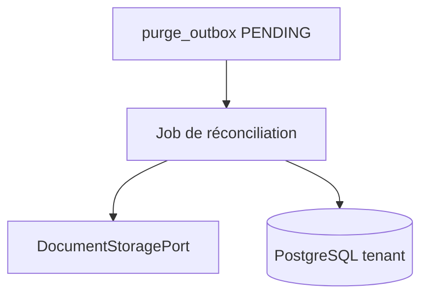

# System Design & Architecture — `purge-stockage`

> Squelette Phase 1. **Q1 = B** (job outbox). Le reste (Q2+) n’est pas
> tranché. Pas une revue Phase 3.

## Architecture Overview

Contrainte Phase 1 : **Q1 = B** — worker / scheduler sur `purge_outbox`.

Les options A (TX unique) et C (soft-delete + GC only) sont **écartées**.

Stack inchangée : Java / Spring Boot / PostgreSQL+Liquibase / port S3|FS
déjà présents. Hexagone : use case domaine, adapters infrastructure.

## Data Models

- Réutiliser `purge_outbox` + `Dossier` / `DossierElement.storageRef`.
- Évolution des **statuts** outbox et colonnes (`last_error`, index) :
  **si Q1 = B**. Sinon à redéfinir.
- `DocumentStoragePort.delete` : probable quelle que soit Q1 (Q2).

## API Design

- **Externe :** dépend de Q6/Q7 (aucune vs `DELETE` vs UI).
- **Ports domaine :** à figer en Phase 3 après Q1–Q5.

## Component Breakdown

| Zone | Notes Phase 1 |
|---|---|
| Backend | Use case purge + adapters store/PG ; job **seulement si Q1=B** |
| Frontend | Aucun jusqu’à Q6 |
| Liquibase | Probable si statuts / index outbox |
| Flowable | Q5 |

## Design Decisions

Aucune décision de design **actée**. Les D-* du tour précédent sont
invalidées : à reposer en Phase 2/3 après Q1+.

## Non-Functional Requirements

- Idempotence de l’effacement (requirements).
- Isolation tenant = schéma instance (décision n° 13).
- Pas de secrets dans les logs.
- Job/TX borné si asynchrone (taille de batch — Phase 3).
