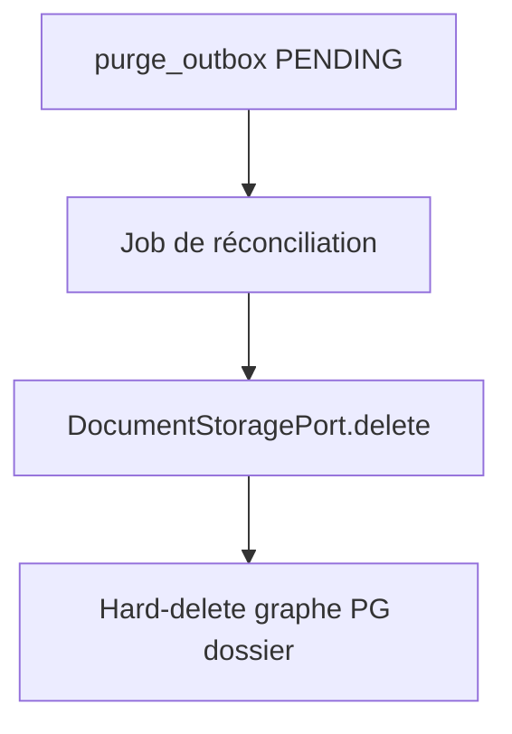

# System Design & Architecture — `purge-stockage`

> Squelette Phase 1. **Q1–Q5** actées. Q6+ ouvertes. Pas une revue Phase 3.

## Architecture Overview

Contrainte Phase 1 : **Q1 = B** — worker / scheduler sur `purge_outbox`.

**Q3 = A :** store puis PostgreSQL (les `storageRef` restent lisibles pour un retry). Options PG-d’abord et parallèle écartées.

Les options A (TX unique) et C (soft-delete + GC only) sont **écartées**.

Stack inchangée : Java / Spring Boot / PostgreSQL+Liquibase / port S3|FS
déjà présents. Hexagone : use case domaine, adapters infrastructure.

## Data Models

- Graphe PG **Q4 = A :** `dossier_element`, `dossier_relation` (source
  ou cible), `dossier_workflow_link`, puis `dossier`. Ligne outbox
  conservée pour audit (détail Phase 3).
- Évolution des **statuts** outbox et colonnes (`last_error`, index) :
  **si Q1 = B**. Sinon à redéfinir.
- `DocumentStoragePort.delete` : **Q2 = A** — étendre le port existant
  (adapters S3 + filesystem). Missing object = succès (idempotent).

## API Design

- **Externe :** dépend de Q6/Q7 (aucune vs `DELETE` vs UI).
- **Ports domaine :** à figer en Phase 3 après Q1–Q5.

## Component Breakdown

| Zone | Notes Phase 1 |
|---|---|
| Backend | Use case purge + adapters store/PG ; job **seulement si Q1=B** |
| Frontend | Aucun jusqu’à Q6 |
| Liquibase | Probable si statuts / index outbox |
| Flowable | **Q5 = A** best-effort `WorkflowEnginePort` ; ACT_HI_* résiduel OK |

## Design Decisions

Contraintes Phase 1 déjà actées (Q1–Q5) : job outbox, `delete` sur le
port existant, ordre store→PG, graphe dossier complet, Flowable
best-effort. Q6–Q10 ouvertes.

## Non-Functional Requirements

- Idempotence de l’effacement (requirements).
- Isolation tenant = schéma instance (décision n° 13).
- Pas de secrets dans les logs.
- Job/TX borné si asynchrone (taille de batch — Phase 3).
