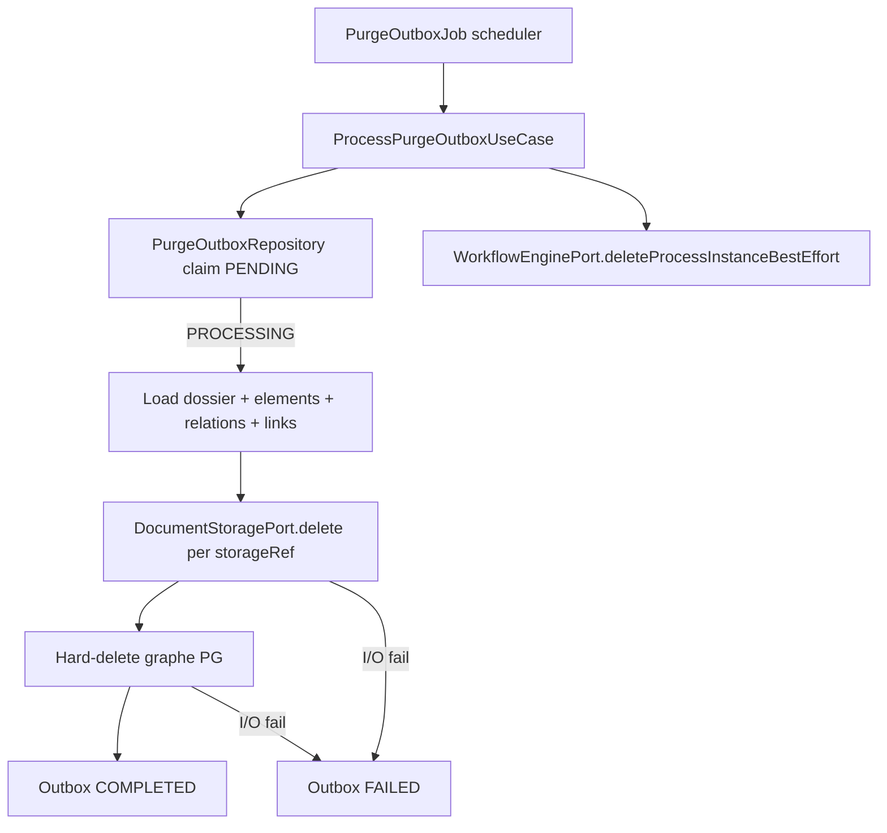

# System Design & Architecture — `purge-stockage`

> Consommation de `purge_outbox` produite par `retention-dossier-type`.
> Port stockage existant étendu (`delete`). Pas d’API HTTP ni d’UI V1.

## Architecture Overview



### Composants

| Couche | Responsabilité |
|---|---|
| Domaine | `ProcessPurgeOutboxUseCase` (+ Impl) ; étendre `PurgeOutboxStatus` ; ports out étendus |
| Application / infra sched | `@Scheduled` job borné (aligné rétention `fixedDelay`) |
| Infra persistence | Claim atomique ; deletes ordonnés JPA / Spring Data |
| Infra storage | `delete` sur `FilesystemStorageAdapter` + `S3StorageAdapter` |
| Infra Flowable | Étendre `WorkflowEnginePort` + `FlowableWorkflowEngineAdapter` (D-WF) |

Stack inchangée : Java 25 / Spring Boot 4.1 / PostgreSQL+Liquibase / port S3|FS.

## Data Models

### `PurgeOutboxStatus` (étendu)

```java
public enum PurgeOutboxStatus {
  PENDING,      // produit §21
  PROCESSING,   // claimé par §22
  COMPLETED,    // purge physique OK (ou déjà absente — idempotent)
  FAILED        // retry ultérieur
}
```

Liquibase : élargir contrainte CHECK / colonne enum si nécessaire
(`011-purge-outbox-status.yaml`).

### `PurgeOutboxRecord`

Inchangé structurellement ; statuts étendus. Champs optionnels futurs
(`processedAt`, `lastError`) **hors V1** sauf besoin debug minimal
(`lastError` varchar nullable recommandé pour ops — **D-ERROR-COL**).

### `DocumentStoragePort`

```java
public interface DocumentStoragePort {
  String store(String tenantId, String contentType, byte[] content);
  byte[] retrieve(String tenantId, String storageRef);
  boolean exists(String tenantId, String storageRef);
  /** Idempotent: missing object = success. */
  void delete(String tenantId, String storageRef) throws DocumentStorageException;
}
```

Validation `storageRef` : même règles que `retrieve` / `exists` (préfixe
tenant, pas de `..`).

### Graphe PG à supprimer (D-SCOPE-PG)

Ordre **après** deletes store :

1. `dossier_element` WHERE `dossier_id = ?`
2. `dossier_relation` WHERE `source_dossier_id = ? OR target_dossier_id = ?`
3. `dossier_workflow_link` WHERE `dossier_id = ?` (après D-WF runtime)
4. `dossier` WHERE `id = ?` (et colonnes dépendantes / `current_workflow_link_id`)
5. Outbox → `COMPLETED` (garder la ligne pour audit V1 ; pas de DELETE outbox)

Pas de soft-delete. Types / ACL / templates / settings rétention **non**
touchés.

## API Design

### Externe

**Aucune** API HTTP de purge en V1 (D-HTTP). Les lecteurs voient seulement
l’effet : `GET /api/dossiers/{id}` → 404 après `COMPLETED`.

### Ports domaine (in)

```java
public interface ProcessPurgeOutboxUseCase {
  /** @return number of outbox rows terminalized (COMPLETED or FAILED) this pass */
  int processBatch(Instant now, int limit);
}
```

### Ports domaine (out) — extensions

```java
public interface PurgeOutboxRepository {
  void insert(PurgeOutboxRecord record);           // existant §21
  boolean existsByDossierId(UUID dossierId);       // existant
  List<PurgeOutboxRecord> findPending(int limit);  // nouveau
  boolean claim(UUID id, Instant now);             // PENDING→PROCESSING atomique
  void markCompleted(UUID id);
  void markFailed(UUID id, String error);
}

public interface DocumentStoragePort { /* + delete */ }

// Deletes métier (nouveaux ou méthodes sur repos existants)
void deleteAllElementsByDossierId(UUID dossierId);
void deleteRelationsTouching(UUID dossierId);
void deleteWorkflowLinksByDossierId(UUID dossierId);
void deleteDossierById(UUID dossierId);

public interface WorkflowEnginePort {
  // existant: start, completeTask, find…
  /** Best-effort: missing / already ended PI = success; failures logged, not thrown to fail purge. */
  void deleteProcessInstanceBestEffort(String processInstanceId);
}
```

### AuthZ

Job non exposé HTTP. Actor logique `system:purge-job` pour tout audit
éventuel (pas de `updatedBy` sur delete hard).

## Component Breakdown

### Backend

1. **Domain** — use case purge ; enum status ; ports.
2. **JpaPurgeOutbox…** — claim SQL
   `UPDATE … SET status='PROCESSING' WHERE id=? AND status='PENDING'`.
3. **Storage adapters** — `Files.deleteIfExists` / S3 `DeleteObject` ;
   missing = no-op.
4. **PurgeOutboxJob** — `fixedDelay` (ex. 1h) + `batch-size` (ex. 50) ;
   propriétés `app.purge.*`.
5. **Liquibase 011** — statuts + index `(status, created_at)` + optionnel
   `last_error`.

### Frontend

Aucun composant nouveau (D-UI). Phase 8 : vérifier que les E2E existants
ne cassent pas ; pas de nouveau spec Playwright **sauf** régression mocks.

### Config

```yaml
app:
  purge:
    fixed-delay-ms: 3600000
    batch-size: 50
```

## Design Decisions

| Id | Choix | Pourquoi |
|---|---|---|
| **D-MECH** | Job outbox | XA impossible ; file déjà produite §21 |
| **D-ORDER** | Store → PG → COMPLETED | Retry peut relire `storageRef` tant que PG existe |
| **D-PORT** | Étendre port existant | DEFERRED §0 déjà matérialisé S3+FS |
| **D-STATUS** | 4 états | Claim + retry + audit minimal |
| **D-SCOPE-PG** | Hard-delete graphe dossier | Effacement effectif RGPD |
| **D-WF** | Best-effort via `WorkflowEnginePort` + delete links | Réutilise port existant ; pas de nouveau port |
| **D-UI** / **D-HTTP** | Aucun | Aligné non-goals §21 ; surface ops via logs |
| **D-CLAIM** | UPDATE atomique | Anti double-purge concurrente |
| **D-ERROR-COL** | `last_error` nullable | Debug FAILED sans §29 complet |
| **D-KEEP-OUTBOX** | Garder ligne COMPLETED | Audit ; UNIQUE dossier déjà consommé |
| **D-GRACE** | Aucun délai extra | `purgeEligibleAt` suffit |

### Alternatives écartées

- Soft-delete PG + GC asynchrone séparé.
- Nouveau micro-service purge.
- Purge synchrone dans `EvaluateDossierRetentionUseCase`.

## Non-Functional Requirements

- Job borné (`batch-size`) ; une passe ne bloque pas indéfiniment.
- Idempotence stricte store + PG.
- Pas de secrets dans `last_error` / logs (pas de storageRef massifs en clair
  si sensible — log id outbox + dossierId).
- SSRF N/A (pas d’URL externe).
- Isolation tenant = schéma instance (décision n° 13).
- Tests : domaine (use case) + adaptateurs storage delete + IT claim/purge
  + `./mvnw verify` ; FE selon impact.

## Assumptions techniques

- **A-ELIGIBLE-GUARD :** avant claim, si payload `purgeEligibleAt` parseable et
  `> now` → **skip sans claim** (reste `PENDING`). Si absent / null /
  non parseable → traiter (dossierId outbox fait foi).
- **A-PAYLOAD :** `dossierId` colonne outbox fait foi ; payload JSON
  informatif (tenantId, typeCode, purgeEligibleAt).
- **A-WF-HIST :** historique ACT_HI_* résiduel acceptable V1 (D-WF-HIST).
- **A-REL-OTHER :** purge d’un dossier supprime les relations le touchant ;
  l’autre dossier reste.
- **A-BATCH :** `limit` = max lignes `PENDING` examinées / claims tentés
  par passe.
- **A-FAILED-RETRY :** `findPending` (ou `findRetryable`) inclut `FAILED`
  après backoff simple V1 = **réinclure FAILED immédiatement** dans le
  batch suivant (pas de colonne `nextAttemptAt` V1 — **A-RETRY-IMMEDIATE**).

## Phase 3 review notes (2026-08-19)

- Couverture requirements : goals purge symétrique, idempotence, port
  delete, non-goals UI/HTTP/tenant → **OK**.
- Écart corrigé : `WorkflowRuntimePort` → extension **`WorkflowEnginePort`**.
- A-ELIGIBLE-GUARD figé : skip **sans** claim.
- Retry FAILED : immédiat au batch suivant (pas de scheduler backoff V1).

## Questions & Open Items

### Clos Phase 3

D-* requirements + A-ELIGIBLE-GUARD + D-WF port + A-RETRY-IMMEDIATE.

### Reporté

- TTL purge des lignes `COMPLETED` outbox (ops / DEV-PURGE).
- Écran supervision / force admin.
- Purge tenant automatisée.
- Backoff / `nextAttemptAt` pour FAILED.
