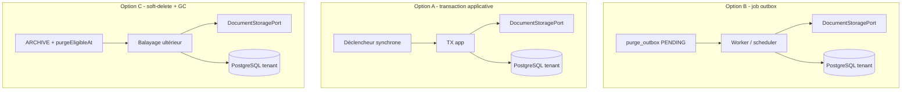

# System Design & Architecture — `purge-stockage`

> Squelette Phase 1. L’architecture cible **dépend de Q1** (transaction vs
> job vs soft-delete + balayage). Ne pas traiter ce document comme revue
> Phase 3 tant que les requirements ne sont pas `reviewed`.

## Architecture Overview

Trois formes possibles selon Q1 :

Stack inchangée : Java / Spring Boot / PostgreSQL+Liquibase / port S3|FS
déjà présents. Hexagone : use case domaine, adapters infrastructure.

## Data Models

- Réutiliser `purge_outbox` + `Dossier` / `DossierElement.storageRef`.
- Évolution des **statuts** outbox et colonnes (`last_error`, index) :
  **si Q1 = B**. Sinon à redéfinir.
- `DocumentStoragePort.delete` : probable quelle que soit Q1 (Q2).

## API Design

- **Externe :** dépend de Q6/Q7 (aucune vs `DELETE` vs UI).
- **Ports domaine :** à figer en Phase 3 après Q1–Q5.

## Component Breakdown

| Zone | Notes Phase 1 |
|---|---|
| Backend | Use case purge + adapters store/PG ; job **seulement si Q1=B** |
| Frontend | Aucun jusqu’à Q6 |
| Liquibase | Probable si statuts / index outbox |
| Flowable | Q5 |

## Design Decisions

Aucune décision de design **actée**. Les D-* du tour précédent sont
invalidées : à reposer en Phase 2/3 après Q1+.

## Non-Functional Requirements

- Idempotence de l’effacement (requirements).
- Isolation tenant = schéma instance (décision n° 13).
- Pas de secrets dans les logs.
- Job/TX borné si asynchrone (taille de batch — Phase 3).
