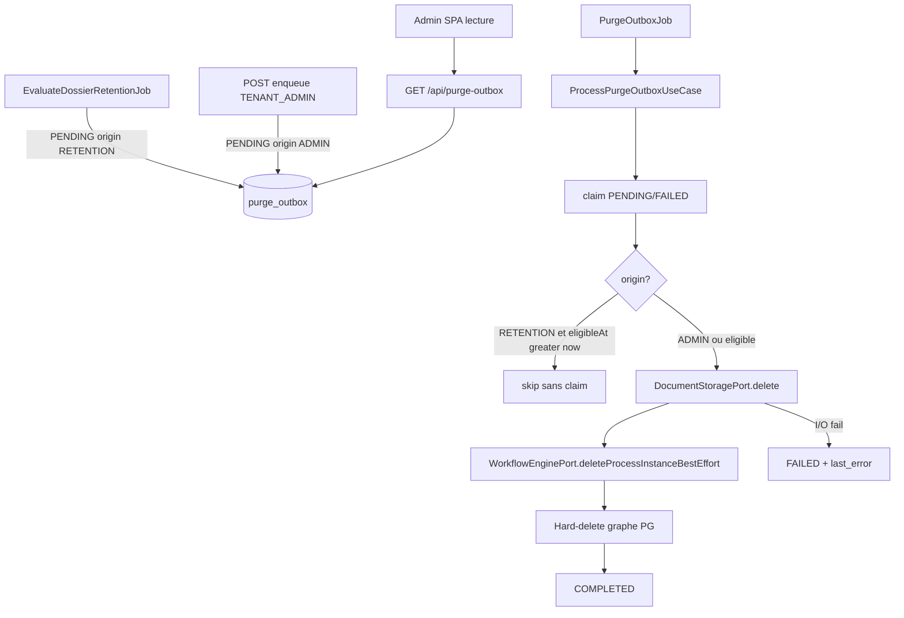

# System Design & Architecture — `purge-stockage`

> Phase 3 **reviewed**. Aligné requirements Q1–Q11. Pas d’implémentation.

## Architecture Overview



Stack : Java / Spring Boot / Liquibase / `DocumentStoragePort` S3+FS.
Hexagone : use cases domaine, adapters infrastructure, pas de Spring
dans `com.flowforge.domain`.

## Data Models

### `PurgeOutboxStatus`

`PENDING` | `PROCESSING` | `COMPLETED` | `FAILED` (**D-STATUS**).

### `PurgeOutboxRecord`

Champs existants + :

- `origin` : `RETENTION` | `ADMIN` (**D-ORIGIN**)
- `lastError` : varchar nullable (**D-ERROR-COL**)

UNIQUE(`dossier_id`) inchangé (**D-KEEP-OUTBOX** : pas de DELETE de la
ligne `COMPLETED`).

Liquibase `011-purge-outbox-worker.yaml` : CHECK/enum élargi, colonnes
`origin` (défaut `RETENTION` pour les lignes §21), `last_error`, index
`(status, created_at)`.

### Graphe PG (Q4)

Après deletes store, ordre :

1. `dossier_element` (dossier_id)
2. `dossier_relation` (source **ou** cible)
3. `dossier_workflow_link` (après D-WF)
4. `dossier`
5. outbox → `COMPLETED`

### `DocumentStoragePort`

```java
void delete(String tenantId, String storageRef); // missing = succès
```

Même validation tenant / `..` que `retrieve`.

## API Design

AuthZ : `TENANT_ADMIN` + CSRF (**D-AUTHZ**). Pas de purge dans le thread
HTTP.

| Méthode | Chemin | Rôle |
|---|---|---|
| GET | `/api/purge-outbox` | Liste + compteurs (`status` query optionnel, `limit`) |
| POST | `/api/dossiers/{id}/purge-requests` | Enqueue `PENDING` origin `ADMIN` |

**D-ENQUEUE-HTTP :** POST (pas DELETE — le dossier existe encore après 2xx).

Enqueue (**Q11**) :

- 403 si pas `TENANT_ADMIN`
- 404 dossier inconnu
- 409 si statut ∉ {`CLOTURE`,`ARCHIVE`}
- 200/201 si insert ; **204** ou 200 no-op si UNIQUE déjà présent
  (idempotent)

GET liste : items `{ id, dossierId, status, origin, eventType,
createdAt, lastError }` + `{ counts: { pending, processing, failed,
completed } }`. Pas de bouton côté contrat.

### Ports domaine

```java
int processBatch(Instant now, int limit); // ProcessPurgeOutboxUseCase

void insert(...); // existant
boolean existsByDossierId(UUID);
List<PurgeOutboxRecord> findRetryable(int limit); // PENDING ∪ FAILED
boolean claim(UUID id); // → PROCESSING
void markCompleted(UUID id);
void markFailed(UUID id, String error);

void delete(String tenantId, String storageRef);

void deleteAllElementsByDossierId(UUID);
void deleteRelationsTouching(UUID);
void deleteWorkflowLinksByDossierId(UUID);
void deleteDossierById(UUID);

void deleteProcessInstanceBestEffort(String processInstanceId);
// extension WorkflowEnginePort — pas de nouveau port
```

Enqueue use case : charge dossier, refuse ouvert, `insert` origin ADMIN,
`purgeEligibleAt` informatif (now) dans le payload.

## Component Breakdown

| Zone | Contenu |
|---|---|
| Domaine | `ProcessPurgeOutboxUseCase`, `EnqueueDossierPurgeUseCase`, enum status/origin |
| Infra JPA | claim SQL atomique ; deletes graphe |
| Storage | `delete` FS + S3 |
| Flowable | `WorkflowEnginePort.deleteProcessInstanceBestEffort` |
| Sched | `PurgeOutboxJob` + `app.purge.poll-delay` (défaut 1h) + `batch-size` 50 (**D-SCHED**) |
| Web | 2 controllers ; pas d’endpoint destroy-tenant |
| FE | Route `/admin/purge-outbox` (**D-UI-LOC**) ; lecture seule ; lien nav admin |

## Design Decisions

| Id | Choix | Alt. écartée |
|---|---|---|
| Q1 D-MECH | Job outbox | XA / soft-delete only |
| Q2 D-PORT | `DocumentStoragePort.delete` | Second port |
| Q3 D-ORDER | Store → PG | PG d’abord / parallèle |
| Q4 D-SCOPE-PG | Graphe complet | Dossier seul |
| Q5 D-WF | Best-effort via `WorkflowEnginePort` | Bloquer / ignorer |
| Q6 D-UI | Lecture seule | Force bouton |
| Q7 | POST enqueue | DELETE synchrone |
| Q8 | Runbook tenant | API destroy |
| Q9 | Pas de GC orphelins | Scan store |
| Q10 | E2E-PURGE-1..5 | Exemption Playwright |
| Q11 | Enqueue CLOTURE/ARCHIVE ; job ignore horloge si `ADMIN` | Tout statut / 409 si pas éligible |
| **D-STATUS** | 4 états |  |
| **D-ORIGIN** | Colonne `RETENTION` \| `ADMIN` | Flag seulement dans JSON |
| **D-CLAIM** | UPDATE atomique | Select for update seul |
| **D-RETRY** | FAILED au batch suivant | Backoff `nextAttemptAt` V1 |
| **D-KEEP-OUTBOX** | Garder COMPLETED | DELETE outbox |
| **D-ERROR-COL** | `last_error` | Logs seuls |
| **D-SCHED** | 1h / batch 50 | Même 100 que rétention (trop d’I/O store) |
| **D-ENQUEUE-HTTP** | POST `/api/dossiers/{id}/purge-requests` | DELETE ressource |
| **D-LIST** | GET `/api/purge-outbox` + counts | Pagination OpenAPI §24 |
| **D-UI-LOC** | Page `/admin/purge-outbox` | Bloc dans types (surcharge) |
| **D-ELIGIBLE-GUARD** | Skip horloge **seulement** origin RETENTION | Skip toutes les origines |

## Requirements coverage

| Story / critère | Design |
|---|---|
| 1 Rétention → disparition | Job + D-ORDER + D-SCOPE-PG |
| 2 Rejeu échec | D-RETRY (job, pas UI) |
| 3 GET dossier 404 | Hard-delete |
| 4 Tenant vs dossier | Deployment runbook Q8 |
| 5 Écran file | D-UI-LOC + GET |
| 6 Enqueue hors horloge | POST + Q11 + D-ORIGIN ADMIN |
| Idempotence store/PG | delete missing OK ; UNIQUE |
| Playwright | testing E2E-PURGE-* |
| Hexagone / pas MinIO | port existant |

## Non-Functional Requirements

- Job borné (`batch-size`) ; une passe = max `limit` claims.
- Idempotence store + PG ; claim anti-concurrence.
- Logs : `outboxId`, `dossierId`, statut — pas de dump `storageRef` massif.
- Isolation tenant = schéma instance.
- SSRF N/A.

## Phase 3 review notes (2026-08-19)

Squelette Phase 1 **insuffisant** : ports, HTTP, origin, UI loc, sched
figés ici. Aucune question produit nouvelle. Q10 restaurée dans le
tableau requirements Clos si manquante.

**Ouvert design :** aucun. Prêt Phase 4 (plan T1…).
