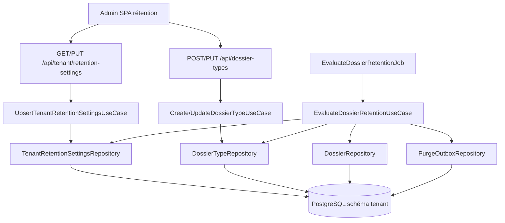

# System Design & Architecture — `retention-dossier-type`

## Architecture Overview

Lot **backend + admin SPA**. Le worker de suppression d’objets reste hors
scope (§22 consommera `purge_outbox`).



**Composants :**

| Composant | Responsabilité |
|---|---|
| `TenantRetentionSettings` | Défaut tenant (`defaultRetentionDays > 0`) |
| `RetentionPolicy` (domaine) | Résoudre durée effective type × défaut ; `NEVER` |
| `EvaluateDossierRetentionUseCase` | Batch : candidats `CLOTURE` expirés → ARCHIVE + outbox |
| `EvaluateDossierRetentionJob` | Scheduler infra (polling / cron configurable) |
| `PurgeOutboxRepository` | Append-only événements `DOSSIER_PURGE_REQUESTED` |
| Admin FE | Section settings + champs sur `DossierTypesAdminView` |

## Data Models

### `TenantRetentionSettings` (1 ligne / schéma tenant)

```java
public record TenantRetentionSettings(
    String tenantId,
    int defaultRetentionDays, // > 0
    Instant updatedAt,
    String updatedBy
) {}
```

### Extension `DossierType`

```java
// Ajouts immuables sur le record existant
Integer retentionDays,     // null si INHERIT ou NEVER
boolean retentionNever     // true ⇒ NEVER ; exclusif avec retentionDays != null
```

Validation create/update :

- `retentionNever=true` ⇒ `retentionDays` doit être `null`.
- `retentionNever=false` et `retentionDays != null` ⇒ `retentionDays > 0`.
- sinon ⇒ héritage.

### Extension `Dossier`

```java
Instant purgeEligibleAt  // nullable ; posé uniquement par le job rétention
```

`closedAt` / `closedBy` : déjà posés à `CLOTURE` via `withStatus`.  
**A-REOPEN :** pas de clear dans ce lot (pas de transition de réouverture).

### `PurgeOutboxRecord`

```java
public record PurgeOutboxRecord(
    UUID id,
    UUID dossierId,
    String eventType,      // "DOSSIER_PURGE_REQUESTED"
    String status,         // PENDING | … (§22 pourra étendre)
    String payloadJson,    // dossierId, typeCode, purgeEligibleAt, tenantId
    Instant createdAt
) {}
```

Table Liquibase `purge_outbox` (schéma tenant). **Aucun relay** dans ce lot.

### Résolution politique

```java
public final class RetentionPolicyResolver {
  public OptionalInt effectiveDays(DossierType type, TenantRetentionSettings settings);
  // empty = NEVER (pas d'expiration)
  // sinon jours > 0
}
```

Expiration : `closedAt.plus(Period.ofDays(days)).isBefore(now)` (UTC).

## API Design

### Settings tenant — nouveau

| Méthode | Path | Auth | Body / réponse |
|---|---|---|---|
| `GET` | `/api/tenant/retention-settings` | `TENANT_ADMIN` | `{ defaultRetentionDays }` |
| `PUT` | `/api/tenant/retention-settings` | `TENANT_ADMIN` | idem ; 400 si ≤ 0 |

Bootstrap (**D-BOOTSTRAP**, figé Phase 2) : **pas de seed** Liquibase.
`GET` → **404** tant qu’aucun `PUT` ; job **no-op** (warn) si settings
absents.

### `DossierType` — étendu

`CreateDossierTypeRequest` / `UpdateDossierTypeRequest` /
`DossierTypeResponse` :

```json
{
  "retentionDays": 365,
  "retentionNever": false
}
```

Héritage : omettre les deux ou `retentionDays: null`, `retentionNever: false`.

### Dossier response

Ajouter `purgeEligibleAt` (nullable) sur `DossierResponse` pour transparence
admin / debug ; pas d’UI supervision dans ce lot.

### Statut

Transitions inchangées (`CLOTURE`→`ARCHIVE` seule sortie de `CLOTURE`).
Le job utilise le même garde-fou de transition + pose `purgeEligibleAt` +
outbox dans **une transaction**.

## Component Breakdown

### Backend (domaine)

- `domain.dossier.model.TenantRetentionSettings`
- `domain.dossier.model.RetentionPolicyResolver`
- `domain.dossier.port.in.Get/UpsertTenantRetentionSettingsUseCase`
- `domain.dossier.port.in.EvaluateDossierRetentionUseCase` (+ Impl)
- `domain.dossier.port.out.TenantRetentionSettingsRepository`
- `domain.dossier.port.out.PurgeOutboxRepository`
- Extension `Dossier` / `DossierType` / use cases create-update type

### Backend (infra)

- JPA entities + adapters + Liquibase (`tenant-migration`)
- `TenantRetentionSettingsController`
- Extension DTOs `DossierType*` / `DossierResponse`
- `EvaluateDossierRetentionJob` (`@Scheduled` ou équivalent Boot)
- Propriétés `app.retention.batch-size`, `app.retention.cron` (yaml)

### Frontend

- Types + client `retentionSettings.ts` / extension `dossierTypes.ts`
- Vue admin : section « Rétention » (défaut tenant) + champs sur formulaire
  type (`DossierTypesAdminView` ou sous-composant)
- Vitest composants / clients ; Playwright admin

## Design Decisions

| Id | Choix | Pourquoi |
|---|---|---|
| Outbox dédiée `purge_outbox` | Ne pas réutiliser `outbox_event` workflow | Payloads / cycle de vie distincts ; §22 clair |
| Job applicatif | Pas Flowable | Pas un processus métier BPMN |
| Settings en base | Pas seulement `application.yml` | UI `TENANT_ADMIN` (D-UI) |
| `retentionNever` bool + `retentionDays` | Simple JSON API | Évite enum FE complexe |
| ARCHIVE métier sans outbox | Respect D-FORCE | RGPD ≠ archivage process |
| Pas de seed durée | Force décision admin | **D-BOOTSTRAP** (Phase 2) |

## Non-Functional Requirements

- Job : batch borné (`batch-size`), idempotent, pas de purge I/O objet.
- Secrets : aucun dans outbox payload.
- AuthZ : settings + mutation type = `TenantAdminGuard` / rôle existant.
- SSRF N/A ; pas d’URL externes.
- Perf : index utile `(status, closed_at)` pour le scan job (Liquibase).
- Tests : Jacoco domaines touchés ; FE Vitest + Playwright obligatoires.
