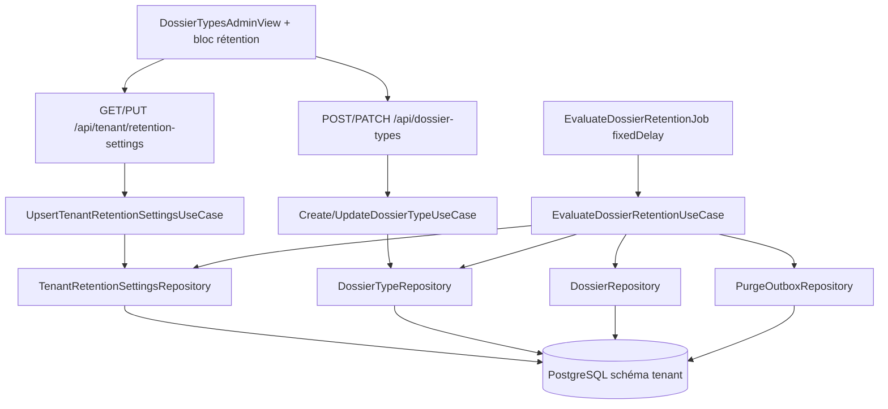

# System Design & Architecture — `retention-dossier-type`

## Architecture Overview

Lot **backend + admin SPA**. Le worker de suppression d’objets reste hors
scope (§22 consommera `purge_outbox`).



**Composants :**

| Composant | Responsabilité |
|---|---|
| `TenantRetentionSettings` | Défaut tenant (`defaultRetentionDays > 0`) |
| `RetentionPolicyResolver` | Durée effective type × défaut ; `NEVER` → empty |
| `EvaluateDossierRetentionUseCase` | Batch dédié : candidats → ARCHIVE + `purgeEligibleAt` + outbox (**sans** ACL user) |
| `EvaluateDossierRetentionJob` | `@Scheduled(fixedDelay…)` infra |
| `PurgeOutboxRepository` | Insert `DOSSIER_PURGE_REQUESTED` ; UNIQUE `dossier_id` |
| Admin FE | Bloc rétention sur / près de `DossierTypesAdminView` + champs type |

## Requirements coverage

| Requirements | Design |
|---|---|
| D-DURATION / D-NEVER | Settings + champs type + resolver |
| D-ACTION / D-OUTBOX | Use case dédié + `purge_outbox` |
| D-CLOCK / A-NULL-CLOSEDAT | `closedAt` + skip null ; `expiration <= now` |
| D-BOOTSTRAP | Pas de seed ; GET 404 ; job no-op |
| D-FORCE | Job ne traite que `CLOTURE` ; ARCHIVE métier sans outbox |
| D-JOB-ACTOR | `system:retention-job` |
| D-POLICY-CHANGE | Pas de cancel outbox ; recalcul seulement `CLOTURE` |
| D-UI / D-UI-LOC | Bloc + champs types admin |
| Non-goal purge physique | Aucun port S3/FS / delete |

## Data Models

### `TenantRetentionSettings` (1 ligne / schéma tenant)

```java
public record TenantRetentionSettings(
    String tenantId,
    int defaultRetentionDays, // > 0
    Instant updatedAt,
    String updatedBy
) {}
```

Table : PK `tenant_id` (singleton aligné `app.tenant.id`).

### Extension `DossierType`

```java
Integer retentionDays,     // null si INHERIT ou NEVER
boolean retentionNever     // true ⇒ NEVER ; exclusif avec retentionDays != null
```

Validation create/update :

- `retentionNever=true` ⇒ `retentionDays` doit être `null`.
- `retentionNever=false` et `retentionDays != null` ⇒ `retentionDays > 0`.
- sinon ⇒ héritage.

Migration (A-MIGRATE-TYPES) : `retention_never=false`, `retention_days=null`.

### Extension `Dossier`

```java
Instant purgeEligibleAt  // nullable ; posé uniquement par EvaluateDossierRetentionUseCase
```

Méthode domaine dédiée (ex. `withRetentionArchive(updatedBy, at)`) :
`assertCanTransition(CLOTURE→ARCHIVE)`, pose status ARCHIVE, `purgeEligibleAt=at`,
`updatedBy`/`updatedAt` ; **ne** passe **pas** par `UpdateDossierStatusUseCase`
(D-ARCHIVE-PATH).

### `PurgeOutboxRecord`

```java
public record PurgeOutboxRecord(
    UUID id,
    UUID dossierId,        // UNIQUE
    String eventType,      // "DOSSIER_PURGE_REQUESTED"
    String status,         // PENDING (§22 pourra étendre)
    String payloadJson,    // tenantId, dossierId, typeCode, purgeEligibleAt
    Instant createdAt
) {}
```

Contrainte **UNIQUE(`dossier_id`)** (D-OUTBOX-UNIQ). Insert conflict → no-op
idempotent. **Aucun relay** dans ce lot.

### Résolution politique

```java
public final class RetentionPolicyResolver {
  public OptionalInt effectiveDays(DossierType type, TenantRetentionSettings settings);
  // empty = NEVER
}
```

Candidat expiré (A-CLOCK) :  
`!closedAt.plus(Period.ofDays(days)).isAfter(now)` ⇔ `expiration <= now` (UTC).

### Sélection candidats (D-SCAN)

Port sortant ex. :

```java
List<Dossier> findClosedForRetention(int limit);
// status = CLOTURE AND closed_at IS NOT NULL
// ORDER BY closed_at ASC, id ASC
```

Le use case charge settings (absent → no-op), types, résout politique en
mémoire, ignore NEVER / non expirés / déjà traités, traite jusqu’à
`batch-size` **archivages réussis** ou épuisement du batch lu (préciser en
implémentation : compter les updates ou les lectures — **A-BATCH-COUNT** :
compter les **lectures** du port `limit`, une passe).

Index Liquibase : `(status, closed_at)`.

## API Design

### Settings tenant

| Méthode | Path | Auth | Comportement |
|---|---|---|---|
| `GET` | `/api/tenant/retention-settings` | `TENANT_ADMIN` | `{ defaultRetentionDays }` ou **404** |
| `PUT` | `/api/tenant/retention-settings` | `TENANT_ADMIN` | upsert ; **400** si ≤ 0 |

### `DossierType` — étendu

`Create` / `Patch` / réponses : `retentionDays`, `retentionNever`.

- Patch : même sémantique null-means-keep que les autres champs ; pour forcer
  héritage depuis un override : envoyer `retentionNever=false` et
  `retentionDays=null` explicitement (**A-PATCH-INHERIT**).
- **D-TYPE-VIS :** champs toujours sérialisés pour tout lecteur authentifié
  des types.

### `DossierResponse`

**D-PURGE-FIELD :** `purgeEligibleAt` (nullable) toujours exposé aux lecteurs
autorisés du dossier.

### Statut

Transitions inchangées. Archivage rétention = use case dédié + une
**transaction** (dossier + outbox).

## Component Breakdown

### Backend (domaine)

- `TenantRetentionSettings`, `RetentionPolicyResolver`, `PurgeOutboxRecord`
- Ports in : Get/Upsert settings, `EvaluateDossierRetentionUseCase`
- Ports out : settings repo, purge outbox, `findClosedForRetention`
- Extension `Dossier` / `DossierType` + create/update type

### Backend (infra)

- JPA + Liquibase `tenant-migration`
- `TenantRetentionSettingsController`
- DTOs étendus
- `EvaluateDossierRetentionJob` :
  - `app.retention.poll-delay` défaut **1h**
  - `app.retention.batch-size` défaut **100**
  (D-SCHED)

### Frontend

- Client settings + extension `dossierTypes`
- Bloc rétention + champs type sur `DossierTypesAdminView` (D-UI-LOC)
- Vitest + Playwright

## Design Decisions

| Id | Choix | Pourquoi |
|---|---|---|
| **D-SCAN** | Batch `CLOTURE` + resolve mémoire | Simple, correct V1 |
| **D-OUTBOX-UNIQ** | UNIQUE(`dossier_id`) | Idempotence sous concurrence |
| **D-ARCHIVE-PATH** | Use case dédié sans ACL | Pas de half-update via status UC |
| **D-TYPE-VIS** | Champs type toujours visibles | Pas sensible ; API simple |
| **D-SCHED** | `fixedDelay` 1h + batch 100 | Aligné relays outbox |
| **D-PURGE-FIELD** | `purgeEligibleAt` toujours sur dossier | Observable sans écran file |
| Outbox dédiée | ≠ `outbox_event` workflow | Cycle §22 distinct |
| Settings en base | Pas yaml-only | UI admin |
| Pas de seed | D-BOOTSTRAP | Config explicite |

## Non-Functional Requirements

- Job borné, idempotent, zéro I/O object store.
- Payload outbox sans secrets.
- AuthZ settings / mutation type : `TENANT_ADMIN` + `TenantAdminGuard`.
- Index `(status, closed_at)`.
- Tests : domaine + IT/MockMvc + Vitest + Playwright ; `./mvnw verify`.

## Assumptions techniques Phase 3

- **A-BATCH-COUNT :** une passe = jusqu’à `limit` dossiers **lus** ; les
  non-candidats (NEVER, non expirés) consomment le budget de lecture.
- **A-PATCH-INHERIT :** retour héritage via patch explicite
  `retentionNever=false` + `retentionDays=null`.

## Questions & Open Items

### Clos Phase 3 (stakeholders)

D-SCAN, D-OUTBOX-UNIQ, D-ARCHIVE-PATH, D-TYPE-VIS, D-SCHED, D-PURGE-FIELD —
toutes **option A**.

### Reporté

- Consommation `purge_outbox` / port S3-FS → `purge-stockage` (§22).
