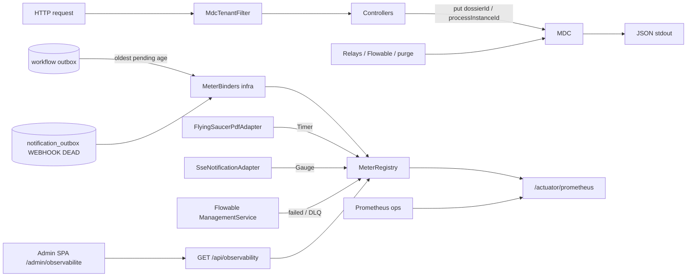

# System Design & Architecture — `observabilite`

> Draft. Requirements **pas reviewed** : Q1–Q6 ouvertes. D-FE acté.

## Architecture Overview



- **Couche :** tout dans `com.flowforge.infrastructure` (observability,
  web filters, adapters existants). **Aucun** type Micrometer / MDC /
  actuator dans `com.flowforge.domain`.
- **Stack :** Spring Boot 4.1 actuator + Micrometer Prometheus ;
  logs structurés Boot (`logging.structured.format.console`).
- **Tenant :** `TenantProperties.id()` — jamais résolu par requête.

## Data Models

Pas de nouvelle table métier (**Q1 = B**, pas C).

### MDC

| Clé | Source | Cycle de vie |
|---|---|---|
| `tenantId` | `app.tenant.id` | Filtre HTTP + wrapper jobs ; clear `finally` |
| `dossierId` | path / use case / payload outbox | Put au plus près du contexte dossier ; clear |
| `processInstanceId` | lien workflow / exécution Flowable | Idem |

### Métriques (noms provisoires — figer Phase 3)

| SLI | Type | Source |
|---|---|---|
| Âge PENDING outbox **déclenchement** | Gauge (s) | `OutboxRepository` |
| Âge PENDING outbox **notification** | Gauge (s) | `NotificationOutboxRepository` (**Q3 = B**) |
| Âge PENDING/non traité outbox **purge** | Gauge (s) | `PurgeOutboxRepository` (**Q3 = B**) |
| Jobs Flowable en échec | Gauge (count) | `ManagementService` dead-letter (+ failed si distinct) |
| Durée rendu PDF | Timer | `PdfRenderer` adapter |
| Webhooks DLQ | Gauge (count) | Count `WEBHOOK`+`DEAD` |
| `SseEmitter` actifs | Gauge (count) | Somme des emitters |

### Audit lecture (**Q1 = B**)

Événement `SECURITY_AUDIT` INFO, même logger que les 403 :

- `event=dossier_read` — `GET /api/dossiers/{id}` et `?ref=` **si 2xx**
- `event=element_content_read` — `GET /api/dossier-elements/{id}/content`
  **si le contenu est servi**

Champs : `principal`, `path`, `dossierId` / `elementId`. **Jamais** le
contenu ni les `fields`. Pas de log read si 403 (`access_denied`
suffit).

## API Design

### Actuator (D-ACTUATOR, **Q2 = A**)

- Exposer uniquement `health`, `prometheus`.
- Probes `liveness` / `readiness` Boot.
- **Port management** distinct (`management.server.port`) : scrape
  Prometheus **sans** OIDC ; le reverse-proxy public **ne route pas**
  ce port.
- `GET /api/**` métier : **+** snapshot JSON pour le SPA (D-API-UI).
  OpenAPI : inclure ce GET si flag on (discipline §24).

### Snapshot SPA (D-FE, D-API-UI)

`GET /api/observability` — `@PreAuthorize("hasRole('TENANT_ADMIN')")`
(**Q5 = A**). Même origine, session BFF. **Pas** de texte Prometheus.
`pdfRender.count = 0` → mean/max absents ou 0 ; UI **n/a**.

Forme provisoire (figer Phase 3) :

```json
{
  "tenantId": "tenant_dev",
  "observedAt": "2026-08-20T07:41:00Z",
  "triggerOutboxOldestPendingAgeSeconds": 12.5,
  "notificationOutboxOldestPendingAgeSeconds": 0,
  "purgeOutboxOldestPendingAgeSeconds": 3600,
  "flowableFailedJobCount": 0,
  "pdfRender": { "count": 10, "meanMs": 80.0, "maxMs": 200.0 },
  "webhookDeadCount": 2,
  "sseActiveCount": 3
}
```

Lecture seule. 403 si rôle insuffisant.

## Component Breakdown

| Composant | Responsabilité |
|---|---|
| `MdcTenantFilter` (web) | Put/clear `tenantId` ; clear all en finally |
| Helpers MDC dossier/PI | Try/finally autour des controllers / relays concernés |
| `OutboxAgeMeterBinder` | Trois gauges d’âge (**Q3 = B**) |
| `FlowableJobMetrics` | Gauges failed / DLQ |
| `NotificationDlqMeterBinder` | Gauge WEBHOOK DEAD |
| Timer PDF | Micrometer autour de `render` |
| Jauge SSE | `activeEmitterCount()` sur l’adapter existant |
| `ObservabilityController` | GET snapshot — mappe registry / ports → JSON |
| `SecurityAuditLog` | + `dossier_read` / `element_content_read` (**Q1 = B**) |
| `SecurityConfig` | Ne pas authentifier le port management comme le BFF |

### Frontend (D-FE) — carte composants

| Pièce | Responsabilité |
|---|---|
| Route `/admin/observabilite` | `meta.roles: ['TENANT_ADMIN']` (**Q5 = A**) |
| `AppShell` | Lien Admin « Observabilité » si `isTenantAdmin` |
| `ObservabilityAdminView` | Chargement, erreur, bouton Rafraîchir (**Q6 = A**) |
| `ObservabilityKpiGrid` | Grille SLI + trois âges outbox |
| `ObservabilityKpiCard` | Une métrique + sévérité (**Q4 = A**) |
| `api/observability.ts` | Client GET snapshot |
| `useObservabilitySnapshot` | Fetch / état (pas de store Pinia global sauf besoin) |

Pas de `chart.js` (**Q4 = A**). PrimeVue existant (Tag / Message /
Card — widgets exacts Phase 3, alignés maquette `11`).

## Design Decisions

| Décision | Choix draft | Alternative écartée |
|---|---|---|
| Où vivent les métriques | Infrastructure binders | Annotation domaine / AOP use case |
| Âge outbox | Port lecture + binder | SQL natif dans le binder sans port |
| Flowable | Adapter infra seulement | Port domaine « JobMetrics » (YAGNI) |
| Logs | Structured logging Boot natif | logstash-logback-encoder additionnel |
| Q1 | **B** logs `SECURITY_AUDIT` | Table d’audit (C) ; hors V1 (A) |
| Q2 | Port management | Actuator public / OIDC scrape |
| Q4 | Cartes KPI | Chart.js / historique |
| D-FE | Écran admin snapshot | SPA scrape Prometheus |
| D-API-UI | JSON BFF | Exposer actuator sur le port app pour le SPA |

## Non-Functional Requirements

- **Perf :** MDC put/clear = négligeable. Binders : requêtes COUNT /
  MIN(`created_at`) bornées, intervalle d’échantillonnage Micrometer
  par défaut. Timer PDF : une observation / rendu.
- **Sécurité :** pas de secrets dans les labels/logs ; prometheus
  non public (**Q2 = A**). SSRF / PJ hors lot.
- **Fiabilité :** échec d’une collecte de jauge = log WARN, pas de
  crash du relais métier.
- **Scalabilité :** une JVM / tenant (décision n° 13) — jauge SSE
  locale = correcte V1.

## Points à figer en Phase 3

- Noms Prometheus définitifs + labels (`tenant` redondant avec
  instance : **éviter** un label haute cardinalité).
- Exact failed vs dead-letter Flowable 8 API.
- Format JSON `ecs` vs `logstash`.
- Comportement jauge outbox vide (0 vs NaN).
- Seuils ok/warn/crit des cartes (**A-THRESHOLDS**).
- `GET /api/observability` est **figé** (plus un point ouvert).
