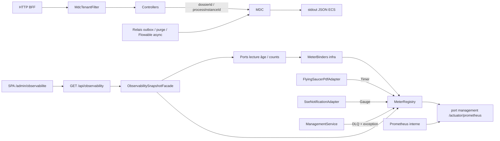

# System Design & Architecture — `observabilite`

> Phase 3 **reviewed**. Aligné requirements Q1–Q6. A-* figés (DD-*).
> **Pas d’implémentation** (Phase 4 planning, puis Phase 5).

## Architecture Overview



- **Couche :** tout le code observabilité vit dans
  `com.flowforge.infrastructure` (binders, filtre MDC, façade snapshot,
  chaînes Security). **Aucun** type Micrometer, `org.slf4j.MDC`,
  actuator ou Flowable `ManagementService` dans `com.flowforge.domain`.
- **Stack :** Spring Boot 4.1 `spring-boot-starter-actuator` +
  `micrometer-registry-prometheus` ; logs
  `logging.structured.format.console=ecs` (**DD-JSON**).
- **Tenant :** `TenantProperties.id()` uniquement (décision n° 13).
- **Deux surfaces HTTP distinctes :**
  1. Port applicatif (BFF / OIDC) : métier + `GET /api/observability`.
  2. Port management (**DD-MGMT** / **Q2 = A**) : `health` +
     `prometheus` seulement, **sans** session OIDC.

## Data Models

Pas de nouvelle table métier (**Q1 = B**). Changelog Liquibase
**uniquement** un index de lecture (**DD-INDEX-NOTIF**).

### MDC (**D-MDC**)

| Clé | Source | Cycle de vie |
|---|---|---|
| `tenantId` | `app.tenant.id` | Filtre HTTP + wrapper jobs / Flowable async ; `clear` `finally` |
| `dossierId` | path, payload outbox, `PurgeOutboxRecord` | Put au plus près ; `clear` entre items de batch |
| `processInstanceId` | lien workflow / job Flowable | Idem |

Helper infra `MdcScope` (`AutoCloseable`) : put + `close()` nettoie
**uniquement** les clés posées par ce scope (pas un `MDC.clear()`
global qui casserait un scope parent).

Requête / job sans dossier ou PI : la clé **n’est pas** posée (pas de
valeur fantôme `"null"`).

### Lecture d’âge — ports domaine (purs)

Méthodes **ajoutées** aux ports existants (pas de port
« Observability » dans le domaine — **DD-NO-DOMAIN-UC**) :

| Port | Méthode | Sémantique |
|---|---|---|
| `OutboxRepository` | `Optional<Instant> oldestPendingCreatedAt()` | `status = PENDING` |
| `NotificationOutboxRepository` | `Optional<Instant> oldestPendingCreatedAt()` | `status = PENDING`, **tous** canaux |
| `NotificationOutboxRepository` | `long countByChannelAndStatus(channel, status)` | jauge WEBHOOK + DEAD |
| `PurgeOutboxRepository` | `Optional<Instant> oldestUnfinishedCreatedAt()` | `PENDING ∪ PROCESSING ∪ FAILED` (**DD-PURGE-AGE**) |

Âge exposé = `max(0, now - createdAt)` en **secondes entières**
(floor). Outbox vide → **`0`** (**DD-EMPTY-AGE** / **A-EMPTY-AGE**).
`Clock` injecté dans les binders / la façade (même pattern que les
rate limiters : `Clock.systemUTC()` par défaut).

SQL : `SELECT MIN(created_at) WHERE status …` — index existants
`ix_outbox_event_status_created_at` et
`idx_purge_outbox_status_created_at`. Notification : index actuel
`(status, next_attempt_at)` ; ajouter
`ix_notification_outbox_status_created_at` sur `(status, created_at)`
(**DD-INDEX-NOTIF**, changeset `012-observability-indexes.yaml`).

### Métriques Prometheus (**DD-PROM-NAMES**)

Préfixe `flowforge.` (Micrometer → underscores Prometheus). **Aucun**
label `tenant`, `dossierId`, `processInstanceId` (1 JVM = 1 tenant ;
cardinalité interdite).

| SLI | Type Micrometer | Nom Prometheus scrape |
|---|---|---|
| Âge PENDING outbox déclenchement | Gauge, base unit `seconds` | `flowforge_outbox_trigger_oldest_pending_age_seconds` |
| Âge PENDING outbox notification | Gauge, s | `flowforge_outbox_notification_oldest_pending_age_seconds` |
| Âge unfinished outbox purge | Gauge, s | `flowforge_outbox_purge_oldest_unfinished_age_seconds` |
| Jobs Flowable dead-letter | Gauge, count | `flowforge_flowable_jobs_dead_letter` |
| Jobs Flowable avec exception (retry) | Gauge, count | `flowforge_flowable_jobs_exception` |
| Durée rendu PDF | Timer | `flowforge_pdf_render_seconds_count` / `_sum` / `_max` (+ buckets) |
| Webhooks `WEBHOOK`+`DEAD` | Gauge, count | `flowforge_notification_webhook_dead` |
| `SseEmitter` actifs | Gauge, count | `flowforge_sse_emitters_active` |

Noms Java Micrometer (points) :

- `flowforge.outbox.trigger.oldest.pending.age`
- `flowforge.outbox.notification.oldest.pending.age`
- `flowforge.outbox.purge.oldest.unfinished.age`
- `flowforge.flowable.jobs.dead.letter`
- `flowforge.flowable.jobs.exception`
- `flowforge.pdf.render`
- `flowforge.notification.webhook.dead`
- `flowforge.sse.emitters.active`

Timer PDF : buckets Prometheus **par défaut** Micrometer (suffisant
pour les ordres `07` ; pas de `sla` custom V1).

### Jobs Flowable (**DD-FLOWABLE-API**)

Flowable 8 Community **n’a pas** de `createFailedJobQuery()`. Deux
jauges, adapter infra uniquement :

1. **Dead-letter** : `managementService.createDeadLetterJobQuery().count()`
2. **Exception encore en retry** :
   `createJobQuery().withException().count()`
   + `createTimerJobQuery().withException().count()`

Échec de collecte → log WARN, jauge `0` (pas de crash relais).

### Audit lecture (**Q1 = B**)

Même logger `SECURITY_AUDIT`. Nouveaux INFO **après succès** du use
case / du retrieve, dans les contrôleurs (pas un filtre générique, qui
loggerait aussi les 403) :

- `event=dossier_read` — `GET /api/dossiers/{id}` et
  `GET /api/dossiers?ref=` si 2xx
- `event=element_content_read` — `GET /api/dossier-elements/{id}/content`
  **après** `documentStoragePort.retrieve` réussi

Champs : `principal`, `path`, `dossierId` ou `elementId`. **Jamais**
contenu, `fields`, bytes. Pas de log read si 403 (`access_denied`
suffit). Pas de log si élément non téléchargeable / storage fail.

### Sévérité UI (**DD-THRESHOLDS**)

Calculée **côté serveur** (une seule source) ; le SPA n’a pas de
seuils dupliqués. Enum JSON : `ok` | `warn` | `crit`.

| KPI | ok | warn | crit |
|---|---|---|---|
| Trois âges outbox (s) | `< 60` | `< 300` | `≥ 300` |
| `flowableDeadLetterJobCount` | `0` | `1–9` | `≥ 10` |
| `flowableExceptionJobCount` | `0` | `1–9` | `≥ 10` |
| `webhookDeadCount` | `0` | `1–4` | `≥ 5` |
| PDF `meanMs` | `count = 0` **ou** `< 2000` | `< 5000` | `≥ 5000` |
| `sseActiveCount` | `< 50` | `< 200` | `≥ 200` |

SSE : heuristique de fuite, pas un SLO métier. PDF `count = 0` :
`meanMs` / `maxMs` = `null`, sévérité `ok`, UI affiche **n/a**.

Classe infra unique `ObservabilityThresholds` (constantes) partagée
par la façade snapshot. Runbook ops = les mêmes chiffres.

## API Design

### Actuator (**D-ACTUATOR**, **Q2 = A**, **DD-HEALTH**)

```yaml
management:
  server:
    address: ${MANAGEMENT_ADDRESS:127.0.0.1}
    port: ${MANAGEMENT_PORT:8090}
  endpoints:
    web:
      exposure:
        include: health,prometheus
  endpoint:
    health:
      probes:
        enabled: true
logging:
  structured:
    format:
      console: ecs
```

> **Note (D-42, `durcissement-securite-post-revue`, 2026-08-25) :** le défaut d'origine
> `8081` entrait en conflit avec Keycloak local. Bind loopback, port défaut **8090**.
> `permitAll` (DD-MGMT-SEC) conservé **parce que** loopback. Source de vérité :
> `application.yml`.

- Probes Boot : `/actuator/health/liveness`, `/actuator/health/readiness`.
- **Pas** de `HealthIndicator` métier (lag outbox ≠ DOWN).
- Endpoints non listés (`beans`, `env`, `heapdump`, …) → 404.
- Port applicatif **ne sert pas** `/actuator/**` (port management
  dédié). Tests : `@LocalManagementPort` + 404 sur le port app.
- `SecurityFilterChain` `@Order(0)`, matcher
  `EndpointRequest.toAnyEndpoint()`, `permitAll()` — scrape **sans**
  OIDC. Le reverse-proxy **public** ne route pas le port management
  (`8090` depuis D-42 ; `8081` était le défaut d'origine, occupé par Keycloak).
- Tests : `management.server.port=0` (port aléatoire) pour éviter un
  bind fixe en CI.

Dépendances Maven (BOM Boot 4.1) :

- `spring-boot-starter-actuator`
- `io.micrometer:micrometer-registry-prometheus`

Flowable `EndpointAutoConfiguration` **reste exclu** (déjà dans
`application.yml`) — on n’expose pas le cockpit actuator Flowable.

### Snapshot SPA (**D-API-UI**, **Q5 = A**) — contrat figé

`GET /api/observability`

- `@PreAuthorize("hasRole('TENANT_ADMIN')")` + CSRF BFF (GET).
- Même origine, session. **Pas** de texte Prometheus.
- 403 si rôle insuffisant (`WORKFLOW_ADMIN` inclus).
- Lecture seule. OpenAPI : le chemin apparaît si `app.openapi.enabled`
  (étendre `OpenApiEnabledApiTest`).

```json
{
  "tenantId": "tenant_dev",
  "observedAt": "2026-08-20T07:41:00Z",
  "triggerOutboxOldestPendingAgeSeconds": 12,
  "notificationOutboxOldestPendingAgeSeconds": 0,
  "purgeOutboxOldestUnfinishedAgeSeconds": 3600,
  "flowableDeadLetterJobCount": 0,
  "flowableExceptionJobCount": 0,
  "pdfRender": { "count": 10, "meanMs": 80.0, "maxMs": 200.0 },
  "webhookDeadCount": 2,
  "sseActiveCount": 3,
  "severity": {
    "triggerOutboxOldestPendingAge": "ok",
    "notificationOutboxOldestPendingAge": "ok",
    "purgeOutboxOldestUnfinishedAge": "crit",
    "flowableDeadLetterJobs": "ok",
    "flowableExceptionJobs": "ok",
    "pdfRender": "ok",
    "webhookDead": "warn",
    "sseActive": "ok"
  }
}
```

Quand `pdfRender.count = 0` : `"meanMs": null, "maxMs": null`.

La façade lit **les mêmes ports** que les binders pour âges / counts
(JSON ≠ scrape du texte Prometheus). Timer PDF : snapshot
`MeterRegistry` (`count`, `mean`, `max`).

### Logs structurés (**DD-JSON**)

`logging.structured.format.console=ecs` (format ECS natif Boot 4.1).
Écarté : `logstash` (schéma plus pauvre) et `logstash-logback-encoder`
(dépendance en plus). Les clés MDC doivent apparaître dans l’événement
JSON (champs / `labels` ECS selon le mapping Boot) ; test
d’intégration : une ligne stdout / ListAppender contient `tenantId`.

## Component Breakdown

| Composant | Package / fichier | Responsabilité |
|---|---|---|
| `MdcScope` | `infrastructure.observability` | Put/clear typé |
| `MdcTenantFilter` | idem (web) | `tenantId` HTTP, `finally` |
| `ObservabilityMeterConfig` | idem | Enregistre les `MeterBinder` |
| `OutboxAgeMeterBinder` | idem | Trois gauges d’âge (**Q3 = B**) |
| `FlowableJobMetricsBinder` | `infrastructure.flowable` | DLQ + exception |
| `NotificationDlqMeterBinder` | `infrastructure.notification` | WEBHOOK DEAD |
| Timer PDF | `FlyingSaucerPdfAdapter.render` | `Timer.recordCallable` succès **et** exception |
| Jauge SSE | `SseNotificationAdapter.activeEmitterCount()` | Somme des emitters |
| `FlowableMdcConfigurer` | `infrastructure.flowable` | `EngineConfigurationConfigurer` : MDC `tenantId` + `processInstanceId` autour de l’async executor (factory `ExecuteAsyncRunnable` Flowable 8 ; si l’API a bougé, fallback documenté en Phase 5 **sans** élargir le domaine) |
| `ObservabilitySnapshotFacade` | `infrastructure.observability` | Assemble le JSON |
| `ObservabilityController` | `infrastructure.web.observability` | GET snapshot |
| `ObservabilityThresholds` | `infrastructure.observability` | Seuils ok/warn/crit |
| `SecurityAuditLog` | existant | + `dossierRead` / `elementContentRead` |
| `SecurityConfig` | existant | Chaîne Order 0 actuator |
| `ArchitectureRulesTest` | test | + `io.micrometer..`, `org.slf4j.MDC`, `org.springframework.boot.actuate..` |

Relais à envelopper `MdcScope` **par item** :

- `OutboxRelayScheduler.processOne` — `dossierId` depuis
  `TriggerOutboxPayload`
- `NotificationOutboxRelay` — `dossierId` si présent dans le JSON
  payload, sinon tenant seul
- `PurgeOutboxJob` / `ProcessPurgeOutboxUseCase` côté infra job —
  `dossierId` du record

### Frontend (**D-FE**, **Q4 = A**, **Q5 = A**, **Q6 = A**)

Composition API `<script setup lang="ts">`. Pas de Pinia global (état
écran = composable). Pas de `chart.js`. Widgets : **HTML sémantique**
aligné File purge (**DD-UI-WIDGETS**) — le thème PrimeVue Aura reste
global ; pas d’obligation d’importer `Card.vue` (aucun écran admin
actuel ne le fait).

| Pièce | Responsabilité |
|---|---|
| Route `/admin/observabilite` | `meta.roles: ['TENANT_ADMIN']` |
| `AppShell` | Lien « Observabilité » si `isTenantAdmin` (avec File purge / Webhooks) |
| `ObservabilityAdminView` | Titre, chargement, erreur ProblemDetail, bouton **Rafraîchir** |
| `ObservabilityKpiGrid` | Grille des SLI (3 âges + 2 Flowable + PDF + webhook + SSE) |
| `ObservabilityKpiCard` | Libellé, valeur, unité, classe `kpi-card--ok\|warn\|crit` |
| `api/observability.ts` | `GET /api/observability` typé |
| `useObservabilitySnapshot` | fetch à l’ouverture + `refresh()` (**Q6 = A**, **pas de poll**) |

Carte PDF : si `count = 0`, mean/max = **n/a**. Aucun bouton métier
(retry / force / replay).

`data-testid` : `observability-page`, `observability-refresh`,
`kpi-trigger-outbox-age`, `kpi-notification-outbox-age`,
`kpi-purge-outbox-age`, `kpi-flowable-dlq`, `kpi-flowable-exception`,
`kpi-pdf-render`, `kpi-webhook-dead`, `kpi-sse-active`.

## Design Decisions

| Id | Choix | Alternative écartée |
|---|---|---|
| Q1–Q6 / D-* produit | Inchangés (Phase 2) | — |
| **DD-JSON** | `ecs` Boot 4.1 natif | `logstash` ; encoder Logstash additionnel |
| **DD-PROM-NAMES** | Préfixe `flowforge.*`, table ci-dessus | Noms génériques `outbox_age` ; label `tenant` |
| **DD-EMPTY-AGE** | `0` secondes si vide | NaN / omettre le champ |
| **DD-PURGE-AGE** | MIN `created_at` sur PENDING∪PROCESSING∪FAILED | PENDING seul (raterait un PROCESSING coincé) |
| **DD-FLOWABLE-API** | DLQ + `withException` (job + timer) | Une seule jauge ; API « failed » inexistante en Community 8 |
| **DD-THRESHOLDS** | Table ci-dessus, calcul serveur | Seuils seulement dans le SPA ; Alertmanager in-repo |
| **DD-HEALTH** | Probes Boot, pas de DOWN outbox | HealthIndicator lag |
| **DD-NO-DOMAIN-UC** | Façade infra + méthodes lecture sur ports existants | `ObservabilityUseCase` domaine (pas de règle métier) |
| **DD-INDEX-NOTIF** | Index `(status, created_at)` notification | Scan heap H2/PG « assez petit » sans index |
| **DD-UI-WIDGETS** | Cartes HTML + classes sévérité | Chart.js ; PrimeVue Chart ; Card.vue obligatoire |
| **DD-PDF-TIMER** | Timer dans `FlyingSaucerPdfAdapter` | Décorateur `@Primary` autour du port |
| **DD-MGMT-SEC** | Order 0 `EndpointRequest` permitAll | Actuator sur le BFF ; scrape OIDC |
| **DD-SNAPSHOT-SRC** | Ports + registry, pas parse Prometheus | SPA ou BFF scrape `/actuator/prometheus` |

## Alternatives brainstormées (Phase 3)

1. **Un HealthIndicator DOWN si âge outbox > 5 min** — écarté
   (**A-HEALTH** / non-goal) : Kubernetes tuerait un pod « lent mais
   vivant » ; le SLI reste jauge + carte crit.
2. **Label Prometheus `tenant`** — redondant (1 JVM / tenant) et
   risque de copier-coller vers `dossierId`.
3. **Port domaine `ObservabilityQueryPort`** — YAGNI ; la façade infra
   orchestre déjà 5 sources.
4. **Une jauge Flowable unique (DLQ+exception)** — perd le signal
   « encore en retry » vs « coincé DLQ » ; ops a besoin des deux
   (story 4).
5. **Format logstash** — OK pour ELK legacy ; ECS est le format Boot
   4.1 aligné agrégateurs actuels, sans JAR de plus.

## Non-Functional Requirements

- **Perf :** MDC négligeable. Binders = `MIN`/`COUNT` indexés,
  échantillonnage Micrometer par défaut. GET snapshot = mêmes lectures
  bornées, pas de N+1. Timer = une observation / `render`.
- **Sécurité :** pas de secrets / payloads dans MDC, labels, audit,
  JSON snapshot. Port management non public. CSRF GET snapshot = N/A
  (safe method). AuthZ identique File purge.
- **Fiabilité :** exception binder → WARN + `0` ; relais métier
  inchangé.
- **Scalabilité :** jauge SSE locale = correcte V1 (1 JVM / tenant).
- **Compat tests :** H2 MODE=PostgreSQL ; `management.server.port=0`.

## Requirements coverage

| Goal / story / contrainte | Couverture design |
|---|---|
| Logs JSON + MDC 3 clés | DD-JSON, MdcScope, filtre, jobs, Flowable async |
| 3 jauges âge outbox (Q3=B) | Ports + OutboxAgeMeterBinder + 3 cartes |
| Jobs Flowable échec | DD-FLOWABLE-API, 2 gauges + 2 cartes |
| Timer PDF | DD-PDF-TIMER, carte count/mean/max |
| Webhooks DEAD | countByChannelAndStatus + jauge |
| SSE actifs | `activeEmitterCount` |
| Écran admin D-FE / Q4–Q6 | route, nav, cartes, refresh |
| TENANT_ADMIN seul (Q5) | PreAuthorize + `meta.roles` + AppShell |
| Audit GET succès (Q1=B) | SecurityAuditLog + contrôleurs |
| Actuator port management (Q2=A) | DD-MGMT-SEC, yaml |
| Hexagone / ArchUnit | DD-NO-DOMAIN-UC + règle étendue |
| OpenAPI GET snapshot | springdoc + test golden |
| Non-goals (OTel, Chart.js, poll, table audit, …) | inchangés |

Aucune story requirements sans design. Aucun A-* ouvert.

## Phase 3 — revue close (2026-08-20)

Lint `--feature observabilite` : docs OK (MISS branche
`feature-observabilite` attendu, Cloud `cursor/observabilite-9800`).

Status : **`reviewed`**.

**Prochaine phase :** `dev-planning` Phase 4 (pas d’implémentation).
