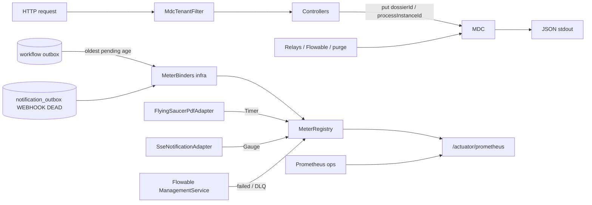

# System Design & Architecture — `observabilite`

> Draft Phase 1 (esquisse). **Revue design = Phase 3** après
> requirements `reviewed`. Aligné sur les recommandations D-* ; Q1–Q3
> encore ouvertes.

## Architecture Overview

- **Couche :** tout dans `com.flowforge.infrastructure` (observability,
  web filters, adapters existants). **Aucun** type Micrometer / MDC /
  actuator dans `com.flowforge.domain`.
- **Stack :** Spring Boot 4.1 actuator + Micrometer Prometheus ;
  logs structurés Boot (`logging.structured.format.console`).
- **Tenant :** `TenantProperties.id()` — jamais résolu par requête.

## Data Models

Pas de nouvelle table métier **sauf si Q1 = C** (écarté en reco).

### MDC

| Clé | Source | Cycle de vie |
|---|---|---|
| `tenantId` | `app.tenant.id` | Filtre HTTP + wrapper jobs ; clear `finally` |
| `dossierId` | path / use case / payload outbox | Put au plus près du contexte dossier ; clear |
| `processInstanceId` | lien workflow / exécution Flowable | Idem |

### Métriques (noms provisoires — figer Phase 3)

| SLI §29 | Type | Source |
|---|---|---|
| Âge plus ancien PENDING outbox déclenchement | Gauge (secondes) | Nouvelle lecture `OutboxRepository` |
| Jobs Flowable en échec | Gauge (count) | `ManagementService` dead-letter (+ failed si distinct) |
| Durée rendu PDF | Timer | `PdfRenderer` adapter |
| Webhooks DLQ | Gauge (count) | Count `WEBHOOK`+`DEAD` |
| `SseEmitter` actifs | Gauge (count) | Somme des sets dans `SseNotificationAdapter` |

### Audit lecture (si Q1 = B)

Événement `SECURITY_AUDIT` INFO, même logger que les 403 :

- `event=dossier_read` — `GET /api/dossiers/{id}` et `?ref=`
- `event=element_content_read` — `GET /api/dossier-elements/{id}/content`

Champs : `principal`, `path`, `dossierId` / `elementId`. **Jamais** le
contenu ni les `fields`.

## API Design

### Actuator (D-ACTUATOR, Q2 reco A)

- Exposer uniquement `health`, `prometheus`.
- Probes `liveness` / `readiness` Boot.
- **Port management** distinct (`management.server.port`) : scrape
  Prometheus **sans** OIDC ; le reverse-proxy public **ne route pas**
  ce port.
- `GET /api/**` inchangé. OpenAPI : actuator **hors** spec SPA
  (springdoc déjà gated).

Pas de nouvel endpoint métier.

## Component Breakdown

| Composant | Responsabilité |
|---|---|
| `MdcTenantFilter` (web) | Put/clear `tenantId` ; clear all en finally |
| Helpers MDC dossier/PI | Try/finally autour des controllers / relays concernés |
| `OutboxAgeMeterBinder` | Gauge âge PENDING déclenchement |
| `FlowableJobMetrics` | Gauges failed / DLQ |
| `NotificationDlqMeterBinder` | Gauge WEBHOOK DEAD |
| Timer PDF | Micrometer autour de `render` |
| Jauge SSE | `activeEmitterCount()` sur l’adapter existant |
| `SecurityAuditLog` | + méthodes read si Q1 = B |
| `SecurityConfig` | Ne pas authentifier le port management comme le BFF |

Frontend : **aucun** composant.

## Design Decisions

| Décision | Choix draft | Alternative écartée |
|---|---|---|
| Où vivent les métriques | Infrastructure binders | Annotation domaine / AOP use case |
| Âge outbox | Port lecture + binder | SQL natif dans le binder sans port |
| Flowable | Adapter infra seulement | Port domaine « JobMetrics » (YAGNI) |
| Logs | Structured logging Boot natif | logstash-logback-encoder additionnel |
| Q1 | Reco B logs | Table d’audit (C) trop large pour §29 |

## Non-Functional Requirements

- **Perf :** MDC put/clear = négligeable. Binders : requêtes COUNT /
  MIN(`created_at`) bornées, intervalle d’échantillonnage Micrometer
  par défaut. Timer PDF : une observation / rendu.
- **Sécurité :** pas de secrets dans les labels/logs ; prometheus
  non public (Q2). SSRF / PJ hors lot.
- **Fiabilité :** échec d’une collecte de jauge = log WARN, pas de
  crash du relais métier.
- **Scalabilité :** une JVM / tenant (décision n° 13) — jauge SSE
  locale = correcte V1.

## Points à figer en Phase 3

- Noms Prometheus définitifs + labels (`tenant` redondant avec
  instance : **éviter** un label haute cardinalité).
- Exact failed vs dead-letter Flowable 8 API.
- Format JSON `ecs` vs `logstash`.
- Comportement jauge outbox vide (0 vs NaN).
