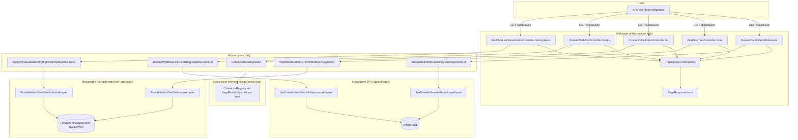

# System Design & Architecture — `contrat-api-client`

> Couvre les 4 décisions produit actées en requirements (D-CODEGEN,
> D-RELATIONS, D-PAGINATION-SCOPE, D-HIDDEN-SPEC) et tranche les 3 points
> techniques laissés ouverts : mécanisme de pagination par source de
> données, sort du plafond `DEFAULT_LIMIT = 100`, disponibilité d'une
> pagination Flowable native.

## Architecture Overview

Trois mécanismes de pagination coexistent déjà dans le code (JPA
`Pageable`/`SpringPages`, slice en mémoire `PageResult.slice`) ou sont à
ajouter (Flowable `listPage`/`count` natif). La feature ne crée **aucun**
nouveau mécanisme : elle applique le bon mécanisme existant — ou son
équivalent natif côté Flowable — à chacune des 6 listes, toutes converties
vers l'envelope `PageResponse<T>` au niveau web via `PageQueryParser`.

**Choix technologiques :** aucune nouvelle dépendance. `springdoc-openapi`
gère déjà nativement `multipart/form-data` et permet de documenter un
`text/event-stream` via `@ApiResponse(content = @Content(mediaType = ...))`
sans plugin additionnel.

## Data Models

Aucun nouveau modèle de domaine. Seules les **signatures de ports out**
changent (paramètre `PageQuery` en entrée, retour `PageResult<T>` au lieu
de `List<T>`) :

| Port | Avant | Après |
|---|---|---|
| `DossierElementRepository` | `findByDossierIdOrderByAddedAtAsc(UUID)` → `List<DossierElement>` | + `pageByDossierId(UUID, PageQuery)` → `PageResult<DossierElement>` (méthode existante conservée si utilisée ailleurs — à vérifier en implémentation) |
| `DossierWorkflowLinkRepository` | `findByDossierIdOrderBySequence(UUID)` → `List<DossierWorkflowLink>` | + `pageByDossierId(UUID, PageQuery)` → `PageResult<DossierWorkflowLink>` |
| `WorkflowTaskInboxPort` | `findActiveAssignedTo(String assigneeId, int limit)` | `findActiveAssignedTo(String assigneeId, PageQuery query)` → `PageResult<ActiveTaskSnapshot>` (remplace `int limit`) |
| `WorkflowVisualizationPort` | `getHistory(String, String)` / `listActiveTasks(String, String)` → `List<...>` | `getHistory(String, String, PageQuery)` / `listActiveTasks(String, String, PageQuery)` → `PageResult<...>` |
| `ConnectorCatalog` | `listAll()` → `List<ConnectorDefinition>` | **inchangé** — le slice se fait au niveau du contrôleur (voir D-CONN-DEF-MECH), le port reste un simple accès mémoire |

Les méthodes `List<>` existantes citées ci-dessus, quand elles ne sont
utilisées que par le endpoint migré, sont supprimées (pas de code mort) ;
quand elles sont réutilisées ailleurs (à vérifier par grep en Phase 4),
elles sont conservées à côté de la nouvelle méthode paginée.

## API Design

Pattern uniforme pour les 6 endpoints : ajout de query params optionnels
`page` (défaut `0`), `size` (défaut `20`, max `100`), `sort` (allow-list à
une seule valeur, défaut = valeur de tri actuelle implicite) ; réponse
`200` migrée de `[ ... ]` vers
`{ "content": [...], "page", "size", "totalElements", "totalPages" }`.

| # | Endpoint | Tri par défaut (allow-list unique) | Mécanisme |
|---|---|---|---|
| 1 | `GET /api/dossiers/{id}/elements` | `addedAt,asc` | JPA `Pageable` |
| 2 | `GET /api/workflow-tasks/mine` | `createdAt,desc` (préserve l'ordre implicite pré-existant, corrigé en Phase 7 — cf. implementation doc) | Flowable `TaskQuery.listPage/count` |
| 3 | `GET /api/connector-definitions` | `type,asc` | Slice mémoire `PageResult.slice` |
| 4 | `GET /api/dossiers/{id}/workflows` | `sequence,asc` | JPA `Pageable` |
| 5 | `GET /api/workflow-links/{linkId}/history` | `startedAt,asc` | Flowable `HistoricActivityInstanceQuery.listPage/count` |
| 6 | `GET /api/workflow-links/{linkId}/tasks` | `createdAt,asc` | Flowable `TaskQuery.listPage/count` |

C'est le même contrat que les 6 listes admin déjà migrées
(`openapi-pagination-admin`, PR #58) : pas de breaking change de forme
d'item, uniquement l'enveloppe qui change — cohérent avec le succès
critère « pas de breaking change de type sur le contenu de chaque item ».

**3 endpoints `@Hidden` à documenter (D-HIDDEN-SPEC), sans changement de
comportement runtime :**

| Endpoint | Retrait `@Hidden` | Documentation OpenAPI ajoutée |
|---|---|---|
| `GET /api/notifications/stream` (SSE) | oui | `@ApiResponse(responseCode = "200", content = @Content(mediaType = "text/event-stream"))` |
| `POST /api/dossiers/{id}/elements/attachment` (multipart) | oui | Déjà supporté nativement par springdoc via `MultipartFile` — juste retirer `@Hidden`, vérifier que le schema `binary` généré est correct |
| `POST /api/webhooks/{instanceId}` (ingress) | oui | `@RequestBody` schema `object` libre (`@Schema(type = "object")`), reflète l'absence de contrat de champs fixe (payload dépend du connecteur appelant) |

## Component Breakdown

**Backend — nouveaux/modifiés :**
- `infrastructure/web/ListSorts.java` (renommage de `AdminListSorts`, D-SORT-CONST) + 6 nouvelles constantes (`DOSSIER_ELEMENTS`, `MY_WORKFLOW_TASKS`, `CONNECTOR_DEFINITIONS`, `DOSSIER_WORKFLOWS`, `WORKFLOW_LINK_HISTORY`, `WORKFLOW_LINK_TASKS`).
- `DossierController.listElements`, `WorkflowTaskController.mine`, `ConnectorDefinitionController.list`, `DossierWorkflowController.history`, `WorkflowLinkVisualizationController.history/tasks` — ajout params `page`/`size`/`sort`, retour `PageResponse<T>`.
- `ListDossierElementsUseCaseImpl`, `AttachWorkflowUseCaseImpl.getHistory`, `ListMyTasksUseCaseImpl`, `WorkflowLinkVisualizationUseCaseImpl.getHistory/getTasks` — signatures adaptées `PageQuery` → `PageResult<T>`.
- `JpaDossierElementRepositoryAdapter`, `JpaDossierWorkflowLinkRepositoryAdapter` — nouvelle méthode paginée (pattern `SpringPages.of`/`SpringPages.map`, cf. `JpaDossierTypeRepositoryAdapter`).
- `FlowableWorkflowTaskInboxAdapter`, `FlowableWorkflowVisualizationAdapter` — `listPage(offset, size)` + `.count()` au lieu de `.list()`.
- `NotificationSseController`, `DossierElementUploadController`, `WebhookController` — annotations OpenAPI, retrait `@Hidden`.
- `openapi/openapi.yaml` — régénéré (`-Dopenapi.update=true`).

**Frontend — modifiés (aucun composant Vue touché, cf. D-SPA-ADAPT) :**
- `frontend/src/api/dossiers.ts` (`listElements`, endpoint `/workflows`), `frontend/src/api/tasks.ts` (`listMyTasks`), `frontend/src/api/workflows.ts` (`getWorkflowHistory`, `getWorkflowTasks`), `frontend/src/api/admin.ts` (connector-definitions) — chaque wrapper interne s'appuie sur `listAllPages` (déjà présent dans `frontend/src/api/page.ts`, utilisé par `listAllWorkflowTypeConfigs`) pour ré-agréger les pages côté client et conserver la même signature `Promise<T[]>` exposée aux stores/composants.
- Tests Vitest impactés (mocks `axios.get` doivent renvoyer une `Page<T>` au lieu d'un tableau) : `frontend/src/api/phase8Api.spec.ts`, `apiCoverage.spec.ts`, `clients.spec.ts`, `dossiers.spec.ts`, et tout test de `stores`/`components` qui mocke au niveau axios plutôt qu'au niveau du wrapper.

## Design Decisions

| Id | Sujet | Décision | Alternative écartée | Raison |
|---|---|---|---|---|
| **D-SORT-CONST** | Nom de la classe des allow-lists de tri | Renommer `AdminListSorts` → `ListSorts` (générique), ajouter les 6 constantes | Créer une 2ᵉ classe `ResourceListSorts` en parallèle | Ces listes ne sont pas toutes admin (elements, mes tâches, historique workflow) — un seul nom générique évite la confusion et la duplication de pattern ; renommage mécanique à faible risque, `ArchitectureRulesTest`/compilateur détectent tout usage oublié |
| **D-CONN-DEF-MECH** | Pagination `connector-definitions` | Slice en mémoire au niveau contrôleur : trier `catalog.listAll()` par `type`, puis `PageResult.slice(sorted, query)` | Ajouter la pagination dans `ConnectorCatalog`/`ConnectorRegistry` | Le port reste un simple accès mémoire (catalogue codé, pas de croissance par tenant) ; `PageResult.slice` existe déjà pour exactement ce cas (contrairement à ce que supposait la question ouverte, aucun nouveau helper n'est nécessaire) |
| **D-ELEMENTS-MECH** | Pagination `dossiers/{id}/elements` | JPA `Pageable` (pattern `JpaDossierTypeRepositoryAdapter.page`) | — | Backé par `DossierElementRepository`/JPA, aucune particularité |
| **D-DOSSIER-WORKFLOWS-MECH** | Pagination `dossiers/{id}/workflows` | JPA `Pageable` sur `DossierWorkflowLinkRepository` (confirmé JPA-backed via `JpaDossierWorkflowLinkRepositoryAdapter`, pas Flowable) | — | Le endpoint expose la table de liaison dossier↔process, pas l'état runtime du moteur |
| **D-FLOWABLE-MECH** | Pagination `workflow-links/{linkId}/history`, `.../tasks`, `workflow-tasks/mine` | Pagination Flowable **native** : `query.listPage(offset, maxResults)` + `query.count()` sur `HistoricActivityInstanceQuery`/`TaskQuery` | Charger `.list()` complet puis `PageResult.slice` en mémoire | Flowable expose nativement `listPage`/`count` sur ces query builders (confirmé par lecture de `FlowableWorkflowVisualizationAdapter`/`FlowableWorkflowTaskInboxAdapter`) — éviter un full scan mémoire pour un historique qui peut grossir sans borne dans le temps |
| **D-TASK-LIMIT** | Sort de `ListMyTasksUseCaseImpl.DEFAULT_LIMIT = 100` | Supprimer le plafond dur ; remplacé par le contrat `page`/`size` (size déjà borné à `PageQuery.MAX_SIZE = 100` par page) | Garder `DEFAULT_LIMIT` comme garde-fou en plus de la pagination | Un plafond dur au-delà de la pagination masquerait silencieusement des tâches à l'utilisateur (le problème que la feature corrige) ; la pagination native Flowable (D-FLOWABLE-MECH) rend le plafond redondant — chaque page reste bornée à 100 lignes côté serveur, mais le client peut désormais parcourir toutes les pages |
| **D-HIDDEN-ANNOTATIONS** | Documentation des 3 endpoints `@Hidden` | Retirer `@Hidden`, ajouter les annotations OpenAPI minimales par endpoint (cf. tableau API Design) | Documenter uniquement SSE/multipart, laisser webhook `@Hidden` | Rejette l'option B des requirements — cohérent avec D-HIDDEN-SPEC déjà acté |
| **D-SPA-ADAPT** | Adaptation du SPA aux 6 endpoints migrés | Ré-agréger côté client via `listAllPages` (déjà utilisé pour `workflow-type-configs`) dans les wrappers `api/*.ts`, zéro changement de composant Vue | Adapter chaque composant consommateur pour piloter `page`/`size` avec pagination UI | Aucune des 6 listes migrées n'a de besoin produit de pagination *visible* côté SPA aujourd'hui (pas de demande utilisateur pour une UI paginée) ; `listAllPages` préserve exactement le contrat `Promise<T[]>` actuel des stores, zéro régression fonctionnelle, feature réversible côté SPA sans toucher aux vues |

## Non-Functional Requirements

- **Compatibilité :** tout client qui ignore `page`/`size`/`sort` reçoit le
  comportement par défaut (`page=0`, `size=20`, tri actuel implicite) —
  pas de breaking change pour un futur intégrateur qui n'utilise pas la
  pagination immédiatement. Le SPA, via `listAllPages`, ne voit aucun
  changement de comportement (toutes les pages sont ré-agrégées).
- **Performance :** les 2 listes Flowable (`history`, `tasks`, `mine`)
  passaient déjà par un `.list()` complet côté moteur — le passage à
  `listPage`/`count` réduit la charge sur `ACT_HI_ACTINST`/`ACT_RU_TASK`
  pour les processus/utilisateurs à fort volume d'activité, sans
  régression sur les petits volumes.
- **Sécurité :** aucun changement d'autorisation — chaque endpoint garde
  exactement les vérifications d'accès existantes
  (`DossierAccessPolicy.assertCanView`, `@PreAuthorize`,
  `requireReadableLink`) ; la pagination ne modifie pas quelles données
  sont visibles, seulement leur découpage.
- **Fiabilité :** `OpenApiContractIT` (fail-on-diff) garantit qu'aucune
  dérive de contrat ne passe en CI après régénération du golden.
- **Domaine pur :** `PageQuery`/`PageResult` restent dans
  `domain.shared` (déjà le cas) — aucune fuite de type web
  (`Pageable`/`Page` Spring Data, types Flowable) au-delà de la couche
  `infrastructure`, conforme à `ArchitectureRulesTest`.

## Requirements Coverage

| Exigence (requirements doc) | Couverte par |
|---|---|
| 6 listes → `PageResponse<T>`, tri contrôlé | API Design (tableau), Component Breakdown |
| `dossiers/{id}/relations` inchangée (D-RELATIONS) | Hors périmètre de ce design — non touchée, aucun composant listé ci-dessus ne la référence |
| 3 endpoints `@Hidden` documentés (D-HIDDEN-SPEC) | API Design, D-HIDDEN-ANNOTATIONS |
| Pas de régression SPA | D-SPA-ADAPT, Component Breakdown (liste exacte des fichiers + tests impactés) |
| Mécanisme `connector-definitions` (slice mémoire) | D-CONN-DEF-MECH |
| Sort `DEFAULT_LIMIT = 100` vs contrat page/size | D-TASK-LIMIT |
| Pagination native Flowable pour history/tasks | D-FLOWABLE-MECH (confirmé : `listPage`/`count` disponibles sur `HistoricActivityInstanceQuery` et `TaskQuery`) |
| `./mvnw verify` (ArchUnit inclus) vert | Non-Functional Requirements (domaine pur) |
| Codegen exclu (D-CODEGEN) | Aucun composant de génération de client dans ce design |

Aucun écart non couvert. Les 3 points techniques laissés ouverts par les
requirements sont tranchés (D-CONN-DEF-MECH, D-TASK-LIMIT,
D-FLOWABLE-MECH).

## Revue design close (2026-08-21)

Architecture, mécanismes par source de données, contrats API des 6
endpoints + 3 endpoints `@Hidden`, composants backend/frontend, décisions
et alternatives, exigences non-fonctionnelles, couverture requirements —
tous couverts. Aucune question ouverte bloquante.

Status : **`reviewed`**. Prochaine phase : `dev-planning` (Phase 4).

## Addendum — D-SPA-ADAPT rejouée après coup (2026-08-21)

Cette phase de design a été exécutée **sans poser les questions
matérielles à l'utilisateur**, en violation du contrat de la skill
`dev-design` (« ask one decision at a time »). Après coup, l'utilisateur
a rejoué explicitement les 3 décisions les plus significatives via
`AskUserQuestion`. Verdict :

| Décision | Verdict rejoué | Détail |
|---|---|---|
| D-TASK-LIMIT | **Confirmée telle quelle** | Suppression du plafond dur maintenue |
| D-SORT-CONST | **Confirmée telle quelle** | Renommage `ListSorts` maintenu |
| D-SPA-ADAPT | **Inversée** | Pagination visible en UI demandée à la place de `listAllPages` silencieux |

**D-SPA-ADAPT révisée**, par liste (le périmètre s'est affiné en creusant
l'usage réel de chaque liste côté SPA, chaque affinement validé
explicitement) :

| Liste | Décision finale | Raison |
|---|---|---|
| `dossiers/{id}/elements` | Pager visible (`ElementsList.vue`) | Sous-section de `DossierDetailView`, état local (pas d'URL — 4 pagers coexistent sur la même page) |
| `dossiers/{id}/workflows` | Pager visible **+ nouvel affichage** (`WorkflowLinksList.vue`) | Cette liste était chargée mais **jamais affichée** avant cet addendum (constat fait en creusant, pas anticipé en design initial) — l'utilisateur a demandé d'ajouter l'affichage en plus du pager, élargissant légèrement le périmètre au-delà du contrat API pur |
| `workflow-tasks/mine` | Pager visible, **synchronisé à l'URL** (`useAdminListQuery`, comme les listes admin) | Vue dédiée `/tasks`, pas de collision d'état possible |
| `workflow-links/{linkId}/history` | Pager visible (`HistoryTimeline.vue`) | État local, même raison que `elements` |
| `workflow-links/{linkId}/tasks` | Pager visible (`TaskList.vue`) | État local, même raison que `elements` |
| `connector-definitions` | **`listAllPages` maintenu, pas de pager** | Ce n'est pas une liste parcourue — `ConnectorsAdminView.vue` l'utilise pour peupler un menu déroulant de types de connecteur à la création (une poignée de types codés en dur). Une pagination visible y casserait l'UX (le formulaire a besoin de tous les types) |

Voir `docs/ai/implementation/2026-08-21-feature-contrat-api-client.md`,
section « Addendum D-SPA-ADAPT », pour le détail de l'implémentation.
