# System Design & Architecture — `durcissement-donnees-sensibles`

> Phase 3, revue close le 2026-08-21. Couvre les 4 lots requirements
> (D-AV, D-CSV-SCOPE/D-CSV-ROLE, D-SERVICE-HTTP, D-SECRETS-AUDIT).
> Vérification de couverture ligne à ligne en fin de document.

## Architecture Overview
**What is the high-level system structure?**

Quatre sous-systèmes indépendants, chacun greffé sur une frontière hexagonale
existante — aucun ne partage de code entre eux.

```mermaid
graph TD
    subgraph "1. Upload durci"
        U[Client SPA] -->|multipart| UC[DossierElementUploadController]
        UC --> Sniffer[AttachmentContentSniffer<br/>domain, pur]
        UC --> ScanPort[AttachmentScanPort]
        ScanPort --> NoOp[NoOpAttachmentScanAdapter<br/>infra, V1]
        UC --> Storage[(DocumentStoragePort)]
    end

    subgraph "2. Export CSV masqué"
        C[Client SPA / ops] -->|GET export.csv| EC[DossierExportController]
        EC --> EU[ExportDossiersUseCase]
        EU --> ACL[DossierTypeAclRepository]
        EU --> EP[DossierExportPort]
        EU --> Redactor[DossierFieldRedactor<br/>réutilisé]
        EP --> DB[(PostgreSQL, schéma tenant)]
    end

    subgraph "3. Skeleton SERVICE http-rest"
        Test[Test unitaire uniquement] -.instancie directement.-> HSC[HttpRestServiceConnector<br/>ServiceConnector, PAS @Component]
        HSC --> Guard[OutboundUrlGuard<br/>réutilisé tel quel]
        Registry[ConnectorRegistry] -.ne voit jamais HSC.-> HSC
    end

    subgraph "4. Audit fuite secrets"
        Admin[Contrôleurs admin] --> DTO[DTO masqués existants]
        Guardrail[Test garde-fou<br/>anti-régression] --> DTO
    end
```



- **Techno** : rien de nouveau — Java pur (domaine), Spring MVC (contrôleurs),
  Spring Data JPA (adaptateur export), `java.net.http.HttpClient` (skeleton
  connecteur, déjà utilisé côté `OutboundUrlGuard`/webhooks sortants).
- Aucune dépendance ajoutée à `pom.xml`.

## Data Models
**What data do we need to manage?**

Aucune nouvelle table. Réutilisation intégrale des modèles existants :

- `Dossier` (`fields: Map<String,Object>`) — source des lignes CSV.
- `FieldDefinition.sensitive` — pilote le masquage (déjà en base).
- `ConnectorInstanceData` — inchangé, consommé en lecture seule par le
  skeleton SERVICE (jamais persisté par lui).

Nouveaux types **domaine pur**, sans persistance propre :

```java
// domain.dossier.port.out
public record AttachmentScanResult(boolean clean, String reason) {
    public static AttachmentScanResult clean() { return new AttachmentScanResult(true, null); }
    public static AttachmentScanResult infected(String reason) { return new AttachmentScanResult(false, reason); }
}

public interface AttachmentScanPort {
    AttachmentScanResult scan(byte[] content, String declaredContentType);
}

public interface DossierExportPort {
    /** Streamed, non chargé intégralement en mémoire (A-STREAM). Fermer après usage. */
    Stream<Dossier> streamForExport(String tenantId, DossierSearchPort.Filter filter);
}
```

```java
// domain.dossier (helper statique pur, même pattern que DossierFieldRedactor)
public final class AttachmentContentSniffer {
    public static boolean matchesDeclaredType(byte[] content, String declaredContentType);
}
```

## API Design
**How do components communicate?**

### 1. Upload durci — pas de nouveau endpoint

`POST /api/dossiers/{id}/elements/attachment` (inchangé). Nouvelle étape dans
`DossierElementUploadController.upload(...)`, **après** le check MIME déclaré
existant et **avant** l'écriture en storage :

```java
byte[] content = readBytes(file);                       // lu une seule fois, réutilisé
if (!uploadProperties.isAllowed(contentType)) { ... }    // inchangé (déclaratif)
if (!AttachmentContentSniffer.matchesDeclaredType(content, contentType)) {
    throw new InvalidDossierElementException("file content does not match declared type: " + contentType);
}
AttachmentScanResult scan = attachmentScanPort.scan(content, contentType);
if (!scan.clean()) {
    throw new InvalidDossierElementException("attachment rejected: " + scan.reason());
}
String storageRef = documentStoragePort.store(tenantProperties.id(), contentType, content);
```

Réponses : `400` (message distinct pour signature invalide vs type non
autorisé vs rejet scan — même exception `InvalidDossierElementException`,
déjà mappée en 400 par `DossierExceptionHandler`, pas de nouvelle classe).

### 2. Export CSV — nouvel endpoint

```
GET /api/dossiers/export.csv?dossierTypeCode=CLAIM&status=OUVERT&reference=REF-
Accept: text/csv
```

- **`dossierTypeCode`** (pas `dossierTypeId`) : aligné sur le paramètre déjà
  utilisé par `GET /api/dossiers` (`dossierTypeCode`) et sur `DossierType.code`
  (identifiant humain, déjà utilisé comme segment d'URL et dans
  `purge_outbox.payload_json`) — cohérence de nommage, pas de changement de
  périmètre produit (D-CSV-SCOPE reste : dossiers d'un type donné + mêmes
  filtres que la liste).
- **Obligatoire** : `dossierTypeCode` (contrairement à la liste où il est
  optionnel) — l'export sans type n'a pas de colonnes dynamiques cohérentes
  à produire.
- **Optionnels** : `status`, `reference` — mêmes sémantiques que
  `DossierListQueryParser`.
- **Réponse** : `200`, `Content-Type: text/csv; charset=UTF-8`,
  `Content-Disposition: attachment; filename="dossiers-<code>.csv"`, streamé
  ligne à ligne (pas de pagination — l'export est la pagination). `403` si
  l'acteur n'a pas VIEW sur `dossierTypeCode` (non-admin). `400` si
  `dossierTypeCode` absent ou type inconnu.
- **Colonnes** : `reference, label, status, createdAt, updatedAt, closedAt`
  puis une colonne par `FieldDefinition` du type (ordre de
  `fieldDefinitions()`), valeur vide pour tout champ `sensitive` masqué par
  `DossierFieldRedactor` pour l'acteur courant.
- Documenté dans `openapi/openapi.yaml` (golden, pas de raison d'`@Hidden` —
  contrairement au multipart, `text/csv` ne pose pas de souci connu avec
  springdoc).

### 3. Skeleton SERVICE `http-rest` — aucun endpoint

`HttpRestServiceConnector.execute(ConnectorInstanceData instance, Map<String,Object> inputParams)`
reste **inatteignable en prod** : `ExecuteConnectorUseCaseImpl` route via
`catalog.get(instance.connectorType())` puis `instanceof ServiceConnector` sur
le bean **enregistré** — `HttpRestTriggerConnector` (le seul `http-rest`
connu du `ConnectorRegistry`) n'implémente pas `ServiceConnector`, et le
skeleton n'est jamais un bean Spring. Aucune route ne peut donc l'atteindre ;
il est exercé uniquement par instanciation directe dans les tests.

### 4. Audit fuite secrets — pas de nouvel endpoint

Vérification (pas de contrat d'API nouveau) que les réponses existantes
restent masquées : `GET /api/connectors`, `GET /api/connectors/{id}`
(`ConnectorApiDtos.ConnectorResponse.maskSecrets`), `GET/POST/PATCH
/api/notification-webhooks/**` (`NotificationApiDtos.NotificationWebhookResponse.from`
→ `withMaskedSecret()`), `POST /api/connectors/{id}/execute` et
`/api/m2m/connectors/{id}/execute` (retournent tel quel le `Map` produit par
`ServiceConnector.execute` — aujourd'hui **aucune** implémentation réelle
n'existe, donc rien à masquer en V1 ; le garde-fou couvre ce point pour
l'avenir, cf. Design Decisions).

## Component Breakdown
**What are the major building blocks?**

| # | Composant | Couche | Nouveau / modifié |
|---|---|---|---|
| 1 | `AttachmentContentSniffer` | `domain.dossier` | Nouveau (pur) |
| 1 | `AttachmentScanPort` + `AttachmentScanResult` | `domain.dossier.port.out` | Nouveau |
| 1 | `NoOpAttachmentScanAdapter` | `infrastructure.dossier` (ou `infrastructure.config`) | Nouveau |
| 1 | `DossierElementUploadController` | `infrastructure.web.dossier` | Modifié (+ port injecté) |
| 2 | `DossierExportPort` | `domain.dossier.port.out` | Nouveau |
| 2 | `ExportDossiersUseCase` (+ Impl) | `domain.dossier.port.in` / `usecase` | Nouveau |
| 2 | `JpaDossierExportAdapter` | `infrastructure.persistence.dossier` | Nouveau (Hibernate `getResultStream()`) |
| 2 | `DossierExportController` | `infrastructure.web.dossier` | Nouveau (dédié, comme l'upload) |
| 2 | `CsvWriter` (échappement RFC4180 minimal) | `infrastructure.web.dossier` (ou `infrastructure.web.csv`) | Nouveau, utilitaire sans dépendance externe |
| 3 | `HttpRestServiceConnector` | `infrastructure.connector.builtin` | Nouveau, **pas** `@Component` |
| 4 | Test garde-fou anti-régression | `src/test/java/.../SecretExposureRegressionTest` (ou équivalent ArchUnit) | Nouveau |

## Design Decisions
**Why did we choose this approach?**

### D-AV — Sniffer + port pluggable

| Id | Approche | Trade-off | Verdict |
|---|---|---|---|
| A | Signatures magic-bytes en dur pour PDF/PNG/JPEG/ZIP(OOXML)/texte | Ne couvre pas 100% des formats futurs, mais suffisant pour l'allowlist actuelle | **Retenu** |
| B | Librairie de détection MIME (Apache Tika) | Nouvelle dépendance lourde hors stack figée pour un besoin couvert par 5 signatures | Écarté |
| C | Détection uniquement pour PDF/images, texte/OOXML acceptés sans vérif | Laisse passer des ZIP arbitraires renommés en `.docx` | Écarté |

`AttachmentContentSniffer` : vérifie les octets d'en-tête
(`%PDF-`, PNG `89 50 4E 47 0D 0A 1A 0A`, JPEG `FF D8 FF`, ZIP local header
`50 4B 03 04` pour les 3 types OOXML) ; pour `text/plain`, heuristique
« pas d'octet nul dans les 8 premiers Ko » (un vrai binaire renommé en
`.txt` est rejeté, un fichier texte légitime passe).

### D-CSV — Export streamé, port dédié

| Id | Approche | Trade-off | Verdict |
|---|---|---|---|
| A | Boucler `DossierSearchPort.search` page par page (existant) | `DossierListItem` n'a pas `fields` — nécessiterait un `getById` par ligne (N+1) | Écarté |
| B | **Nouveau `DossierExportPort.streamForExport` (Hibernate `getResultStream()`)** | Nouveau port, mais O(1) aller-retour DB, mémoire bornée | **Retenu** |
| C | Étendre `DossierSearchPort.search` pour renvoyer `Dossier` complet | Casse le contrat existant (tous les appelants/tests de `DossierListItem`) pour un seul usage | Écarté |

Le flux JPA (`getResultStream()`) doit rester ouvert pendant toute
l'écriture HTTP — `@Transactional(readOnly = true)` au niveau du use case,
`try-with-resources` sur le `Stream<Dossier>` dans le contrôleur.

### D-SERVICE-HTTP — Non-enregistrement structurel, pas seulement documentaire

`HttpRestServiceConnector` n'implémente **que** `ServiceConnector`, jamais
`ConnectorDefinition` — donc même si la classe était par erreur annotée
`@Component` plus tard, `ConnectorRegistry` (qui n'injecte que
`List<ConnectorDefinition>`) ne la verrait pas. Double garde : ni bean Spring,
ni type compatible avec le registre. Alternative écartée : implémenter
`ConnectorDefinition` avec capability `SERVICE` et `getType()="http-rest"` —
entrerait en collision avec `HttpRestTriggerConnector` (même `getType()`,
`ConnectorRegistry.init()` lève `IllegalStateException` sur type dupliqué) ;
united sous `BOTH` sur une seule classe dépasserait le périmètre acté
(« pas le connecteur lui-même »).

### D-SECRETS-AUDIT — Portée et mécanisme du garde-fou

Surfaces vérifiées en Phase 3 (déjà saines, à re-vérifier en implémentation
après tout changement) :
- `ConnectorApiDtos.ConnectorResponse` (`maskSecrets`, clés `*secret`/`*password`).
- `NotificationApiDtos.NotificationWebhookResponse` (`withMaskedSecret()`).
- `ConnectorExecuteController` / `M2mConnectorExecuteController` : renvoient
  tel quel le `Map` de `ServiceConnector.execute()` — aucune implémentation
  réelle n'existe aujourd'hui donc rien n'est déchiffré à ce point ; **contrainte
  de conception pour `HttpRestServiceConnector`** (§3) et tout futur
  `ServiceConnector` : ne jamais recopier `instance.config()` tel quel dans le
  `Map` de résultat.
- Recherche `log.debug/info/error` dans `infrastructure.connector.**` et
  `infrastructure.notification.**` : aucun hit (confirmé Phase 1).
- Messages d'exception (`ConnectorValidationException`, etc.) : aucun ne
  sérialise `config`/`secret` en texte (`grep` ciblé, confirmé Phase 3).

Garde-fou anti-régression : un test qui sérialise chaque DTO de réponse admin
exposant potentiellement un champ secret (`ConnectorResponse`,
`NotificationWebhookResponse`) avec une valeur secrète connue en entrée, et
échoue si cette valeur apparaît telle quelle dans le JSON produit — pas
d'ArchUnit ici (une règle structurelle ne peut pas vérifier une valeur
runtime), un test unitaire ciblé suffit et est plus lisible.

### D-CSV-UI — Pas d'écran SPA en V1

| Id | Approche | Trade-off | Verdict |
|---|---|---|---|
| A | **Endpoint seul, pas de composant SPA** | L'acteur authentifié (cookie de session BFF même origine) ouvre l'URL directement dans le navigateur ; aucune découvrabilité dans l'UI | **Retenu** |
| B | Bouton « Exporter CSV » sur l'écran liste dossiers | Découvrable, mais ajoute une surface SPA → Vitest **et** Playwright deviennent obligatoires (convention projet) pour un lot cadré comme du hardening | Écarté V1 |

Cohérent avec les non-goals déjà actés (« pas de nouvelle table d'audit ou
d'écran dédié à l'export CSV »). Le feature reste **backend uniquement** :
aucun changement `frontend/`, donc pas d'obligation Playwright/Vitest pour
cette feature (la règle « Vitest et Playwright obligatoires dès qu'une
feature touche le SPA » ne s'applique pas faute de code SPA touché).

## Non-Functional Requirements
**How should the system perform?**

- **Sécurité** : aucune donnée sensible supplémentaire journalisée ; export
  CSV soumis à la même ACL que la lecture liste (pas de contournement du
  masquage `sensitive`).
- **Performance** : export streamé — mémoire bornée indépendamment du volume
  de dossiers (contrainte edge case requirements). Pas d'objectif de débit
  chiffré (V1 = correction fonctionnelle, pas de SLA export).
- **Hexagone** : `AttachmentScanPort`, `DossierExportPort` et
  `AttachmentContentSniffer` sont domaine pur (zéro Spring/JPA) ; ArchUnit
  existant les couvre sans règle nouvelle à ajouter.
- **Compatibilité** : aucune migration Liquibase requise (zéro nouvelle
  table/colonne).

## Vérification de couverture requirements → design

| Requirements (succès) | Couverture design |
|---|---|
| Magic-bytes rejette un contenu usurpé | `AttachmentContentSniffer` + intégration contrôleur |
| `AttachmentScanPort` no-op documenté | `NoOpAttachmentScanAdapter` |
| Export CSV filtré + masqué + rôles | `DossierExportController` / `ExportDossiersUseCase` / `DossierFieldRedactor` réutilisé |
| Skeleton `ServiceConnector` non enregistré + tests guard | `HttpRestServiceConnector` (pas `@Component`, pas `ConnectorDefinition`) |
| Audit exhaustif + garde-fou | Surfaces listées D-SECRETS-AUDIT + test garde-fou |
| `./mvnw verify` vert (ArchUnit inclus) | Ports/domaine purs, aucune violation attendue |

Aucun écart requirements non couvert. Aucune question ouverte bloquante à
l'issue de la Phase 3.

## Status

**`reviewed`** — prochaine phase : `dev-planning` (Phase 4).
