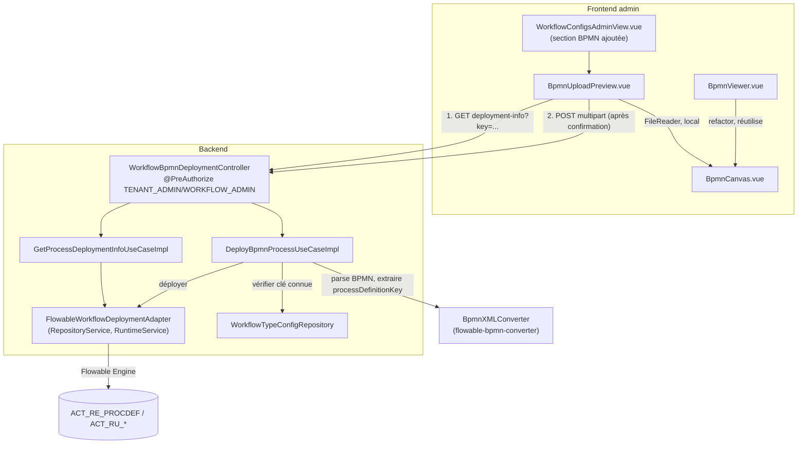

# System Design & Architecture — `deploiement-bpmn`

> Design **reviewed** (Phase 3). 5 décisions techniques actées via
> `AskUserQuestion` en Phase 3 (mécanisme, le périmètre était déjà figé
> en Phase 2 avec 2 décisions produit). Aucun point ouvert bloquant.

## Architecture Overview



**Composants clés et responsabilités :**

- **`BpmnCanvas.vue`** (nouveau) — rendu bas-niveau bpmn-js
  (`NavigatedViewer` + `importXML`), extrait de `BpmnViewer.vue` pour
  être réutilisable sans les marqueurs d'exécution.
- **`BpmnViewer.vue`** (refactor interne, contrat public inchangé) —
  utilise `BpmnCanvas.vue` en interne, applique les marqueurs
  `activeIds`/`completedIds`/`failedIds` par-dessus. Seul consommateur
  actuel (`DossierDetailView.vue`) non impacté.
- **`BpmnUploadPreview.vue`** (nouveau) — sélection de fichier local
  (`<input type="file">`), lecture via `FileReader`, rendu immédiat via
  `BpmnCanvas.vue` (sans appel réseau), appel `GET .../deployment-info`
  pour afficher la version actuellement déployée + nombre d'instances
  actives si la clé existe déjà, confirmation explicite, puis `POST`
  multipart de déploiement.
- **`WorkflowBpmnDeploymentController`** (nouveau, package
  `infrastructure.web.workflow`) — `@PreAuthorize("hasAnyRole('TENANT_ADMIN','WORKFLOW_ADMIN')")`,
  même pattern que `WorkflowTypeConfigController`.
- **`DeployBpmnProcessUseCaseImpl`** (nouveau, domain use case) —
  orchestre : parse BPMN (extraction de `processDefinitionKey` avant
  tout effet de bord) → vérifie `WorkflowTypeConfigRepository.findByWorkflowKey`
  (rejet strict si absent, D-BPMN-KEY-VALIDATION) → déploie via le port
  out.
- **`GetProcessDeploymentInfoUseCaseImpl`** (nouveau) — lit la version
  actuellement déployée + le nombre d'instances actives pour une clé
  donnée (D-BPMN-REDEPLOY-INFO), sans effet de bord.
- **`FlowableWorkflowDeploymentAdapter`** (nouveau, infrastructure) —
  implémente le port out avec `RepositoryService`/`RuntimeService`,
  même style que `FlowableWorkflowVisualizationAdapter`.

**Choix technologiques :**

- **`flowable-bpmn-converter`** (déjà dépendance transitive de
  `flowable-spring-boot-starter`, aucune nouvelle dépendance) —
  `BpmnXMLConverter.convertToBpmnModel(...)` pour parser et valider le
  BPMN 2.0 **avant** tout appel à `RepositoryService`, afin d'extraire
  `processDefinitionKey` et de pouvoir vérifier la cohérence avec
  `WorkflowTypeConfig` avant de committer un déploiement.
- **Taille d'upload** : réutilise le seuil global
  `spring.servlet.multipart.max-file-size` existant (25 Mo) —
  D-BPMN-UPLOAD-SIZE, pas de nouvelle propriété (convention déjà établie
  pour les pièces jointes dossier : « une seule source de vérité »).
- **Content-type** : nouvelle classe de propriétés dédiée
  `BpmnUploadProperties(List<String> allowedContentTypes)`, même forme
  qu'`AttachmentUploadProperties` mais **sans** champ de taille (celui-ci
  reste global). Défaut : `application/xml`, `text/xml`.
- **Aucune migration de base de données** — le versionnement des
  déploiements est entièrement porté par les tables natives Flowable
  (`ACT_RE_PROCDEF`, `ACT_GE_BYTEARRAY`, etc.), déjà en place.

## Data Models

Aucun nouveau modèle persistant côté FlowForge. Nouveaux value objects
domaine (non persistés, calculés à la volée) :

```java
// domain/workflow/model/
public record ProcessDeploymentInfo(
    String processDefinitionKey,
    int latestVersion,
    long activeInstanceCount
) {}
```

Exceptions domaine nouvelles :
- `InvalidBpmnException` — XML malformé ou non conforme BPMN 2.0.
- `UnknownWorkflowKeyException` — `processDefinitionKey` sans
  `WorkflowTypeConfig` correspondant pour le tenant (D-BPMN-KEY-VALIDATION).

## API Design

### `GET /api/workflow-bpmn-deployments/info?processDefinitionKey={key}`

- Rôles : `TENANT_ADMIN`, `WORKFLOW_ADMIN` (même garde que les autres
  endpoints `/api/workflow-type-configs`).
- Réponse `200` : `{ "processDefinitionKey": "...", "latestVersion": 3, "activeInstanceCount": 12 }`
  si une version existe déjà pour cette clé.
- Réponse `204` (pas de corps) si aucune version n'est encore déployée
  pour cette clé — première déploiement, rien à afficher.

### `POST /api/workflow-bpmn-deployments` (`multipart/form-data`)

- Rôles : `TENANT_ADMIN`, `WORKFLOW_ADMIN`.
- Champ `file` : le `.bpmn20.xml`.
- Validation, dans l'ordre (échec rapide, aucun effet de bord avant la
  dernière étape) :
  1. Fichier présent, non vide, content-type autorisé
     (`BpmnUploadProperties`).
  2. Parsing BPMN via `BpmnXMLConverter` → `InvalidBpmnException` si
     échec (XML malformé ou non BPMN 2.0).
  3. `processDefinitionKey` extrait du modèle → recherche
     `WorkflowTypeConfigRepository.findByWorkflowKey` → `UnknownWorkflowKeyException`
     si absent (D-BPMN-KEY-VALIDATION, rejet strict).
  4. Déploiement via `RepositoryService.createDeployment()`.
- Réponse `201` : `{ "processDefinitionKey": "...", "deployedVersion": 4, "deploymentId": "..." }`.
- Erreurs mappées en `ProblemDetail` (`WorkflowExceptionHandler`,
  package `infrastructure.web.workflow`, même convention que
  l'existant) : `400` (BPMN invalide), `409` ou `422` (clé inconnue —
  à trancher au moment de l'implémentation selon la sémantique la plus
  proche des codes déjà utilisés dans ce contrôleur), `413` (taille,
  géré globalement comme pour les pièces jointes).

## Component Breakdown

| Composant | Nature | Emplacement prévu |
|---|---|---|
| `BpmnCanvas.vue` | Nouveau (frontend) | `frontend/src/components/workflow/` |
| `BpmnViewer.vue` | Modifié (refactor interne) | `frontend/src/components/workflow/` |
| `BpmnUploadPreview.vue` | Nouveau (frontend) | `frontend/src/components/workflow/` ou `admin/` |
| `WorkflowConfigsAdminView.vue` | Modifié (+section) | `frontend/src/views/admin/` |
| API wrappers déploiement BPMN | Nouveau | `frontend/src/api/workflow.ts` (ou fichier dédié) |
| `WorkflowBpmnDeploymentController` | Nouveau | `src/main/java/com/flowforge/infrastructure/web/workflow/` |
| `DeployBpmnProcessUseCase` (port in) + Impl | Nouveau | `src/main/java/com/flowforge/domain/workflow/port/in/`, `usecase/` |
| `GetProcessDeploymentInfoUseCase` (port in) + Impl | Nouveau | idem |
| `WorkflowDeploymentPort` (port out) | Nouveau | `src/main/java/com/flowforge/domain/workflow/port/out/` |
| `FlowableWorkflowDeploymentAdapter` | Nouveau | `src/main/java/com/flowforge/infrastructure/flowable/` |
| `BpmnUploadProperties` | Nouveau | `src/main/java/com/flowforge/infrastructure/config/` |
| `ProcessDeploymentInfo`, `InvalidBpmnException`, `UnknownWorkflowKeyException` | Nouveau | `src/main/java/com/flowforge/domain/workflow/model/` |
| `README.md`, `05-workflow-engine.md`, `GUIDE-UTILISATEUR.md` | Modifiés (doc) | racine, `analysis doc/` |

## Design Decisions

| Id | Décision | Choix retenu | Alternative écartée |
|---|---|---|---|
| **D-BPMN-PREVIEW-COMPONENT** | Réutilisation du rendu bpmn-js | Extraire `BpmnCanvas.vue` partagé entre `BpmnViewer.vue` (marqueurs d'exécution) et `BpmnUploadPreview.vue` (structure seule) | Construire un objet `WorkflowDiagram` factice côté client et réutiliser `BpmnViewer.vue` tel quel — plus simple mais couple artificiellement la prévisualisation pré-import à un composant pensé pour une instance en cours d'exécution |
| **D-BPMN-KEY-VALIDATION** | `processDefinitionKey` sans `WorkflowTypeConfig` | Rejet strict (`UnknownWorkflowKeyException`) | Avertir mais autoriser — écarté : symétrie avec `AttachWorkflowUseCase` qui vérifie déjà `findByWorkflowKey` avant de démarrer un workflow, un processus orphelin ne serait jamais démarrable |
| **D-BPMN-REDEPLOY-INFO** | Info avant redéploiement d'une clé existante | Afficher version actuelle + nombre d'instances actives avant confirmation (`GET .../info`), déploiement toujours autorisé (comportement Flowable natif) | Documentation seule, sans UI — écarté : cohérent avec l'exigence de confirmation visuelle déjà actée pour la prévisualisation (D-BPMN-PREVIEW) |
| **D-BPMN-UPLOAD-SIZE** | Taille max de l'upload | Réutilise le seuil global `spring.servlet.multipart.max-file-size` (25 Mo), pas de nouvelle propriété | Propriété dédiée plus basse — écarté après relecture du code : casserait la convention explicite « une seule source de vérité pour la taille » déjà établie pour les pièces jointes dossier |
| **D-BPMN-UPLOAD-CONTENT-TYPE** | Content-types acceptés | Nouvelle classe `BpmnUploadProperties(allowedContentTypes)`, même forme qu'`AttachmentUploadProperties` mais sans champ de taille | Réutiliser `AttachmentUploadProperties` tel quel — écarté : mélange deux contextes sémantiquement différents (pièce jointe dossier vs diagramme BPMN) |

## Non-Functional Requirements

- **Sécurité** : la validation frontend (prévisualisation) n'est **pas**
  la barrière de sécurité — toute la validation (BPMN 2.0 valide, clé
  connue) est reproduite côté backend avant tout déploiement, cohérent
  avec le principe déjà appliqué à `DossierElementUploadController`
  (jamais faire confiance au client).
- **Rollback** : aucune migration de schéma — un déploiement BPMN raté
  ou incorrect peut être retiré via les mécanismes Flowable existants
  (`RepositoryService.deleteDeployment`), hors périmètre de cette
  feature (pas d'écran de suppression demandé).
- **Compatibilité** : `BpmnViewer.vue` garde exactement son contrat
  public (`diagram`, `unavailable`) — `DossierDetailView.vue` n'a besoin
  d'aucune modification.
- **Performance** : la prévisualisation est 100% locale (aucun appel
  réseau tant que l'utilisateur n'a pas confirmé) — pas de coût serveur
  pour un fichier jamais réellement importé.

## Requirements Coverage

| Success criterion (requirements doc) | Couvert par |
|---|---|
| Section upload dans `/admin/workflow-types`, gardée par rôles existants | `WorkflowConfigsAdminView.vue` + `BpmnUploadPreview.vue`, `@PreAuthorize` backend |
| Prévisualisation avant tout appel réseau de déploiement | `BpmnCanvas.vue` + `FileReader` local dans `BpmnUploadPreview.vue` |
| Rejet fichier non-BPMN-2.0 valide | `InvalidBpmnException` via `BpmnXMLConverter` |
| Rejet clé sans `WorkflowTypeConfig` | `UnknownWorkflowKeyException` |
| Déploiement visible sans redémarrage | `RepositoryService.createDeployment()` (à chaud, natif Flowable) |
| `README.md`/`05-workflow-engine.md` corrigés | Tâche documentaire dédiée (Phase 5) |
| TODO §35 clos | Mise à jour post-implémentation |

Toutes les user stories et success criteria de la Phase 2 ont une
couverture design explicite ci-dessus ; aucun gap.

## Phase 3 — revue close (2026-08-22)

5 décisions techniques actées via `AskUserQuestion` (une à la fois) :
D-BPMN-PREVIEW-COMPONENT, D-BPMN-KEY-VALIDATION, D-BPMN-REDEPLOY-INFO,
D-BPMN-UPLOAD-SIZE (corrigée après découverte d'une convention
existante — « une seule source de vérité » pour la taille d'upload,
signalée avant de trancher plutôt que silencieusement contournée),
D-BPMN-UPLOAD-CONTENT-TYPE. Précédents de code exploités partout où ils
existaient (`WorkflowTypeConfigController` pour le pattern
`@PreAuthorize`, `DossierElementUploadController` pour le patron
multipart, `FlowableWorkflowVisualizationAdapter` pour le style
d'adaptateur Flowable). Couverture requirements-vers-design vérifiée
exhaustive.

Status : **`reviewed`**. Prochaine phase : `dev-planning` (Phase 4).
