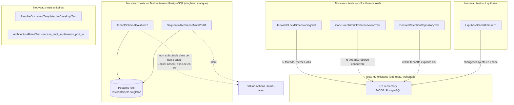

# System Design & Architecture — `fiabilisation-tests-plateforme`

> Design **reviewed** (Phase 3). 4 décisions techniques actées via
> `AskUserQuestion` (mécanisme, pas périmètre — le périmètre était déjà
> figé en Phase 2). Aucun point ouvert bloquant.

## Architecture Overview

Cette feature n'ajoute aucun composant applicatif : elle ajoute des
**tests** (et une règle ArchUnit) qui exercent des composants
existants sous des conditions non couvertes aujourd'hui (vrai
PostgreSQL, vrai parallélisme, échec partiel de migration). Le seul
composant de production modifié est `SpringDataDossierRepository`
(§37, ajout explicite du paramètre `tenantId`).

**Composants clés et responsabilités :**

- **`FlowableLockDimensioningTest`** — plusieurs threads réels
  interrogent/acquièrent des jobs Flowable (`AsyncExecutor` /
  acquisition de jobs) sur le même schéma H2 partagé
  (`DB_CLOSE_DELAY=-1`), pour prouver que `lockOwner`/
  `lockExpirationTime` empêchent bien la double exécution d'un même
  job sous contention réelle.
- **`ConcurrentWorkflowReservationTest`** — plusieurs threads réels
  appellent `AttachWorkflowUseCaseImpl.reserve()` simultanément sur le
  même dossier ; prouve que l'index unique partiel
  `uq_dossier_workflow_link_active` (émulé sur H2 via colonne générée,
  `002-workflow-tables.yaml:75-83`) fait échouer toutes les
  réservations concurrentes sauf une, et que l'échec est bien traduit
  en `WorkflowAlreadyRunningException` (pas une `DataIntegrityViolationException` brute qui fuiterait hors du port).
- **`TenantSchemaIsolationIT`** — Testcontainers PostgreSQL réel :
  deux schémas tenants créés (comme au bootstrap réel,
  `02-multi-tenant.md:250-283`), `search_path` fixé par
  `connectionInitSql`, preuve qu'une requête sur le schéma A ne voit
  jamais les lignes du schéma B.
- **`SequentialReferenceMultiPodIT`** — Testcontainers PostgreSQL réel :
  plusieurs threads simulant plusieurs pods appellent
  `SequentialReferenceGenerator` concurremment sur le même
  `(tenant_id, dossier_type_code, year)` ; preuve d'absence de doublon
  et d'absence de trou dans la séquence.
- **`LiquibasePartialFailureIT`** — changelog de test dédié contenant
  un changeset qui échoue délibérément (ex. contrainte SQL invalide)
  après N changesets réussis ; prouve que (a) l'instance ne démarre
  pas / lève une exception claire, (b) relancer `liquibase.update()`
  depuis zéro reprend correctement grâce au suivi natif
  `DATABASECHANGELOG` et termine sans corruption.
- **`ResolveDocumentTemplateUseCaseImplTest`** — teste la cascade de
  résolution (variant+locale exacts → fallback locale → fallback
  variant → template par défaut → `TemplateNotFoundException`),
  documentée dans `08-templates-documents.md` mais jamais testée.
- **`ArchitectureRulesTest`** — nouvelle règle `usecase_impl_implements_port_in`.
- **`SpringDataDossierRepository.findClosedForRetention`** (§37) —
  ajout du paramètre `tenantId` explicite, alignement sur le pattern
  déjà utilisé par `findByTenantIdAndReference`.

**Choix technologiques :**

- **Testcontainers** (`org.testcontainers:postgresql`,
  `org.testcontainers:junit-jupiter`) — uniquement pour les 2 tests qui
  ont structurellement besoin d'un vrai moteur PostgreSQL
  (`search_path` réel, verrouillage ligne réel sous contention
  multi-pods). Nouvelle dépendance `test`-scope dans `pom.xml`.
- **JUnit 5 + `java.util.concurrent`** (`ExecutorService`,
  `CountDownLatch`) pour tous les tests de parallélisme réel — aucune
  dépendance supplémentaire, première utilisation de ce pattern dans
  la suite (vérifié : aucun usage actuel de `CountDownLatch`/
  `ExecutorService` dans `src/test`).
- **H2 MODE=PostgreSQL existant** pour tous les tests qui n'ont pas
  besoin de sémantique Postgres native (verrous Flowable, réservation
  workflow, migration Liquibase) — cohérent avec la convention déjà
  établie par le changelog (émulation H2 de l'index partiel).

## Data Models

Aucun nouveau modèle de données métier. Seuls artefacts de test :

- **Changelog Liquibase de test** dédié (ex.
  `src/test/resources/db/changelog/failure-injection/changelog-failure.yaml`)
  contenant un changeset syntaxiquement valide mais dont l'exécution
  échoue de façon déterministe (ex. `insert` violant une contrainte
  `NOT NULL` déjà en place), appliqué après 1-2 changesets qui
  réussissent — pour observer un état « partiellement migré ».
- **`SpringDataDossierRepository.findClosedForRetention`** : signature
  modifiée de `findClosedForRetention(DossierStatus, Pageable)` à
  `findClosedForRetention(String tenantId, DossierStatus, Pageable)` ;
  répercuté sur `DossierRepository.findClosedForRetention(String
  tenantId, int limit)` (port) et `JpaDossierRepositoryAdapter`.

## API Design

Aucun changement d'API externe (REST). `DossierRepository` (port
`out`) change de signature — impact interne uniquement, aucun
consommateur hors du use case `EvaluateDossierRetentionUseCaseImpl`
(seul appelant actuel).

## Component Breakdown

| Composant | Nature | Emplacement prévu |
|---|---|---|
| `FlowableLockDimensioningTest` | Nouveau test | `src/test/java/com/flowforge/infrastructure/flowable/` |
| `ConcurrentWorkflowReservationTest` | Nouveau test | `src/test/java/com/flowforge/domain/dossier/usecase/` |
| `TenantSchemaIsolationIT` | Nouveau test (Testcontainers) | `src/test/java/com/flowforge/infrastructure/tenant/` |
| `SequentialReferenceMultiPodIT` | Nouveau test (Testcontainers) | `src/test/java/com/flowforge/infrastructure/persistence/dossier/` |
| `LiquibasePartialFailureIT` | Nouveau test | `src/test/java/com/flowforge/infrastructure/migration/` (nouveau package) |
| `ResolveDocumentTemplateUseCaseImplTest` | Nouveau test | `src/test/java/com/flowforge/domain/document/usecase/` |
| `ArchitectureRulesTest` | Modifié (+1 règle) | `src/test/java/com/flowforge/` |
| `PostgresTestContainerSupport` | Nouveau support test (singleton Testcontainers) | `src/test/java/com/flowforge/support/` |
| `SpringDataDossierRepository`, `JpaDossierRepositoryAdapter`, `DossierRepository` | Modifiés (§37) | `src/main/java/com/flowforge/infrastructure/persistence/dossier/`, `src/main/java/com/flowforge/domain/dossier/port/out/` |
| `pom.xml` | Modifié (+testcontainers, +jacoco thresholds) | racine |

**`PostgresTestContainerSupport`** centralise le singleton statique
partagé (D-CONTAINER-REUSE) : les 2 classes `*IT` qui ont besoin de
Postgres implémentent une interface/étendent une classe commune qui
démarre le conteneur une seule fois par JVM de test et expose un
`DataSource` ; le schéma est recréé/nettoyé entre méthodes de test via
`@BeforeEach`, pas en redémarrant le conteneur.

## Design Decisions

| Id | Décision | Choix retenu | Alternative écartée |
|---|---|---|---|
| **D-FLOWABLE-LOCK-TEST** | Infra du test de dimensionnement des verrous Flowable | H2 + threads réels (`ExecutorService`) | Testcontainers Postgres — écarté : le verrouillage Flowable (`UPDATE ... WHERE rev=?` + comptage de lignes) est un mécanisme SQL portable, pas spécifique Postgres |
| **D-PARALLELISM-TEST** | Infra du test « un seul workflow actif » | H2 + threads réels | Testcontainers Postgres — écarté : la garantie repose sur un index unique déjà émulé sur H2 pour ce projet (`002-workflow-tables.yaml`), donc H2 teste le même mécanisme réellement utilisé en test |
| **D-LIQUIBASE-TEST** | Portée du test de migration en échec partiel | Échec partiel **mono-schéma** + reprise idempotente au redémarrage | Test multi-schéma — écarté : l'architecture réelle est « un schéma par instance, une migration par démarrage » (`02-multi-tenant.md:250-291`), aucun job ne migre plusieurs schémas dans un même process ; un test multi-schéma testerait un scénario qui n'existe pas en production |
| **D-CONTAINER-REUSE** | Cycle de vie du conteneur Testcontainers | Singleton statique partagé entre `TenantSchemaIsolationIT` et `SequentialReferenceMultiPodIT`, schéma nettoyé entre tests | Conteneur par classe/méthode — écarté : coût de démarrage (plusieurs secondes) répété inutilement pour seulement 2 classes de test |

Ces 4 décisions techniques répondent aux 4 points restés ouverts en
fin de Phase 2 (voir requirements doc, section « Ouvertes ») ; le
périmètre produit lui-même (6 décisions D-SCOPE…D-ARCHUNIT-RULE) était
déjà figé et n'est pas rediscuté ici.

## Non-Functional Requirements

- **Temps de build** : les tests H2 + threads réels (`D-FLOWABLE-LOCK-TEST`,
  `D-PARALLELISM-TEST`) tournent dans le `./mvnw verify` habituel, coût
  marginal (quelques secondes). Les 2 tests Testcontainers
  (`TenantSchemaIsolationIT`, `SequentialReferenceMultiPodIT`) ajoutent
  un coût de démarrage de conteneur (~2-5s, une seule fois grâce au
  singleton) — acceptable, ne s'exécutent que sur CI (Docker natif
  `ubuntu-latest`), pas dans ce bac à sable.
- **Fiabilité de la preuve** : conformément à D-TESTCONTAINERS-EXEC
  (Phase 1), les 2 tests Testcontainers seront écrits en TDD (rouge
  avant impl si possible), mais leur statut « vert » ne sera **pas**
  affirmé dans ce bac à sable — seule leur compilation et leur logique
  seront vérifiées ici ; le testing doc documentera explicitement cette
  limite.
- **Couverture** : seuils Jacoco relevés à LINE 85% / BRANCH 75%
  (niveau BUNDLE) — doit rester vert après ajout de tous les nouveaux
  tests, sans changer la stratégie de couverture par fichier.
- **Non-régression** : `findClosedForRetention` (§37) doit conserver
  son comportement pour l'unique appelant existant
  (`EvaluateDossierRetentionUseCaseImpl`) — test de non-régression
  explicite requis en implémentation.
- **Portabilité CI** : aucun test ne doit supposer un accès local à
  Docker pour compiler ; l'usage de Testcontainers doit suivre le
  pattern JUnit 5 standard (`@Testcontainers`) pour s'activer
  automatiquement en CI sans configuration additionnelle.

## Requirements Coverage

| Success criteria (requirements doc) | Couvert par |
|---|---|
| Test `search_path` isolation | `TenantSchemaIsolationIT` |
| Smoke test multi-pods séquence | `SequentialReferenceMultiPodIT` |
| Test verrous Flowable sous charge | `FlowableLockDimensioningTest` |
| Test migration Liquibase échec partiel | `LiquibasePartialFailureIT` |
| Règle ArchUnit `usecase.*Impl` → `port.in` | `ArchitectureRulesTest.usecase_impl_implements_port_in` |
| Test cascade templates | `ResolveDocumentTemplateUseCaseImplTest` |
| Test « un seul workflow actif » parallélisme réel | `ConcurrentWorkflowReservationTest` |
| §37 `tenantId` explicite | `SpringDataDossierRepository` + test de non-régression |
| Seuils Jacoco LINE 85% / BRANCH 75% | `pom.xml` |
| TODO.md §26/§28/§37 à jour | Mise à jour post-implémentation (hors design) |

Toutes les user stories (1-5) et tous les success criteria de la
Phase 2 ont une couverture design explicite ci-dessus ; aucun gap.

## Phase 3 — revue close (2026-08-22)

4 décisions techniques actées via `AskUserQuestion` (une à la fois,
avec justification et recommandation) : `D-FLOWABLE-LOCK-TEST`,
`D-PARALLELISM-TEST`, `D-LIQUIBASE-TEST`, `D-CONTAINER-REUSE`. Chaque
choix H2-vs-Testcontainers a été justifié en relisant le mécanisme
réel testé (SQL portable vs sémantique Postgres native) plutôt que
décidé par défaut. Couverture requirements-vers-design vérifiée
exhaustive (tableau ci-dessus). Aucun gap, aucune contradiction avec
la Phase 2.

Status : **`reviewed`**. Prochaine phase : `dev-planning` (Phase 4).
