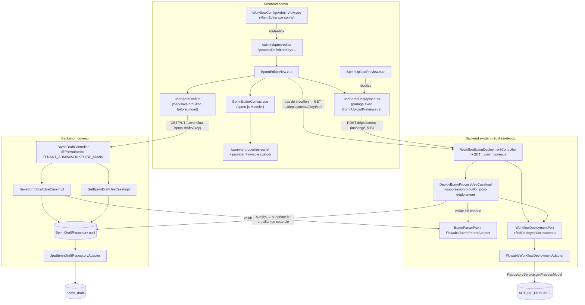

# System Design & Architecture — `edition-bpmn`

> Design **reviewed** (Phase 3). 3 décisions techniques actées via
> `AskUserQuestion` (une à la fois) ; le reste du mécanisme suit
> directement les précédents de code identifiés en exploration
> (`deploiement-bpmn`, `TenantRetentionSettings`,
> `WorkflowIdempotencyJpaEntity`). Aucun point ouvert bloquant.

## Architecture Overview



**Composants clés et responsabilités :**

- **`BpmnEditorView.vue`** (nouveau, `frontend/src/views/admin/`) — écran
  dédié, route `/admin/bpmn-editor`. Lit `processDefinitionKey` en query
  param optionnel : présent → tente `GET` du brouillon, sinon retombe sur
  le diagramme déployé (`GET .../xml`), sinon canvas vide (clé invalide
  ou toute première création) ; absent → canvas vierge (D-DESIGN-ROUTE).
- **`BpmnEditorCanvas.vue`** (nouveau, `frontend/src/components/workflow/`)
  — encapsule `bpmn-js/lib/Modeler` (import dynamique, comme
  `BpmnCanvas.vue` le fait pour `NavigatedViewer`) + les modules
  `bpmn-js-properties-panel` standard + un provider custom
  (`flowablePropertiesProvider.ts`) exposant uniquement `async`,
  `delegateExpression`, `expression` (`serviceTask`) et `scope` (`signal`)
  — D-EDIT-SCOPE (Phase 2). Écoute `commandStack.changed` pour exposer un
  état « modifications non enregistrées » au parent.
- **`useBpmnDraft.ts`** (nouveau composable) — `load(key)`/`save(key, xml)`
  vers les nouveaux endpoints brouillon, plus l'écouteur `beforeunload`
  conditionné à l'état « non enregistré » (D-EDIT-UNSAVED, Phase 2).
- **`useBpmnDeployment.ts`** (nouveau composable, extrait de la logique
  déjà écrite dans `BpmnUploadPreview.vue`) — appel `GET .../info`,
  affichage version/instances actives, confirmation, `POST` déploiement.
  Consommé par `BpmnUploadPreview.vue` **et** `BpmnEditorView.vue` — zéro
  duplication (D-EDIT-DEPLOY-FLOW, Phase 2).
- **`BpmnDraftController`** (nouveau, `infrastructure.web.workflow`) —
  même garde `@PreAuthorize("hasAnyRole('TENANT_ADMIN','WORKFLOW_ADMIN')")`
  que `WorkflowBpmnDeploymentController`.
- **`SaveBpmnDraftUseCaseImpl` / `GetBpmnDraftUseCaseImpl`** (nouveaux,
  domain use cases, package `domain.workflow.usecase`) — la sauvegarde
  valide le XML comme bien formé BPMN 2.0 via `BpmnParserPort` (réutilisé
  tel quel) **sans** exiger de `WorkflowTypeConfig` correspondant
  (contrairement au déploiement final, §35) : un brouillon peut exister
  avant que la clé soit configurée.
- **`BpmnDraftRepository`** (nouveau port out, pur) + **`JpaBpmnDraftRepositoryAdapter`**
  (nouveau, `infrastructure.persistence.workflow`) — clé composite
  `(tenant_id, process_definition_key)` via `@IdClass`, comme
  `WorkflowIdempotencyJpaEntity`/`WebhookIdempotencyJpaEntity` (précédent
  déjà établi 2x dans le dépôt) — D-DESIGN-DRAFT-KEY.
- **`WorkflowDeploymentPort.findDeployedXml`** (nouvelle méthode sur le
  port existant) + implémentation dans `FlowableWorkflowDeploymentAdapter`
  via `RepositoryService.getProcessModel(processDefinitionId)` (dernière
  version de la clé) — nécessaire pour le 3ᵉ point d'entrée (édition d'un
  diagramme déjà déployé, D-EDIT-ENTRYPOINT Phase 2) : aucun mécanisme
  existant ne renvoyait le XML brut d'une définition de process par clé
  (seul `GET .../info` renvoie des métadonnées).
- **`DeployBpmnProcessUseCaseImpl`** (modifié, additif) — après un
  déploiement réussi, supprime le brouillon existant pour cette clé via
  `BpmnDraftRepository.deleteByTenantIdAndProcessDefinitionKey`
  (D-DESIGN-DRAFT-LIFECYCLE) — évite un brouillon qui diverge
  silencieusement de ce qui est réellement déployé.

**Choix technologiques :**

- **`bpmn-js` `Modeler`** (déjà en dépendance `^18.24.0`, aucune montée de
  version requise) + **`bpmn-js-properties-panel`** (nouvelle dépendance
  npm, MIT, même éditeur bpmn.io) — licences à confirmer explicitement en
  lisant les fichiers `LICENSE` exacts avant `npm install`, pas de raison
  de doute a priori.
- **Aucune nouvelle dépendance backend** : `BpmnParserPort`/
  `FlowableBpmnParserAdapter` (validation), `BpmnXMLConverter`/
  `RepositoryService` (Flowable, déjà présents) sont réutilisés tels
  quels ou étendus.

## Data Models

```java
// domain/workflow/model/BpmnDraft.java
public record BpmnDraft(
        String tenantId,
        String processDefinitionKey,
        String xml,
        Instant updatedAt,
        String updatedBy) {}
```

Table `bpmn_draft` (PostgreSQL, schéma tenant) :

| Colonne | Type | Contrainte |
|---|---|---|
| `tenant_id` | `varchar(64)` | clé composite (`@IdClass`, comme `workflow_idempotency`) |
| `process_definition_key` | `varchar(255)` | clé composite |
| `xml` | `text` | `not null` |
| `updated_at` | `timestamp with time zone` | `not null` |
| `updated_by` | `varchar(128)` | `not null` |

Aucune colonne d'historique/version — un seul enregistrement par clé,
remplacé en place à chaque sauvegarde (D-EDIT-DRAFT-MODEL, Phase 2).

Pas de nouveau modèle domaine pour `findDeployedXml` — réutilise
directement `byte[]`/`String` XML brut, symétrique à `deploy(...)` qui
prend déjà `byte[] bpmnXml` en entrée.

## API Design

### `GET /api/workflow-bpmn-drafts/{processDefinitionKey}`

- Rôles : `TENANT_ADMIN`, `WORKFLOW_ADMIN`.
- `200` : `{ "processDefinitionKey": "...", "xml": "...", "updatedAt": "...", "updatedBy": "..." }`
  si un brouillon existe pour cette clé.
- `204` (pas de corps) si aucun brouillon — le frontend retombe alors sur
  `GET .../deployments/{key}/xml`.

### `PUT /api/workflow-bpmn-drafts/{processDefinitionKey}`

- Rôles : `TENANT_ADMIN`, `WORKFLOW_ADMIN`.
- Corps : `{ "xml": "..." }`.
- Validation : XML bien formé BPMN 2.0 via `BpmnParserPort`
  (`InvalidBpmnException` → `400` sinon) — **pas** de vérification de
  `WorkflowTypeConfig` correspondant à ce stade (un brouillon peut
  précéder la configuration de la clé, à la différence du déploiement).
  Le `processDefinitionKey` du chemin doit correspondre à l'id du process
  extrait du XML (sinon `400` — évite un brouillon stocké sous une clé
  différente de son contenu réel).
- `200` : même forme que `GET`, upsert (écrase l'existant).

### `GET /api/workflow-bpmn-deployments/{processDefinitionKey}/xml` (nouveau, sur le contrôleur existant §35)

- Rôles : `TENANT_ADMIN`, `WORKFLOW_ADMIN`.
- `200` : corps `text/xml`, le XML de la dernière version déployée pour
  cette clé.
- `204` si aucune version n'est encore déployée pour cette clé (première
  création, pas encore de diagramme à charger).

### `POST /api/workflow-bpmn-deployments` (inchangé, §35)

- Comportement identique. Effet de bord additionnel côté domaine
  uniquement : suppression du brouillon de la clé déployée en cas de
  succès (D-DESIGN-DRAFT-LIFECYCLE) — pas de changement de contrat API.

## Component Breakdown

| Composant | Nature | Emplacement prévu |
|---|---|---|
| `BpmnEditorView.vue` | Nouveau (frontend) | `frontend/src/views/admin/` |
| `BpmnEditorCanvas.vue` | Nouveau (frontend) | `frontend/src/components/workflow/` |
| `flowablePropertiesProvider.ts` | Nouveau (frontend) | `frontend/src/components/workflow/bpmn-properties/` |
| `useBpmnDraft.ts` | Nouveau composable | `frontend/src/composables/` |
| `useBpmnDeployment.ts` | Nouveau composable (extrait de `BpmnUploadPreview.vue`) | `frontend/src/composables/` |
| `BpmnUploadPreview.vue` | Modifié (refactor interne vers `useBpmnDeployment.ts`, contrat public inchangé) | `frontend/src/components/workflow/` |
| `WorkflowConfigsAdminView.vue` | Modifié (+lien vers l'éditeur par config) | `frontend/src/views/admin/` |
| `frontend/src/app/routes.ts` | Modifié (+route `/admin/bpmn-editor`) | `frontend/src/app/` |
| `frontend/src/api/workflows.ts` | Modifié (+`getBpmnDraft`, `saveBpmnDraft`, `getDeployedBpmnXml`) | `frontend/src/api/` |
| `BpmnDraftController` | Nouveau | `src/main/java/com/flowforge/infrastructure/web/workflow/` |
| `SaveBpmnDraftUseCase`/`GetBpmnDraftUseCase` (port in) + Impl | Nouveau | `domain/workflow/port/in/`, `usecase/` |
| `BpmnDraftRepository` (port out) | Nouveau | `domain/workflow/port/out/` |
| `JpaBpmnDraftRepositoryAdapter`, `BpmnDraftJpaEntity` | Nouveau | `infrastructure/persistence/workflow/` |
| `BpmnDraft` (modèle domaine) | Nouveau | `domain/workflow/model/` |
| `WorkflowDeploymentPort.findDeployedXml` | Modifié (nouvelle méthode) | `domain/workflow/port/out/` |
| `FlowableWorkflowDeploymentAdapter` | Modifié (+implémentation `findDeployedXml`) | `infrastructure/flowable/` |
| `WorkflowBpmnDeploymentController` | Modifié (+`GET .../{key}/xml`) | `infrastructure/web/workflow/` |
| `DeployBpmnProcessUseCaseImpl` | Modifié (+suppression brouillon post-succès, `BpmnDraftRepository` injecté) | `domain/workflow/usecase/` |
| `WorkflowConfig` (Spring `@Configuration`) | Modifié (+beans des nouveaux use cases) | `infrastructure/config/` |
| Migration `013-bpmn-draft-tables.yaml` | Nouveau | `db/changelog/changes/` |

## Design Decisions

| Id | Décision | Choix retenu | Alternative écartée |
|---|---|---|---|
| **D-DESIGN-DRAFT-KEY** | Clé primaire JPA du brouillon | Clé composite `(tenant_id, process_definition_key)` via `@IdClass`, comme `WorkflowIdempotencyJpaEntity`/`WebhookIdempotencyJpaEntity` | UUID généré + contrainte unique (comme `WorkflowTypeConfig`) — écarté : impose un `findBy...` avant `save` pour réutiliser l'UUID existant, sans bénéfice ici (rien ne référence le brouillon par FK) |
| **D-DESIGN-ROUTE** | Forme de la route SPA de l'éditeur | Une seule route `/admin/bpmn-editor` avec `processDefinitionKey` en query param optionnel | Routes séparées `/new` et `/:processDefinitionKey` — écarté : dupliquerait le montage du composant éditeur pour un comportement interne quasi identique |
| **D-DESIGN-DRAFT-LIFECYCLE** | Devenir du brouillon après déploiement réussi | Suppression automatique (le brouillon n'a de sens qu'avant déploiement) | Conservation — écarté : risque de divergence silencieuse entre un brouillon oublié et ce qui est réellement déployé, sans indicateur prévu en V1 |
| D-EDIT-XML-KEY-MATCH | Cohérence clé du chemin vs clé dans le XML sauvegardé | Rejet `400` si le `processDefinitionKey` du chemin ne correspond pas à l'id du process extrait du XML | Accepter et stocker sous la clé du chemin même si différente du contenu — écarté : créerait un brouillon dont la clé de stockage ment sur son contenu réel, source de confusion au chargement suivant |
| D-EDIT-DEPLOYED-XML | Récupération du XML d'un diagramme déjà déployé (3ᵉ point d'entrée) | Nouvelle méthode `WorkflowDeploymentPort.findDeployedXml` via `RepositoryService.getProcessModel` | Étendre `GET .../info` pour inclure le XML — écarté : mélangerait une réponse légère (métadonnées, déjà consommée pour l'affichage version/instances) avec un payload potentiellement volumineux consommé dans un contexte différent (chargement initial de l'éditeur, pas la confirmation de déploiement) |
| D-EDIT-DRAFT-VALIDATION | Validation à la sauvegarde d'un brouillon | Bien-formé BPMN 2.0 uniquement (`BpmnParserPort`), pas de vérification `WorkflowTypeConfig` | Même validation stricte qu'au déploiement (§35) — écarté : un brouillon est par nature un état intermédiaire, potentiellement antérieur à la configuration de la clé ; la validation stricte reste au déploiement, inchangée |
| D-EDIT-DEPLOY-EXTRACT | Mécanisme d'extraction de la logique de confirmation/déploiement partagée | Composable Vue (`useBpmnDeployment.ts`) | Composant Vue partagé — écarté : les deux contextes (aperçu compact d'upload vs panneau de l'éditeur pleine page) ont des besoins de rendu différents ; un composable partage l'état/logique sans imposer un même gabarit visuel (cohérent avec `vue-best-practices`) |

## Non-Functional Requirements

- **Sécurité** : mêmes rôles que §35 sur tous les nouveaux endpoints
  (`TENANT_ADMIN`/`WORKFLOW_ADMIN`). La validation de sauvegarde de
  brouillon (bien-formé BPMN) est reproduite côté backend — jamais faire
  confiance au client, cohérent avec `deploiement-bpmn`. Le déploiement
  final reste la seule opération à effet réel sur le moteur Flowable ;
  sauvegarder un brouillon n'a aucun effet sur `ACT_RE_PROCDEF`.
- **Multi-tenant** : `bpmn_draft` vit dans le schéma par tenant comme
  toutes les autres tables métier ; `tenantId` injecté au niveau bean
  (`TenantProperties.id()`), jamais lu dynamiquement par requête — même
  pattern que `DeployBpmnProcessUseCaseImpl`.
- **Architecture hexagonale** : `domain/workflow/{model,port,usecase}`
  reste sans dépendance Spring/JPA/Flowable — `BpmnDraftRepository` est
  une interface pure ; `BpmnDraftJpaEntity`/adaptateur entièrement dans
  `infrastructure/persistence/workflow`. Vérifié par
  `ArchitectureRulesTest` en Phase 5/7 (`domain_has_no_framework_dependency`,
  `usecase_impl_naming_convention`, `usecase_impl_implements_port_in`).
- **Compatibilité** : `BpmnCanvas.vue`/`BpmnViewer.vue`/
  `BpmnUploadPreview.vue` gardent leur contrat public — seule
  l'implémentation interne de `BpmnUploadPreview.vue` change
  (extraction vers `useBpmnDeployment.ts`), aucun consommateur externe
  affecté.
- **Rollback** : migration `013-bpmn-draft-tables.yaml` avec bloc
  `rollback: dropTable`, comme toutes les migrations récentes.
- **Performance** : le brouillon est un `text` unique par clé, pas de
  volumétrie particulière attendue (taille d'un diagramme BPMN, quelques
  dizaines de Ko au plus) — pas de pagination/streaming nécessaire.

## Requirements Coverage

| Success criterion (requirements doc) | Couvert par |
|---|---|
| Nouvel écran dédié, gardé par rôles existants | `BpmnEditorView.vue` + route `/admin/bpmn-editor` (meta roles) + `@PreAuthorize` backend |
| 3 points d'entrée (vierge, import fichier, diagramme déployé) | Query param optionnel + sélecteur de fichier local dans `BpmnEditorCanvas.vue` + `GET .../deployments/{key}/xml` |
| Panel de propriétés standard + provider custom (`async`/`delegateExpression`/`expression`/`scope`) | `bpmn-js-properties-panel` + `flowablePropertiesProvider.ts` |
| Brouillon persisté côté backend, un par clé, écrasé | `BpmnDraftController` + `BpmnDraft*UseCase` + `BpmnDraftRepository`/`BpmnDraftJpaEntity` (clé composite) |
| Bouton déployer intégré, logique partagée non dupliquée | `useBpmnDeployment.ts` consommé par `BpmnEditorView.vue` et `BpmnUploadPreview.vue` |
| Confirmation `beforeunload` si modifications non enregistrées | `useBpmnDraft.ts` (état « non enregistré » + écouteur `beforeunload`) |
| Aucune app tierce introduite | Aucune dépendance hors écosystème bpmn.io / Flowable déjà présent |

Toutes les user stories et success criteria de la Phase 2 ont une
couverture design explicite ci-dessus ; aucun gap. Les 3 décisions
D-DESIGN-* actées cette phase couvrent les points laissés ouverts par le
doc requirements (route, clé JPA, devenir du brouillon post-déploiement).
Les autres points de mécanisme identifiés en Phase 2 (attribut
`flowable:*` non couvert préservé par le moddle, message d'erreur
`importXML`) restent des vérifications empiriques à faire en Phase 5,
pas des décisions d'architecture.

## Phase 3 — revue close (2026-08-24)

3 décisions techniques actées via `AskUserQuestion` (une à la fois) :
D-DESIGN-DRAFT-KEY, D-DESIGN-ROUTE, D-DESIGN-DRAFT-LIFECYCLE. Précédents
de code exploités systématiquement (`DeployBpmnProcessUseCaseImpl` pour
le style d'injection `tenantId`, `TenantRetentionSettings` pour le
pattern « un par clé, écrasé », `WorkflowIdempotencyJpaEntity`/
`WebhookIdempotencyJpaEntity` pour la clé composite `@IdClass` déjà
utilisée 2x dans le dépôt, `TenantRetentionSettingsController` pour la
récupération de `updatedBy` via `Authentication`/`AccessContextFactory`).
Gap réel trouvé en exploration : aucun mécanisme existant ne renvoyait le
XML brut d'une définition de process par clé (`GET .../info` ne renvoie
que des métadonnées) — nouvelle méthode `findDeployedXml` sur
`WorkflowDeploymentPort`, documentée en Design Decisions (D-EDIT-DEPLOYED-XML)
plutôt que silencieusement supposée résolue. Couverture
requirements-vers-design vérifiée exhaustive.

Status : **`reviewed`**. Prochaine phase : `dev-planning` (Phase 4).
