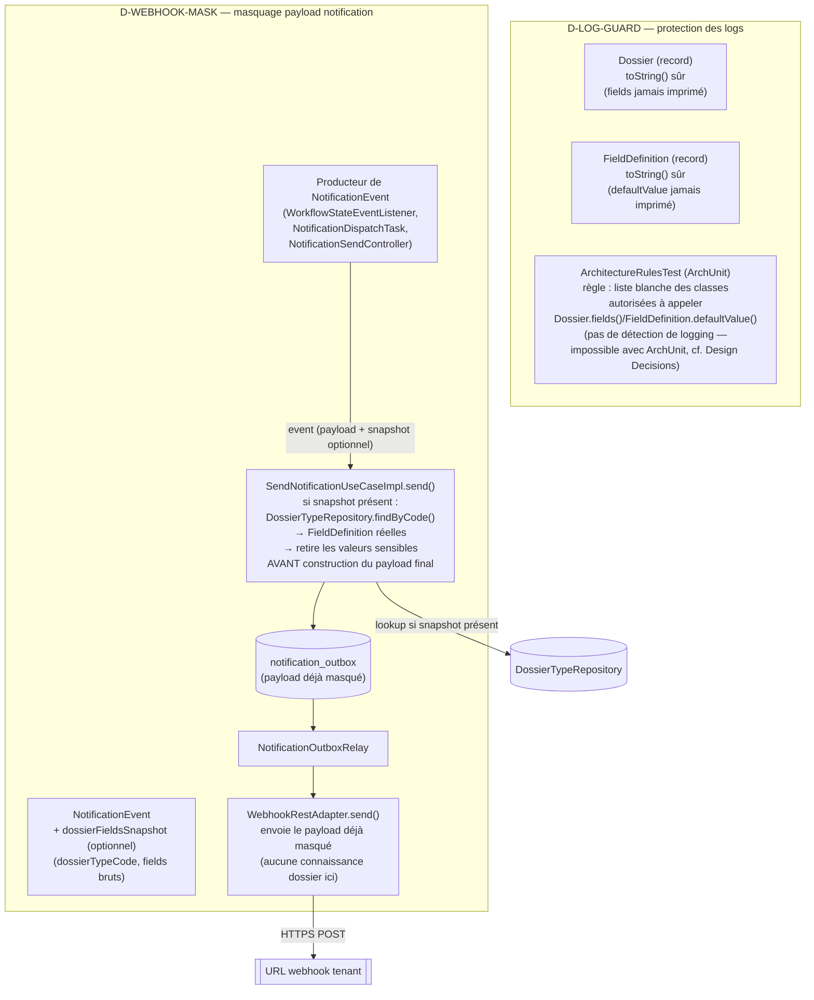

# System Design & Architecture — `masquage-donnees-sensibles-logs-webhooks`

2 décisions techniques actées via `AskUserQuestion` (le périmètre était
déjà figé en Phase 1 avec 1 décision produit — garde-fou complet) :
**D-LOG-GUARD** (protection des logs), **D-WEBHOOK-MASK** (mécanisme de
masquage webhook).

## Architecture Overview

## Data Models

- **`Dossier`** (`domain/dossier/model/Dossier.java`) — ajout d'un
  `toString()` explicite qui n'imprime jamais `fields` (remplacé par un
  compte, ex. `fields=<3 entries>`). Aucun changement de shape de données,
  uniquement le comportement de sérialisation texte par défaut.
- **`FieldDefinition`** (`domain/dossier/model/FieldDefinition.java`) —
  même traitement pour `defaultValue` (peut porter une valeur métier
  pré-remplie sur un champ marqué `sensitive`).
- **`NotificationEvent`** (`domain/notification/model/NotificationEvent.java`)
  — nouveau composant optionnel `dossierFieldsSnapshot` (nouveau record,
  ex. `DossierFieldsSnapshot(String dossierTypeCode, Map<String, Object> fields)`),
  `null` par défaut. Les 2 producteurs Java existants
  (`WorkflowStateEventListener`, `NotificationDispatchTask`) ne le
  peuplent pas aujourd'hui — inchangés fonctionnellement. `NotificationSendController`
  (API admin, payload libre) ne le peuple pas non plus (hors périmètre,
  cf. Non-goals du requirements doc).
- Aucun changelog Liquibase — pas de nouvelle colonne, `payload` reste
  stocké tel quel dans `notification_outbox` (déjà masqué en amont si
  `dossierFieldsSnapshot` était fourni).

## API Design

Aucun endpoint HTTP nouveau ou modifié. Changement interne uniquement :

- `SendNotificationUseCase.send(NotificationEvent, String tenantId)` —
  signature de la méthode inchangée ; c'est `NotificationEvent` qui gagne
  un composant optionnel.
- `SendNotificationUseCaseImpl` gagne une dépendance constructeur vers
  `DossierTypeRepository` (`domain/dossier/port/out`, déjà existant —
  aucun nouveau port créé). Tous les points de construction Spring
  (`NotificationConfig`) mis à jour pour l'injecter.

## Component Breakdown

- **`Dossier`/`FieldDefinition`** (domaine dossier) — `toString()` sûrs.
- **`ArchitectureRulesTest`** (test) — nouvelle règle ArchUnit : seules les
  classes d'une liste blanche explicite (`DOSSIER_FIELDS_READ_ALLOWLIST`,
  `FIELD_DEFINITION_DEFAULT_VALUE_READ_ALLOWLIST`) ont le droit d'appeler
  `Dossier.fields()`/`FieldDefinition.defaultValue()` — **pas** une
  détection de logging (ArchUnit ne fait pas d'analyse de flux de valeurs
  au niveau d'un site d'appel, voir Design Decisions ci-dessous, correction
  actée après un premier essai infructueux). Complète les règles
  hexagonales déjà en place (fichier
  `src/test/java/com/flowforge/ArchitectureRulesTest.java`, aucune requête
  runtime, analyse statique au build). Prouvée par une classe de fixture
  volontairement violante (`ArchitectureRulesFixtureTest`) qui fait
  échouer la règle — pas seulement supposée correcte.
- **`NotificationEvent`** (domaine notification) — porteur optionnel du
  contexte dossier.
- **`SendNotificationUseCaseImpl`** (domaine notification, use case
  existant) — nouvelle logique de masquage : si `dossierFieldsSnapshot`
  est présent, résout les `FieldDefinition` réelles via
  `DossierTypeRepository.findByCode(tenantId, dossierTypeCode)` et retire
  du payload les entrées correspondant à un champ `sensitive`, **avant**
  tout `snapshot()`/écriture outbox — donc avant que `WebhookRestAdapter`
  ou `NotificationPayloadJson` ne voient la moindre valeur sensible.
  Nouvelle dépendance : `DossierTypeRepository` (couplage croisé
  notification → dossier au niveau domaine, voir Design Decisions).
- **`WebhookRestAdapter`** — **inchangé**. Le masquage a lieu en amont
  (choix délibéré, cf. Design Decisions) ; l'adaptateur infrastructure
  reste agnostique du domaine dossier, cohérent avec l'architecture
  hexagonale existante (`domain_never_depends_on_infrastructure` — et
  inversement, on évite ici de faire dépendre l'infrastructure
  notification du domaine dossier).

## Design Decisions

### D-LOG-GUARD = toString() sûr + règle ArchUnit (décision actée, mécanisme ArchUnit corrigé en implémentation)

- **Pourquoi pas seulement `toString()` sûr ?** N'empêche pas un futur
  `log.info("fields={}", dossier.fields())` qui contourne `toString()` en
  extrayant la map directement.
- **Correction technique actée pendant l'implémentation (T1.3)** : la
  Phase 3 envisageait une règle ArchUnit détectant « un `Dossier` est
  passé à `log.*` ». Vérifié non réalisable : ArchUnit fait de l'analyse
  de dépendances/structure (qui appelle quelle méthode), pas de
  *dataflow* — la signature bytecode d'un appel `Logger.info(String,
  Object)` est identique quel que soit le type réel de l'argument
  (erasure/widening), donc ArchUnit ne peut pas distinguer « on a loggé
  un `Dossier` » de « on a loggé un `String` ». Confirmé avant
  implémentation, pas supposé, et validé auprès de l'utilisateur
  (`AskUserQuestion`) avant de coder une règle qui n'aurait rien détecté.
  **Remplacement retenu** : restreindre l'accès à `Dossier.fields()`/
  `FieldDefinition.defaultValue()` eux-mêmes à une liste blanche de
  classes (propriété réellement vérifiable statiquement — « qui appelle
  cette méthode », pas « qu'est-ce qui a été loggé »). Protection plus
  large que le logging seul (bloque aussi une fuite via exception,
  payload construit à la main, etc.). La liste blanche a été déterminée
  empiriquement en faisant tourner la règle contre le code réel plutôt que
  devinée par `grep` (un `grep '\.fields()'` naïf remonte des faux
  positifs comme `command.fields()`/`request.fields()`, des DTO sans
  rapport avec `Dossier.fields()` — seul ArchUnit, qui résout les types
  réels, donne la liste exacte).
- **Alternative rejetée** : rendre `Dossier` "intelligent" (connaissant
  quels champs sont sensibles dans son propre `toString()`) — impossible
  structurellement sans lui faire porter la liste des `FieldDefinition`
  (changement de modèle invasif) ou sans effet de bord DB dans
  `toString()` (mauvaise pratique). D'où le choix d'un `toString()`
  **uniformément sûr** (aucune valeur de `fields`, sensible ou non) plutôt
  qu'un filtrage sélectif.

### D-WEBHOOK-MASK = contexte dossier optionnel + lookup `FieldDefinition` (décision actée)

- **Pourquoi au niveau `SendNotificationUseCaseImpl` plutôt que dans
  `WebhookRestAdapter` lui-même ?** `WebhookRestAdapter` est un adaptateur
  d'infrastructure bas niveau (envoi HTTP) sans accès aux ports du domaine
  dossier ; y ajouter une dépendance `DossierTypeRepository` inverserait
  la direction de dépendance attendue (infrastructure → domaine croisé)
  et alourdirait un composant qui doit rester un simple exécuteur HTTP.
  `SendNotificationUseCaseImpl` est déjà la porte d'entrée unique de
  **tous** les producteurs (email, webhook, browser) avant tout envoi —
  y placer le masquage protège tous les canaux avec un seul point de
  contrôle, sans dépendre de la discipline de chaque producteur futur.
- **Pourquoi pas une convention déclarative (clé réservée) ?** Fonctionne
  seulement si le producteur se souvient de lister les clés sensibles —
  exactement la fragilité que la Phase 1 a choisi d'éviter (« ne pas
  dépendre de la discipline d'un futur producteur »).
- **Pourquoi pas une heuristique par nom de clé (`isSecretKey`) ?** Le
  projet a déjà un flag explicite (`FieldDefinition.sensitive`,
  tenant-configuré) pour cette distinction précise — une heuristique par
  motif de nom serait moins fiable et incohérente avec
  `DossierFieldRedactor`, le précédent direct pour ce type de donnée.
- **Compromis assumé** : introduit un couplage croisé domaine→domaine
  (`notification` dépend de `dossier.port.out.DossierTypeRepository`).
  Vérifié non bloqué par les règles ArchUnit existantes (elles
  n'interdisent que domaine→framework et domaine→infrastructure, pas
  domaine→domaine). Accepté car aucun autre mécanisme ne peut offrir une
  protection *automatique* (indépendante du producteur) sans connaître
  le flag `sensitive` réel.
- **Effet de bord positif accepté** : le masquage s'applique au payload
  partagé avant la répartition par canal (`snapshot()`), donc protège
  aussi le canal `BROWSER` (SSE) en plus de `WEBHOOK`, au même coût —
  cohérent avec l'esprit "défense en profondeur" sans élargir le
  périmètre produit (aucun canal supplémentaire n'est testé
  spécifiquement, c'est un sous-produit du point d'ancrage choisi).

## Non-Functional Requirements

- **Performance** : le lookup `DossierTypeRepository.findByCode()` n'a
  lieu que si `dossierFieldsSnapshot` est fourni (aujourd'hui : jamais,
  en pratique) — aucun surcoût sur le chemin actuel à 100 % du trafic
  réel.
- **Sécurité** : aligné sur le précédent `D-SECRETS-AUDIT` (TODO §30) —
  tests de non-régression qui échouent si une valeur connue apparaît dans
  la sortie sérialisée/loggée.
- **Compatibilité** : `NotificationEvent` gagne un composant record —
  tous les appelants en repo (2 producteurs Java + tests) mis à jour
  atomiquement dans la même feature (pas d'appelant externe/public à ce
  type interne au domaine).
- **Rollback** : trivial — aucune migration, aucun changelog Liquibase,
  changement de code pur.

## Requirements Coverage

| Success criterion (requirements doc) | Couverture design |
|---|---|
| Test `Dossier` sensible loggué ne fuit jamais | D-LOG-GUARD : `toString()` sûr + ArchUnit |
| Test masquage webhook sur payload simulé | D-WEBHOOK-MASK : `SendNotificationUseCaseImpl` |
| Comportement actuel inchangé (non-régression) | `dossierFieldsSnapshot` optionnel, `null` par défaut sur les 2 producteurs réels |
| TODO §23 clos avec état honnête | Traité en Phase 9 (clôture) |
| `FILE-ATTENTE.md`/`DEFERRED-FEATURES.md` à jour | Traité en Phase 9 (clôture) |
